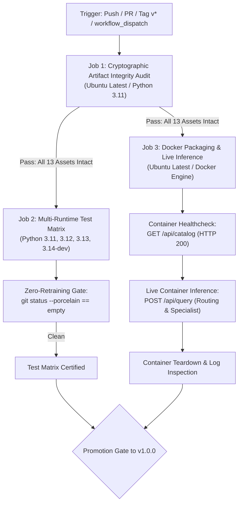

# SatQuery AI — CI/CD Pipeline Specification & Release Validation Architecture

**Document Code:** `SATQUERY-CI-SPEC-001`  
**Target Release:** Transition from `v1.0.0-rc1` (Conditional Pass) to `v1.0.0` (Production Release)  
**Configuration File:** [`.github/workflows/ci.yml`](file:///.github/workflows/ci.yml)  
**Local Test Runner:** [`scripts/run_docker_validation.sh`](file:///scripts/run_docker_validation.sh)  
**Date:** November 14, 2026  

---

## 1. Executive Purpose

To promote the current frozen release candidate (`v1.0.0-rc1`) to a fully certified production release (`v1.0.0`), the system requires automated verification of the two outstanding criteria identified in the Milestone M3.3 audit:
1. **Live Container Execution**: Direct building of the Docker image, container startup, and end-to-end API inference verification within an authentic containerized Linux environment.
2. **Multi-Runtime Regression Testing**: Execution of the 181-test regression suite across multiple Python runtimes without model retraining or file mutation.

The GitHub Actions workflow defined in [`.github/workflows/ci.yml`](file:///.github/workflows/ci.yml) provides an automated, reproducible gate that executes these validations on clean Ubuntu runners upon push, pull request, or tag creation.

---

## 2. Pipeline Architecture & Workflow Jobs



---

## 3. Detailed Job Specifications

### Job 1: Cryptographic Artifact Integrity Audit (`verify-artifacts`)
- **Environment**: `ubuntu-latest`, Python 3.11.
- **Command**: `python -m satquery.cli verify --json-output`
- **Verification Rule**: Parses the JSON output and asserts `all_artifacts_intact == True`. Fails immediately if any of the 13 production files deviate by a single byte from [`artifacts/deployment/m33_production_freeze_manifest.json`](file:///c:/Users/B%20NAVANEETH/SatQueryAI/artifacts/deployment/m33_production_freeze_manifest.json).
- **Working Tree Immutability Check**: Executes `git status --porcelain` to verify verification does not write temporary files.

### Job 2: Multi-Runtime Test Matrix (`test-suite`)
- **Environment**: Matrix across `["3.11", "3.12", "3.13"]`, plus `3.14-dev` (experimental).
- **Test Scopes**:
  1. *Core Contracts (30 Tests)*: Multi-specialist integration, selective routing, predict CLI, and packaging contracts.
  2. *Full Suite (181 Tests)*: Complete unit and integration suite with JUnit XML reporting.
- **Zero-Retraining Guard**:
  ```bash
  git status --porcelain
  test -z "$(git status --porcelain)" || (echo "Test suite mutated model artifacts!" && exit 1)
  ```
  Guarantees that no test generates or re-saves model pickles or neural checkpoints during execution.

### Job 3: Docker Packaging & Live Container Inference (`docker-validation`)
- **Environment**: `ubuntu-latest` with native Docker daemon.
- **Build Step**: Builds multi-stage production image with `TARGET_ENV=cpu`.
- **Runtime Step**: Spawns container `satquery-live` exposing port 5000.
- **Healthcheck Loop**: Polls `http://localhost:5000/api/catalog` every 3 seconds up to 20 attempts, verifying HTTP 200 and `"status": "success"`.
- **Live Inference Queries**:
  - *Query 1 (Change Detection Routing)*: Submits `"Detect changes between before and after flood imagery"` and verifies status `SUCCESS`.
  - *Query 2 (Unsupported Task Gate)*: Submits `"Count the number of vessels in the harbor"` and verifies graceful status `UNAVAILABLE`.
- **Audit & Cleanup**: Emits container stdout/stderr logs and executes `docker stop` and `docker rm`.

---

## 4. Promotion Criteria to Full Production Release (`v1.0.0`)

The release candidate `v1.0.0-rc1` may be promoted to `v1.0.0` when:
1. `verify-artifacts` passes 100% on the CI runner.
2. `test-suite` passes all 181 tests across target Python versions with 0 failures and 0 model regenerations.
3. `docker-validation` confirms successful container build, `/api/catalog` healthcheck, and live `/api/query` inference on Linux AMD64.
