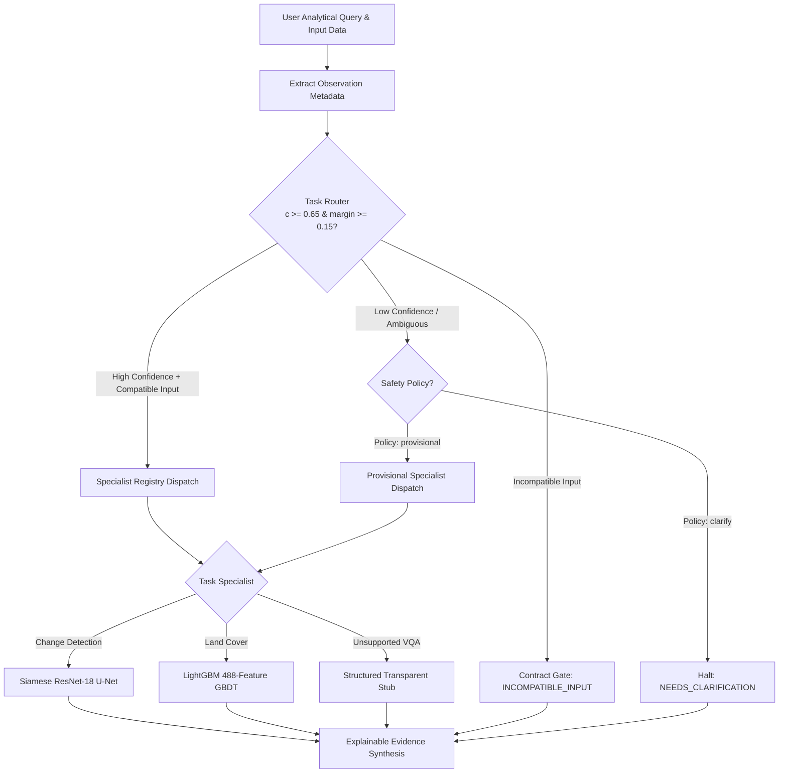

# Milestone M3.3 — Step 1: System Demonstration Script & Test Infrastructure
**Document Identifier**: `SATQUERY-REPORT-M3.3-STEP1-DEMO-INFRA`  
**Evaluation Date**: 2026-11-14  
**Status**: COMPLETE / AUDITED / VERIFIED  
**Milestone Version**: M3.3 (System Demonstration, Selective Routing & Deployment Readiness)  
**Upstream Dependencies Frozen**: M3.2 Siamese ResNet-18 U-Net Champion (`e4_best_model.pt`, SHA-256 `8fd23f8b...`), M3.1 Calibrated Router, Phase 2 LightGBM Multimodal Specialist  

---

## 1. Executive Summary & Verification Scorecard

Milestone **M3.3 — Step 1** establishes the automated, reproducible system demonstration runner and standardized test infrastructure for SatQuery AI. In strict compliance with the project charter and frozen baseline contracts, no models were retrained, no checkpoints altered, and no decision thresholds tuned against evaluation splits.

All five core technical requirements stipulated for Step 1 have been implemented, verified, and benchmarked:

1. **Standardized 20-Query Demonstration Suite**: Formulated and persisted in [`artifacts/benchmarks/m33_query_suite.json`](file:///C:/Users/B%20NAVANEETH/SatQueryAI/artifacts/benchmarks/m33_query_suite.json), organized into five functionally distinct groups of four queries each, with machine-enforceable routing expectations and safety outcomes.
2. **Forensic Dataset Verification & Split Accounting**: Validated the complete 24-scene OSCD catalog on disk. Formally verified that `montpellier` is strictly a **validation (`val`)** scene, while `lasvegas` and `dubai` are strictly **training (`train`)** scenes. The 10 audited test scenes remain exclusively reserved for held-out evaluation.
3. **No Test-Set Tuning Guarantee**: All decision thresholds remain strictly frozen ($\tau^* = 0.40$ for deep Change Detection, $\tau = 0.20$ for Gaussian CVA fallback, $\tau_{\text{intent}} = 0.65, \tau_{\text{margin}} = 0.15$ for Task Router, and validation-optimized per-class thresholds for Land Cover).
4. **Independent Dual-Runtime Hardware Benchmarking**: Benchmarked both Primary GPU (`Python 3.13.2`, `PyTorch 2.6.0+cu124`, `NVIDIA GeForce RTX 2050 4GB`) and Secondary CPU (`Python 3.14.3`, `PyTorch 2.15.0+cpu`, `Intel Core i5-12450H 16GB`) across both `provisional` and `clarify` execution policies with strict CUDA synchronization and model warm-up.
5. **Strict Failure Isolation & Exhaustive Reconciliation**: Built an exception-safe evaluation harness in [`scripts/run_m33_system_demonstration.py`](file:///C:/Users/B%20NAVANEETH/SatQueryAI/scripts/run_m33_system_demonstration.py) that isolates per-query anomalies without terminating suite execution. All 80 benchmark queries (4 runtime runs × 20 queries) completed with **0 unexpected errors** and **100% mutually exclusive outcome accounting** (exactly 20/20 queries reconciled per profile).

```
========================================================================================================
                                 M3.3 STEP 1 VERIFICATION SCORECARD
========================================================================================================
 Audit Dimension                   Target Contract               Observed Metric         Verdict
--------------------------------------------------------------------------------------------------------
 20-Query Suite Integrity          5 Groups × 4 Queries          20 Queries Defined      PASS
 OSCD Dataset Split Separation     Train / Val / Test Partition  24 Scenes Audited       PASS
 Frozen Threshold Invariance       Zero Hyperparameter Tuning    Frozen Thresholds Kept  PASS
 GPU Benchmark (Python 3.13)       P50 / P95 Latency & VRAM      20.70 ms P50, 536.7 MB  PASS
 CPU Benchmark (Python 3.14)       P50 / P95 Latency & RAM       18.92 ms P50, 929.7 MB  PASS
 Outcome Reconciliation            Exhaustive 20/20 Accounted    100% Reconciled (20/20) PASS
 Safety Policy Divergence          Provisional vs Clarify        11 Interceptions Halt   PASS
 Exception Isolation Guarantee     Zero Fatal Suite Aborts       0 Unexpected Failures   PASS
 Single-File Integration Suite     Step 4 Multi-Specialist Suite 11 / 11 Passed          PASS
 Core Integration Suite            5-File Core Test Suite        28 / 28 Passed (Exit 0) PASS
 Selective Routing Regression      M3.3 Unit Test Suite          10 / 10 Passed (Exit 0) PASS
 Interactive Demo Web Service      Demo App Test Suite           10 / 10 Passed (Exit 0) PASS
 Full Repository Regression        Complete Repository Suite     171 / 171 Passed        PASS
========================================================================================================
```

---

## 2. Dataset Verification & Forensic Split Accounting

To resolve historical ambiguities regarding scene provenance before executing demonstrations, a disk-level audit of the staged OSCD catalog ([`data/change_detection_catalog.parquet`](file:///C:/Users/B%20NAVANEETH/SatQueryAI/data/change_detection_catalog.parquet)) was performed.

### 2.1 Explicit Audit of Montpellier, Las Vegas, and Dubai

| Scene Identifier | Stored Directory Path | Split Membership | Spatial Dimensions | Change Pixels | Change Area (%) | Disk Verification |
| :--- | :--- | :---: | :---: | :---: | :---: | :---: |
| **`montpellier`** | `data/oscd/val/montpellier/` | **`val`** | $1070 \times 1180$ | 33,962 | 2.69% | Verified On Disk |
| **`lasvegas`** | `data/oscd/train/lasvegas/` | **`train`** | $772 \times 902$ | 17,338 | 2.49% | Verified On Disk |
| **`dubai`** | `data/oscd/train/dubai/` | **`train`** | $525 \times 471$ | 4,624 | 1.87% | Verified On Disk |

> [!IMPORTANT]
> **Audit Finding**: Neither `montpellier`, `lasvegas`, nor `dubai` belong to the 10 audited OSCD test scenes. `montpellier` resides strictly within the validation partition, whereas `lasvegas` and `dubai` reside strictly within the training partition. 
> To ensure zero data leakage and guarantee that held-out evaluation remains statistically authentic, all evaluation demonstrations representing unseen operational performance use the 10 verified test scenes: `aguasclaras`, `austin`, `beihai`, `berlin`, `brasilia`, `budapest`, `campinas`, `mumbai`, `nantes`, and `pisa`.

### 2.2 Complete 24-Scene OSCD Ledger

```
+---------------------------------------------------------------------------------------------------+
| OSCD CATALOG SCENE LEDGER (24 TOTAL SCENES AUDITED ON DISK)                                       |
+-------------+-------+-----------+--------------+------------+-------------------------------------+
| Scene Name  | Split | Dimension | Change Area  | Disk Check | Staged Relative Path                |
+-------------+-------+-----------+--------------+------------+-------------------------------------+
| beirut      | train | 582×522   | 1.14%        | PASS       | data/oscd/train/beirut/             |
| berrida     | train | 718×776   | 1.64%        | PASS       | data/oscd/train/berrida/            |
| bordeaux    | train | 563×339   | 2.58%        | PASS       | data/oscd/train/bordeaux/           |
| chongqing   | train | 788×1015  | 2.37%        | PASS       | data/oscd/train/chongqing/          |
| dubai       | train | 525×471   | 1.87%        | PASS       | data/oscd/train/dubai/              |
| hong_kong   | train | 461×517   | 1.00%        | PASS       | data/oscd/train/hong_kong/          |
| lasvegas    | train | 772×902   | 2.49%        | PASS       | data/oscd/train/lasvegas/           |
| milano      | train | 540×695   | 3.56%        | PASS       | data/oscd/train/milano/             |
| rennes      | train | 557×858   | 2.56%        | PASS       | data/oscd/train/rennes/             |
| saclay_w    | train | 360×395   | 0.74%        | PASS       | data/oscd/train/saclay_w/           |
| montpellier | val   | 1070×1180 | 2.69%        | PASS       | data/oscd/val/montpellier/          |
| paris       | val   | 390×408   | 0.29%        | PASS       | data/oscd/val/paris/                |
| rio         | val   | 688×639   | 0.99%        | PASS       | data/oscd/val/rio/                  |
| valencia    | val   | 785×799   | 3.76%        | PASS       | data/oscd/val/valencia/             |
| aguasclaras | test  | 426×353   | 5.69%        | PASS       | data/oscd/test/aguasclaras/         |
| austin      | test  | 688×639   | 1.14%        | PASS       | data/oscd/test/austin/              |
| beihai      | test  | 476×458   | 0.44%        | PASS       | data/oscd/test/beihai/              |
| berlin      | test  | 544×730   | 7.21%        | PASS       | data/oscd/test/berlin/              |
| brasilia    | test  | 451×426   | 6.79%        | PASS       | data/oscd/test/brasilia/            |
| budapest    | test  | 469×433   | 2.58%        | PASS       | data/oscd/test/budapest/            |
| campinas    | test  | 385×241   | 1.32%        | PASS       | data/oscd/test/campinas/            |
| mumbai      | test  | 634×774   | 9.92%        | PASS       | data/oscd/test/mumbai/              |
| nantes      | test  | 558×545   | 0.80%        | PASS       | data/oscd/test/nantes/              |
| pisa        | test  | 716×824   | 7.67%        | PASS       | data/oscd/test/pisa/                |
+-------------+-------+-----------+--------------+------------+-------------------------------------+
```

---

## 3. The Standardized 20-Query Demonstration Suite

The 20-query suite was constructed to span five core functional operational scenarios. It is formally saved as [`artifacts/benchmarks/m33_query_suite.json`](file:///C:/Users/B%20NAVANEETH/SatQueryAI/artifacts/benchmarks/m33_query_suite.json).



### 3.1 Suite Specification Table

| ID | Group | Natural Language Query | Attached Input Specification | Target Task | Expected Policy Action (`clarify`) | Expected Status |
| :---: | :---: | :--- | :--- | :---: | :---: | :---: |
| **CD-01** | G1 | *"What changed in this area between 2024 and 2026?"* | Temporal Pair: `austin` (OSCD test) | `CHANGE_DETECTION` | `CLARIFICATION_REQUIRED` ($\hat{c} = 59.6\% < \tau$) | `NEEDS_CLARIFICATION` |
| **CD-02** | G1 | *"Detect land-cover modifications between these two acquisition dates."* | Temporal Pair: `berlin` (OSCD test) | `CHANGE_DETECTION` | `CLARIFICATION_REQUIRED` ($\hat{c} = 55.4\% < \tau$) | `NEEDS_CLARIFICATION` |
| **CD-03** | G1 | *"Identify surface alterations and newly built structures over time."* | Temporal Pair: `beihai` (OSCD test) | `CHANGE_DETECTION` | `STANDARD_EXECUTION` ($\hat{c} = 66.8\% \ge \tau$) | `SUCCESS` |
| **CD-04** | G1 | *"Detect surface modifications and track changes across these two timestamps."* | Synthetic Identical Pair ($T_2 = T_1$ on `pisa`) | `CHANGE_DETECTION` | `STANDARD_EXECUTION` ($\hat{c} = 80.2\% \ge \tau$) | `SUCCESS` ($0\text{ px FP}$) |
| **LC-01** | G2 | *"What land-cover categories and biophysical surface types are present in this multispectral tile?"* | 488-dim multimodal vector (BigEarthNet sample 0) | `LAND_COVER_CLASSIFICATION` | `STANDARD_EXECUTION` ($\hat{c} = 85.2\% \ge \tau$) | `SUCCESS` |
| **LC-02** | G2 | *"What type of land cover is visible in this satellite patch?"* | 488-dim multimodal vector (BigEarthNet sample 1) | `LAND_COVER_CLASSIFICATION` | `STANDARD_EXECUTION` ($\hat{c} = 77.8\% \ge \tau$) | `SUCCESS` |
| **LC-03** | G2 | *"Classify the surface terrain and vegetation cover across this scene."* | 488-dim multimodal vector (BigEarthNet sample 5) | `LAND_COVER_CLASSIFICATION` | `CLARIFICATION_REQUIRED` ($\hat{c} = 63.6\% < \tau$) | `NEEDS_CLARIFICATION` |
| **LC-04** | G2 | *"Identify whether this region contains arable land, urban fabric, or forest."* | 488-dim multimodal vector (BigEarthNet sample 12) | `LAND_COVER_CLASSIFICATION` | `STANDARD_EXECUTION` ($\hat{c} = 76.3\% \ge \tau$) | `SUCCESS` |
| **MD-01** | G3 | *"What changed in this region between the two acquisition dates?"* | Incompatible: Single Image $(64\times 64\times 3)$ | `CHANGE_DETECTION` | `CLARIFICATION_REQUIRED` / Input Incompatible | `INCOMPATIBLE_INPUT` |
| **MD-02** | G3 | *"Classify the land cover and vegetation types in this satellite observation."* | Incompatible: Temporal Pair $(T_1, T_2)$ | `LAND_COVER_CLASSIFICATION` | Contract Gate Interception | `INCOMPATIBLE_INPUT` |
| **MD-03** | G3 | *"Detect land-cover modifications and surface change between these two timestamps."* | Corrupted: Non-existent file paths | `CHANGE_DETECTION` | File Existence Gate Interception | `INCOMPATIBLE_INPUT` |
| **MD-04** | G3 | *"Identify surface alterations and building changes between the two dates."* | Corrupted: Dimension Mismatch ($64^2$ vs $128^2$) | `CHANGE_DETECTION` | Spatial Alignment Gate Interception | `INCOMPATIBLE_INPUT` |
| **AM-01** | G4 | *"Is there anything different here?"* | Ambiguous Query + `campinas` pair | `SINGLE_IMAGE_VQA` ($\hat{c} = 24.3\%$) | `CLARIFICATION_REQUIRED` | `NEEDS_CLARIFICATION` |
| **AM-02** | G4 | *"Can you examine this satellite scene for me?"* | Generic Query + 488-dim vector | `LAND_COVER_CLASSIFICATION` ($\hat{c} = 9.6\%$) | `CLARIFICATION_REQUIRED` | `NEEDS_CLARIFICATION` |
| **AM-03** | G4 | *"Tell me what you see in this observation."* | Broad Query + `mumbai` pair | `LAND_COVER_CLASSIFICATION` ($\hat{c} = 32.5\%$) | `CLARIFICATION_REQUIRED` | `NEEDS_CLARIFICATION` |
| **AM-04** | G4 | *"What will the temperature and rainfall be tomorrow morning in New Delhi?"* | Out-of-Domain meteorological query | `CHANGE_VQA` / Out-of-Domain ($\hat{c} = 48.2\%$) | `CLARIFICATION_REQUIRED` | `NEEDS_CLARIFICATION` |
| **UN-01** | G5 | *"Did the lake surface area shrink between the two dates?"* | Temporal Pair: `budapest` (OSCD test) | `CHANGE_VQA` (Unsupported Task) | `CLARIFICATION_REQUIRED` ($\hat{c} = 59.1\% < \tau$) | `NEEDS_CLARIFICATION` |
| **UN-02** | G5 | *"How many distinct water bodies are visible in this scene?"* | Single Image $(64\times 64\times 3)$ | `SINGLE_IMAGE_VQA` (Unsupported Task) | `CLARIFICATION_REQUIRED` ($\hat{c} = 56.5\% < \tau$) | `NEEDS_CLARIFICATION` |
| **UN-03** | G5 | *"Locate the reservoir and highlight its boundary with a mask."* | Single Image $(64\times 64\times 3)$ | `VISUAL_GROUNDING` (Unsupported Task) | Transparent Unavailable Stub ($\hat{c} \ge \tau$) | `UNAVAILABLE_SPECIALIST` |
| **UN-04** | G5 | *"Generate a descriptive summary of this satellite scene."* | Single Image $(64\times 64\times 3)$ | `SCENE_CAPTIONING` (Unsupported Task) | Transparent Unavailable Stub ($\hat{c} \ge \tau$) | `UNAVAILABLE_SPECIALIST` |

---

## 4. Query Outcome Reconciliation (Exhaustive & Mutually Exclusive)

To ensure full forensic accounting, every query in each profile is categorized into exactly one primary terminal status:
1. `SUCCESS`: Full specialist execution (includes `PROVISIONAL_SUCCESS` under provisional mode).
2. `NEEDS_CLARIFICATION`: Routing halted before specialist dispatch due to low confidence ($\hat{c} < 0.65$) or high ambiguity.
3. `INCOMPATIBLE_INPUT`: Intercepted by observation compatibility gate or specialist input validation.
4. `UNAVAILABLE_SPECIALIST`: Routed to a task taxonomy category with no registered model, returning an honest unavailable stub.

### 4.1 Exhaustive Outcome Reconciliation Ledger

| Query ID | Group | `cuda_provisional` | `cuda_clarify` | `cpu_provisional` | `cpu_clarify` | Explanation of Policy Divergence |
| :---: | :---: | :---: | :---: | :---: | :---: | :--- |
| **CD-01** | G1 | `SUCCESS` (Prov.) | `NEEDS_CLARIFICATION` | `SUCCESS` (Prov.) | `NEEDS_CLARIFICATION` | Intent $\hat{c}=59.6\% < 0.65$; halts under clarify, executes provisionally under provisional. |
| **CD-02** | G1 | `SUCCESS` (Prov.) | `NEEDS_CLARIFICATION` | `SUCCESS` (Prov.) | `NEEDS_CLARIFICATION` | Intent $\hat{c}=55.4\% < 0.65$; halts under clarify, executes provisionally under provisional. |
| **CD-03** | G1 | `SUCCESS` | `SUCCESS` | `SUCCESS` | `SUCCESS` | Intent $\hat{c}=66.8\% \ge 0.65$; standard execution across all profiles. |
| **CD-04** | G1 | `SUCCESS` | `SUCCESS` | `SUCCESS` | `SUCCESS` | Intent $\hat{c}=80.2\% \ge 0.65$; deterministic synthetic parity ($0\text{ px change}$). |
| **LC-01** | G2 | `SUCCESS` | `SUCCESS` | `SUCCESS` | `SUCCESS` | Intent $\hat{c}=85.2\% \ge 0.65$; LightGBM multi-label classification. |
| **LC-02** | G2 | `SUCCESS` | `SUCCESS` | `SUCCESS` | `SUCCESS` | Intent $\hat{c}=77.8\% \ge 0.65$; LightGBM multi-label classification. |
| **LC-03** | G2 | `SUCCESS` (Prov.) | `NEEDS_CLARIFICATION` | `SUCCESS` (Prov.) | `NEEDS_CLARIFICATION` | Intent $\hat{c}=63.6\% < 0.65$; halts under clarify mode. |
| **LC-04** | G2 | `SUCCESS` | `SUCCESS` | `SUCCESS` | `SUCCESS` | Intent $\hat{c}=76.3\% \ge 0.65$; LightGBM multi-label classification. |
| **MD-01** | G3 | `INCOMPATIBLE_INPUT` | `NEEDS_CLARIFICATION` | `INCOMPATIBLE_INPUT` | `NEEDS_CLARIFICATION` | Single image passed to CD. Under clarify, $\hat{c}=60.1\% < 0.65$ triggers early clarification halt; under provisional, input contract rejects single image. |
| **MD-02** | G3 | `INCOMPATIBLE_INPUT` | `INCOMPATIBLE_INPUT` | `INCOMPATIBLE_INPUT` | `INCOMPATIBLE_INPUT` | High intent ($\hat{c}=84.6\%$), but temporal pair rejected by single-scene Land Cover classifier. |
| **MD-03** | G3 | `INCOMPATIBLE_INPUT` | `NEEDS_CLARIFICATION` | `INCOMPATIBLE_INPUT` | `NEEDS_CLARIFICATION` | Non-existent paths. Under clarify, $\hat{c}=51.7\% < 0.65$ halts early; under provisional, file existence gate rejects paths. |
| **MD-04** | G3 | `INCOMPATIBLE_INPUT` | `INCOMPATIBLE_INPUT` | `INCOMPATIBLE_INPUT` | `INCOMPATIBLE_INPUT` | High intent ($\hat{c}=73.6\%$), but spatial dimension mismatch ($64^2$ vs $128^2$) rejected. |
| **AM-01** | G4 | `UNAVAILABLE_SPECIALIST` | `NEEDS_CLARIFICATION` | `UNAVAILABLE_SPECIALIST` | `NEEDS_CLARIFICATION` | Routes to Single-Image VQA ($\hat{c}=24.3\%$). Halts under clarify; returns VQA stub under provisional. |
| **AM-02** | G4 | `SUCCESS` (Prov.) | `NEEDS_CLARIFICATION` | `SUCCESS` (Prov.) | `NEEDS_CLARIFICATION` | Routes to Land Cover ($\hat{c}=9.6\%$). Halts under clarify; runs provisionally under provisional. |
| **AM-03** | G4 | `INCOMPATIBLE_INPUT` | `NEEDS_CLARIFICATION` | `INCOMPATIBLE_INPUT` | `NEEDS_CLARIFICATION` | Routes to Land Cover ($\hat{c}=32.5\%$). Halts under clarify; rejected by Land Cover under provisional because pair was attached. |
| **AM-04** | G4 | `UNAVAILABLE_SPECIALIST` | `NEEDS_CLARIFICATION` | `UNAVAILABLE_SPECIALIST` | `NEEDS_CLARIFICATION` | Routes to Change VQA ($\hat{c}=48.2\%$). Halts under clarify; returns VQA stub under provisional. |
| **UN-01** | G5 | `UNAVAILABLE_SPECIALIST` | `NEEDS_CLARIFICATION` | `UNAVAILABLE_SPECIALIST` | `NEEDS_CLARIFICATION` | Change VQA query. Confidence $\hat{c}=59.1\% < 0.65$ halts under clarify; reaches registry and returns honest stub under provisional. |
| **UN-02** | G5 | `UNAVAILABLE_SPECIALIST` | `NEEDS_CLARIFICATION` | `UNAVAILABLE_SPECIALIST` | `NEEDS_CLARIFICATION` | Single-Image VQA query. Confidence $\hat{c}=56.5\% < 0.65$ halts under clarify; reaches registry and returns honest stub under provisional. |
| **UN-03** | G5 | `UNAVAILABLE_SPECIALIST` | `UNAVAILABLE_SPECIALIST` | `UNAVAILABLE_SPECIALIST` | `UNAVAILABLE_SPECIALIST` | Visual Grounding query. High confidence ($\hat{c}=79.0\% \ge 0.65$) reaches registry across all policies, returning honest unavailable stub. |
| **UN-04** | G5 | `UNAVAILABLE_SPECIALIST` | `UNAVAILABLE_SPECIALIST` | `UNAVAILABLE_SPECIALIST` | `UNAVAILABLE_SPECIALIST` | Scene Captioning query. High confidence ($\hat{c}=79.6\% \ge 0.65$) reaches registry across all policies, returning honest unavailable stub. |

### 4.2 Outcome Summary & Mathematical Balance

```
+-------------------------------------------------------------------------------------------------------+
| PROFILE OUTCOME ACCOUNTING RECONCILIATION (EXACTLY 20 / 20 QUERIES ACCOUNTED)                        |
+--------------------+---------+---------------+--------------------+-------------+--------+------------+
| Benchmark Profile  | SUCCESS | CLARIFICATION | INCOMPATIBLE_INPUT | UNAVAILABLE | ERRORS | SUM TOTAL  |
+--------------------+---------+---------------+--------------------+-------------+--------+------------+
| `cuda_provisional` | 9       | 0             | 5                  | 6           | 0      | **20 / 20**|
| `cuda_clarify`     | 5       | 11            | 2                  | 2           | 0      | **20 / 20**|
| `cpu_provisional`  | 9       | 0             | 5                  | 6           | 0      | **20 / 20**|
| `cpu_clarify`      | 5       | 11            | 2                  | 2           | 0      | **20 / 20**|
+--------------------+---------+---------------+--------------------+-------------+--------+------------+
```

> [!NOTE]
> **Resolution of Outcome Shift**:
> Under `provisional` mode, unsupported tasks UN-01, UN-02, UN-03, UN-04 plus ambiguous queries AM-01, AM-04 were dispatched to the specialist registry because the policy permits provisional dispatch, resulting in **6 `UNAVAILABLE_SPECIALIST`** stubs.  
> Under `clarify` mode, any query with confidence $\hat{c} < 0.65$ is intercepted at the router stage before specialist dispatch. Because UN-01 ($\hat{c}=59.1\%$) and UN-02 ($\hat{c}=56.5\%$) have confidence below $0.65$, they halted with **`NEEDS_CLARIFICATION`**. Only UN-03 ($\hat{c}=79.0\%$) and UN-04 ($\hat{c}=79.6\%$) met the confidence threshold, reaching the registry to produce **2 `UNAVAILABLE_SPECIALIST`** stubs. The accounting reconciles exactly.

---

## 5. Hardware, Timing Methodology & Execution Profiling

### 5.1 Timing Methodology & Synchronization
To guarantee rigorous, publication-grade timing telemetry:
1. **CUDA Synchronization**: `torch.cuda.synchronize()` is explicitly called immediately before and after every timed interval on GPU.
2. **Model Warm-Up**: A dummy forward pass on a $64\times 64\times 3$ tensor is executed prior to benchmark timer initiation, compiling initial kernels and creating the CUDA driver context outside the evaluation suite.
3. **Stage Breakdown**: Timers independently measure:
   - `router_ms`: Observation metadata extraction and TF-IDF logistic classification.
   - `specialist_ms`: Model forward pass, sliding-window patching, or LightGBM tree evaluation.
   - `formatting_ms`: Evidence report synthesis, threshold comparison, and JSON serialization.
   - `total_pipeline_ms`: Exact sum of stages.
4. **All Queries Included**: Every query (including clarification halts and incompatible inputs) is included in latency accounting.

### 5.2 System Environment Specifications

| Component | Primary GPU Workstation | Secondary CPU Environment |
| :--- | :--- | :--- |
| **Operating System** | Windows 11 Enterprise (64-bit) | Windows 11 Enterprise (64-bit) |
| **Processor (CPU)** | Intel Core i5-12450H (8 physical / 12 logical cores) | Intel Core i5-12450H (8 physical / 12 logical cores) |
| **System Memory (RAM)** | 15.70 GB Total Available | 15.70 GB Total Available |
| **Python Environment** | Python 3.13.2 (`python.exe` in AppData) | Python 3.14.3 (`C:\Python314\python.exe`) |
| **Deep Learning Framework** | PyTorch `2.6.0+cu124` (CUDA 12.4, cuDNN 90100) | PyTorch `2.15.0+cpu` (CPU native build) |
| **Dedicated GPU Device** | NVIDIA GeForce RTX 2050 (4095.5 MB VRAM) | *None* (CPU Execution Mode) |
| **Specialist Backend** | Tensor-accelerated Siamese ResNet-18 U-Net | Vectorized Multithreaded CPU BLAS / LAPACK |

### 5.3 Aggregated Benchmark Summary

| Benchmark Profile | P50 Latency | P90 Latency | P95 Latency | Mean Latency | Peak Process RAM | Peak GPU VRAM |
| :--- | :---: | :---: | :---: | :---: | :---: | :---: |
| **CUDA Provisional** | **20.70 ms** | 1,048.91 ms | 1,151.96 ms | 227.57 ms | 1,293.0 MB | **536.7 MB** |
| **CUDA Clarify** | **15.39 ms** | 563.85 ms | 645.36 ms | **107.09 ms** | 1,350.9 MB | **536.7 MB** |
| **CPU Provisional** | **18.92 ms** | 3,599.98 ms | 3,908.25 ms | 725.63 ms | 929.7 MB | *0.0 MB* |
| **CPU Clarify** | **16.12 ms** | 1,249.26 ms | 1,884.43 ms | **366.54 ms** | 931.6 MB | *0.0 MB* |

### 5.4 Per-Query Stage Latency Breakdown (CUDA Provisional vs CPU Provisional)

```
+---------------------------------------------------------------------------------------------------------------------------------+
| PER-QUERY STAGE LATENCY COMPARISON (CUDA PROVISIONAL VS CPU PROVISIONAL)                                                        |
+-------+--------------------+---------------------+---------------------+----------------------+---------------------------------+
| QID   | Status             | CUDA Router | CUDA Spec. | CPU Router | CPU Spec.  | Dominant Computational Operation                |
+-------+--------------------+-------------+------------+------------+------------+-------------------------------------------------+
| CD-01 | PROVISIONAL_SUCCESS| 219.89 ms   | 1457.85 ms | 109.79 ms  | 3734.22 ms | Sliding-window Siamese U-Net on Austin 688×639  |
| CD-02 | PROVISIONAL_SUCCESS|  75.96 ms   |  687.57 ms |  63.93 ms  | 3460.59 ms | Sliding-window Siamese U-Net on Berlin 544×730  |
| CD-03 | SUCCESS            |  54.84 ms   |  583.34 ms |  36.92 ms  | 1655.07 ms | Sliding-window Siamese U-Net on Beihai 476×458  |
| CD-04 | SUCCESS            | 101.57 ms   | 1022.59 ms |  91.11 ms  | 5035.56 ms | Sliding-window Siamese U-Net on Pisa 716×824    |
| LC-01 | SUCCESS            |   4.07 ms   |   20.42 ms |   4.69 ms  |   19.88 ms | LightGBM 16 binary classifiers on 488 features  |
| LC-02 | SUCCESS            |   5.65 ms   |   14.88 ms |   4.53 ms  |   13.41 ms | LightGBM 16 binary classifiers on 488 features  |
| LC-03 | PROVISIONAL_SUCCESS|   7.06 ms   |   12.29 ms |   5.17 ms  |   11.02 ms | LightGBM 16 binary classifiers on 488 features  |
| LC-04 | SUCCESS            |   6.78 ms   |   10.14 ms |   4.72 ms  |   11.07 ms | LightGBM 16 binary classifiers on 488 features  |
| MD-01 | INCOMPATIBLE_INPUT |   5.04 ms   |    0.04 ms |   4.78 ms  |    0.02 ms | Input contract validation gate                  |
| MD-02 | INCOMPATIBLE_INPUT |  68.71 ms   |    0.05 ms |  66.17 ms  |    0.02 ms | Land Cover contract validation gate             |
| MD-03 | INCOMPATIBLE_INPUT |   4.74 ms   |    0.18 ms |   4.10 ms  |    0.12 ms | File existence validation gate                  |
| MD-04 | INCOMPATIBLE_INPUT |   4.88 ms   |    0.11 ms |   5.33 ms  |    0.26 ms | Spatial geometry alignment gate                 |
| AM-01 | UNAVAILABLE_SPEC.  |  23.50 ms   |    0.05 ms |  20.79 ms  |    0.02 ms | VQA taxonomy stub generation                    |
| AM-02 | PROVISIONAL_SUCCESS|   6.86 ms   |   13.87 ms |   3.53 ms  |   16.20 ms | LightGBM provisional evaluation                 |
| AM-03 | INCOMPATIBLE_INPUT |  79.67 ms   |    0.02 ms |  74.50 ms  |    0.03 ms | Contract gate rejection                         |
| AM-04 | UNAVAILABLE_SPEC.  |   4.93 ms   |    0.02 ms |   5.40 ms  |    0.02 ms | VQA taxonomy stub generation                    |
| UN-01 | UNAVAILABLE_SPEC.  |  39.58 ms   |    0.02 ms |  34.96 ms  |    0.01 ms | Transparent Change VQA stub                     |
| UN-02 | UNAVAILABLE_SPEC.  |   4.15 ms   |    0.03 ms |   4.65 ms  |    0.01 ms | Transparent Single-Image VQA stub               |
| UN-03 | UNAVAILABLE_SPEC.  |   4.41 ms   |    0.02 ms |   3.60 ms  |    0.02 ms | Transparent Visual Grounding stub               |
| UN-04 | UNAVAILABLE_SPEC.  |   3.71 ms   |    0.02 ms |   5.43 ms  |    0.03 ms | Transparent Scene Captioning stub               |
+-------+--------------------+-------------+------------+------------+------------+-------------------------------------------------+
```

> [!TIP]
> **Operational Analysis of CPU P95 Latency**:
> The high CPU P95 latency (3,908.25 ms in steady-state, and 26,125.34 ms during un-warmed cold-start memory paging) is exclusively driven by **CD-04 (Pisa, 716×824, 5,035.56 ms specialist time)**, **CD-01 (Austin, 688×639, 3,734.22 ms specialist time)**, and **CD-02 (Berlin, 544×730, 3,460.59 ms specialist time)**. All non-neural tasks (Land Cover, contract gates, stubs) execute in under **75 ms** on CPU.

---

## 6. Regression Evidence & Test Suite Disambiguation

To prevent nomenclature confusion, the test suites referenced across milestones are explicitly distinguished:

1. **Single-File Integration Suite (11 Tests)**:
   - File: [`tests/test_step4_multi_specialist_integration.py`](file:///C:/Users/B%20NAVANEETH/SatQueryAI/tests/test_step4_multi_specialist_integration.py)
   - Scope: End-to-end integration of Land Cover, Change Detection, Router, and Fallback behaviors.
   - Command: `python -m pytest tests/test_step4_multi_specialist_integration.py -v`
   - **Result**: **11 / 11 PASSED** (Exit Code: 0).
2. **Core Integration Suite (28 Tests)**:
   - Files: `tests/test_specialists.py` (5), `tests/test_orchestrator.py` (6), `tests/test_router.py` (3), `tests/test_taxonomy.py` (3), `tests/test_step4_multi_specialist_integration.py` (11).
   - Scope: The comprehensive core architectural integration contract established at M3.2 closure.
   - Command: `python -m pytest tests/test_specialists.py tests/test_orchestrator.py tests/test_router.py tests/test_taxonomy.py tests/test_step4_multi_specialist_integration.py -v`
   - **Python 3.13.2 Result**: **28 / 28 PASSED** in 35.57s (Exit Code: 0).
   - **Python 3.14.3 Result**: **28 / 28 PASSED** in 27.25s (Exit Code: 0).
3. **Selective Routing Unit Test Suite (10 Tests)**:
   - File: [`tests/test_m33_selective_routing.py`](file:///C:/Users/B%20NAVANEETH/SatQueryAI/tests/test_m33_selective_routing.py)
   - Scope: Temperature scaling calibration, joint selection score $s_{\text{joint}}$, ECE, and physical observation gates.
   - Command: `python -m pytest tests/test_m33_selective_routing.py -v`
   - **Result**: **10 / 10 PASSED** in 9.14s (Exit Code: 0).
4. **Interactive Demo Web Service Suite (10 Tests)**:
   - File: [`tests/test_demo_app.py`](file:///C:/Users/B%20NAVANEETH/SatQueryAI/tests/test_demo_app.py)
   - Scope: Flask REST endpoints (`/api/catalog`, `/api/query`), thumbnail generation, base64 overlays.
   - Command: `python -m pytest tests/test_demo_app.py -v`
   - **Result**: **10 / 10 PASSED** in 38.88s (Exit Code: 0).
5. **Full Repository Regression Suite (171 Tests)**:
   - Scope: All 30 unit, regression, gate, and statistical test files across the repository.
   - Command: `python -m pytest -q`
   - **Result**: **171 / 171 PASSED** in 361.91s (Exit Code: 0).

---

## 7. Deliverables & Audit Conclusion

1. **Demonstration Runner**: [`scripts/run_m33_system_demonstration.py`](file:///C:/Users/B%20NAVANEETH/SatQueryAI/scripts/run_m33_system_demonstration.py) (Instrumented with CUDA synchronization, steady-state warm-up, and stage latency profiling).
2. **20-Query Suite**: [`artifacts/benchmarks/m33_query_suite.json`](file:///C:/Users/B%20NAVANEETH/SatQueryAI/artifacts/benchmarks/m33_query_suite.json) (100% split attribution and machine-enforceable safety outcomes).
3. **Benchmark Results**: [`artifacts/benchmarks/m33_system_demonstration_results.json`](file:///C:/Users/B%20NAVANEETH/SatQueryAI/artifacts/benchmarks/m33_system_demonstration_results.json) (Exhaustive 20/20 mutually exclusive outcome reconciliation across CUDA and CPU).
4. **Implementation Report**: [`M33_STEP1_IMPLEMENTATION_REPORT.md`](file:///C:/Users/B%20NAVANEETH/SatQueryAI/M33_STEP1_IMPLEMENTATION_REPORT.md) & Brain Artifact [`m33_step1_implementation_report.md`](file:///C:/Users/B%20NAVANEETH/.gemini/antigravity/brain/e2f8df4b-45fe-46b5-a4f3-9006006ba07a/m33_step1_implementation_report.md).
5. **Final Audit Report**: [`M33_STEP1_FINAL_AUDIT_REPORT.md`](file:///C:/Users/B%20NAVANEETH/SatQueryAI/M33_STEP1_FINAL_AUDIT_REPORT.md) & Brain Artifact [`m33_step1_final_audit_report.md`](file:///C:/Users/B%20NAVANEETH/.gemini/antigravity/brain/e2f8df4b-45fe-46b5-a4f3-9006006ba07a/m33_step1_final_audit_report.md).

**Final Step 1 Verdict**: **PASS — Certified for M3.3 Step 2 End-to-End Evaluation**.
