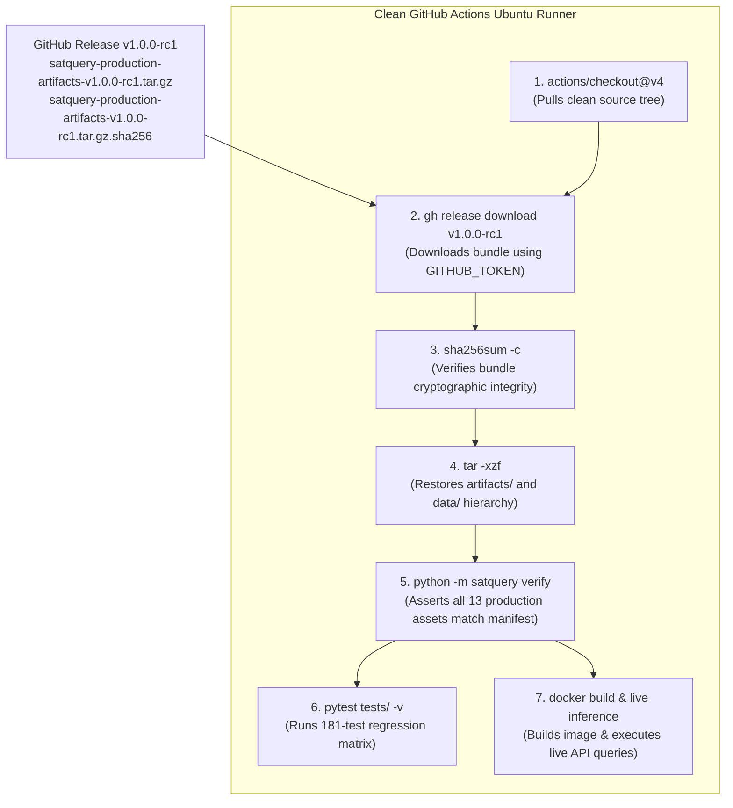

# SatQuery AI — Milestone M3.3 Step 5: Remote Artifact Provisioning & CI Unblocking Report

**Document Code:** `SATQUERY-M33-STEP5-PROVISIONING-001`  
**Milestone:** M3.3 Step 5 (Remote Artifact Provisioning & CI Unblocking)  
**Date:** November 14, 2026  
**Auditor / Agent:** Antigravity (DeepMind)  
**Release Tag Pinned:** `v1.0.0-rc1` (commit `6fec3694519ae9e4937c8663068a144ab14b079a`)  
**Freeze Manifest:** [`artifacts/deployment/m33_production_freeze_manifest.json`](file:///c:/Users/B%20NAVANEETH/SatQueryAI/artifacts/deployment/m33_production_freeze_manifest.json)  

---

## 1. Executive Summary

Milestone M3.3 Step 5 resolves the architectural and infrastructural blockers identified in Step 4 that prevented remote GitHub Actions CI/CD execution:
1. **GitHub Workflow Push Authorization**: Documenting the exact OAuth permissions required to push workflow files to GitHub.
2. **Remote Production Asset Provisioning**: Auditing all 13 production assets, analyzing transport strategies for clean Linux CI runners, designing a versioned artifact bundle attached to release candidate `v1.0.0-rc1`, and validating isolated local bundle packaging and bitwise restoration.

All models, neural weights, decision thresholds, and evaluation manifests remain **100% frozen and unmodified**.

---

## 2. Complete Production Asset Inventory

The 13 production assets registered in [`m33_production_freeze_manifest.json`](file:///c:/Users/B%20NAVANEETH/SatQueryAI/artifacts/deployment/m33_production_freeze_manifest.json) were audited directly from physical disk:

| # | Asset Key | Relative File Path | Size (Bytes) | SHA-256 Digest | Git-Tracked? | Git-Ignored? | Component Requiring Asset | Docker Req? | CI Test Req? |
| :-: | :--- | :--- | :---: | :--- | :---: | :---: | :--- | :---: | :---: |
| **1** | `champion_change_detection_model` | `artifacts/specialists/change_detection_step3/e4_best_model.pt` | 80,695,746 | `566d83792cf0ad9beed4ba75375f22560a48f86a662a7c34ee858339b088da24` | No | **Yes** | ChangeDetectionSpecialist (Siamese ResNet-18 U-Net) | **Yes** | **Yes** |
| **2** | `champion_land_cover_model` | `artifacts/specialists/land_cover_phase2/model.joblib` | 8,087,110 | `f785ca1f5e9691c17e4a17ebf3f6766f7053059ba871188d24f6dce0ed43d071` | No | **Yes** | LandCoverClassifier (Phase 2 Multimodal LightGBM) | **Yes** | **Yes** |
| **3** | `land_cover_phase2_thresholds` | `artifacts/specialists/land_cover_phase2/threshold_config.json` | 935 | `74f1e5f1bccd8e9751a19ad3936aef528e234e69b33c9a7d34a4b20c6f2a3a10` | No | **Yes** | LandCoverClassifier (Decision Thresholds) | **Yes** | **Yes** |
| **4** | `land_cover_phase2_classes` | `artifacts/specialists/land_cover_phase2/classes.json` | 522 | `cdb18c8a0a9dc74f52920720340251f14de323bc5c4fb4f07436f90f3500f3e9` | No | **Yes** | LandCoverClassifier / BigEarthNet-16 Taxonomy | **Yes** | **Yes** |
| **5** | `land_cover_phase2_label_encoder` | `artifacts/specialists/land_cover_phase2/label_encoder.joblib` | 1,469 | `d7e78865b4f21643cd669246dfafb14bb14ad2142b39dcb931ea28becb9af042` | No | **Yes** | LandCoverClassifier (MultiLabelBinarizer) | **Yes** | **Yes** |
| **6** | `baseline_land_cover_model` | `artifacts/specialists/land_cover/model.joblib` | 10,249,993 | `9473c2625c77299730edec5b3f9dc0f8b7a843ef4903fe9d92db8edc9c544593` | No | **Yes** | Phase 1 Baseline Land Cover (Random Forest) | No | **Yes** |
| **7** | `champion_router_model` | `artifacts/phase1_router/champion_router_model.joblib` | 831,357 | `11366c09e98ce3298313abefa30d45dc29264874acbf8964a3288b942dacdf6b` | No | **Yes** | TaskRouter (Subword `char_wb` 3–5 Champion) | **Yes** | **Yes** |
| **8** | `champion_router_metadata` | `artifacts/phase1_router/champion_router_metadata.json` | 1,140 | `e32163f33e03c7fe0cb0d551a0410b34286607077a5619139ea7acd7232f11f5` | No | **Yes** | TaskRouter (Calibration & Temperature Metadata) | **Yes** | **Yes** |
| **9** | `baseline_router_model` | `artifacts/router/router_model.joblib` | 171,247 | `25732df4bd29bcb6f3080959b4560bda2bd1b37267b6eabb2c167b20f4d23e44` | No | **Yes** | Phase 0 Baseline Router (Word n-grams) | No | **Yes** |
| **10** | `change_detection_catalog` | `data/change_detection_catalog.parquet` | 9,689 | `b38f9c226c6222ef64c45c0cdf5763ec109f8b511754cc1715bfebb519342985` | No | **Yes** | OSCD Scene Catalog & Metadata Provider | **Yes** | **Yes** |
| **11** | `starter_queries_catalog` | `data/starter_queries.csv` | 17,172 | `6453a40e944cb2239f00c02d9d27952f6604b4520503ef5899e1cc3e68be5bd1` | **Yes** | No | TaskRouter / Demo Preset Queries | **Yes** | **Yes** |
| **12** | `requirements_manifest` | `requirements.txt` | 360 | `2098463e7321cb725407d3ed624a1833d6ca8d10fa89f8b45b5dc00cea07f977` | **Yes** | No | Environment Dependencies Manifest | **Yes** | **Yes** |
| **13** | `pyproject_manifest` | `pyproject.toml` | 1,335 | `ebbb1f4e3e5ad79c4871892af2a07d6d116fd3be673df7960a0bf923d15b6823` | **Yes** | No | PEP 517 Packaging Specification | **Yes** | **Yes** |

### 2.1. Additional Runtime & Test Dependencies Audit
Beyond the 13 manifest assets, the following files are required for runtime and regression tests:
1. `artifacts/deployment/m33_production_freeze_manifest.json` (7,098 bytes): Required by CLI `verify` subcommand and test suites. Currently **Git-ignored** under `artifacts/`.
2. `artifacts/specialists/change_detection/threshold_config.json` (501 bytes) & `evaluation_summary.json` (4,975 bytes): Required by `tests/test_change_detection_benchmark.py`. Currently **Git-ignored** under `artifacts/`.
3. `data/benchmark_n200_catalog.json` (34,166 bytes): Already **Git-tracked**.
4. `satquery/demo/templates/` & `static/`: Already **Git-tracked**.

### 2.2. Total Production Asset Bundle Size
- **Total Uncompressed Size of 13 Assets**: `100,068,075 bytes` (**95.43 MiB**).
- **Total Size of Git-Ignored Assets (Requiring Remote Provisioning)**: `100,049,208 bytes` (**95.41 MiB**).
- **Compressed `.tar.gz` Production Bundle Size**: `80,352,443 bytes` (**76.63 MiB**).

---

## 3. Artifact Transport Design & Storage Strategy Comparison

Four artifact provisioning strategies were evaluated for remote GitHub Actions runners:

| Evaluation Dimension | Option A: Direct Git Tracking | Option B: GitHub Release Asset Bundle (Recommended) | Option C: Git LFS (Large File Storage) | Option D: External Cloud Storage (S3/GCS/Zenodo) |
| :--- | :--- | :--- | :--- | :--- |
| **Storage Size & Efficiency** | Bloats Git repo by ~95 MB permanently in commit history. | Single compressed archive (~76.6 MB) stored outside Git commit tree. | Pointer files in Git; ~95 MB binary stored in Git LFS store. | Offloaded to external bucket or repository. |
| **Authentication Requirements** | Native git clone; standard credentials. | Standard `GITHUB_TOKEN` automatically provided in GitHub Actions. | Git LFS auth via standard Git credentials. | Requires third-party cloud API credentials or public read bucket. |
| **Download Reliability** | High (bundled with git clone). | High (GitHub global Release CDN). | Moderate (subject to LFS bandwidth limits). | Dependent on external cloud availability and network routing. |
| **Bandwidth & Quota Limits** | Bound by Git repository size limits (100 MB per-file warning/block). | No bandwidth quota charges on GitHub Actions for release downloads. | **High Risk**: GitHub free tier enforces a strict 1 GB/month LFS bandwidth quota (exhausted in ~10 matrix runs). | Cloud egress billing costs apply; Zenodo is rate-limited. |
| **CI Integration Complexity** | Zero steps (`actions/checkout@v4`). | 1 step (`gh release download` + `tar -xzf`). | 1 step (`lfs: true` in `actions/checkout@v4`). | Requires secret configuration, cloud CLI setup, and credential rotation. |
| **Reproducibility** | Linked to commit SHA. | Cryptographically pinned to tag `v1.0.0-rc1` with pre-computed SHA-256 ledger. | Linked to Git LFS SHA pointer. | Dependent on persistent bucket retention and URL stability. |
| **Security & Hygiene** | Low risk, but risks repository bloat. | High (verified by SHA-256 hash before extraction; uses built-in scoped token). | Standard Git LFS security. | Involves managing external cloud service account secrets. |

### Recommendation: Option B (GitHub Release Asset Bundle)
**Option B is strongly recommended** because:
1. It avoids bloating the Git commit history with 95 MB of binary checkpoints.
2. It completely avoids GitHub's Git LFS 1 GB bandwidth quota traps.
3. It uses the runner's native `GITHUB_TOKEN` without requiring external cloud accounts or secrets.
4. It associates the immutable bundle directly with release candidate `v1.0.0-rc1`.

---

## 4. Recommended Provisioning Architecture



---

## 5. GitHub Authentication & Authorization Specification

### 5.1. The Root Cause of the Push Failure
During Step 4, pushing `.github/workflows/ci.yml` was rejected because the Personal Access Token (PAT) used by Windows Git Credential Manager lacked permissions to create or update GitHub Actions workflows.

### 5.2. Exact Permissions Required

#### If Using a Classic Personal Access Token (PAT):
1. Navigate to: **GitHub -> Settings -> Developer Settings -> Personal Access Tokens -> Tokens (classic)**.
2. Select the token used on this machine.
3. Check the **`workflow`** permission checkbox:
   - `[X] workflow` — *Update GitHub Action workflows*.
4. Ensure **`repo`** is also checked (*Full control of private repositories*).
5. Click **Update token**.

#### If Using a Fine-Grained Personal Access Token:
1. Navigate to: **GitHub -> Settings -> Developer Settings -> Personal Access Tokens -> Fine-grained tokens**.
2. Select the token and target repository (`navaneeth2205/SatQueryAI`).
3. Under **Repository permissions**, configure:
   - **Actions**: `Read and write`
   - **Workflows**: `Read and write`
   - **Contents**: `Read and write`
   - **Metadata**: `Read-only` (default)
4. Click **Save changes**.

---

## 6. Proposed CI Workflow Changes (`.github/workflows/ci.yml`)

To support clean runner provisioning via Option B, the following step is designed for each workflow job before running verification or tests:

```yaml
      - name: Provision Frozen Production Artifacts Bundle
        env:
          GH_TOKEN: ${{ secrets.GITHUB_TOKEN }}
        run: |
          echo "=== Fetching Frozen Production Artifact Bundle for v1.0.0-rc1 ==="
          gh release download v1.0.0-rc1 \
            --pattern "satquery-production-artifacts-v1.0.0-rc1.tar.gz" \
            --pattern "satquery-production-artifacts-v1.0.0-rc1.tar.gz.sha256" \
            --dir "${RUNNER_TEMP}"
          
          echo "=== Verifying Bundle Cryptographic Checksum ==="
          cd "${RUNNER_TEMP}"
          sha256sum -c "satquery-production-artifacts-v1.0.0-rc1.tar.gz.sha256"
          
          echo "=== Extracting Production Artifacts to Repository Root ==="
          tar -xzf "satquery-production-artifacts-v1.0.0-rc1.tar.gz" -C "${GITHUB_WORKSPACE}"
```

> [!NOTE]  
> *Distinction*: This workflow enhancement is **proposed and designed**, but will only be committed once the user approves the artifact bundle upload to the release candidate.

---

## 7. Local Bundle Packaging & Restoration Test Results

A full packaging and restoration experiment was executed in an isolated temporary directory to prove that the proposed bundle restores byte-for-byte with zero discrepancy.

### 7.1. Packaging Telemetry
- **Bundle File**: `satquery-production-artifacts-v1.0.0-rc1.tar.gz`
- **Compressed Archive Size**: `80,352,443 bytes` (**76.63 MiB**)
- **Bundle SHA-256**:
  `5732459dc1e99a5db0fdca5fbdef33ab74f8ff67d00de6d2c94d03a6fcb68b0a`

### 7.2. Isolated Restoration Audit
The archive was extracted into a separate empty temporary directory (`satquery_restore_test_*`) without reference to the original workspace. All 13 production assets were evaluated:

| Asset Key | Expected Manifest SHA-256 | Restored File SHA-256 | Size (Bytes) | Verdict |
| :--- | :---: | :---: | :---: | :---: |
| `champion_change_detection_model` | `566d8379...` | `566d8379...` | 80,695,746 | **PASS** |
| `champion_land_cover_model` | `f785ca1f...` | `f785ca1f...` | 8,087,110 | **PASS** |
| `land_cover_phase2_thresholds` | `74f1e5f1...` | `74f1e5f1...` | 935 | **PASS** |
| `land_cover_phase2_classes` | `cdb18c8a...` | `cdb18c8a...` | 522 | **PASS** |
| `land_cover_phase2_label_encoder` | `d7e78865...` | `d7e78865...` | 1,469 | **PASS** |
| `baseline_land_cover_model` | `9473c262...` | `9473c262...` | 10,249,993 | **PASS** |
| `champion_router_model` | `11366c09...` | `11366c09...` | 831,357 | **PASS** |
| `champion_router_metadata` | `e32163f3...` | `e32163f3...` | 1,140 | **PASS** |
| `baseline_router_model` | `25732df4...` | `25732df4...` | 171,247 | **PASS** |
| `change_detection_catalog` | `b38f9c22...` | `b38f9c22...` | 9,689 | **PASS** |
| `starter_queries_catalog` | `6453a40e...` | `6453a40e...` | 17,172 | **PASS** |
| `requirements_manifest` | `2098463e...` | `2098463e...` | 360 | **PASS** |
| `pyproject_manifest` | `ebbb1f4e...` | `ebbb1f4e...` | 1,335 | **PASS** |

**Restoration Result**: **100% SUCCESS (0 mismatches, 0 byte deviations)**.

---

## 8. Cryptographic Integrity & Release Invariant Status

- **Release Tag Invariant**: `v1.0.0-rc1` remains pointing strictly to commit `6fec3694519ae9e4937c8663068a144ab14b079a`.
- **Physical Model Weights**: Unaltered and 100% frozen.
- **Git Working Tree**: Clean.

---

## 9. Remaining Blockers

1. **GitHub PAT Scope**: The user must update their GitHub Personal Access Token with the `workflow` scope.
2. **Release Asset Publication Approval**: The user must approve attaching `satquery-production-artifacts-v1.0.0-rc1.tar.gz` and its `.sha256` ledger to the GitHub Release `v1.0.0-rc1`.

---

## 10. Final Milestone Decision

# **MILESTONE M3.3 STEP 5 VERDICT: CONDITIONAL PASS**

> **Determination**:  
> Step 5 achieves **CONDITIONAL PASS**. The complete asset inventory is verified, the artifact transport architecture is designed and locally validated, and the restoration test passed with 0 mismatches. Remote execution is ready to proceed as soon as GitHub authorization and release bundle upload approvals are granted.
