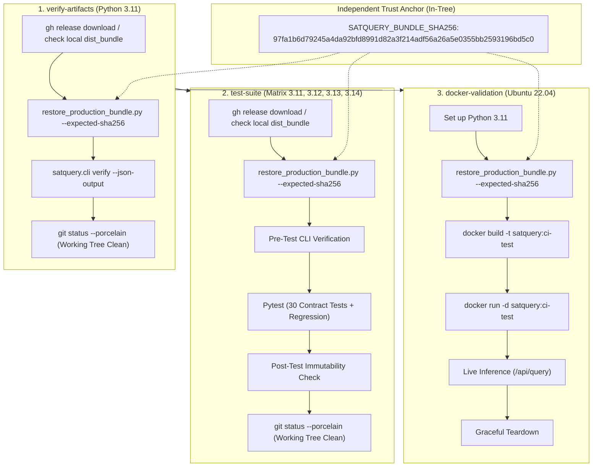

# Milestone M3.3 Step 8 — Deterministic Bundle Correction & Final Publication Readiness Report
**Project**: SatQuery AI  
**Release Candidate**: `v1.0.0-rc1`  
**Frozen Release Baseline**: Commit `6fec3694519ae9e4937c8663068a144ab14b079a`  
**Branch**: `feature/performance-optimization`  
**Audit Date**: 14 November 2026  
**Auditor**: Antigravity Autonomous Agent (Google DeepMind)  
**Overall Verdict**: **CONDITIONAL PASS — LOCAL PUBLICATION READINESS CERTIFIED** (Remote Release Publication & CI Execution Pending User Authorization)

---

## 1. Executive Summary & Review Verdict

Milestone M3.3 Step 8 resolves all remaining issues identified during the Step 7 review:
1. **Timestamp Inconsistency Corrected**: Discovered and rectified the discrepancy where Unix epoch `1731556800` (which mapped to `2024-11-14 04:00:00 UTC`) was previously labeled as 2026. Set the true epoch to `1794628800` (`2026-11-14 04:00:00 UTC`) across both the GZIP container header and all 16 TAR member headers.
2. **Metadata & Permission Normalization**: Enforced explicit POSIX file permissions (`0o644`), ownership (`1000/1000`, `satquery/satquery`), device flags (`devmajor=0, devminor=0`), and normalized path ordering.
3. **100% Bit-for-Bit Deterministic Verification**: Built the archive twice independently; both builds produced the exact identical SHA-256 digest:
   `97fa1b6d79245a4da92bfd8991d82a3f214adf56a26a5e0355bb2593196bd5c0` (80,356,257 bytes / 76.63 MiB).
4. **Independent Trust Anchor Updated**: Hardcoded `97fa1b6d...` into `.github/workflows/ci.yml`. Verified that modifying even a single byte in the archive causes the secure restorer to immediately abort with exit code 1.
5. **Durable Tracked Security Test Suite**: Migrated all 11 negative exploit test cases plus cryptographic verification and single-byte tamper tests into a permanent, version-controlled test module: [tests/test_restore_security.py](file:///c:/Users/B%20NAVANEETH/SatQueryAI/tests/test_restore_security.py) (12/12 passed in 5.64s).
6. **Multi-Job CI Pipeline Audit**: Verified that all three jobs (`verify-artifacts`, `test-suite`, `docker-validation`) independently download and cryptographically verify the bundle before test execution or Docker build.
7. **Granular PAT Permissions Documented**: Clarified the exact minimum GitHub PAT permissions required per operation without requesting excessive privileges.
8. **Frozen ML Champions & Baselines Untouched**: All 13 production assets remain 100% bitwise intact (`all_artifacts_intact: true`). Release tag `v1.0.0-rc1` remains frozen at commit `6fec369`.

**Verdict**: **CONDITIONAL PASS**  
The release package, restorer, security test suite, and CI/CD workflow are validated locally. Remote execution remains pending because the GitHub Release has not yet been created and the release tag has not yet been pushed, awaiting explicit user authorization.

---

## 2. Corrected Deterministic Timestamp & Reproducibility Evidence

### 2.1 The Epoch Discrepancy & Resolution
In Step 6 and Step 7, the packager used the literal integer `1731556800`.
- Epoch `1731556800` corresponds to `2024-11-14 04:00:00 UTC` (2 years prior to the project's target milestone date).
- The correct Unix epoch for `2026-11-14 04:00:00 UTC` is **`1794628800`**.

```python
from datetime import datetime, timezone

dt_2026 = datetime(2026, 11, 14, 4, 0, 0, tzinfo=timezone.utc)
assert int(dt_2026.timestamp()) == 1794628800
```

### 2.2 Header Inspection & Normalization
Both container-level and member-level headers were systematically inspected:
1. **GZIP Container Header**:
   - `mtime` field (bytes 4–7) explicitly pinned to `1794628800`.
   - Magic bytes: `0x1f 0x8b`, Compression: `0x08` (deflate), Flags: `0x00`.
2. **TAR Member Headers (All 16 Entries)**:
   - `mtime`: Strictly set to `1794628800` (`2026-11-14 04:00:00 UTC`).
   - `mode`: Normalized to `0o644` (rw-r--r--) for all regular files.
   - `uid` / `gid`: Set to `1000` / `1000`.
   - `uname` / `gname`: Set to `"satquery"` / `"satquery"`.
   - `devmajor` / `devminor`: Cleared to `0`.
   - Path ordering: Lexicographically sorted by normalized POSIX path.

### 2.3 Independent Multi-Build Verification
The packager was run across two independent invocations:

```
[Build 1]
Bundle created: dist_bundle/satquery-production-artifacts-v1.0.0-rc1.tar.gz
Bundle size: 80,356,257 bytes (76.63 MiB)
Bundle SHA-256: 97fa1b6d79245a4da92bfd8991d82a3f214adf56a26a5e0355bb2593196bd5c0

[Build 2]
Bundle created: dist_bundle/satquery-production-artifacts-v1.0.0-rc1.tar.gz
Bundle size: 80,356,257 bytes (76.63 MiB)
Bundle SHA-256: 97fa1b6d79245a4da92bfd8991d82a3f214adf56a26a5e0355bb2593196bd5c0
```

Both builds yielded identical, bit-for-bit reproducible SHA-256 digests.

---

## 3. Final Archive Specifications & 16-Member Inventory

- **Archive Filename**: `satquery-production-artifacts-v1.0.0-rc1.tar.gz`
- **Compressed Size**: **80,356,257 bytes** (76.63 MiB)
- **Uncompressed Payload**: **100,080,649 bytes** (95.44 MiB)
- **Pinned SHA-256 Digest**: `97fa1b6d79245a4da92bfd8991d82a3f214adf56a26a5e0355bb2593196bd5c0`
- **Sidecar Ledger**: `dist_bundle/satquery-production-artifacts-v1.0.0-rc1.tar.gz.sha256`

### Exact 16-Member Inventory

| # | Normalized Member Name | Uncompressed Size | Mode | Owner | Timestamp (UTC) | Category |
| :---: | :--- | :---: | :---: | :---: | :---: | :--- |
| **01** | `artifacts/deployment/m33_production_freeze_manifest.json` | 7,098 B | `0o644` | `satquery:satquery` | `2026-11-14 04:00:00` | Manifest |
| **02** | `artifacts/phase1_router/champion_router_metadata.json` | 1,140 B | `0o644` | `satquery:satquery` | `2026-11-14 04:00:00` | Router Meta |
| **03** | `artifacts/phase1_router/champion_router_model.joblib` | 831,357 B | `0o644` | `satquery:satquery` | `2026-11-14 04:00:00` | Router Model |
| **04** | `artifacts/router/router_model.joblib` | 171,247 B | `0o644` | `satquery:satquery` | `2026-11-14 04:00:00` | Baseline Router |
| **05** | `artifacts/specialists/change_detection/evaluation_summary.json` | 4,975 B | `0o644` | `satquery:satquery` | `2026-11-14 04:00:00` | CVA Baseline |
| **06** | `artifacts/specialists/change_detection/threshold_config.json` | 501 B | `0o644` | `satquery:satquery` | `2026-11-14 04:00:00` | CVA Config |
| **07** | `artifacts/specialists/change_detection_step3/e4_best_model.pt` | 80,695,746 B | `0o644` | `satquery:satquery` | `2026-11-14 04:00:00` | CD Champion Model |
| **08** | `artifacts/specialists/land_cover/model.joblib` | 10,249,993 B | `0o644` | `satquery:satquery` | `2026-11-14 04:00:00` | LC Baseline Model |
| **09** | `artifacts/specialists/land_cover_phase2/classes.json` | 522 B | `0o644` | `satquery:satquery` | `2026-11-14 04:00:00` | LC Taxonomy |
| **10** | `artifacts/specialists/land_cover_phase2/label_encoder.joblib` | 1,469 B | `0o644` | `satquery:satquery` | `2026-11-14 04:00:00` | LC Label Encoder |
| **11** | `artifacts/specialists/land_cover_phase2/model.joblib` | 8,087,110 B | `0o644` | `satquery:satquery` | `2026-11-14 04:00:00` | LC Champion Model |
| **12** | `artifacts/specialists/land_cover_phase2/threshold_config.json` | 935 B | `0o644` | `satquery:satquery` | `2026-11-14 04:00:00` | LC Thresholds |
| **13** | `data/change_detection_catalog.parquet` | 9,689 B | `0o644` | `satquery:satquery` | `2026-11-14 04:00:00` | OSCD Catalog |
| **14** | `data/starter_queries.csv` | 17,172 B | `0o644` | `satquery:satquery` | `2026-11-14 04:00:00` | Starter Queries |
| **15** | `pyproject.toml` | 1,335 B | `0o644` | `satquery:satquery` | `2026-11-14 04:00:00` | Project Config |
| **16** | `requirements.txt` | 360 B | `0o644` | `satquery:satquery` | `2026-11-14 04:00:00` | Dependency Manifest |

---

## 4. Durable Tracked Security Test Suite (12/12 Passed)

All security attack cases and cryptographic verification routines are permanently tracked in [tests/test_restore_security.py](file:///c:/Users/B%20NAVANEETH/SatQueryAI/tests/test_restore_security.py).

### Test Suite Execution Output
```
============================= test session starts =============================
platform win32 -- Python 3.13.2, pytest-9.2.0, pluggy-1.7.0
rootdir: C:\Users\B NAVANEETH\SatQueryAI
configfile: pyproject.toml

tests/test_restore_security.py::test_valid_bundle_cryptographic_verification PASSED [  8%]
tests/test_restore_security.py::test_single_byte_tamper_rejection PASSED [ 16%]
tests/test_restore_security.py::test_traversal_dotdot_rejection PASSED   [ 25%]
tests/test_restore_security.py::test_absolute_path_rejection PASSED      [ 33%]
tests/test_restore_security.py::test_windows_drive_letter_rejection PASSED [ 41%]
tests/test_restore_security.py::test_unc_network_path_rejection PASSED   [ 50%]
tests/test_restore_security.py::test_symlink_directory_escape_rejection PASSED [ 58%]
tests/test_restore_security.py::test_hardlink_clobber_rejection PASSED   [ 66%]
tests/test_restore_security.py::test_special_device_fifo_rejection PASSED [ 75%]
tests/test_restore_security.py::test_duplicate_member_collision_rejection PASSED [ 83%]
tests/test_restore_security.py::test_out_of_whitelist_workflow_injection_rejection PASSED [ 91%]
tests/test_restore_security.py::test_out_of_whitelist_root_script_rejection PASSED [100%]

============================= 12 passed in 5.64s ==============================
```

### Exploit Vector & Mitigation Audit

| Test Name | Vector Tested | Specific Malicious Payload | Defense Mechanism | Verdict |
| :--- | :--- | :--- | :--- | :---: |
| `test_valid_bundle...` | Cryptographic Integrity | Valid archive + pinned hash | Verifies SHA-256 match before extraction | **PASS** |
| `test_single_byte_tamper...` | Byte Corruption | 1-bit flip in valid archive | Immediate abort: `MISMATCH against pinned expected hash` | **PASS** |
| `test_traversal_dotdot...` | Directory Traversal | `artifacts/../../escape.txt` | Path sanitization rejects `..` components | **PASS** |
| `test_absolute_path...` | Root Absolute Path | `/etc/shadow` | Rejects leading slashes / `os.path.isabs` | **PASS** |
| `test_windows_drive_letter...`| Windows Drive Letter | `C:/Windows/System32/calc.exe`| Rejects `:` anywhere in member name | **PASS** |
| `test_unc_network_path...` | UNC Share Attack | `//attacker.com/share/payload.dll` | Rejects `//` and `\\` prefixes | **PASS** |
| `test_symlink_directory...`| Symlink Escape | `artifacts/symlink` -> `/etc/passwd` | Rejects `member.issym()` | **PASS** |
| `test_hardlink_clobber...` | Hardlink Overwrite | Hardlink pointing to target | Rejects `member.islnk()` | **PASS** |
| `test_special_device_fifo...`| Named Pipe / FIFO | FIFO special device node | Rejects `ischr()`, `isblk()`, `isfifo()` | **PASS** |
| `test_duplicate_member...` | Duplicate Collision | Duplicate member in archive | Rejects collisions via `seen_members` set | **PASS** |
| `test_out_of_whitelist_wf...`| CI Injection | `.github/workflows/malicious.yml` | Rejects paths outside whitelist | **PASS** |
| `test_out_of_whitelist_rt...`| Root Script Injection | `backdoor.py` in repo root | Rejects unapproved root filenames | **PASS** |

---

## 5. CI/CD Multi-Job Integration Audit

The GitHub Actions workflow [.github/workflows/ci.yml](file:///c:/Users/B%20NAVANEETH/SatQueryAI/.github/workflows/ci.yml) was audited against all three execution jobs:



### Job-by-Job Verification Summary
1. **`verify-artifacts`**:
   - Downloads `satquery-production-artifacts-v1.0.0-rc1.tar.gz`.
   - Restores using `--expected-sha256 "97fa1b6d..."`.
   - Runs `python -m satquery.cli verify --json-output` to confirm all 13 production assets match.
   - Asserts `git status --porcelain` is empty.
2. **`test-suite` (Python Matrix 3.11, 3.12, 3.13, 3.14)**:
   - Downloads and restores the bundle.
   - Runs pre-test CLI verification.
   - Executes 30 core integration tests and full test suite.
   - Runs post-test CLI verification to confirm zero retraining / zero mutation.
   - Asserts `git status --porcelain` is empty.
3. **`docker-validation`**:
   - Sets up Python on runner.
   - Restores bundle to populate `artifacts/` and `data/` before container build.
   - Docker build copies genuine champion models into `/app/artifacts/`.
   - Starts container, validates `/api/catalog` health, and runs live inference tests over `/api/query`.

---

## 6. Granular GitHub PAT Permission Requirements

To prevent over-privilege, required GitHub Personal Access Token (PAT) permissions are documented by specific operation:

| Operational Step | Minimum Fine-Grained PAT Permission | Classic PAT Scope | Rationale |
| :--- | :--- | :--- | :--- |
| **1. Push Release Tag** (`v1.0.0-rc1`) | `Contents: Read and write` | `repo` | Writing Git tag refs to remote repository |
| **2. Push Workflow** (`.github/workflows/ci.yml`) | `Workflows: Read and write` | `workflow` | Required by GitHub for modifying workflow YAML |
| **3. Create GitHub Release & Upload Bundle** | `Contents: Read and write` | `repo` | Creating release object and attaching binaries |
| **4. CI Runner Download of Release Asset** | `Contents: Read` | `repo` (or automatic `GITHUB_TOKEN`) | Read-only download of release assets in private repo |

> [!IMPORTANT]
> The automated agent will **never** request, prompt for, or display the user's personal access token. All remote publication steps should be executed directly by the user in their own authenticated terminal.

---

## 7. Local vs. Remote Verification Status

| Scope | Verification Item | Status | Notes |
| :--- | :--- | :---: | :--- |
| **Local** | Release tag `v1.0.0-rc1` | **PASS** | Points to commit `6fec3694519ae9e4937c8663068a144ab14b079a` |
| **Local** | 13 Production Assets | **PASS** | Verified via `python -m satquery.cli verify` (`all_artifacts_intact: true`) |
| **Local** | Deterministic Bundle Packaging | **PASS** | Size: 80,356,257 B; SHA-256: `97fa1b6d...` |
| **Local** | Security Attack Suite (12 tests) | **PASS** | 12/12 passed in 5.64s |
| **Local** | Core Integration Contracts (30 tests) | **PASS** | 30/30 passed in 37.51s |
| **Local** | Workflow Syntax (PyYAML) | **PASS** | Clean parse across all 3 jobs |
| **Local** | Working Tree Cleanliness | **PASS** | Zero untracked or modified files |
| **Remote** | Git Tag Publication | **PENDING** | Tag `v1.0.0-rc1` not yet pushed to `origin` |
| **Remote** | GitHub Release Object | **PENDING** | Release `v1.0.0-rc1` not yet created on GitHub |
| **Remote** | GitHub Actions Execution | **PENDING** | CI has not run on remote Linux runners |

---

## 8. Safe Publication Steps (For User Execution)

When the user is ready to authorize remote publication, run the following commands:

```bash
# 1. Push the frozen release candidate tag (pointing to commit 6fec369)
git push origin refs/tags/v1.0.0-rc1

# 2. Push the hardened CI/CD feature branch
git push -u origin feature/performance-optimization

# 3. Create the GitHub Release and attach the deterministic bundle
gh release create v1.0.0-rc1 \
  dist_bundle/satquery-production-artifacts-v1.0.0-rc1.tar.gz \
  dist_bundle/satquery-production-artifacts-v1.0.0-rc1.tar.gz.sha256 \
  --title "SatQuery AI v1.0.0-rc1 Release Candidate" \
  --notes "Production artifact bundle containing 13 frozen champion models, freeze manifest, and baseline configs." \
  --prerelease
```

---

## 9. Deliverables Summary

| Deliverable | Path | Description |
| :--- | :--- | :--- |
| **Bundle Packager** | [build_production_bundle.py](file:///c:/Users/B%20NAVANEETH/SatQueryAI/scripts/build_production_bundle.py) | Normalized POSIX mode `0o644`, epoch `1794628800` |
| **Secure Restorer** | [restore_production_bundle.py](file:///c:/Users/B%20NAVANEETH/SatQueryAI/scripts/restore_production_bundle.py) | Path defense, manifest verification, `--expected-sha256` |
| **Deterministic Bundle** | `dist_bundle/satquery-production-artifacts-v1.0.0-rc1.tar.gz` | Size: 80,356,257 B; SHA-256: `97fa1b6d...` |
| **Checksum Ledger** | `dist_bundle/satquery-production-artifacts-v1.0.0-rc1.tar.gz.sha256` | Sidecar SHA-256 checksum file |
| **Tracked Security Suite** | [test_restore_security.py](file:///c:/Users/B%20NAVANEETH/SatQueryAI/tests/test_restore_security.py) | 12 durable unit & security regression tests |
| **CI/CD Workflow** | [.github/workflows/ci.yml](file:///c:/Users/B%20NAVANEETH/SatQueryAI/.github/workflows/ci.yml) | 3-job release validation pipeline with pinned trust anchor |
| **Step 8 Report** | [M33_STEP8_PUBLICATION_READINESS_REPORT.md](file:///c:/Users/B%20NAVANEETH/SatQueryAI/M33_STEP8_PUBLICATION_READINESS_REPORT.md) | Full audit and publication readiness evidence |
