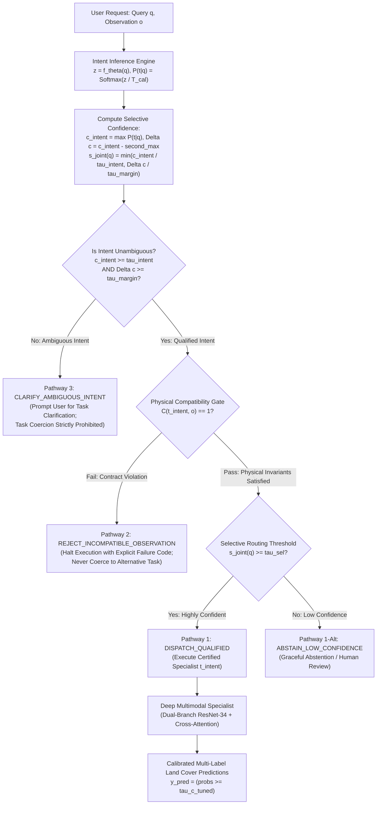
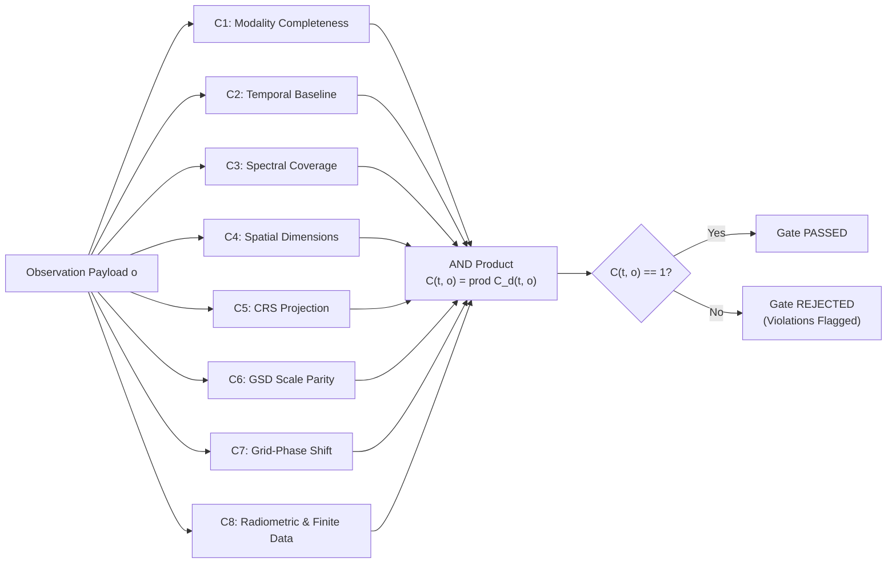
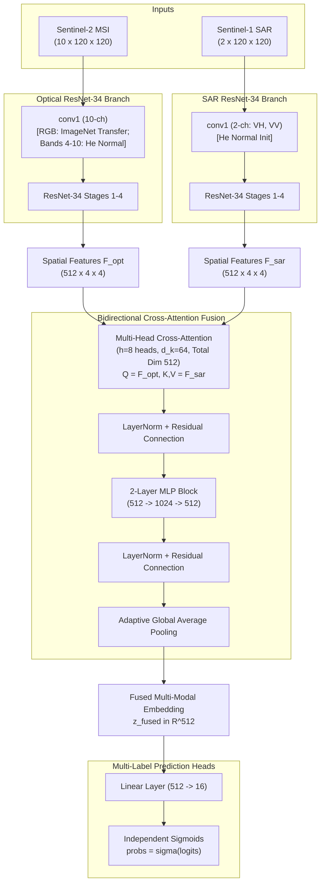

# SatQuery AI: Research Methodology

## An Input-Constrained Selective Routing and Multimodal Perception Architecture for Satellite Earth Observation

---

## 1. System Overview & Problem Formulation

Modern Earth Observation (EO) query systems face two fundamental challenges:
1. **Linguistic Ambiguity & Hallucinatory Coercion**: Natural language queries submitted to multi-task satellite pipelines are frequently under-specified (e.g., *"Assess the environmental status of this parcel"*), prompting traditional unconstrained multi-task models to arbitrarily hallucinate or coerce tasks based on whatever image modalities happen to be available.
2. **Physical Sensor Mismatch**: Analytical tasks require strict sensor parameters (e.g., specific spectral band combinations, spatial resolution limits, multi-temporal coregistration, or synthetic aperture radar polarization). Dispatched perception models execute silently on malformed or physically incompatible inputs, emitting deceptive, ungrounded predictions.

**SatQuery AI** resolves these challenges through a three-stage decoupled architecture:
1. **Input-Constrained Selective Intent Classification Router**: A calibrated, margin-aware text classifier with selective abstention that infers user intent strictly from the linguistic instruction, independent of observation payload.
2. **Deterministic Physical Compatibility Gate**: A closed-form verification suite $\mathcal{C}(t, o) \in \{0, 1\}$ enforcing physical sensor contracts across 8 distinct physical dimensions before specialist execution can occur.
3. **Deep Multimodal Perception Specialists**: Task-specific deep-learning encoders (such as the Dual-Branch ResNet-34 Multimodal Land-Cover Specialist) trained under extreme class imbalance with calibrated loss formulations.



---

## 2. Mathematical Formulation of Selective Routing

### 2.1 Latent Intent Inference Independent of Payload
Let $x = (q, o)$ be an incoming query-observation tuple, where $q \in \mathcal{Q}$ represents the user's natural language instruction and $o \in \mathcal{O}$ represents the attached Earth Observation payload metadata. Let $\mathcal{T} = \{t_1, \dots, t_K\}$ be the discrete taxonomy of $K=7$ analytical tasks:
1. `LAND_COVER_CLASSIFICATION` (Multimodal Sentinel-1 SAR + Sentinel-2 MSI)
2. `CHANGE_DETECTION` (Bitemporal optical Sentinel-2)
3. `SINGLE_IMAGE_VQA` (Single-image optical)
4. `CHANGE_VQA` (Bitemporal optical VQA)
5. `VISUAL_GROUNDING` (Single-image optical bounding box grounding)
6. `SCENE_CAPTIONING` (Single-image optical descriptive captioning)
7. `OPTICAL_SAR_FUSION` (Optical + SAR pixel-level feature fusion)

#### The Non-Coercion Invariant
The user's latent intended task $T^* \in \mathcal{T}$ is conditionally independent of observation payload $o$ given instruction $q$:
$$T^* \perp o \mid q$$
The routing engine estimates the posterior task distribution strictly from linguistic evidence:
$$\vec{z} = f_\theta(q) \in \mathbb{R}^K, \qquad P_{\text{text}}(t \mid q) = \text{Softmax}(\vec{z} / T_{\text{cal}})_t = \frac{\exp(z_t / T_{\text{cal}})}{\sum_{j=1}^K \exp(z_j / T_{\text{cal}})}$$
where $T_{\text{cal}} > 0$ is a post-hoc calibration temperature fitted strictly on validation queries via negative log-likelihood minimization:
$$T_{\text{cal}}^* = \arg\min_{T > 0} - \sum_{i \in \text{Val}} \log \left( \frac{\exp(z_{i, y_i} / T)}{\sum_{j=1}^K \exp(z_{i, j} / T)} \right)$$

### 2.2 Competitive Confidence Margin & The Joint Selection Function
The candidate intent and its competitive margin against the second-highest task are:
$$\hat{t}_{\text{intent}} = \arg\max_{t \in \mathcal{T}} P_{\text{text}}(t \mid q), \qquad c_{\text{intent}} = P_{\text{text}}(\hat{t}_{\text{intent}} \mid q)$$
$$\Delta c = c_{\text{intent}} - \max_{j \ne \hat{t}_{\text{intent}}} P_{\text{text}}(j \mid q)$$

To avoid single-score threshold distortions and unify confidence and margin into an operational decision variable, we define the **Standardized Joint Selection Function**:
$$s_{\text{joint}}(q) = \min\left( \frac{c_{\text{intent}}}{\tau_{\text{intent}}}, \frac{\Delta c}{\tau_{\text{margin}}} \right)$$
where operational thresholds $\tau_{\text{intent}}$ and $\tau_{\text{margin}}$ are pre-calibrated on the validation set.

Under this formulation:
$$s_{\text{joint}}(q) \ge 1.0 \iff c_{\text{intent}} \ge \tau_{\text{intent}} \quad \land \quad \Delta c \ge \tau_{\text{margin}}$$

### 2.3 The Three Fundamental Execution Pathways
1. **Pathway 1: Qualified Dispatch (`DISPATCH_QUALIFIED`)**:
   Triggered if and only if:
   $$s_{\text{joint}}(q) \ge \tau_{\text{sel}} \quad \land \quad \mathcal{C}(\hat{t}_{\text{intent}}, o) == 1$$
   The request is dispatched to specialist $\hat{t}_{\text{intent}}$ for neural execution.
2. **Pathway 2: Reject Incompatible Observation (`REJECT_INCOMPATIBLE_OBSERVATION`)**:
   Triggered when intent is unambiguous ($s_{\text{joint}}(q) \ge 1.0$), but the payload violates the task contract:
   $$\mathcal{C}(\hat{t}_{\text{intent}}, o) == 0$$
   The orchestrator immediately halts execution with an explicit failure reason, refusing to coerce the query to an alternative task.
3. **Pathway 3: Clarify Ambiguous Intent (`CLARIFY_AMBIGUOUS_INTENT`)**:
   Triggered whenever linguistic intent is polysemous or below confidence margins:
   $$c_{\text{intent}} < \tau_{\text{intent}} \quad \lor \quad \Delta c < \tau_{\text{margin}}$$
   The orchestrator solicits human clarification before any physical payload verification or specialist execution.

---

## 3. Physical Sensor Compatibility Gate

The physical compatibility gate $\mathcal{C}(t, o) \in \{0, 1\}$ evaluates the logical conjunction of 8 deterministic physical invariants:
$$\mathcal{C}(t, o) = \prod_{d=1}^8 C_d(t, o)$$



### Table 1: Physical Failure Dimensions and Verification Predicates

| # | Dimension | Failure Mode / Anomaly Mechanism | Mathematical Invariant Predicate | Target Tasks |
| :-: | :--- | :--- | :--- | :--- |
| **1** | **Modality Completeness** | Missing SAR for Land Cover or Optical for Fusion | $\mathcal{M}_{\text{req}}(t) \subseteq \mathcal{M}(o)$ | Land Cover, Fusion |
| **2** | **Temporal Baseline** | Single-image supplied for change detection ($\Delta t = 0$) | $|t_2 - t_1| \ge \Delta t_{\min}(t)$ | Change Detection, Change VQA |
| **3** | **Spectral Coverage** | Missing spectral channels (e.g. RGB supplied for 12-band MSI) | $\mathcal{B}_{\text{req}}(t) \subseteq \mathcal{B}(o)$ | Land Cover, Optical Tasks |
| **4** | **Spatial Dimension** | Patch dimensions smaller than minimum receptive field | $H(o) \ge H_{\min}(t) \land W(o) \ge W_{\min}(t)$ | Patch Specialists ($120 \times 120$) |
| **5** | **CRS / Projection** | Incompatible coordinate system or severe affine distortion | $\text{CRS}(o_1) \equiv \text{CRS}(o_2) \land |\det(\mathbf{A}) - 1.0| \le 0.05$ | Multi-image Tasks |
| **6** | **GSD Scale Parity** | Pixel scale mismatch across bitemporal/multimodal inputs | $\frac{|\text{GSD}_1 - \text{GSD}_2|}{\min(\text{GSD}_1, \text{GSD}_2)} \le 0.01$ | Change Detection, Fusion |
| **7** | **Grid-Phase Shift** | Sub-pixel sampling phase misalignment without coregistration | $\delta_{\text{phase}} = \sqrt{(\Delta x \bmod 1)^2 + (\Delta y \bmod 1)^2} \le 0.05\text{ px}$ | Change Detection, Fusion |
| **8a** | **Cloud / Shadow Limit** | Operational cloud coverage fraction exceeds task threshold | $f_{\text{cloud}}(o) \le \tau_{\text{cloud}}(t)$ ($\le 20\%$ LC, $\le 10\%$ CD) | Optical Tasks |
| **8b** | **Radiometric Finite Data** | Tensors contain NaNs, infinities, or invalid dtype | $\sum \mathbb{I}(\text{isnan}(o)) == 0 \land \sum \mathbb{I}(\text{isinf}(o)) == 0$ | All 7 Tasks |

---

## 4. Multimodal Land-Cover Specialist Architecture (Milestone M3.1)

### 4.1 Sensor Inputs & Normalization Pipeline
The multimodal land-cover classification model takes paired Sentinel-1 SAR and Sentinel-2 MSI patches:
* **Sentinel-1 SAR**: $X_{\text{SAR}} \in \mathbb{R}^{2 \times 120 \times 120}$ representing backscatter coefficient $\sigma^0$ in decibels (dB) for channels $[\text{VH}, \text{VV}]$.
  - *Clipping and Scaling*: Clipped to $[-35.0, +5.0]\text{ dB}$ (frozen from training split) and linearly scaled:
    $$\widetilde{X}_{\text{SAR}} = \frac{\operatorname{clip}(X_{\text{SAR}}, -35.0, +5.0) + 35.0}{40.0} \in [0.0, 1.0]$$
* **Sentinel-2 MSI**: $X_{\text{opt}} \in \mathbb{R}^{10 \times 120 \times 120}$ representing 10 surface reflectance bands: $[\text{B02}, \text{B03}, \text{B04}, \text{B05}, \text{B06}, \text{B07}, \text{B08}, \text{B8A}, \text{B11}, \text{B12}]$ (native 20m bands resampled to 10m grid).
  - *Reflectance Scaling & Standardization*: Scaled via $\text{DN} / 10,000.0$ and standardized channel-wise using static training-split statistics:
    $$\widetilde{X}_{\text{opt}}^{(c)} = \frac{(X_{\text{opt}}^{(c)} / 10,000.0) - \mu_c}{\sigma_c}$$
    $$\vec{\mu} = [0.136, 0.118, 0.106, 0.128, 0.203, 0.257, 0.272, 0.273, 0.187, 0.121]$$
    $$\vec{\sigma} = [0.082, 0.076, 0.074, 0.089, 0.098, 0.108, 0.113, 0.112, 0.095, 0.078]$$

### 4.2 Dual-Branch ResNet-34 Architecture
The multimodal architecture was trained on BigEarthNet using ImageNet-pretrained initialization for the corresponding optical backbone filters, with newly initialized additional spectral and SAR input channels and cross-attention fusion. The deep perception model comprises two independent ResNet-34 convolutional backbones:
1. **Optical Branch ($f_{\text{opt}}$)**:
   - Input channel count: 10 channels.
   - *ImageNet Pretrained Weight Transfer*: The first convolutional layer (`conv1`, $7 \times 7$, stride 2) transfers pretrained ImageNet-1k weights into the corresponding RGB spectral bands:
     * Channel 0 ($\text{B04}$, Red, $\sim 665\text{ nm}$) $\gets$ ImageNet Red filter weights (`conv1.weight[:, 0:1, :, :]`)
     * Channel 1 ($\text{B03}$, Green, $\sim 560\text{ nm}$) $\gets$ ImageNet Green filter weights (`conv1.weight[:, 1:2, :, :]`)
     * Channel 2 ($\text{B02}$, Blue, $\sim 490\text{ nm}$) $\gets$ ImageNet Blue filter weights (`conv1.weight[:, 2:3, :, :]`)
     * Remaining 7 multispectral channels ($\text{B05, B06, B07, B08, B8A, B11, B12}$) are initialized using He (Kaiming) normal initialization: $\mathcal{N}(0, 2 / n_{\text{in}})$.
2. **SAR Branch ($f_{\text{sar}}$)**:
   - Input channel count: 2 channels ($[\text{VH}, \text{VV}]$).
   - Initialized completely from scratch using He normal initialization.



### 4.3 Multi-Head Cross-Attention Fusion
Spatial feature maps from both branches ($F_{\text{opt}}, F_{\text{sar}} \in \mathbb{R}^{B \times 512 \times H' \times W'}$) are reshaped into spatial token sequences of length $S = H' \times W' = 16$.
Multi-head cross-attention ($h=8$ heads, $d_k = 64$) couples optical and SAR tokens:
$$\text{head}_i = \text{Softmax}\left( \frac{(F_{\text{opt}} W_i^Q)(F_{\text{sar}} W_i^K)^T}{\sqrt{d_k}} \right) (F_{\text{sar}} W_i^V)$$
$$\text{MHA}(F_{\text{opt}}, F_{\text{sar}}) = \text{Concat}(\text{head}_1, \dots, \text{head}_h) W^O$$
The cross-attended representation passes through LayerNorm, a 2-layer MLP with GELU activations and residual connection, followed by adaptive global average pooling, yielding a compact 512-dimensional multimodal embedding:
$$\vec{h}_{\text{fused}} \in \mathbb{R}^{512}$$

16 independent linear heads project the fused embedding to class logits:
$$z_c = \vec{w}_c^T \vec{h}_{\text{fused}} + b_c, \qquad \hat{p}_c = \sigma(z_c) = \frac{1}{1 + \exp(-z_c)}$$

---

## 5. Loss Formulations for Extreme Multi-Label Class Imbalance

BigEarthNet-14k exhibits extreme multi-label class imbalance, with positive class frequencies ranging from $>60\%$ down to $<0.5\%$. We formulate and compare two mathematically grounded loss functions.

### 5.1 Formulation A: Normalized Class-Balanced BCE (CB-BCE)
Following Cui et al. (2019), effective sample numbers account for data overlap in feature space:
$$E_{n} = \frac{1 - \beta^N}{1 - \beta}$$
where $\beta = 0.999$.

1. **Static Class-Weight Derivation**:
   Positive counts $N_{c, +}^{\text{train}} = \sum_{i \in \text{train}} y_{i, c}$ are calculated strictly from the training split ($N_{\text{train}} = 7,180$).
2. **Finite Fallback for Rare/Zero Support**:
   If $N_{c, +}^{\text{train}} = 0$, direct division is undefined ($0/0$). We enforce a finite fallback rule:
   $$w_{c, +}^{\text{raw}} = \begin{cases} \frac{1 - \beta}{1 - \beta^{N_{c, +}^{\text{train}}}} & \text{if } N_{c, +}^{\text{train}} > 0 \\ 1.0 & \text{if } N_{c, +}^{\text{train}} = 0 \end{cases}$$
3. **Normalized Weight Vector**:
   With $\epsilon = 10^{-5}$, weights are normalized to sum to 16:
   $$\tilde{w}_{c, +} = \frac{w_{c, +}^{\text{raw}} + \epsilon}{\sum_{j=1}^{16} (w_{j, +}^{\text{raw}} + \epsilon)} \times 16$$
4. **Numerically Stable Logits Loss with Scale Parity**:
   Averaging across both batch dimension $B$ and class dimension $C=16$ ensures elementwise scale parity ($\frac{1}{16B}$):
   $$\mathcal{L}_{\text{CB-BCE}} = \frac{1}{16B} \sum_{i=1}^B \sum_{c=1}^{16} \left[ - \tilde{w}_{c, +} y_{i, c} \log(\sigma(z_{i, c})) - (1 - y_{i, c}) \log(1 - \sigma(z_{i, c})) \right]$$

### 5.2 Formulation B: Multi-Label Asymmetric Loss (ASL)
Following Ridnik et al. (2021), Asymmetric Loss dynamically downweights easy negative instances while preserving positive gradient signal:
$$\mathcal{L}_{\text{ASL}} = \frac{1}{16B} \sum_{i=1}^B \sum_{c=1}^{16} \left[ - y_{i, c} (1 - p_{i, c})^{\gamma_+} \log(p_{i, c}) - (1 - y_{i, c}) (p_{m, i, c})^{\gamma_-} \log(1 - p_{m, i, c}) \right]$$
where:
* Asymmetric focusing parameters: $\gamma_+ = 0.0$ (no positive downweighting) and $\gamma_- = 4.0$ (aggressive negative downweighting).
* Probability margin shift with hard thresholding:
  $$p_{m, i, c} = \max(p_{i, c} - m, 0), \qquad m = 0.05$$
  which completely eliminates gradients from easy negatives having $p_{i, c} \le 0.05$.
* Identical $\frac{1}{16B}$ normalization ensures rigorous gradient scale parity with CB-BCE.

---

## 6. Formal Algorithms & Optimization Logic

### Algorithm 1: Selective Orchestration with Physical Compatibility Verification
```text
Input:  Natural language query q, Observation payload o,
        Trained intent model f_theta, Calibration temperature T_cal,
        Operational thresholds tau_intent, tau_margin, tau_sel,
        Physical gate suite {C_1, ..., C_8}, Certified specialists {S_1, ..., S_K}
Output: Orchestration decision, specialist predictions or structured rejection

1:  z <- f_theta(q)
2:  P <- Softmax(z / T_cal)
3:  t_cand <- argmax_{t in T} P_t
4:  c_intent <- P[t_cand]
5:  Delta_c <- c_intent - max_{j != t_cand} P_j
6:  s_joint <- min(c_intent / tau_intent, Delta_c / tau_margin)
7:
8:  if c_intent < tau_intent or Delta_c < tau_margin then
9:      return Action(CLARIFY_AMBIGUOUS_INTENT, candidate=t_cand, confidence=c_intent)
10: end if
11:
12: gate_passed <- True
13: violation_flags <- []
14: for d = 1 to 8 do
15:     if C_d(t_cand, o) == 0 then
16:         gate_passed <- False
17:         violation_flags.append(d)
18:     end if
19: end for
20:
21: if not gate_passed then
22:     return Action(REJECT_INCOMPATIBLE_OBSERVATION, task=t_cand, violations=violation_flags)
23: end if
24:
25: if s_joint >= tau_sel then
26:     y_hat <- S[t_cand].predict(o)
27:     return Action(DISPATCH_QUALIFIED, task=t_cand, predictions=y_hat)
28: else
29:     return Action(ABSTAIN_LOW_CONFIDENCE, task=t_cand, score=s_joint)
30: end if
```

### Algorithm 2: Vectorized Per-Class Threshold Optimization
```text
Input:  Validation ground truth Y_val in {0, 1}^(N x C),
        Predicted probabilities P_val in [0, 1]^(N x C),
        Threshold grid T = [0.10, 0.15, ..., 0.90] (K = 17 points)
Output: Optimal per-class thresholds tau* in [0.10, 0.90]^C, Optimal Macro F1

1:  N, C <- shape(Y_val)
2:  K <- len(T)
3:  // Reshape for 3D broadcasting: (K, N, C)
4:  T_grid <- reshape(T, (K, 1, 1))
5:  P_exp <- expand(P_val, (1, N, C))
6:  Y_exp <- expand(Y_val, (1, N, C))
7:
8:  Y_pred <- (P_exp >= T_grid).astype(int32)
9:
10: TP <- sum(Y_pred * Y_exp, axis=1)          // shape: (K, C)
11: FP <- sum(Y_pred * (1 - Y_exp), axis=1)    // shape: (K, C)
12: FN <- sum((1 - Y_pred) * Y_exp, axis=1)    // shape: (K, C)
13:
14: Denom <- 2 * TP + FP + FN
15: F1_grid <- zeros((K, C))
16: Valid <- (Denom > 0)
17: F1_grid[Valid] <- (2.0 * TP[Valid]) / Denom[Valid]
18:
19: best_indices <- argmax(F1_grid, axis=0)     // shape: (C,)
20: tau* <- T[best_indices]
21: best_per_class_f1 <- max(F1_grid, axis=0)
22: best_macro_f1 <- mean(best_per_class_f1)
23: return tau*, best_macro_f1
```

---

## 7. Experimental Controls & Evaluation Protocol

### 7.1 Spatial Buffer Separation (Anti-Leakage Invariant)
To prevent spatial autocorrelation leakage, BigEarthNet-14k patches are partitioned across 4 MGRS tiles (`T34TCR`, `T34TEQ`, `T34TFN`, `T34TCS`) in UTM Zone 34N / WGS 84 (EPSG:32634):
* Each patch is a $120 \times 120$ pixel sub-tile at 10m GSD ($1.2\text{ km} \times 1.2\text{ km}$).
* Planar Euclidean distance between sub-tile centers:
  $$d(p_A, p_B) = 1.2\text{ km} \times \sqrt{(\text{row}_A - \text{row}_B)^2 + (\text{col}_A - \text{col}_B)^2}$$
* Minimum pairwise distance between any training patch and any test patch:
  - Tile `T34TCR`: Minimum grid distance = **10.0 units** $\implies \mathbf{12.0\text{ km}}$ center-to-center.
  - Tile `T34TEQ`: Minimum grid distance = **10.0 units** $\implies \mathbf{12.0\text{ km}}$ center-to-center.
  - Tile `T34TFN`: Minimum grid distance = **11.0 units** $\implies \mathbf{13.2\text{ km}}$ center-to-center.
* Tile `T34TCS` contains 0 test patches and is strictly excluded from held-out benchmark evaluation.

### 7.2 Five Non-Overlapping Evaluation Metrics
To prevent population confounding (where temperature scaling or confidence filtering alters the evaluation cohort), we report 5 segregated metrics:
1. **Selective Classification Risk ($\text{AURC}_{\text{joint}}$ & $\text{E-AURC}$)**: Evaluated over fixed valid requests $\mathcal{E}_{\text{eval}}$.
2. **Matched-Coverage Selective Risk ($\mathcal{R}(\Phi)$)**: Error rates at fixed coverage points $\Phi \in \{0.80, 0.85, 0.90, 0.95\}$.
3. **Ambiguity Clarification Fidelity ($\text{PRF}_1^{\text{clarify}}$)**: Precision, recall, and $F_1$ evaluated strictly on ambiguous queries ($V_3$).
4. **Physical Gate Interception Recall & Safety ($\text{CVDR}_d$ & $\text{IDER}_{\text{obs}}$)**: Evaluated on contract violations ($V_5$).
5. **Specialist Perception Certification**: Evaluated on held-out domain splits ($N=3,248$ test patches for BigEarthNet-14k; 10 held-out test scenes for OSCD).
