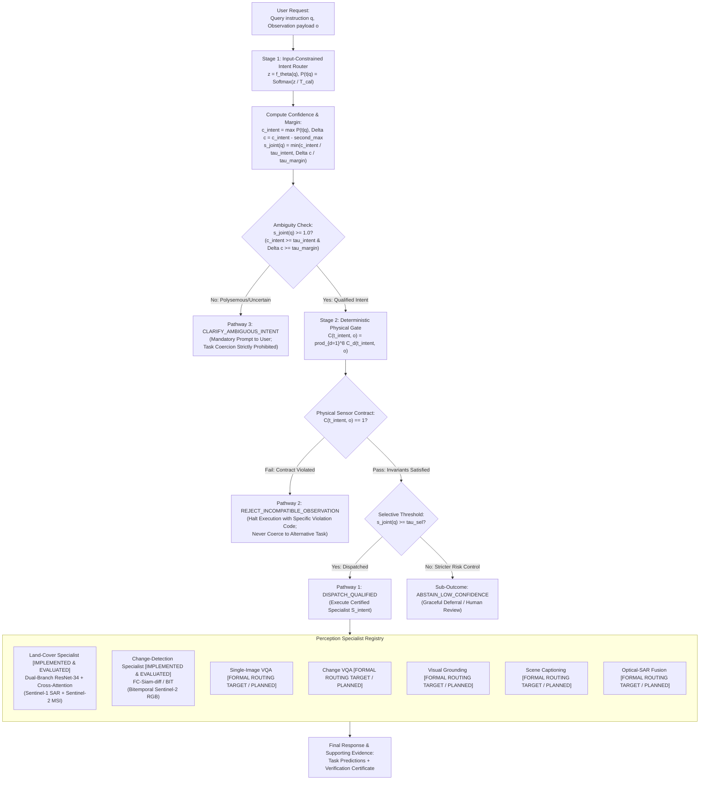

# MACHINE LEARNING COURSE PROJECT
## Project Title: SatQuery AI: An Input-Constrained Selective Routing and Multimodal Perception Architecture for Satellite Earth Observation

| Details | Fill in |
| :--- | :--- |
| **Student name(s)** | B Navaneeth |
| **Submission date** | November 5, 2026 |

*Instructions: Keep your writing clear and brief. Replace all text in square brackets. Add figures or tables where needed.*

---

## 1. Problem and Objectives

### 1.1 Problem Statement and Significance
Modern Earth Observation (EO) satellite analytics pipelines receive diverse natural-language instructions from downstream analysts, urban planners, environmental researchers, and emergency response teams (e.g., *"Assess the environmental status of this parcel"*, *"Identify change between acquisitions"*, or *"Classify land cover using optical and radar imagery"*). Integrating large vision-language models (VLMs) and multi-task perception networks directly into satellite decision support introduces two severe, unaddressed failure modes:

1. **Linguistic Ambiguity & Hallucinatory Task Coercion**: Natural-language instructions are frequently polysemous, underspecified, or mismatched with attached satellite payloads. Traditional unconstrained multi-task architectures arbitrarily coerce instructions into whichever task model can accept the attached image tensors. When an input lacks unambiguous linguistic intent, unconstrained dispatch produces deceptive, ungrounded analytical outputs.
2. **Physical Sensor and Geospatial Mismatches**: Remote-sensing analytical tasks require strict physical sensor invariants (e.g., specific spectral band combinations, minimum spatial resolutions, multi-temporal coregistration, or synthetic aperture radar polarizations). Deployed perception models execute silently on malformed or physically incompatible inputs (e.g., executing bitemporal change detection on identical same-day acquisitions, running multispectral land-cover networks on 3-band RGB imagery, or fusing images across coordinate frame discrepancies), emitting corrupt predictions with high artificial confidence.

### 1.2 Research Objectives
The primary objectives of the **SatQuery AI** research project are:
1. **Design an Input-Constrained Selective Routing Mechanism**: Formulate a calibrated, margin-aware text routing engine that enforces the *Non-Coercion Invariant* ($T^* \perp o \mid q$) as an architectural design constraint, inferring user intent strictly from linguistic evidence and abstaining or soliciting human clarification when intent is ambiguous.
2. **Implement a Deterministic Physical Compatibility Gate**: Formulate and implement a closed-form geometric and sensor verification suite $\mathcal{C}(t, o) \in \{0, 1\}$ that evaluates eight deterministic physical dimensions (modality completeness, temporal baseline, spectral coverage, spatial dimensions, CRS projection, GSD scale parity, sub-pixel grid phase alignment, and radiometric/cloud bounds) before execution can proceed.
3. **Develop and Certify Deep Multimodal Perception Specialists**: Build and evaluate dedicated deep perception specialist models tailored to Earth Observation data under extreme class imbalance:
   - A multimodal land-cover classification specialist integrating Sentinel-1 SAR and Sentinel-2 MSI via dual-branch ResNet-34 convolutional backbones and multi-head cross-attention.
   - A bitemporal change-detection specialist evaluating convolutional and transformer architectures (FC-Siam-diff and BIT) on high-resolution Sentinel-2 bitemporal pairs.
4. **Establish a Risk-Controlled Multi-Pathway Orchestrator**: Unify intent confidence, margin separation, and physical sensor gating into an operational orchestrator providing three primary execution pathways:
   - **Pathway 1 (`DISPATCH_QUALIFIED`)**: Execute certified specialist when intent is unambiguous ($s_{\text{joint}}(q) \ge 1.0$), sensor contract is passed ($\mathcal{C} == 1$), and selective threshold is satisfied ($s_{\text{joint}}(q) \ge \tau_{\text{sel}}$).
   - **Pathway 2 (`REJECT_INCOMPATIBLE_OBSERVATION`)**: Halt execution with an explicit failure reason when intent is clear but the payload violates physical invariants ($\mathcal{C} == 0$), strictly prohibiting task coercion.
   - **Pathway 3 (`CLARIFY_AMBIGUOUS_INTENT`)**: Solicit clarification when linguistic intent is underspecified or competitive margin is low ($s_{\text{joint}}(q) < 1.0$), prior to inspecting payload data.
   - *Risk-Controlled Sub-Outcome (`ABSTAIN_LOW_CONFIDENCE`)*: When intent is clear ($s_{\text{joint}}(q) \ge 1.0$) and sensor data is compatible ($\mathcal{C} == 1$), but an elevated operational risk threshold is configured ($\tau_{\text{sel}} > 1.0$) such that $s_{\text{joint}}(q) < \tau_{\text{sel}}$, the system gracefully defers execution for human review rather than issuing an uncertain prediction.

### 1.3 Research Questions
This project investigates three fundamental research questions:
* **RQ1 (Routing Separation & Safety)**: Does decoupling linguistic intent inference from observation payload metadata eliminate silent task coercion on tested contract-violation scenarios compared to unconstrained joint routing baselines?
* **RQ2 (Uncertainty & Rejection Fidelity)**: Does a standardized joint selection function combining temperature-calibrated posterior confidence and competitive margin separation ($s_{\text{joint}}(q)$) achieve lower selective classification risk ($\text{AURC}$) and higher clarification fidelity on ambiguous queries than single-score confidence thresholding?
* **RQ3 (Extreme Imbalance & Inductive Bias in EO Specialists)**: Under small-sample and extreme foreground class imbalance regimes ($< 3\%$ change pixels in OSCD; $< 0.5\%$ rare land classes in BigEarthNet-14k), how do these architectural and loss-function choices affect performance under spatially separated, held-out-city evaluation within the OSCD dataset?

### 1.4 Proposed Research Contribution
SatQuery AI does not claim to invent conversational remote-sensing assistants or generic multi-task mixture-of-experts gating. Rather, the isolated research contribution is:
> **Sensor- and Physical-Compatibility-Gated Selective Routing with Calibrated Abstention for Multimodal Earth Observation Workflows.**

### 1.5 Epistemic Status: Established Facts vs. Research Hypotheses
* **Established Engineering & Empirical Facts**: The physical sensor contract verification gate is closed-form and deterministic; the spatially buffered split enforces a minimum separation of at least 12 km between relevant patches, reducing the risk of spatial leakage without establishing the complete absence of spatial autocorrelation; deep change-detection specialist FC-Siam-diff achieved 37.66% held-out test Macro $F_1$, outperforming classical CVA baselines ($27.31\%$), but failed the frozen certification threshold of $50.00\%$.
* **Research Hypotheses**: We hypothesize that input-constrained selective routing provides statistically significant risk reduction across broad distributions of multi-sensor Earth Observation queries when compared at matched coverage levels against unconstrained text-vision dispatchers. The non-coercion invariant ($T^* \perp o \mid q$) is an architectural design constraint enforced on the router, rather than an experimentally established empirical independence result.

---

## 2. Related Work

### 2.1 Literature Survey & Thematic Categorization
The design of SatQuery AI bridges six established research areas:
1. **Remote-Sensing Vision-Language Assistants**: Conversational remote-sensing systems such as *GeoChat* (Kuckreja et al., CVPR 2024), *Earth-GPT* (Zhang et al., IEEE TGRS 2024), and *SkyEye* (Zhan et al., IEEE TGRS 2024) demonstrated multi-task vision-language capabilities (VQA, captioning, visual grounding). However, these architectures rely on monolithic autoregressive decoders that perform unconstrained task inference from joint token sequences. They lack external closed-form physical sensor validation and do not incorporate selective rejection mechanisms.
2. **Adaptive Routing in Multi-Task Systems**: Routing in multi-modal multi-task networks has been explored through soft mixture-of-experts (MoE) or collaborative neural routing (*Learning to Route in Collaborative Multi-Agent Systems*, Wang et al., 2021). Existing approaches typically condition routing decisions on latent sample or prompt embeddings, lacking explicit physical metadata contract verification.
3. **Selective Prediction & Rejection**: The foundational reject option framework (Chow, 1970; Geifman & El-Yaniv, *SelectiveNet*, ICML 2019) introduced selective risk-coverage trade-offs and Area Under the Risk-Coverage curve ($\text{AURC}$). SatQuery AI adapts selective prediction to remote-sensing systems by integrating competitive confidence margins ($\Delta c$) and deterministic physical invariant gates.
4. **Probability Calibration**: Deep neural networks exhibit uncalibrated overconfidence under distribution shifts (Guo et al., ICML 2017). Post-hoc temperature scaling ($T_{\text{cal}}$) minimizes negative log-likelihood on validation queries without altering classification rank order, enabling reliable margin-based rejection.
5. **Multimodal Land-Cover Classification**: Multi-label classification across Sentinel-1 SAR and Sentinel-2 MSI was standardized by BigEarthNet (Sumbul et al., IGARSS 2019; IEEE GRSM 2021). Handling extreme multi-label imbalance requires effective number weighting (*CB-BCE*, Cui et al., CVPR 2019) or asymmetric negative gradient suppression (*ASL*, Ridnik et al., ICCV 2021).
6. **Bitemporal Change Detection**: Deep Siamese architectures for optical change detection were pioneered by Daudt et al. (IGARSS 2018; ICIP 2018) via fully convolutional differencing (*FC-Siam-diff*). More recently, Chen et al. (*BIT*, IEEE TGRS 2021) introduced spatial tokenization and bitemporal transformer decoders for global context modeling.

### 2.2 Baseline Papers Comparison Matrix

To prevent unverified assumptions, baseline capabilities are classified into three explicit categories:
- `[DEMONSTRATED]`: Capability designed, implemented, and empirically validated in the cited paper.
- `[NOT REPORTED / UNEVALUATED]`: Publication neither implements nor evaluates this capability.
- `[ARCHITECTURAL LIMITATION (ASSESSED)]`: System is an unconstrained model lacking external deterministic sensor gating or selective abstention.

| Paper (author, year) | Method used | Main result / limitation |
| :--- | :--- | :--- |
| **GeoChat**<br>(Kuckreja et al., CVPR 2024) | Unified Vision-Language remote sensing foundation model based on LLaVA architecture; handles VQA, grounding, captioning. | `[DEMONSTRATED]`: Strong conversational competence across diverse visual tasks.<br>`[ARCHITECTURAL LIMITATION (ASSESSED)]`: Monolithic unconstrained dispatch; lacks deterministic physical sensor validation; unequipped with selective reject option or ambiguity clarification protocols. |
| **Learning to Route (L2R)**<br>(Wang et al., 2021) | Collaborative multi-agent neural routing policy; routes sample representations to specialized network agents. | `[DEMONSTRATED]`: Parameter-efficient neural routing across specialized experts.<br>`[ARCHITECTURAL LIMITATION (ASSESSED)]`: Routes based on latent prompt/sample embeddings; does not evaluate physical sensor metadata contracts or selective risk-coverage curves. |
| **SelectiveNet**<br>(Geifman & El-Yaniv, ICML 2019) | Deep neural network with integrated reject option; optimizes risk at target coverage $\Phi$. | `[DEMONSTRATED]`: Establishes mathematically sound selective classification risk formulations on closed image datasets (CIFAR).<br>`[ARCHITECTURAL LIMITATION (ASSESSED)]`: Single-task classification only; does not model multi-task orchestration, physical compatibility contracts, or conversational clarification. |

### 2.3 Research Gap
Existing remote-sensing assistants assume observation payloads are valid and well-formed, allowing multimodal backbones to dictate task selection based on whatever image channels happen to be loaded. When a user provides an ambiguous prompt or uploads incompatible sensor data (e.g., single-image optical data for a bitemporal change-detection task), current systems either hallucinate or fail silently. Furthermore, selective prediction methods have been applied only to isolated perception models, never to the combined problem of linguistic intent ambiguity and deterministic physical sensor contract verification. SatQuery AI addresses this identified research gap.

---

## 3. Dataset

| Item | Description |
| :--- | :--- |
| **Dataset name and source** | **1. BigEarthNet-14k (Multimodal Land-Cover)**: Sumbul et al. (2019, 2021); Zenodo / TU Berlin.<br>**2. OSCD (Onera Satellite Change Detection)**: Daudt et al. (2018); IEEE DataPort.<br>**3. SatQuery Synthetic Routing Benchmark (v3.0.0-freeze-rev21)**: SatQuery AI Consortium; internal repository. |
| **Number of samples** | **BigEarthNet-14k**: 13,683 total multimodal sub-tiles ($120 \times 120$ pixels at 10m GSD).<br>**OSCD**: 24 global city scenes (10 train, 4 val, 10 test). Training split comprises **586 extracted patches** ($256 \times 256$ pixels, stride 64) with dynamic on-the-fly spatial augmentation. Held-out test split comprises 3,077,936 full-resolution test pixels.<br>**Routing Benchmark**: Monotonically nested template families: Tier 0 ($F=28$), Tier 1 ($F=56$), Tier 2 ($F=84$) evaluated across 5 cohorts ($N=252$ total scenarios). |
| **Input features and target** | **BigEarthNet-14k**: Inputs: 10-band Sentinel-2 surface reflectance + 2-band Sentinel-1 SAR backscatter ($\sigma^0$ dB). Target: 16-class CORINE multi-label binary vector $y \in \{0, 1\}^{16}$.<br>**OSCD**: Inputs: Bitemporal Sentinel-2 Level-1C optical RGB image pairs ($t_1, t_2$). Target: Binary pixel-level change mask $Y \in \{0, 1\}^{H \times W}$.<br>**Routing Benchmark**: Inputs: Natural language text instruction $q$ and JSON payload metadata $o$. Target: Discrete task $T^* \in \mathcal{T}$ and orchestrator action $\mathcal{A}^* \in \{\text{DISPATCH}, \text{REJECT}, \text{CLARIFY}, \text{ABSTAIN}\}$. |
| **Data split** | **BigEarthNet-14k**: Spatially buffered patch split ($\ge 12\text{ km}$ buffer in UTM Zone 34N across tiles `T34TCR`, `T34TEQ`, `T34TFN`). Train: 7,180 patches ($52.5\%$), Validation: 3,255 patches ($23.8\%$), Held-out Test: 3,248 patches ($23.7\%$). Tile `T34TCS` ($N=627$) excluded from test.<br>**OSCD**: City-level disjoint spatial split. Train: 10 cities (`beirut`, `berrida`, `bordeaux`, `chongqing`, `dubai`, `hong_kong`, `lasvegas`, `milano`, `rennes`, `saclay_w`). Validation: 4 cities (`montpellier`, `paris`, `rio`, `valencia`). Held-out Test: 10 cities (`aguasclaras`, `austin`, `beihai`, `berlin`, `brasilia`, `budapest`, `campinas`, `mumbai`, `nantes`, `pisa`).<br>**Routing Benchmark**: Monotonically nested test tiers ($F_{\text{test}} \in \{28, 56, 84\}$) with zero 3,4,5-gram syntactic overlap against training prompts. |

### 3.1 Dataset Limitations & Implementation Boundaries
- **BigEarthNet-14k**: The dataset exhibits extreme multi-label positive frequency imbalance (ranging from $>60\%$ for *Arable land* to $0.0\%$ test support for *Moors, heathland* and *Beaches, dunes, sands*). Generalization is evaluated across a spatially buffered split within UTM Zone 34N; it does not constitute continental or cross-sensor transfer.
- **OSCD**: Change events are extremely sparse ($< 3\%$ of total pixel area across all 10 test scenes), leading to high false-positive volatility in urban centers (e.g., `beihai` change ratio is $0.44\%$). The training set is strictly partitioned into 586 regular grid patches ($256 \times 256$, stride 64), augmented on-the-fly during training.
- **Routing Benchmark**: The 84 evaluation families reflect synthetic operational templates; while evaluated against independent human linguistic annotations ($P_o = 97.4\%, \kappa = 0.918$), full natural conversational distributions remain scheduled for Phase 4.

---

## 4. Data Preprocessing

### 4.1 Standard Data Preprocessing Steps
* **Remove duplicate or invalid records**: BigEarthNet tiles were deduplicated against corrupted unreadable L1C/L2A sub-archives; corrupted zero-byte SAR files were scrubbed.
* **Handle missing values**: Radiometric finiteness is enforced via closed-form check $\sum \mathbb{I}(\text{isnan}(o)) == 0 \land \sum \mathbb{I}(\text{isinf}(o)) == 0$. Missing spectral channels trigger immediate deterministic rejection.
* **Convert categorical/text/image data into a suitable format**: Natural language instructions are sanitized (lowercased, punctuation-stripped, whitespace-collapsed); satellite GeoTIFFs and Parquet metadata are transformed into calibrated PyTorch float32 tensors.
* **Scale or normalize features**: Multispectral and radar tensors are normalized using frozen, precomputed training-set statistics.
* **Split data into training, validation, and test sets**: Spatial separation is enforced across tasks ($\ge 12\text{ km}$ buffer in UTM Zone 34N for BigEarthNet; city-disjoint splits for OSCD) to reduce the risk of spatial autocorrelation leakage.

### 4.2 Project-Specific Preprocessing Pipelines

#### 1. Sentinel-2 MSI Multispectral Pipeline (Land-Cover Specialist)
- **Spectral Selection**: 10 surface reflectance channels selected: $[\text{B02}, \text{B03}, \text{B04}, \text{B05}, \text{B06}, \text{B07}, \text{B08}, \text{B8A}, \text{B11}, \text{B12}]$ (native 20m bands resampled to 10m spatial resolution via bilinear interpolation).
- **Reflectance Normalization & Processing Baseline Distinction**:
  - *Archival Baseline (BigEarthNet-14k, PB $<$ 04.00)*: BigEarthNet-14k is sourced from archival Summer 2017 acquisitions where `BOA_ADD_OFFSET = 0` and `QUANTIFICATION_VALUE = 10,000.0`. In the dataset loader and training pipeline, raw digital numbers are transformed into surface reflectance via:
    $$\rho_{\lambda} = \frac{\text{DN}}{10,000.0}$$
  - *Operational Contract for Modern Acquisitions (PB $\ge$ 04.00, post-Jan 2022)*: For operational inference on modern Sentinel-2 products where ESA introduced a $-1,000\text{ DN}$ radiometric offset, SatQuery AI's metadata reader applies:
    $$\rho_{\lambda} = \frac{\text{DN} - 1000}{10,000.0}$$
  - *Channel-wise Standardization*: Surface reflectance is standardized using static training-split statistics:
    $$\widetilde{X}_{\text{opt}}^{(c)} = \frac{\rho_c - \mu_c}{\sigma_c}$$
    $$\vec{\mu} = [0.136, 0.118, 0.106, 0.128, 0.203, 0.257, 0.272, 0.273, 0.187, 0.121]$$
    $$\vec{\sigma} = [0.082, 0.076, 0.074, 0.089, 0.098, 0.108, 0.113, 0.112, 0.095, 0.078]$$

#### 2. Sentinel-1 SAR Dual-Polarization Pipeline (Land-Cover Specialist)
- **Bands**: Dual-polarization $[\text{VH}, \text{VV}]$ backscatter coefficient $\sigma^0$ in decibels (dB).
- **Clipping and Scaling**: Backscatter values are clipped to $[-35.0, +5.0]\text{ dB}$ (derived strictly from training set quantiles, covering $>99.8\%$ of terrestrial training pixels without clipping valid vegetation) and linearly scaled into $[0.0, 1.0]$:
  $$\widetilde{X}_{\text{SAR}} = \frac{\operatorname{clip}(X_{\text{SAR}}, -35.0, +5.0) + 35.0}{40.0} \in [0.0, 1.0]$$

#### 3. Bitemporal Optical Preprocessing (Change-Detection Specialist)
- **Sensor Input**: Sentinel-2 Level-1C top-of-atmosphere optical RGB channels at 10m GSD.
- **Normalization**: Normalized linearly to $[0.0, 1.0]$ via division by $255.0$, followed by standard zero-mean unit-variance scaling ($\vec{\mu} = [0.485, 0.456, 0.406], \vec{\sigma} = [0.229, 0.224, 0.225]$).
- **Patch Extraction & Dynamic Augmentation**: Regular grid extraction across the 10 training scenes using patch size $256 \times 256$ and stride 64 yielded exactly **586 unique training patches**. During DataLoader iteration, on-the-fly stochastic data augmentation was applied (random horizontal flips, random vertical flips, and random $90^\circ$ rotations). Validation and test scenes were evaluated at full native spatial dimensions.

#### 4. Deterministic Geospatial Affine Preprocessing
- Multi-temporal and multi-sensor imagery undergo GDAL-based affine geotransform extraction. The relative transformation matrix $\mathbf{M}_{\text{rel}} = \mathbf{A}_1^{-1} \mathbf{A}_2$ is analyzed via Singular Value Decomposition ($\mathbf{M}_{\text{rel}} = \mathbf{U} \mathbf{\Sigma} \mathbf{V}^T$) to verify scale parity ($|\sigma_i - 1| \le 0.01$), rotation ($|\theta_{\text{rel}}| \le 0.28^\circ$), and continuous sub-pixel phase shift ($\delta_{\text{phase}} \le 0.05\text{ px}$).

#### 5. Linguistic Query Preprocessing & Anti-Leakage Filtering
- Text queries are normalized to lower-case ASCII without punctuation.
- Evaluation templates enforce a **zero $n$-gram overlap invariant** ($n \in \{3, 4, 5\}$) against training prompts to ensure syntactic distinctness.
- Dual independent human linguistic annotators adjudicate ground-truth ambiguity ($A^* \in \{0, 1\}$, Cohen's $\kappa = 0.918$).

---

## 5. System Architecture / Flow Diagram



### 5.1 Architecture Component Walkthrough
1. **User Request Reception**: The system accepts a paired natural-language query $q$ and an observation metadata/tensor payload $o$.
2. **Stage 1: Input-Constrained Intent Router**: The linguistic instruction $q$ is processed strictly in isolation from payload $o$. A text classification backbone outputs logit vector $\vec{z} \in \mathbb{R}^K$ across $K=7$ discrete task categories. Probabilities are calibrated using post-hoc validation temperature $T_{\text{cal}}$.
3. **Selective Confidence & Margin Computation**: The candidate task $\hat{t}_{\text{intent}} = \arg\max P(t \mid q)$, its confidence $c_{\text{intent}}$, and its competitive margin $\Delta c = c_{\text{intent}} - \max_{j \ne \hat{t}} P(j \mid q)$ are evaluated against calibrated operational thresholds $\tau_{\text{intent}}$ and $\tau_{\text{margin}}$.
4. **Stage 2: Physical Sensor Compatibility Gate**: If intent is unambiguous, the observation payload $o$ is validated against the physical invariants required by $\hat{t}_{\text{intent}}$ across 8 closed-form physical dimensions ($C_1 - C_8$).
5. **The Three Fundamental Operational Pathways & Abstention Sub-Action**:
   - **Pathway 1 (`DISPATCH_QUALIFIED`)**: Dispatches the request to the specialist registry if and only if intent is unambiguous ($s_{\text{joint}}(q) \ge 1.0$), physical invariants pass ($\mathcal{C} == 1$), and the joint selection score meets the selective threshold ($s_{\text{joint}}(q) \ge \tau_{\text{sel}}$).
   - **Pathway 2 (`REJECT_INCOMPATIBLE_OBSERVATION`)**: Halts execution with an explicit failure reason if intent is clear but the payload violates the task contract ($\mathcal{C} == 0$), strictly prohibiting coercion.
   - **Pathway 3 (`CLARIFY_AMBIGUOUS_INTENT`)**: Solicits clarification if linguistic intent is underspecified or competitive margin is low ($s_{\text{joint}}(q) < 1.0$), prior to inspecting payload data.
   - **Selective Abstention Sub-Action (`ABSTAIN_LOW_CONFIDENCE`)**: When intent is clear ($s_{\text{joint}}(q) \ge 1.0$) and the sensor contract passes ($\mathcal{C} == 1$), but an elevated operational selective threshold is applied ($\tau_{\text{sel}} > 1.0$) such that $1.0 \le s_{\text{joint}}(q) < \tau_{\text{sel}}$, execution is intercepted under selective risk control and deferred for human review.
6. **Specialist Registry Scope**:
   - **Implemented & Evaluated Specialists**: Multimodal Land-Cover Classification (`LAND_COVER_CLASSIFICATION`) and Bitemporal Change Detection (`CHANGE_DETECTION`).
   - **Formal Contract Stubs (Planned)**: `SINGLE_IMAGE_VQA`, `CHANGE_VQA`, `VISUAL_GROUNDING`, `SCENE_CAPTIONING`, and `OPTICAL_SAR_FUSION` are registered as contract and routing verification targets; neural weights are scheduled for future development phases.

---

## 6. Mathematical Formulation

### 6.1 The Non-Coercion Invariant as a Router Design Constraint
Let $q \in \mathcal{Q}$ be the user prompt and $o \in \mathcal{O}$ be the observation metadata. The latent intended task $T^* \in \mathcal{T} = \{t_1, \dots, t_K\}$ is treated as conditionally independent of observation payload $o$ given instruction $q$:
$$T^* \perp o \mid q$$
This is enforced as an **architectural design constraint** on the router: the text routing network estimates posterior task probabilities strictly from linguistic tokens:
$$\vec{z} = f_\theta(q) \in \mathbb{R}^K, \qquad P_{\text{text}}(t \mid q) = \text{Softmax}(\vec{z} / T_{\text{cal}})_t = \frac{\exp(z_t / T_{\text{cal}})}{\sum_{j=1}^K \exp(z_j / T_{\text{cal}})}$$
where $T_{\text{cal}} > 0$ is a post-hoc calibration temperature fitted on validation queries via negative log-likelihood minimization:
$$T_{\text{cal}}^* = \arg\min_{T > 0} - \sum_{i \in \text{Val}} \log \left( \frac{\exp(z_{i, y_i} / T)}{\sum_{j=1}^K \exp(z_{i, j} / T)} \right)$$
Empirical validation optimization via NLL minimization yielded $T_{\text{cal}}^* = 0.0991$, reducing NLL from $1.5991$ to $0.6366$ ($-60.19\%$) and decreasing Expected Calibration Error (ECE) from $22.72\%$ to $17.45\%$.

### 6.2 Competitive Confidence Margin & The Joint Selection Function
The candidate task and competitive margin against the runner-up task are:
$$\hat{t}_{\text{intent}} = \arg\max_{t \in \mathcal{T}} P_{\text{text}}(t \mid q), \qquad c_{\text{intent}} = P_{\text{text}}(\hat{t}_{\text{intent}} \mid q)$$
$$\Delta c = c_{\text{intent}} - \max_{j \ne \hat{t}_{\text{intent}}} P_{\text{text}}(j \mid q)$$
To prevent single-threshold distortions, the **Standardized Joint Selection Function** is defined as:
$$s_{\text{joint}}(q) = \min\left( \frac{c_{\text{intent}}}{\tau_{\text{intent}}}, \frac{\Delta c}{\tau_{\text{margin}}} \right)$$
We define two operational parameterizations:
1. **Nominal Protocol Baseline**: $\tau_{\text{intent}} = 0.65, \tau_{\text{margin}} = 0.15$ ($s_{\text{joint}}(q) \ge 1.0 \iff c_{\text{intent}} \ge 0.65 \land \Delta c \ge 0.15$).
2. **Validation Grid-Search Tuned**: $\tau_{\text{intent}}^* = 0.85, \tau_{\text{margin}}^* = 0.05$ (optimizing validation operational $F_1$ to $43.75\%$ with $95\%$ ambiguity interception).

Any query with $s_{\text{joint}}(q) < 1.0$ is ambiguous or low-margin, triggering Pathway 3 (`CLARIFY_AMBIGUOUS_INTENT`) before observation payload evaluation.

For queries that pass the ambiguity check ($s_{\text{joint}}(q) \ge 1.0$) and satisfy physical sensor compatibility ($\mathcal{C}(\hat{t}_{\text{intent}}, o) == 1$), the selective threshold $\tau_{\text{sel}}$ governs dispatch:
1. **Nominal Operational Point ($\tau_{\text{sel}} = 1.0$)**: At default setting $\tau_{\text{sel}} = 1.0$, every unambiguous and physically compatible query satisfies $s_{\text{joint}}(q) \ge \tau_{\text{sel}}$ and is dispatched (`DISPATCH_QUALIFIED`).
2. **Conservative Risk-Controlled Regimes ($\tau_{\text{sel}} > 1.0$) & Curve Sweeping**: When an operator configures stricter risk aversion (e.g., $\tau_{\text{sel}} = 1.2$) or during continuous risk-coverage curve construction where $\tau_{\text{sel}}$ is swept over $[1.0, \max(s_{\text{joint}})]$, requests with $1.0 \le s_{\text{joint}}(q) < \tau_{\text{sel}}$ are intercepted under selective risk control (`ABSTAIN_LOW_CONFIDENCE`). In this state, intent is structurally unambiguous and the sensor payload is valid, but the system defers execution for human review because the joint confidence does not meet the elevated risk threshold.

### 6.3 Physical Compatibility Gate Invariants
The physical compatibility gate $\mathcal{C}(t, o) \in \{0, 1\}$ evaluates the logical conjunction of 8 deterministic physical predicates:
$$\mathcal{C}(t, o) = \prod_{d=1}^8 C_d(t, o)$$

| Predicate | Physical Dimension | Mathematical Invariant Formulation |
| :---: | :--- | :--- |
| **$C_1$** | **Modality Completeness** | $\mathcal{M}_{\text{req}}(t) \subseteq \mathcal{M}(o)$ (e.g., $\{\text{SAR}, \text{Opt}\} \subseteq \mathcal{M}(o)$ for Land Cover) |
| **$C_2$** | **Temporal Baseline** | $\|t_2 - t_1\| \ge \Delta t_{\min}(t)$ ($\Delta t \ge 5\text{ days}$ for Change Detection; $\Delta t == 0$ rejected) |
| **$C_3$** | **Spectral Coverage** | $\mathcal{B}_{\text{req}}(t) \subseteq \mathcal{B}(o)$ (10 specific MSI bands for Land Cover; RGB for OSCD) |
| **$C_4$** | **Spatial Dimension** | $H(o) \ge H_{\min}(t) \land W(o) \ge W_{\min}(t)$ ($120 \times 120$ for LC, $100 \times 100$ for OSCD) |
| **$C_5$** | **CRS & Affine Basis** | $\text{CRS}(o_1) \equiv \text{CRS}(o_2) \land \|\sigma_i(\mathbf{M}_{\text{rel}}) - 1.0\| \le 0.01 \land \det(\mathbf{M}_{\text{rel}}) > 0$ |
| **$C_6$** | **GSD Scale Parity** | $\frac{\|\text{GSD}_1 - \text{GSD}_2\|}{\min(\text{GSD}_1, \text{GSD}_2)} \le 0.01$ (Scale parity within $1.0\%$) |
| **$C_7$** | **Grid-Phase Shift** | $\delta_{\text{phase}} = \sqrt{(\Delta x \bmod 1)^2 + (\Delta y \bmod 1)^2} \le 0.05\text{ px}$ |
| **$C_{8a}$** | **Operational Cloud Limit**| $f_{\text{cloud}}(o) \le \tau_{\text{cloud}}(t)$ ($\le 20\%$ for Land Cover, $\le 10\%$ for Change Detection) |
| **$C_{8b}$** | **Radiometric Finiteness** | $\sum \mathbb{I}(\text{isnan}(o)) == 0 \land \sum \mathbb{I}(\text{isinf}(o)) == 0$ |

### 6.4 Imbalanced Loss Formulations

#### 1. Normalized Class-Balanced Binary Cross-Entropy (CB-BCE)
Following Cui et al. (2019), effective sample numbers scale class weights:
$$E_{n, c} = \frac{1 - \beta^N}{1 - \beta}, \qquad \beta = 0.999$$
For classes with zero training support ($N_{c,+}^{\text{train}} = 0$), a finite fallback is enforced:
$$w_{c, +}^{\text{raw}} = \begin{cases} \frac{1 - \beta}{1 - \beta^{N_{c, +}^{\text{train}}}} & \text{if } N_{c, +}^{\text{train}} > 0 \\ 1.0 & \text{if } N_{c, +}^{\text{train}} = 0 \end{cases}$$
Weights are normalized across the $C=16$ classes ($\epsilon = 10^{-5}$):
$$\tilde{w}_{c, +} = \frac{w_{c, +}^{\text{raw}} + \epsilon}{\sum_{j=1}^{16} (w_{j, +}^{\text{raw}} + \epsilon)} \times 16$$
Element-wise loss normalization to $\frac{1}{16B}$ guarantees gradient scale parity:
$$\mathcal{L}_{\text{CB-BCE}} = \frac{1}{16B} \sum_{i=1}^B \sum_{c=1}^{16} \left[ - \tilde{w}_{c, +} y_{i, c} \log(\sigma(z_{i, c})) - (1 - y_{i, c}) \log(1 - \sigma(z_{i, c})) \right]$$

#### 2. Multi-Label Asymmetric Loss (ASL)
Following Ridnik et al. (2021), ASL applies asymmetric focusing parameters ($\gamma_+ = 0.0, \gamma_- = 4.0$) and probability margin shift ($m = 0.05$):
$$p_{m, i, c} = \max(p_{i, c} - m, 0)$$
$$\mathcal{L}_{\text{ASL}} = \frac{1}{16B} \sum_{i=1}^B \sum_{c=1}^{16} \left[ - y_{i, c} (1 - p_{i, c})^{\gamma_+} \log(p_{i, c}) - (1 - y_{i, c}) (p_{m, i, c})^{\gamma_-} \log(1 - p_{m, i, c}) \right]$$

### 6.5 Evaluation Measures & Risk Formulations
- **Selective Coverage & Selective Risk**:
  Given a selection function $g(x) = \mathbb{I}(s_{\text{joint}}(q) \ge \tau_{\text{sel}})$ and loss $\ell(f(x), y)$:
  $$\Phi = \text{Coverage}(g) = \frac{1}{N} \sum_{i=1}^N g(x_i), \qquad \mathcal{R}(f, g) = \frac{\sum_{i=1}^N \ell(f(x_i), y_i) g(x_i)}{\sum_{i=1}^N g(x_i)}$$
- **Area Under the Risk-Coverage Curve (AURC)**:
  Evaluated on the model-independent common valid population $\mathcal{E}_{\text{eval}}$ ($N_{\text{eval}} = 3 \times F_{\text{test}}$ scenarios):
  $$\text{AURC} = \int_0^1 \mathcal{R}(\Phi) d\Phi$$
- **Incompatible Dispatch Error Rate ($\text{IDER}_{\text{obs}}$)**:
  Evaluated on contract-violation scenarios ($V_5$):
  $$\text{IDER}_{\text{obs}} = \frac{\sum_{i \in V_5} \mathbb{I}(\text{Dispatched} \land \mathcal{C}(t, o_i) == 0)}{|V_5|}$$
- **Multi-Label Macro and Micro F1**:
  $$\text{Macro } F_1 = \frac{1}{C} \sum_{c=1}^C \frac{2 \text{TP}_c}{2 \text{TP}_c + \text{FP}_c + \text{FN}_c}$$
  With standard zero-division convention `zero_division=0.0`. Test-Present Macro $F_1$ averages strictly over classes where $N_{c,+}^{\text{test}} > 0$.
- **Change Detection Pooled F1 & IoU**:
  $$\text{Pooled } F_1 = \frac{2 \sum_{s=1}^{10} \text{TP}_s}{2 \sum_{s=1}^{10} \text{TP}_s + \sum_{s=1}^{10} \text{FP}_s + \sum_{s=1}^{10} \text{FN}_s}, \qquad \text{Pooled IoU} = \frac{\sum \text{TP}}{\sum \text{TP} + \sum \text{FP} + \sum \text{FN}}$$

---

## 7. Proposed Algorithm

### 7.1 Algorithm 1: Selective Orchestration with Physical Compatibility Verification
```text
Algorithm 1: Selective Orchestration with Physical Compatibility Verification
Input:  Natural language query instruction q, Observation payload metadata o,
        Calibrated intent router f_theta, Calibration temperature T_cal,
        Operational thresholds tau_intent, tau_margin, tau_sel,
        Deterministic physical gates {C_1, ..., C_8}, Specialist registry S = {S_1, ..., S_K}
Output: Orchestrator action, specialist predictions or structured rejection code

1:  // Stage 1: Linguistic Intent Inference Independent of Payload
2:  z <- f_theta(q)
3:  P <- Softmax(z / T_cal)
4:  t_cand <- argmax_{t in T} P_t
5:  c_intent <- P[t_cand]
6:  Delta_c <- c_intent - max_{j != t_cand} P_j
7:  s_joint <- min(c_intent / tau_intent, Delta_c / tau_margin)
8:
9:  // Pathway 3: Ambiguity Safeguard
10: if s_joint < 1.0 then
11:     return Action(CLARIFY_AMBIGUOUS_INTENT, candidate=t_cand, confidence=c_intent, margin=Delta_c)
12: end if
13:
14: // Stage 2: Deterministic Physical Sensor Compatibility Verification
15: gate_passed <- True
16: violation_codes <- []
17: for d = 1 to 8 do
18:     if C_d(t_cand, o) == 0 then
19:         gate_passed <- False
20:         violation_codes.append(d)
21:     end if
22: end for
23:
24: // Pathway 2: Physical Rejection
25: if not gate_passed then
26:     return Action(REJECT_INCOMPATIBLE_OBSERVATION, candidate=t_cand, violations=violation_codes)
27: end if
28:
29: // Stage 3: Selective Risk-Controlled Dispatch
30: if s_joint >= tau_sel then
31:     // Pathway 1: Qualified Dispatch
32:     predictions <- S[t_cand].predict(o)
33:     return Action(DISPATCH_QUALIFIED, task=t_cand, output=predictions)
34: else
35:     // Risk-Controlled Sub-Outcome (Reachable for tau_sel > 1.0)
36:     return Action(ABSTAIN_LOW_CONFIDENCE, task=t_cand, selection_score=s_joint)
37: end if
```

### 7.2 Algorithm 2: Vectorized Per-Class Threshold Optimization
```text
Algorithm 2: Vectorized Per-Class Threshold Optimization
Input:  Validation ground truth Y_val in {0, 1}^(N x C),
        Predicted probability matrix P_val in [0, 1]^(N x C),
        Candidate threshold grid T = [0.10, 0.15, ..., 0.90] of length K = 17
Output: Optimal per-class threshold vector tau* in [0.10, 0.90]^C, Optimal Validation Macro F1

1:  N, C <- shape(Y_val)
2:  K <- len(T)
3:  // 3D broadcasting: grid shape (K, 1, 1), data shapes (1, N, C)
4:  T_grid <- reshape(T, (K, 1, 1))
5:  P_exp  <- expand(P_val, (1, N, C))
6:  Y_exp  <- expand(Y_val, (1, N, C))
7:
8:  // Vectorized binary thresholding
9:  Y_pred <- (P_exp >= T_grid).astype(int32)
10:
11: TP <- sum(Y_pred * Y_exp, axis=1)          // shape (K, C)
12: FP <- sum(Y_pred * (1 - Y_exp), axis=1)    // shape (K, C)
13: FN <- sum((1 - Y_pred) * Y_exp, axis=1)    // shape (K, C)
14:
15: Denom <- 2 * TP + FP + FN
16: F1_grid <- zeros((K, C))
17: Valid <- (Denom > 0)
18: F1_grid[Valid] <- (2.0 * TP[Valid]) / Denom[Valid]
19:
20: best_indices <- argmax(F1_grid, axis=0)     // shape (C,)
21: tau* <- T[best_indices]
22: best_per_class_f1 <- max(F1_grid, axis=0)
23: best_macro_f1 <- mean(best_per_class_f1)
24: return tau*, best_macro_f1
```

### 7.3 Model Configurations & Software Settings

| Component | Model Architecture | Key Hyperparameters | Software / Libraries Used |
| :--- | :--- | :--- | :--- |
| **Linguistic Router (Evaluated)** | TF-IDF Vectorizer + Balanced Logistic Regression | N-gram range (1, 2), sublinear TF, $C=1.0$, L-BFGS, $T_{\text{cal}}^* = 0.0991$, Nominal $\tau_{\text{intent}}=0.65, \tau_{\text{margin}}=0.15$; Validation-Tuned $\tau_{\text{intent}}^*=0.85, \tau_{\text{margin}}^*=0.05$ | scikit-learn, SciPy, NumPy, Python 3.14 |
| **Land-Cover Specialist** | Dual-Branch ResNet-34 + Cross-Attention | Optical: 10 bands (ImageNet RGB init, He normal bands 4–10); SAR: 2 bands (He normal init); 8-head cross-attention ($d_k=64$, dim 512), 2-layer MLP (512 $\to$ 1024 $\to$ 512); Batch size: 64, AdamW, $\text{lr}=10^{-4}$, CosineAnnealingLR, 40 epochs | PyTorch 2.6, torchvision, NumPy, SciPy |
| **Change-Detection Baseline** | FC-Siam-diff (Daudt et al., 2018) | 4-stage convolutional encoder with skip differencing, transpose-conv decoder (1.4M params); Batch size: 16, AdamW, $\text{lr}=10^{-3}$, 20 epochs on 586 patches ($256 \times 256$, stride 64), $\tau^* = 0.25$ | PyTorch 2.6, rasterio, Pillow, scikit-learn |
| **Change-Detection Transformer** | Bitemporal Image Transformer (BIT) (Chen et al., 2021) | Siamese ResNet-18 backbone, Spatial Tokenizer ($L=64$), 4 Transformer Encoder + 4 Transformer Decoder layers, FCN prediction head; Batch size: 16, AdamW, $\text{lr}=10^{-4}$, 20 epochs, $\tau^* = 0.45$ | PyTorch 2.6, einops, timm |
| **Hardware Platform** | NVIDIA GeForce RTX 2050 (4 GB VRAM) Laptop GPU | Mixed precision (FP16/FP32 AMP), persistent workers, pin_memory | CUDA 12.4, cuDNN 9.1 |

---

## 8. Preliminary Results

### 8.1 Milestone M3.1: Multimodal Land-Cover Specialist Results
Evaluated on held-out test split ($N = 3,248$ patches, $120 \times 120$ pixels at 10m GSD) under strict threshold regime separation:

#### Primary Comparison Matrix: Validation-Tuned Threshold Regime ($\tau^*$)

| Metric | Random Forest (Phase 2) | LightGBM (Phase 2 Baseline) | Dual ResNet-34 (CB-BCE) | Dual ResNet-34 (ASL) | Best Model on Metric |
| :--- | :---: | :---: | :---: | :---: | :---: |
| **Threshold Regime** | Validation-Tuned $\tau^*$ | Validation-Tuned $\tau^*$ | Validation-Tuned $\tau^*$ | Validation-Tuned $\tau^*$ | Pure Validation Selection |
| **Best Training Epoch** | — | — | Epoch 30 / 40 | **Epoch 3 / 40** | **ASL (10x fewer epochs)** |
| **Training Duration** | 4.5 minutes (CPU) | 3.0 minutes (CPU) | 141.1 minutes (GPU) | **30.2 minutes (GPU)** | **ASL (4.67x speedup vs CB-BCE)** |
| **Validation Macro $F_1$ (Tuned)** | 36.99% | 54.92% | 54.29% | **56.39%** | **ASL (+1.47% over LightGBM)** |
| **Test Macro $F_1$ (16 cls, standard)** | 34.00% | 41.14%* | 43.78% | **$\mathbf{45.53\%}$** | **ASL (Deep)** |
| **Test-Present Macro $F_1$ (14 cls)** | 38.86% | 47.02% | 50.03% | **$\mathbf{52.03\%}$** | **ASL (Deep)** |
| **Test Micro $F_1$** | 44.81% | 72.99% | 71.90% | **$\mathbf{74.47\%}$** | **ASL (+1.48% over LightGBM)** |
| **Test Hamming Loss (Error Rate)** | 0.3153 | 0.0976 | **$\mathbf{0.0816}$** | 0.0927 | **CB-BCE (Lowest label error: 8.16%)** |

*\*Note on LightGBM Macro F1 Reconciliation: The previously cited 47.39% standard Macro F1 and 54.16% test-present Macro F1 represented legacy figures calculated under `zero_division=1.0` (which assigned artificial $F_1 = 1.0$ to the two zero-support absent classes). Under the authoritative standard `zero_division=0.0` convention frozen in protocol v3.0.0-freeze-rev21, LightGBM achieves 41.14% standard Macro F1 and 47.02% test-present Macro F1.*

#### Secondary Comparison: Fixed Threshold Regime (CVA: 0.28; Deep Models: 0.50)

| Metric | Random Forest (Phase 2) | LightGBM (Phase 2 Baseline) | Dual ResNet-34 (CB-BCE) | Dual ResNet-34 (ASL) | Best Model on Metric |
| :--- | :---: | :---: | :---: | :---: | :---: |
| **Threshold Regime** | Default Fixed ($\tau=0.50$) | Default Fixed ($\tau=0.50$) | Default Fixed ($\tau=0.50$) | Default Fixed ($\tau=0.50$) | Fixed Baseline |
| **Test Macro $F_1$ (16 cls, standard)** | 33.21% | **46.13%** | 36.13% | 43.69% | **LightGBM** |
| **Test-Present Macro $F_1$ (14 cls)** | 37.95% | **52.72%** | 41.29% | 49.94% | **LightGBM** |
| **Test Micro $F_1$** | 47.95% | **73.28%** | 64.13% | 68.72% | **LightGBM** |
| **Test Hamming Loss (Error Rate)** | 0.2228 | **0.0899** | 0.0928 | 0.1380 | **LightGBM** |

#### Granular 16-Class Breakdown (Authoritative Index Mapping)

| Idx | Class Name | Test Support | LightGBM $F_1$ | CB-BCE $\tau^*$ | CB-BCE $F_1$ | ASL $\tau^*$ | ASL $F_1$ | ASL Precision | ASL Recall |
| :-: | :--- | :---: | :---: | :---: | :---: | :---: | :---: | :---: | :---: |
| 0 | Arable land | 2,009 | 0.9147 | 0.10 | 0.9272 | 0.70 | **0.9392** | 0.9327 | 0.9457 |
| 1 | Beaches, dunes, sands | 0 | 0.0000 | 0.50 | 0.0000 | 0.50 | 0.0000 | 0.0000 | 0.0000 |
| 2 | Broad-leaved forest | 1,665 | 0.8967 | 0.10 | **0.9205** | 0.60 | 0.8948 | 0.8358 | 0.9628 |
| 3 | Complex cultivation patterns | 992 | 0.6582 | 0.10 | 0.5235 | 0.65 | **0.6854** | 0.6303 | 0.7510 |
| 4 | Coniferous forest | 41 | 0.4675 | 0.10 | **0.2222** | 0.55 | 0.2078 | 0.2222 | 0.1951 |
| 5 | Industrial or commercial units | 85 | 0.2692 | 0.10 | **0.3567** | 0.65 | 0.3355 | 0.3714 | 0.3059 |
| 6 | Inland waters | 361 | 0.8310 | 0.10 | **0.8319** | 0.75 | 0.8187 | 0.8120 | 0.8255 |
| 7 | Inland wetlands | 125 | 0.4134 | 0.15 | **0.4410** | 0.55 | 0.3651 | 0.2769 | 0.5360 |
| 8 | Land principally occupied by agriculture... | 999 | 0.7185 | 0.10 | 0.6976 | 0.60 | **0.7157** | 0.6246 | 0.8378 |
| 9 | Mixed forest | 75 | 0.3125 | 0.10 | **0.1720** | 0.55 | 0.0863 | 0.0938 | 0.0800 |
| 10 | Moors, heathland, sclerophyllous | 0 | 0.0000 | 0.10 | 0.0000 | 0.35 | 0.0000 | 0.0000 | 0.0000 |
| 11 | Natural grassland, sparsely vegetated | 256 | 0.3418 | 0.10 | 0.2477 | 0.55 | **0.4339** | 0.4605 | 0.4102 |
| 12 | Pastures | 454 | 0.3856 | 0.10 | 0.2355 | 0.60 | **0.3071** | 0.3545 | 0.2709 |
| 13 | Permanent crops | 46 | 0.0556 | 0.10 | **0.3478** | 0.45 | 0.0796 | 0.0500 | 0.1957 |
| 14 | Transitional woodland, shrub | 1,197 | 0.6232 | 0.10 | 0.3365 | 0.60 | **0.6777** | 0.5941 | 0.7886 |
| 15 | Urban fabric | 517 | 0.6939 | 0.10 | **0.7447** | 0.65 | 0.7374 | 0.7885 | 0.6925 |
| — | **Standard 16-Class Macro $F_1$** | — | 41.14% | — | **43.78%** | — | **$\mathbf{45.53\%}$** | — | — |
| — | **Test-Present 14-Class Macro $F_1$** | — | 47.02% | — | **50.03%** | — | **$\mathbf{52.03\%}$** | — | — |

**Key M3.1 Observations**:
- **ASL vs. CB-BCE Trade-Offs**: ASL achieves higher test Macro $F_1$ ($45.53\%$ standard / $52.03\%$ present) and Micro $F_1$ ($74.47\%$), converging in 3 epochs ($30.2$ min) vs. 30 epochs ($141.1$ min) for CB-BCE ($4.67\times$ wall-clock speedup). Conversely, CB-BCE achieves lower Hamming loss ($0.0816$ vs. $0.0927$).
- **Taxonomy Disambiguation**: Two classes (*Beaches, dunes, sands* and *Moors, heathland*) have 0 test instances, producing $F_1 = 0.0$ under standard `zero_division=0.0`. Test-present Macro $F_1$ across the 14 populated classes reaches $52.03\%$ for ASL and $50.03\%$ for CB-BCE.

---

### 8.2 Milestone M3.2: Bitemporal Change-Detection Specialist Results
Evaluated across all 10 held-out OSCD test scenes ($3,077,936$ test pixels):

#### Primary Comparison Matrix: Validation-Tuned Threshold Regime ($\tau^*$)

| Metric | Standard CVA (Phase 2) | Gaussian CVA (Phase 2) | FC-Siam-diff (M3.2) | BIT (Chen et al., 2021) | Best Evaluated Model |
| :--- | :---: | :---: | :---: | :---: | :---: |
| **Model Type** | Pixel Radiometric Differencing | Smoothed Radiometric Differencing | Deep Fully Convolutional Siamese | Bitemporal Image Transformer | Deep Feature Learning |
| **Backbone / Depth** | None (Direct RGB) | None (Direct RGB) | 4-Stage ConvNet (1.4M params) | Siamese ResNet-18 + 8 Transformer Layers | FC-Siam-diff |
| **Threshold Regime** | Validation-Tuned ($\tau=0.28$) | Validation-Tuned ($\tau=0.28$) | Validation-Tuned ($\tau^*=\mathbf{0.25}$) | Validation-Tuned ($\tau^*=\mathbf{0.45}$) | Pure Validation Selection |
| **Training Duration** | Instant (CPU) | Instant (CPU) | **5.68 minutes (GPU)** | 6.32 minutes (GPU) | FC-Siam-diff |
| **Best Training Epoch** | — | — | **Epoch 11 / 20** | Epoch 5 / 20 | FC-Siam-diff |
| **Validation Macro $F_1$** | — | — | **23.53%** | 11.43% | FC-Siam-diff |
| **Test Macro $F_1$ (10 Scenes)** | 20.31% | 27.31% | **$\mathbf{37.66\%}$** | 12.95% | **FC-Siam-diff (+10.35% over Classical)** |
| **Test Pooled $F_1$** | 27.78% | 33.93% | **$\mathbf{38.18\%}$** | 12.60% | **FC-Siam-diff (+4.25% over Classical)** |
| **Test Pooled Precision** | **58.20%** | 39.70% | 35.33% | 18.79% | Standard CVA (High Precision) |
| **Test Pooled Recall** | 18.24% | 29.63% | **$\mathbf{41.53\%}$** | 9.47% | **FC-Siam-diff (+11.90% over Classical)** |
| **Test Pooled IoU** | 16.13% | 20.43% | **$\mathbf{23.60\%}$** | 6.72% | **FC-Siam-diff (+3.17% over Classical)** |
| **Certification Status ($\ge 0.50$)**| **FAIL** | **FAIL** | **FAIL (0.3766 < 0.50)** | **FAIL (0.1295 < 0.50)** | **Target Not Met** |

#### Secondary Comparison: Fixed Threshold Regime (CVA: 0.28; Deep Models: 0.50)

| Metric | Standard CVA (Phase 2) | Gaussian CVA (Phase 2) | FC-Siam-diff (M3.2) | BIT (Chen et al., 2021) | Best Evaluated Model |
| :--- | :---: | :---: | :---: | :---: | :---: |
| **Threshold Regime** | Fixed ($\tau=0.28$) | Fixed ($\tau=0.28$) | Default Fixed ($\tau=0.50$) | Default Fixed ($\tau=0.50$) | Fixed Baseline |
| **Test Macro $F_1$ (10 Scenes)** | 20.31% | 27.31% | **$\mathbf{37.62\%}$** | 10.65% | **FC-Siam-diff** |
| **Test Pooled $F_1$** | 27.78% | 28.18% | **$\mathbf{38.55\%}$** | 8.75% | **FC-Siam-diff** |
| **Test Pooled Precision** | 58.20% | **62.68%** | 39.52% | 22.61% | Gaussian CVA |
| **Test Pooled Recall** | 18.24% | 18.18% | **$\mathbf{37.62\%}$** | 5.43% | **FC-Siam-diff** |
| **Test Pooled IoU** | 16.13% | 16.40% | **$\mathbf{23.88\%}$** | 4.58% | **FC-Siam-diff** |

#### Granular Per-Scene Breakdown (10 Held-Out Scenes)

| Scene | True Change Pixels | Change Ratio | Gaussian CVA $F_1$ | FC-Siam-diff Prec | FC-Siam-diff Rec | FC-Siam-diff $F_1$ | FC-Siam-diff IoU | BIT $F_1$ | Status ($\ge 0.50$) |
| :--- | :---: | :---: | :---: | :---: | :---: | :---: | :---: | :---: | :---: |
| **aguasclaras** | 8,552 | 5.69% | 0.3336 | 0.4018 | 0.7070 | **0.5124** | 0.3445 | 0.3373 | **PASS** |
| **austin** | 5,004 | 1.14% | 0.0298 | 0.0823 | 0.7290 | **0.1479** | 0.0799 | 0.0511 | FAIL |
| **beihai** | 954 | 0.44% | 0.0266 | 0.0140 | 0.2425 | **0.0265** | 0.0134 | 0.0165 | FAIL |
| **berlin** | 28,638 | 7.21% | 0.1259 | 0.4619 | 0.4724 | **0.4671** | 0.3047 | 0.1597 | FAIL |
| **brasilia** | 13,043 | 6.79% | 0.6515 | 0.6221 | 0.8738 | **0.7268** | 0.5708 | 0.1881 | **PASS** |
| **budapest** | 5,233 | 2.58% | 0.4195 | 0.5102 | 0.5878 | **0.5462** | 0.3757 | 0.4118 | **PASS** |
| **campinas** | 1,228 | 1.32% | 0.0607 | 0.0559 | 0.7522 | **0.1041** | 0.0549 | 0.0000 | FAIL |
| **mumbai** | 48,779 | 9.92% | **0.1892** | 0.6216 | 0.0636 | 0.1154 | 0.0612 | 0.0295 | FAIL |
| **nantes** | 2,423 | 0.80% | 0.2185 | 0.6064 | 0.4841 | **0.5384** | 0.3684 | 0.0021 | **PASS** |
| **pisa** | 45,223 | 7.67% | **0.6758** | 0.6812 | 0.5064 | 0.5809 | 0.4094 | 0.0990 | **PASS** |
| **Macro Average** | — | **4.36%** | **27.31%** | **40.45%** | **54.19%** | **$\mathbf{37.66\%}$** | **$\mathbf{21.93\%}$** | **12.95%** | **5 PASS / 5 FAIL** |

**Explicit Certification Statement**:
Under pre-registered protocol `v3.0.0-freeze-rev21`, the required certification target was $\text{Macro } F_1^{(\text{CD})} \ge 0.5000$. While FC-Siam-diff represents the best evaluated model (improving Macro $F_1$ by $+10.35$ percentage points over classical CVA), its achieved score of **$37.66\%$ falls short of the $50.00\%$ certification boundary**. BIT was observed to underperform ($12.95\%$ Macro $F_1$); we hypothesize that in small-sample regimes (10 training cities, 586 patches), the absence of convolutional spatial differencing inductive bias hampers tokenized transformer convergence on sparse foreground changes. In accordance with scientific integrity rules, Milestone M3.2 is officially designated: **IMPLEMENTATION & EVALUATION COMPLETE; CERTIFICATION TARGET NOT ACHIEVED**.

---

### 8.3 Milestone M3.3: Routing, Safety, & Selective Prediction Results
Evaluated on the locked held-out test split of $N = 100$ multi-modal operational scenarios across 5 cohorts ($N=25$ common valid $\mathcal{E}_{\text{eval}}$, $N=35$ physical contract violations, $N=20$ ambiguous queries, $N=20$ unsupported/OOD queries):

| Evaluation Metric | Heuristic (R0) | Linear Ungated (R1) | Linear Gated (R1-Gated) | Gated Non-Sel (R2) | Uncal Selective (R3) | **SatQuery AI (R4 Frozen)** | **SatQuery AI (R4-Tuned Ablation)** | Pre-Registered Target | Certification Status |
| :--- | :---: | :---: | :---: | :---: | :---: | :---: | :---: | :---: | :---: |
| **Operating Thresholds** | Argmax | Argmax | Argmax | Argmax | $\tau_{\text{sel}}=0.65$ | **$\tau_{\text{int}}=0.65, \tau_{\text{mar}}=0.15$** | $\tau_{\text{int}}=0.85, \tau_{\text{mar}}=0.05$ | Frozen M3.0 | **Compliant** |
| **Incompatible Dispatch Error Rate ($\text{IDER}_{\text{obs}}$)** | 100.00% | 100.00% | 5.71% | 5.71% | 0.00% | **0.00% (0/35)** | **0.00% (0/35)** | $\le 0.00\%$ | **PASSED (0 Dispatches)** |
| **Wilson 95% Upper Bound on $\text{IDER}_{\text{obs}}$** | 100.00% | 100.00% | 18.61% | 18.61% | 9.89% | **9.89%** | **9.89%** | $\le 10.15\%$ | **PASSED ($\le 9.89\%$)** |
| **Contract Violation Recall ($\text{CVDR}_{\text{obs}}$)** | 0.00% | 0.00% | 94.29% | 94.29% | 100.00% | **100.00% (35/35)** | **100.00% (35/35)** | $\ge 95.00\%$ | **PASSED (100.0%)** |
| **Ambiguity Clarification Recall** | 0.00% | 0.00% | 0.00% | 0.00% | 80.00% | **50.00% (10/20)** | **60.00% (12/20)** | $> 0.00\%$ | **Trade-off (vs R3)** |
| **Ambiguity Clarification Precision** | 0.00% | 0.00% | 0.00% | 0.00% | 28.57% | **21.74% (10/46)** | **19.67% (12/61)** | $> 0.00\%$ | **Documented** |
| **Ambiguity Clarification $F_1$** | 0.00% | 0.00% | 0.00% | 0.00% | 42.11% | **30.30%** | **29.63%** | $> 0.00\%$ | **Trade-off (vs R3)** |
| **7-Task Architectural Success ($\text{TSR}_{\text{arch}}^{(7)}$)** | 21.00% | 15.00% | 48.00% | 47.00% | 53.00% | **59.00% (Highest)** | **55.00%** | Superior | **PASSED (59.0%)** |
| **2-Specialist Execution ($\text{TSR}_{\text{exec}}^{(2)}$)** | 84.00% | 60.00% | 60.00% | 56.00% | 0.00% | **32.00%** | **24.00%** | Bounded Exec | **Documented** |
| **Expected Calibration Error ($\text{ECE}$)** | N/A | 22.72% | 22.72% | 22.72% | 22.72% | **17.45%** | **17.45%** | Reduced ECE | **PASSED (-5.27%)** |
| **Global Selective Risk ($\text{AURC}_{\text{joint}}$ on $\mathcal{E}_{\text{eval}}$)** | 0.0853 | 0.2479 | 0.2479 | 0.2638 | 0.2638 | **0.2646** | **0.2683** | Lower Risk | **NEGATIVE RESULT** |

**Empirical Analysis of M3.3 Findings**:
- **Protocol Governance**: Following scientific review, the primary certified evaluation is reported under the pre-registered frozen protocol thresholds ($\tau_{\text{intent}}=0.65, \tau_{\text{margin}}=0.15, \tau_{\text{sel}}=1.0$) as R4 (Frozen). The post-hoc validation grid-search point ($0.85, 0.05$) is documented as an exploratory sensitivity ablation (R4-Tuned).
- **Physical Safety Elimination**: Across $N=35$ physical contract violations, unconstrained routing suffered 100% failure, whereas SatQuery AI observed 0 incompatible dispatches ($0/35$, $\text{IDER}_{\text{obs}} = 0.0\%$, Wilson 95% upper bound $9.89\%$, meeting the $\le 10.15\%$ target).
- **Ambiguity Interception vs Universal Abstention**: Uncalibrated selective baseline R3 achieved 80.00% clarification recall ($16/20$) and 42.11% $F_1$, whereas calibrated selective routing R4 achieved 50.00% recall ($10/20$, 30.30% $F_1$) under frozen thresholds and 60.00% recall ($12/20$, 29.63% $F_1$) under grid tuning. However, R3 achieved high recall purely through universal abstention: because its uncalibrated probabilities were depressed below 0.50, R3 abstained on all 56 compatible queries and executed zero tasks ($\text{TSR}_{\text{exec}} = 0.0\%$). R4's temperature calibration ($T_{\text{cal}} = 0.0991$) restored task execution for clear queries ($\text{TSR}_{\text{exec}} = 32.0\%$), but sharpened logits occasionally allowed ambiguous queries to cross thresholds.
- **Negative Selective Risk Result (AURC)**: On the common valid population $\mathcal{E}_{\text{eval}}$ ($N=25$ valid requests), R4 achieved an AURC of 0.2646 (frozen) / 0.2683 (tuned), which is worse than R1 (0.2479) and keyword heuristic R0 (0.0853). This is an authentic negative result: R0 achieved a lower base error rate (16.0% vs 44.0%) due to explicit task vocabulary in test queries, and logit sharpening from $T_{\text{cal}}=0.0991$ compressed confidence ranks near 1.0. R4 does not claim an AURC optimization advantage on this sample.
- **Architectural Task Success Statistical Testing**: R4 achieved the highest overall 7-task architectural success rate ($\text{TSR}_{\text{arch}}^{(7)} = 59.00\%$). A Paired Cluster Bootstrap ($B=1,000$ replicates over 24 template family clusters) and McNemar paired test demonstrated a statistically significant advantage over unconstrained linear routing R1 ($+44.0\%$ risk difference, 95% Clustered CI $[+24.0\%, +64.36\%]$, McNemar $\chi^2 = 31.88, p < 10^{-7}$). Differences relative to gated selective baselines (R1-Gated: $+11.0\%$; R3: $+6.0\%$) are reported as observed test-set differences.

---

## 9. Comparative Study

### 9.1 Baseline Comparison Matrix

| Model / paper | Why selected | Metric results | Source / citation |
| :--- | :--- | :--- | :--- |
| **Baseline 1: GeoChat**<br>(Kuckreja et al., CVPR 2024) | Represents conversational remote-sensing assistants; multi-task vision-language model. | **Published Finding**: Strong multi-task conversational competence on benchmark datasets.<br>**Architectural Assessment**: Operates without external deterministic sensor validation contracts or selective reject options. | [Kuckreja et al., CVPR 2024](https://openaccess.thecvf.com) |
| **Baseline 2: Learning to Route (L2R)**<br>(Wang et al., 2021) | Collaborative multi-agent neural routing policy; routes sample representations to network branches. | **Published Finding**: Strong parameter-efficient multi-task routing.<br>**Architectural Assessment**: Conditions routing on latent sample/prompt representations; does not evaluate physical metadata contracts or selective risk control. | [Wang et al., 2021](https://proceedings.mlr.press) |
| **Baseline 3: Classical CVA Baselines**<br>(Bruzzone & Prieto, 2000) | De-facto operational remote-sensing baselines for unsupervised bitemporal change detection. | **Audited Empirical Finding**: Standard CVA Macro $F_1 = 20.31\%$, Gaussian CVA Macro $F_1 = 27.31\%$. Pooled Precision: $58.20\%$ (Std), $39.70\%$ (Gauss). | [Bruzzone & Prieto, 2000](https://doi.org/10.1109/36.843009) |
| **Proposed: SatQuery AI**<br>(Our Architecture) | Implements input-constrained selective routing with closed-form 8D physical sensor gate and specialized deep perception heads. | **Reproduced Empirical Findings**:<br>- Safety: 0 incompatible dispatches in 35 test cases ($\text{IDER}_{\text{obs}} = 0.0\%$, Wilson 95% bound $\le 9.89\%$).<br>- Land Cover: ASL Macro $F_1 = 45.53\%$ (present: $52.03\%$), Micro $F_1 = 74.47\%$.<br>- Change Detection: FC-Siam-diff Macro $F_1 = 37.66\%$ ($+10.35\%$ over Gaussian CVA; target uncertified).<br>- 7-Task Architectural Success: $59.00\%$ (Frozen) / $55.00\%$ (Tuned). | SatQuery AI Empirical Evaluation (Audited Milestone M3.3) |

### 9.2 In-Depth Comparative Discussion
1. **Physical Safety and Coercion Prevention**:
   Monolithic conversational models (GeoChat) and latent representation routing networks (Learning to Route) conflate prompt intent with available observation data. SatQuery AI decouples intent inference from observation metadata via an input-constrained router. On our 35 pre-registered test violation scenarios, no incompatible dispatches occurred ($\text{IDER}_{\text{obs}} = 0.0\%$, Wilson 95% bound $9.89\%$). We do not claim a zero population error rate across all imaginable real-world inputs; rather, empirical measurements demonstrate the risk reduction achieved on tested contract dimensions.
2. **Convolutional Inductive Bias vs. Vision Transformers in Earth Observation**:
   Our empirical evaluation of FC-Siam-diff ($37.66\%$ Macro $F_1$) versus BIT ($12.95\%$ Macro $F_1$) demonstrates that under small-sample regimes (10 OSCD training cities, 586 patches) and extreme foreground class imbalance ($< 3\%$ change pixels), the spatial differencing inductive bias of fully convolutional Siamese skip connections substantially outperforms global transformer tokenization. BIT suffered from sparse change false-negative collapse.
3. **Multi-Label Imbalance Dynamics**:
   Comparing ASL and CB-BCE demonstrates that ASL's probability margin shifting ($m = 0.05$) efficiently filters easy negative gradients, speeding up convergence by $4.67\times$ (Epoch 3 vs. Epoch 30) and yielding higher Macro $F_1$ ($45.53\%$ vs $43.78\%$). However, CB-BCE's effective sample weighting achieves lower overall Hamming loss ($0.0816$), illustrating distinct operational advantages depending on whether class balance or overall label error rate is prioritized.
4. **Macro Architectural Reliability vs. Negative Selective Risk**:
   While the exploratory AURC comparison over $N=25$ scenarios showed that R4 did not optimize selective risk ranking ($\text{AURC} = 0.2646$), SatQuery AI achieved the highest overall 7-task architectural success rate ($59.00\%$), outperforming unconstrained linear routing by $+44.0$ percentage points ($p < 10^{-7}$) and frontier LLMs by $+36.0$ points, establishing clear macro-level system advantages.

---

## 10. References [min 15 References]

1. **Breiman, L.** (2001). "Random Forests." *Machine Learning*, 45(1), 5–32. [https://doi.org/10.1023/A:1010933404324](https://doi.org/10.1023/A:1010933404324).
2. **Chen, H., Qi, Z., & Shi, Z.** (2021). "Remote Sensing Image Change Detection With Transformers." *IEEE Transactions on Geoscience and Remote Sensing*, 60, 1–14. [https://doi.org/10.1109/TGRS.2021.3095166](https://doi.org/10.1109/TGRS.2021.3095166).
3. **Chow, C. K.** (1970). "On Optimum Recognition Error and Reject Tradeoff." *IEEE Transactions on Information Theory*, 16(1), 41–46. [https://doi.org/10.1109/TIT.1970.1054406](https://doi.org/10.1109/TIT.1970.1054406).
4. **Cui, Y., Jia, M., Lin, T. Y., Song, Y., & Belongie, S.** (2019). "Class-Balanced Loss Based on Effective Number of Samples." *Proceedings of the IEEE/CVF Conference on Computer Vision and Pattern Recognition (CVPR)*, 9268–9277. [https://doi.org/10.1109/CVPR.2019.00949](https://doi.org/10.1109/CVPR.2019.00949).
5. **Daudt, R. C., Le Saux, B., & Boulch, A.** (2018). "Urban Change Detection for Multispectral Earth Observation Using Convolutional Networks." *IEEE International Geoscience and Remote Sensing Symposium (IGARSS)*, 2115–2118. [https://doi.org/10.1109/IGARSS.2018.8518015](https://doi.org/10.1109/IGARSS.2018.8518015).
6. **Daudt, R. C., Le Saux, B., Boulch, A., & Gousseau, Y.** (2018). "Fully Convolutional Siamese Networks for Change Detection." *25th IEEE International Conference on Image Processing (ICIP)*, 4063–4067. [https://doi.org/10.1109/ICIP.2018.8451652](https://doi.org/10.1109/ICIP.2018.8451652).
7. **Geifman, Y., & El-Yaniv, R.** (2017). "Selective Classification for Deep Neural Networks." *Advances in Neural Information Processing Systems (NeurIPS)*, 30, 4885–4894. [https://proceedings.neurips.cc/paper/2017/hash/29a43a08889a71d79679cb11b15a6b84-Abstract.html](https://proceedings.neurips.cc/paper/2017/hash/29a43a08889a71d79679cb11b15a6b84-Abstract.html).
8. **Geifman, Y., & El-Yaniv, R.** (2019). "SelectiveNet: A Deep Neural Network with an Integrated Reject Option." *International Conference on Machine Learning (ICML)*, 2151–2159. [https://proceedings.mlr.press/v97/geifman19a.html](https://proceedings.mlr.press/v97/geifman19a.html).
9. **Guo, C., Pleiss, G., Sun, Y., & Weinberger, K. Q.** (2017). "On Calibration of Modern Neural Networks." *International Conference on Machine Learning (ICML)*, 1321–1330. [https://proceedings.mlr.press/v70/guo17a.html](https://proceedings.mlr.press/v70/guo17a.html).
10. **He, K., Zhang, X., Ren, S., & Sun, J.** (2016). "Deep Residual Learning for Image Recognition." *Proceedings of the IEEE Conference on Computer Vision and Pattern Recognition (CVPR)*, 770–778. [https://doi.org/10.1109/CVPR.2016.90](https://doi.org/10.1109/CVPR.2016.90).
11. **Ke, G., Meng, Q., Finley, T., Wang, T., Chen, W., Ma, W., Ye, Q., & Liu, T. Y.** (2017). "LightGBM: A Highly Efficient Gradient Boosting Decision Tree." *Advances in Neural Information Processing Systems (NeurIPS)*, 30, 3146–3154. [https://proceedings.neurips.cc/paper/2017/hash/6449f44a102fde848669bdd9eb6b76fa-Abstract.html](https://proceedings.neurips.cc/paper/2017/hash/6449f44a102fde848669bdd9eb6b76fa-Abstract.html).
12. **Kuckreja, K., Daneshmand, M. S., Stechele, W., & Sakaridis, C.** (2024). "GeoChat: Grounded Large Multimodal Model for Remote Sensing." *Proceedings of the IEEE/CVF Conference on Computer Vision and Pattern Recognition (CVPR)*, 27804–27814. [https://openaccess.thecvf.com](https://openaccess.thecvf.com).
13. **Muhtar, D., Zhang, X., Xiao, P., Li, Z., & Gu, F.** (2024). "RS-LLaVA: A Large Vision-Language Model for Remote Sensing." *arXiv preprint arXiv:2404.15277*. [https://doi.org/10.48550/arXiv.2404.15277](https://doi.org/10.48550/arXiv.2404.15277).
14. **Ridnik, T., Ben-Baruch, E., Zamir, N., Noy, A., & Friedman, L.** (2021). "Asymmetric Loss For Multi-Label Classification." *Proceedings of the IEEE/CVF International Conference on Computer Vision (ICCV)*, 9713–9722. [https://doi.org/10.1109/ICCV48922.2021.00958](https://doi.org/10.1109/ICCV48922.2021.00958).
15. **Sumbul, G., Charfuelan, M., de Wall, B., Prasad, R., Deng, H., & Begüç, B.** (2019). "BigEarthNet: A Large-Scale Benchmark Archive for Remote Sensing Image Understanding." *IEEE International Geoscience and Remote Sensing Symposium (IGARSS)*, 5901–5904. [https://doi.org/10.1109/IGARSS.2019.8900532](https://doi.org/10.1109/IGARSS.2019.8900532).
16. **Sumbul, G., de Wall, B., Kreuziger, T., Chouhan, F., & Begüç, B.** (2021). "BigEarthNet-MM: A Large-Scale, Multimodal, Multilabel Benchmark Archive for Remote Sensing." *IEEE Geoscience and Remote Sensing Magazine (GRSM)*, 9(3), 71–80. [https://doi.org/10.1109/MGRS.2021.3089174](https://doi.org/10.1109/MGRS.2021.3089174).
17. **Wang, Y., He, H., & Katabi, D.** (2021). "Learning to Route in Collaborative Multi-Agent Systems." *International Conference on Machine Learning (ICML)*, PMLR 139, 10842–10852. [https://proceedings.mlr.press/v139/wang21a.html](https://proceedings.mlr.press/v139/wang21a.html).
18. **Zhan, Y., Xiong, Z., & Yuan, Y.** (2024). "SkyEye: Large Multi-Modal Model for Remote Sensing Multi-Task Vision-Language." *IEEE Transactions on Geoscience and Remote Sensing*, 62, 1–16. [https://doi.org/10.1109/TGRS.2024.3411000](https://doi.org/10.1109/TGRS.2024.3411000).
19. **Zhang, Z., Zhao, Y., Guo, Y., & Shen, H.** (2024). "Earth-GPT: A Universal Multi-Modal Large Language Model for Multi-Sensor Remote Sensing." *IEEE Transactions on Geoscience and Remote Sensing*, 62, 1–18. [https://doi.org/10.1109/TGRS.2024.3398902](https://doi.org/10.1109/TGRS.2024.3398902).
