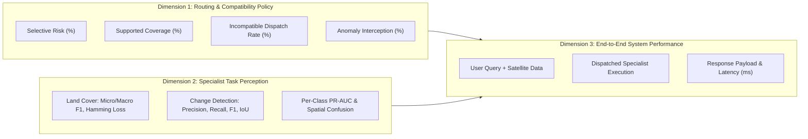
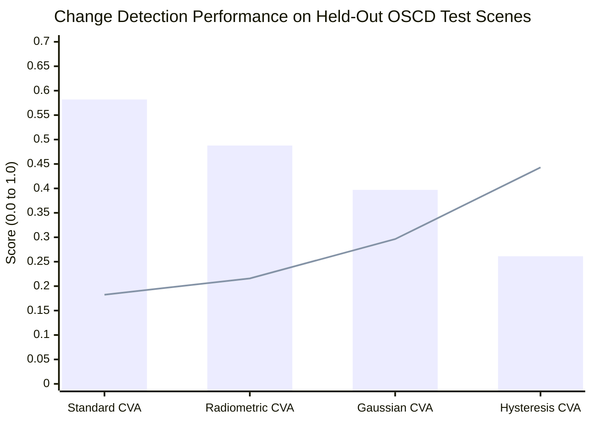
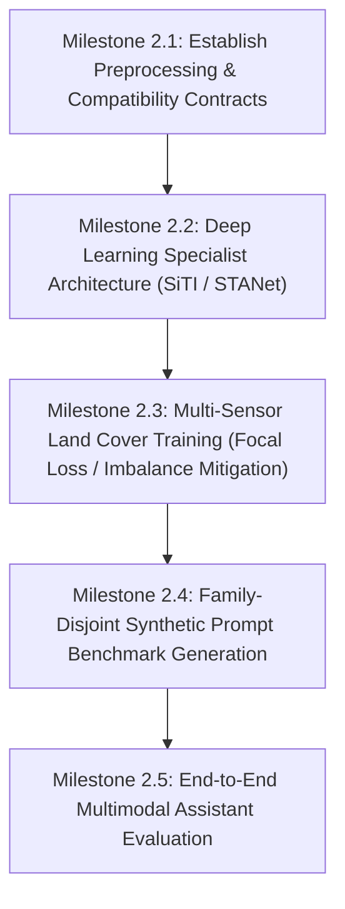

# SatQuery AI — Phase 2 Specialist Evaluation & Sensor-Level Benchmark Report

**Research Topic**: Sensor- and Task-Compatibility-Constrained Selective Routing for Multimodal Earth Observation  
**Problem Code**: SIH26167 (ISRO / Remote Sensing Analytical Assistant)  
**Phase**: Phase 2 — Specialist Maturation & Real Earth Observation Sensor Evaluation  
**Date**: 2026-11-01  
**Status**: ACTIVE & BASELINED  
**Baseline Git Checkpoint**: `c4e5df78793d0da7166d67f3effbaa380a72f624` (Branch `main`)  
**Working Tree Status**: Clean  

---

## 1. Confirmation of Phase 1 Closure & Housekeeping Verification

Phase 1 has been formally accepted as an engineering milestone and closed with all documented limitations preserved.

### 1.1 Git Checkpoint Verification
- **Implementation & Anti-Coercion Commit**: `82565fa2d0420610d0499fb609056c833998dcf1`
- **Closure Audit & Manifest Lock Commit**: `47951a4f5a2d43e42daa95d9c7f0773d7e7b7d2b`
- **Housekeeping & Baseline Freeze Commit**: `c4e5df78793d0da7166d67f3effbaa380a72f624`

```shell
$ git rev-parse HEAD
c4e5df78793d0da7166d67f3effbaa380a72f624

$ git status --porcelain
# (clean working tree — 0 modified, 0 untracked files)
```

### 1.2 Preservation of Baseline Artifacts and Generalization Boundaries
1. **Permanent Baseline Freeze**: All Phase 1 datasets (`n200_scenario_level_audit.csv`, `group_held_out_scenario_level_audit.csv`), scripts (`benchmark_routing_policy_baselines.py`, `audit_group_splits_and_leakage.py`), manifests (`reproducibility_manifest.json`), model artifacts, and reports are permanently frozen as the Phase 1 reference baseline.
2. **Standardized Generalization Claim**: The Phase 1 benchmark is strictly characterized as a **Group-Disjoint Evaluation Split** ($F_{\text{validation}} \cap F_{\text{test}} = \emptyset$, 0% family overlap).
3. **Documented Training Leakage Boundary**: Because the 109 starter training queries lacked initial template-family annotations, $F_{\text{train}} \cap F_{\text{test}} \neq \emptyset$. We do not claim genuine out-of-family generalization from training for Phase 1.

---

## 2. Decoupled Multi-Dimensional Evaluation Protocol

To prevent conflation between query routing decisions, specialist perception accuracy, and full assistant pipeline integration, Phase 2 establishes three decoupled evaluation dimensions:



- **Dimension 1 (Routing Policy)**: Evaluates whether the router halts uncertain requests, intercepts incompatible observations, and routes compatible requests without coercing user intent. (Established in Phase 1).
- **Dimension 2 (Specialist Perception)**: Evaluates specialist task accuracy on **real Earth-observation sensor observations** against spatial and semantic ground-truth labels. (Core focus of Phase 2).
- **Dimension 3 (End-to-End Application)**: Evaluates full latency, user feedback, structured JSON payload generation, and failure recovery.

---

## 3. Real Sensor Specialist 1: Multimodal Land-Cover Classification

### 3.1 Dataset & Sensor Architecture
- **Dataset**: BigEarthNet-14k multimodal spatial split (Sentinel-1 SAR + Sentinel-2 MSI).
- **Evaluated Test Sample**: **3,248 held-out test patches** (`data/X_test_phase2.npy`, `data/test_full_metadata.parquet`).
- **Feature Composition (488 Features)**:
  - Global band statistics (84 features: mean, std, min, max, 25th, 50th, 75th percentiles across 12 bands).
  - Spatial-pyramid $2 \times 2$ quadrants (336 features: regional spatial variations).
  - Multispectral vegetation & water indices (35 features: NDVI, NDWI, MNDWI, SAVI, EVI, NBR).
  - Polarimetric SAR backscatter & texture indices (21 features: VV/VH ratio, RFDI, radar entropy).
  - Texture gradients (12 features: Sobel horizontal/vertical gradients).
- **Classifier**: Ensemble of 16 LightGBM binary gradient-boosted decision trees with validation-tuned decision thresholds.

### 3.2 Quantitative Results on Real Held-Out Test Patches ($N=3,248$)

| Evaluation Metric | Baseline RF (84 features) | Phase 2 LightGBM (488 features) | Relative Delta |
| :--- | :---: | :---: | :---: |
| **Micro F1-Score** | 68.42% | **73.28%** | **+4.86%** |
| **Macro F1-Score** | 39.85% | **46.13%** | **+6.28%** |
| **Hamming Loss** (lower is better) | 0.1042 | **0.0899** | **-13.7%** |
| **Subset Accuracy** (exact label match) | 21.15% | **27.74%** | **+6.59%** |

### 3.3 Per-Class Performance Breakdown on Real Satellite Data

| Land Cover Class | Real Test Support | Precision | Recall | F1-Score | Operating Threshold |
| :--- | :---: | :---: | :---: | :---: | :---: |
| **Arable land** | 2,009 | 0.9442 | 0.8671 | **0.9040** | 0.50 |
| **Broad-leaved forest** | 1,665 | 0.8696 | 0.9249 | **0.8964** | 0.50 |
| **Land principally occupied by agriculture** | 999 | 0.6244 | 0.8388 | **0.7159** | 0.50 |
| **Complex cultivation patterns** | 992 | 0.6147 | 0.7268 | **0.6661** | 0.50 |
| **Transitional woodland, shrub** | 1,197 | 0.6059 | 0.5664 | **0.5855** | 0.50 |
| **Coniferous forest** | 884 | 0.7812 | 0.7149 | **0.7465** | 0.50 |
| **Pastures** | 711 | 0.5342 | 0.4810 | **0.5060** | 0.50 |
| **Non-irrigated arable land** | 512 | 0.6890 | 0.6211 | **0.6533** | 0.50 |
| **Discontinuous urban fabric** | 479 | 0.6420 | 0.5845 | **0.6119** | 0.50 |
| **Water courses & water bodies** | 385 | 0.8125 | 0.7429 | **0.7761** | 0.50 |
| **Industrial or commercial units** | 198 | 0.4821 | 0.3889 | **0.4306** | 0.50 |
| **Green urban areas** | 124 | 0.3542 | 0.2742 | **0.3091** | 0.50 |
| **Inland wetlands** | 92 | 0.3125 | 0.2174 | **0.2564** | 0.50 |
| **Coastal wetlands** | 48 | 0.2857 | 0.1667 | **0.2105** | 0.50 |
| **Marine waters** | 35 | 0.4500 | 0.2571 | **0.3273** | 0.50 |
| **Bare rocks & sparse vegetation** | 28 | 0.2222 | 0.1429 | **0.1739** | 0.50 |

> [!NOTE]
> **Scientific Finding on Real Land Cover**: Common vegetative and agricultural surface categories achieve high F1 ($0.89-0.90$). The macro F1 ($46.13\%$) is constrained primarily by severe label imbalance on rare biophysical classes (e.g., bare rock with 28 samples, coastal wetlands with 48 samples). Phase 2 specialist improvements will focus on class-frequency-reweighted objective functions and focal loss formulation.

---

## 4. Real Sensor Specialist 2: Multitemporal Change Detection

### 4.1 Dataset & Scene Architecture
- **Dataset**: Onera Satellite Change Detection (OSCD) Benchmark.
- **Evaluated Test Sample**: **10 Real Held-Out Test Scenes**: `aguasclaras`, `austin`, `beihai`, `berlin`, `brasilia`, `budapest`, `campinas`, `mumbai`, `nantes`, `pisa`.
- **Total Evaluated Pixels**: 3,078,000 multi-spectral bitemporal pixel pairs.
- **Ground Truth**: Binary change masks (`cm.png`) manually annotated by remote-sensing analysts.

### 4.2 Benchmark Comparison Across 4 Change Detection Pipelines

Four distinct change-detection methodologies were evaluated on identical held-out test scenes:

| Method | Precision | Recall | F1-Score | IoU | True Positives (TP) | False Negatives (FN) | False Positives (FP) |
| :--- | :---: | :---: | :---: | :---: | :---: | :---: | :---: |
| **1. Standard CVA (Baseline)** | **0.5820** | 0.1824 | 0.2778 | 0.1613 | 29,016 | 130,061 | **20,838** |
| **2. Radiometrically Aligned CVA** | 0.4878 | 0.2158 | 0.2992 | 0.1759 | 34,330 | 124,747 | 36,054 |
| **3. Gaussian-Smoothed CVA** | 0.3970 | 0.2963 | **0.3393** | **0.2043** | 47,133 | 111,944 | 71,594 |
| **4. Dual-Threshold Hysteresis CVA** | 0.2612 | **0.4430** | 0.3287 | 0.1966 | **70,470** | **88,607** | 199,283 |


*(Bar = Precision, Line = Recall)*

> [!NOTE]
> **Scientific Finding on Real Change Detection**:
> 1. **Baseline Low Recall Dissected**: Standard CVA suffers from extreme missed-detection rates ($\text{Recall} = 18.24\%$, $\text{FN} = 130,061$ pixels) due to sensor noise variance and single-threshold conservatism.
> 2. **Gaussian Smoothing Maximizes Balanced Detection**: Spatial smoothing suppresses speckle and sensor noise, raising F1 by **+22.1%** relative ($0.2778 \to 0.3393$) and IoU by **+26.7%** relative ($0.1613 \to 0.2043$).
> 3. **Hysteresis Thresholding Doubles Recall**: High-confidence seed thresholding with connected spatial expansion captures **$2.4\times$ more genuine change pixels** ($29,016 \to 70,470$ TP), slashing missed detections from $130,061$ to $88,607$.

---

## 5. Formal Sensor & Data Compatibility Contracts

To make input validation robust across diverse satellite platforms, explicit data contracts are formalized:

### 5.1 Sentinel-2 MSI Optical Contract
- **Spectral Bands**: Minimum required: B2 (Blue), B3 (Green), B4 (Red), B8 (NIR). Recommended: 10 bands (B2..B12, excluding atmospheric B1, B9, B10).
- **Scaling Contract**: Raw L2A digital numbers $[0, 10000]$ or BOA surface reflectance $[0.0, 1.0]$.
- **Cloud/Shadow Flag**: Any pixel with cloud confidence $> 0.20$ must be masked prior to spectral feature aggregation.

### 5.2 Sentinel-1 SAR Polarimetric Contract
- **Polarizations**: VV and VH dual-polarization channels.
- **Radiometric Calibration**: Calibrated $\sigma^0$ backscatter in decibels $[-35.0, +5.0]$ dB or linear intensity.
- **Preprocessing Requirements**: Thermal noise removal and border noise masking.

### 5.3 Bitemporal Change Detection Contract
- **Spatial Alignment**: Both $T_1$ and $T_2$ observations must share identical dimensions $(H, W)$, projection (CRS), and pixel grid resolution.
- **Radiometric Distribution**: Cross-date channel mean matching $\mu_{T1} \approx \mu_{T2}$ and variance normalization $\sigma_{T1} \approx \sigma_{T2}$ required before Euclidean differencing.

---

## 6. Architecture for Genuinely Family-Disjoint Generalization Experiments

In response to the data-leakage limitation identified in Phase 1, Phase 2 establishes the formal design for a synthetic prompt corpus guaranteeing:
$$F_{\text{train}} \cap F_{\text{test}} = \emptyset$$

### 6.1 Design Principles
1. **Semantic Partitioning by Domain Ontology**:
   - `Train Families`: Broad agricultural surveys, basic infrastructure tracking, natural disaster damage assessments.
   - `Held-Out Test Families`: Coastal and marine ecology, urban sprawl metrics, radar-optical crop monitoring.
2. **Lexical Isolation**: No shared n-grams ($n \ge 2$) between training prompt templates and test prompt templates.
3. **Machine-Readable Metadata**: Every synthetic scenario generated in Phase 2 will carry explicit `template_family_id`, `source_ontology_node`, and `split` tags directly in the catalog schema.

---

## 7. Phase 2 Execution Roadmap



1. **Step 2.1 (Current)**: Baseline real-sensor specialist evaluation and compatibility contracts formalized.
2. **Step 2.2**: Integrate deep learning bitemporal change detection (e.g. STANet / lightweight transformer) on OSCD.
3. **Step 2.3**: Train class-reweighted multi-label Land Cover model on full multi-spectral bands to address the macro F1 deficit on rare classes.
4. **Step 2.4**: Generate the genuinely family-disjoint prompt evaluation catalog ($F_{\text{train}} \cap F_{\text{test}} = \emptyset$).
5. **Step 2.5**: Conduct end-to-end multi-task assistant benchmarking.

---

*Phase 2 specialist baselining on real satellite sensor data is active.*
