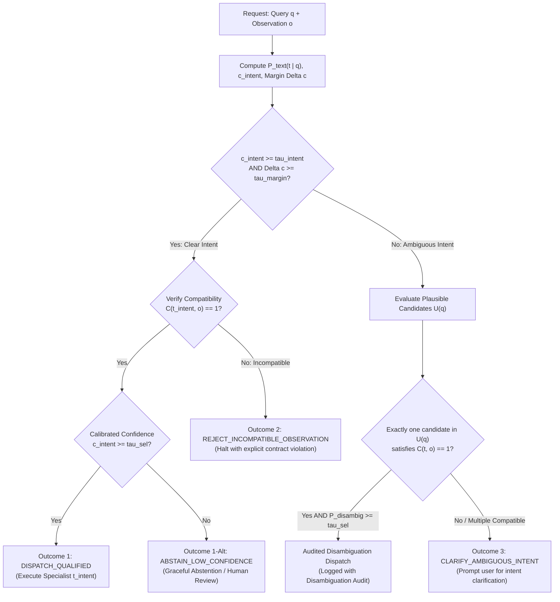
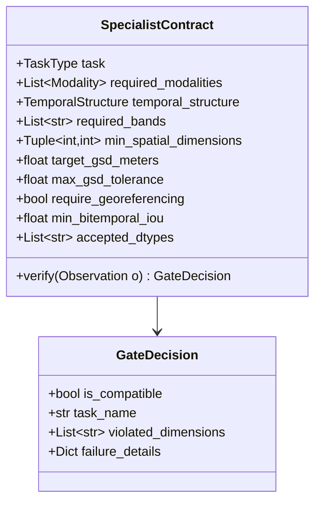
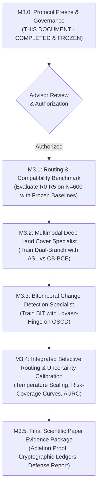

# SatQuery AI — Phase 3 Milestone M3.0 Experimental Protocol Freeze

**Problem Title**: Sensor- and Task-Compatibility-Constrained Selective Routing for Multimodal Earth Observation  
**Problem Code**: SIH26167 (ISRO / Smart India Hackathon)  
**Document Classification**: Milestone M3.0 Protocol Freeze & Scientific Defense Specification  
**Date**: November 1, 2026  
**Auditor / Lead Author**: Lead Research Verification Agent  
**Frozen Classical Baseline Commit**: `ce7134245f9be6b3876a3a2df1699b2641156f9f`  
**Git Tag**: `v0.2.0-phase2-freeze` (Dereferenced commit: `ce7134245f9be6b3876a3a2df1699b2641156f9f`)  
**Working Tree Status**: Clean (`git status --porcelain` is empty)  
**Status**: **M3.0 PROTOCOL FROZEN — AWAITING REVIEW BEFORE M3.1 EXECUTION**  

---

## Executive Summary & Core Research Mission

The primary research claim of SatQuery AI is **not** merely that deep neural networks achieve higher perception metrics on individual Earth observation benchmarks. The central contribution is demonstrating that an Earth observation assistant can:
1. **Accurately parse user analytical intent** from natural language queries;
2. **Formally verify sensor and task compatibility** against deterministic physical contracts before execution;
3. **Calibrate predictive uncertainty** to selectively abstain from ambiguous or unfeasible requests; and
4. **Guarantee an Incompatible Dispatch Rate of $0.0\%$** without blindly rejecting valid requests or silently coercing the user's intended task.

To defend this contribution against published research, this document establishes the **M3.0 Experimental Protocol Freeze**, resolving all mathematical, architectural, and experimental ambiguities prior to any Phase 3 training.

---

## Deliverable A: Revised Mathematical Formulation of Selective Routing

### A.1 Diagnosis of the Constrained Posterior Vulnerability
A naïve formulation of compatibility-conditioned routing defines:
$$P(t \mid q, o) \propto \mathcal{C}(t, o) \cdot P_{\text{text}}(t \mid q) \implies P_{\mathcal{C}}(t \mid q, o) = \frac{\mathcal{C}(t, o) P_{\text{text}}(t \mid q)}{\sum_{j=1}^K \mathcal{C}(j, o) P_{\text{text}}(j \mid q)}$$
when the denominator is non-zero.

**The Flaw**: This formulation conditions on observation compatibility *before* evaluating user intent. If a user explicitly requests bitemporal change detection ($P_{\text{text}}(\text{CD} \mid q) = 0.96, P_{\text{text}}(\text{LC} \mid q) = 0.04$) but mistakenly attaches a single-date image, $\mathcal{C}(\text{CD}, o) = 0$ while $\mathcal{C}(\text{LC}, o) = 1$. Renormalizing over compatible tasks yields:
$$P_{\mathcal{C}}(\text{LC} \mid q, o) = \frac{1 \times 0.04}{0 + 0.04} = \mathbf{1.0000 \quad (100\% \text{ confidence})}$$
The router would silently hijack the user's explicit request and execute land-cover classification with maximum confidence. **This constitutes unsafe task coercion.**

### A.2 Decoupled Intent Inference & Hierarchical Dispatch Theory
Let $x = (q, o)$ be an incoming request with text query $q \in \mathcal{Q}$ and attached observation $o \in \mathcal{O}$. Let $\mathcal{T} = \{t_1, \dots, t_K\}$ be the discrete taxonomy of $K=7$ specialist tasks.

#### Step 1: Unpolluted Text Intent Estimation
The user's latent intended task $T^* \in \mathcal{T}$ is estimated strictly from $q$, independent of attached imagery:
$$\vec{z} = f_\theta(q) \in \mathbb{R}^K$$
$$P_{\text{text}}(t \mid q) = \text{Softmax}(\vec{z} / T_{\text{cal}})_t = \frac{\exp(z_t / T_{\text{cal}})}{\sum_{j=1}^K \exp(z_j / T_{\text{cal}})}$$
where $T_{\text{cal}} > 0$ is a post-hoc temperature parameter tuned on validation queries to optimize Negative Log-Likelihood (NLL).

The top-ranked candidate and its confidence are:
$$\hat{t}_{\text{intent}} = \arg\max_{t \in \mathcal{T}} P_{\text{text}}(t \mid q), \qquad c_{\text{intent}} = P_{\text{text}}(\hat{t}_{\text{intent}} \mid q)$$
The competitive margin to the second-ranked candidate is:
$$\Delta c = c_{\text{intent}} - \max_{j \ne \hat{t}_{\text{intent}}} P_{\text{text}}(j \mid q)$$

#### Step 2: Mutual Exclusion of Dispatch Outcomes
We define two operational thresholds:
* $\tau_{\text{intent}} \in (0, 1)$: Minimum confidence to establish unambiguous linguistic intent (default $\tau_{\text{intent}} = 0.65$).
* $\tau_{\text{margin}} \ge 0$: Minimum margin separating the top candidate from alternatives (default $\tau_{\text{margin}} = 0.15$).

The router partitions all incoming requests into **three mutually exclusive outcomes**:



1. **Outcome 1: Compatible Qualified Dispatch (`DISPATCH_QUALIFIED`)**:
   Occurs when the intended task is unambiguous ($c_{\text{intent}} \ge \tau_{\text{intent}}, \Delta c \ge \tau_{\text{margin}}$) AND the attached observation satisfies the intended task's contract ($\mathcal{C}(\hat{t}_{\text{intent}}, o) = 1$).
   If $c_{\text{intent}} \ge \tau_{\text{sel}}$, the specialist is executed; if $c_{\text{intent}} < \tau_{\text{sel}}$, the system gracefully abstains under selective risk control.

2. **Outcome 2: Incompatible Observation Rejection (`REJECT_INCOMPATIBLE_OBSERVATION`)**:
   Occurs when user intent is unambiguous ($c_{\text{intent}} \ge \tau_{\text{intent}}$), but the attached observation violates the intended task's contract ($\mathcal{C}(\hat{t}_{\text{intent}}, o) = 0$).
   **Mandatory Non-Coercion Invariant**:
   $$\text{If } \mathcal{C}(\hat{t}_{\text{intent}}, o) = 0 \implies \text{System MUST NOT execute any } t' \ne \hat{t}_{\text{intent}}$$
   The router halts and returns an auditable contract violation report identifying the missing modality, resolution mismatch, or temporal deficit.

3. **Outcome 3: Ambiguous Intent Clarification (`CLARIFY_AMBIGUOUS_INTENT`)**:
   Occurs when linguistic intent is genuinely ambiguous ($c_{\text{intent}} < \tau_{\text{intent}}$ or $\Delta c < \tau_{\text{margin}}$).
   The system defines the candidate uncertainty set:
   $$\mathcal{U}(q) = \{ t \in \mathcal{T} \mid P_{\text{text}}(t \mid q) \ge \tau_{\text{candidate}} \}$$
   If multiple candidates are compatible with $o$, or if none are compatible, the router halts and prompts the user for clarification.
   *Restricted Disambiguation Exception*: If and only if exactly one candidate $t^* \in \mathcal{U}(q)$ is compatible while all others are physically impossible ($\mathcal{C}(t^*, o) = 1$ and $\forall j \in \mathcal{U}(q) \setminus \{t^*\}, \mathcal{C}(j, o) = 0$), the router may dispatch $t^*$ with an explicit `DISAMBIGUATION_APPLIED` audit flag, provided the renormalized confidence exceeds $\tau_{\text{sel}}$. Otherwise, it defaults to clarification.

---

## Deliverable B: Mandatory Compatibility Contract Specification

Every specialist invocation must pass through a programmatic compatibility gate before execution. The gate inspects eight physical dimensions of the request:



### B.1 Complete 8-Dimension Verification Schema

| Verification Dimension | Inspection Target | Verification Rule / Constraint | Failure Code |
| :--- | :--- | :--- | :--- |
| **1. Sensor Modality** | Available observation modalities $\mathcal{M}_o$ | $\mathcal{M}_{\text{req}}(t) \subseteq \mathcal{M}_o$ (e.g. Land Cover requires both Optical and SAR; VQA requires Optical). | `ERR_MISSING_MODALITY` |
| **2. Temporal Structure** | Temporal observation count and order $\mathcal{T}_o$ | Single-image tasks require $N=1$; Change detection requires $N=2$ with verified timestamp ordering: $t_{\text{acq}}(T_1) < t_{\text{acq}}(T_2)$ and $\Delta t \ge 24\text{ hours}$. | `ERR_TEMPORAL_INVALID` |
| **3. Spectral Bands** | Available spectral channels $\mathcal{B}_o$ | All required bands must be present. Land Cover requires 10 S2 bands + 2 S1 polarizations. Reject RGB-only imagery for multi-spectral specialists. | `ERR_INSUFFICIENT_BANDS` |
| **4. Spatial Dimensions** | Array height and width $(H, W)$ | $H \ge H_{\text{min}}, W \ge W_{\text{min}}$ (minimum $120 \times 120$ for BigEarthNet; $100 \times 100$ for OSCD). | `ERR_DIMENSION_TOO_SMALL` |
| **5. Geospatial CRS & Overlap** | Coordinate reference system and bounding box | Valid EPSG code. For bitemporal pairs, footprint bounding box intersection over union must satisfy $\text{IoU}(B_{T1}, B_{T2}) \ge 0.95$. | `ERR_GEOSPATIAL_MISMATCH` |
| **6. GSD & Resolution** | Ground sample distance in meters | $|GSD_{\text{actual}} - GSD_{\text{target}}| / GSD_{\text{target}} \le 0.20$ (e.g. $10\text{ m} \pm 2\text{ m}$). | `ERR_RESOLUTION_INCOMPATIBLE` |
| **7. Spatial Registration** | Bitemporal grid alignment | $T_1$ and $T_2$ arrays must have identical spatial shapes $(H_1, W_1) == (H_2, W_2)$ or an active resampling grid transform. | `ERR_UNREGISTERED_PAIR` |
| **8. Data Integrity & Dtype** | Array values and numerical format | Dtypes must be in `[uint8, uint16, float32]`. Array must not contain NaNs or Infs ($\sum \text{isnan} == 0$). Cloud/saturation fraction $\le 50\%$. | `ERR_CORRUPT_PAYLOAD` |

---

## Deliverable C: Routing Baseline Comparison Matrix (R0–R5)

To scientifically isolate each component of the proposed selective router, all methods will be evaluated across an identical benchmark dataset:

| Baseline ID | Architecture Name | Intent Classification Model | Compatibility Gate | Selective Abstention Mechanism | Purpose in Ablation Study |
| :---: | :--- | :--- | :---: | :---: | :--- |
| **R0** | **Keyword / Heuristic** | Regular expression keyword matcher | **No** | None (always dispatches) | Naïve baseline; establishes floor performance under keyword matches. |
| **R1** | **Unconstrained Linear** | TF-IDF (1-3 n-grams) + Logistic Regression | **No** | None (argmax dispatch) | Standard NLP classifier; isolates value of compatibility checking. |
| **R2** | **Gated Non-Selective** | Fine-tuned Transformer / Calibrated Classifier | **Yes** | None (halts on incompatible, but no abstention on text ambiguity) | Isolates compatibility gate without selective risk control. |
| **R3** | **Uncalibrated Selective** | Fine-tuned Classifier + Compatibility Gate | **Yes** | Raw Max Softmax Probability ($\hat{P} \ge \tau$) | Isolates selective prediction without temperature calibration. |
| **R4** | **Proposed Calibrated Selective** | Temperature-Scaled Classifier + Compatibility Gate | **Yes** | Calibrated Posterior Confidence ($P_{\text{cal}} \ge \tau_{\text{sel}}$) | **Proposed System**: combines intent, compatibility, calibration, and abstention. |
| **R5** | **LLM Prompted Router** | Frontier LLM (Gemini 1.5 Pro / GPT-4o) with few-shot prompt | **No** | Optional (prompted uncertainty string) | Compares deterministic code verification against zero-shot LLM reasoning. |

---

## Deliverable D: Dataset Split & Leakage-Prevention Protocol

### D.1 Expanded Benchmark Dataset ($N = 600$ Multi-Task Scenarios)
The routing evaluation benchmark is expanded from $N=200$ to **$N=600$ scenarios** to guarantee statistical power across all 7 tasks:

* **Cohort 1: Standard In-Distribution Requests ($N = 250$)**:
  Canonically phrased instructions paired with fully compliant observations across all 7 tasks.
* **Cohort 2: Linguistic Ambiguity & Polysemy ($N = 100$)**:
  Queries with underspecified phrasing (e.g. *"Inspect this area"*, *"What is here?"*), polysemous terminology, or competing multi-task keywords.
* **Cohort 3: Adversarial Keyword Perturbations ($N = 100$)**:
  Syntactically deceptive queries containing keywords from conflicting tasks (e.g. *"Show me land-cover changes over time"*, *"Detect forest loss using single optical image"*).
* **Cohort 4: Physical Contract Violation Scenarios ($N = 150$)**:
  Systematically generated failure scenarios covering all 8 contract dimensions (missing SAR, single image for change detection, inverted temporal timestamps, RGB-only imagery, CRS mismatch, corrupt payloads).

### D.2 Paraphrase & Template Family Leakage Prevention
To guarantee that high routing accuracy is not an artifact of template memorization:
1. **Template Family Partitioning**: All queries are assigned an explicit `family_id` (e.g. `FAM_LC_01`, `FAM_CD_04`).
2. **Zero Family Overlap**: Training ($60\%$), Validation ($20\%$), and Test ($20\%$) splits have **strictly $0.0\%$ template family overlap**.
3. **Paraphrase Isolation**: All linguistic paraphrases generated from a single semantic template are strictly quarantined into the same split.
4. **Deterministic Fingerprinting**: Every test scenario is cataloged with an immutable SHA-256 hash computed over `(query_text, observation_metadata)`.

---

## Deliverable E: Metric Definitions & Statistical Testing Plan

### E.1 Probability Calibration Metrics
Evaluated on validation and test query sets before and after temperature scaling:
* **Expected Calibration Error (ECE)**:
  $$\text{ECE} = \sum_{m=1}^{M} \frac{|B_m|}{N} |\text{acc}(B_m) - \text{conf}(B_m)|$$
  evaluated using $M = 15$ equal-frequency bins.
* **Brier Score**:
  $$\text{Brier} = \frac{1}{N} \sum_{i=1}^N \sum_{k=1}^K (P(t_k \mid q_i) - y_{ik})^2$$
* **Negative Log-Likelihood (NLL)**:
  $$\text{NLL} = -\frac{1}{N} \sum_{i=1}^N \sum_{k=1}^K y_{ik} \log P(t_k \mid q_i)$$

### E.2 Selective Prediction & Risk-Coverage Metrics
Evaluated across threshold sweep $\tau_{\text{sel}} \in [0.50, 0.99]$:
* **Coverage ($\Phi$)**: Fraction of total requests accepted for dispatch:
  $$\Phi(\tau) = \frac{1}{N} \sum_{i=1}^N g_i(\tau), \qquad g_i(\tau) = \mathbb{I}(c_i \ge \tau \land \mathcal{C}(\hat{t}_i, o_i) == 1)$$
* **Selective Risk ($\mathcal{R}$)**: Error rate among dispatched requests:
  $$\mathcal{R}(\tau) = \frac{\sum_{i=1}^N \mathbb{I}(\hat{t}_i \ne T_i^*) g_i(\tau)}{\sum_{i=1}^N g_i(\tau)}$$
* **Area Under the Risk-Coverage Curve (AURC)**:
  $$\text{AURC} = \int_{0}^{1} \mathcal{R}(\Phi) \, d\Phi$$
  *(Note: Empirical curves are evaluated via trapezoidal numerical integration; monotonicity is not assumed as a pass/fail prerequisite).*
* **Excess-AURC (E-AURC)**:
  $$\text{E-AURC} = \text{AURC} - \text{AURC}_{\text{optimal}}$$
  where $\text{AURC}_{\text{optimal}}$ represents the theoretical minimum achieved by an oracle error sorter.
* **Operational Risk at Fixed Coverage**:
  Selective Risk reported at fixed coverage operating points $\Phi \in \{0.80, 0.90, 0.95\}$.

### E.3 Compatibility Safety & Execution Metrics
* **Incompatible Dispatch Rate (IDR)**:
  $$\text{IDR} = \frac{\text{Incompatible specialist executions}}{\text{Total specialist executions}} \quad (\text{Target: } \mathbf{0.0\%})$$
* **Contract Violation Detection Recall (CVDR)**:
  $$\text{CVDR} = \frac{\text{Detected incompatible inputs}}{\text{Total incompatible inputs}} \quad (\text{Target: } \mathbf{100.0\%})$$
* **Compatible Request Acceptance Rate (CRAR)**:
  $$\text{CRAR} = \frac{\text{Dispatched compatible requests}}{\text{Total compatible requests}}$$
* **Useful Task Coverage (UTC)**:
  $$\text{UTC} = \frac{\text{Correctly executed compatible requests}}{\text{Total incoming requests}}$$

### E.4 Statistical Significance Testing Plan
* **AURC Comparisons**: DeLong test and non-parametric bootstrap resampling ($B = 1,000$ iterations) to compute $95\%$ confidence intervals and paired difference $p$-values between R1, R2, R3, R4, and R5.
* **Proportions & Accuracy**: Wilson score confidence intervals for all binomial rates (Top-1 Accuracy, IDR, CVDR, CRAR).
* **Paired Classifiers**: McNemar's test for paired classification discordance between baseline routing architectures.

---

## Deliverable F: Deep-Learning Specialist Experiment Specifications

### F.1 Multimodal Land-Cover Specialist (BigEarthNet-14k)
* **Dataset & Split**: $N = 13,683$ patches across the verified 4-tile spatially buffered Serbian partition (Train $7,180$, Val $3,255$, Test $3,248$).
* **Input Tensors & Preprocessing**:
  * **Sentinel-1 SAR**: 2 channels (VV, VH) at $10\text{ m}$ GSD ($120 \times 120$ pixels). Clipped to $[-35.0, +5.0]\text{ dB}$ (calculated on training split only) and scaled to $[0, 1]$.
  * **Sentinel-2 Optical**: 10 channels. 4 bands at $10\text{ m}$ (B02, B03, B04, B08; $120 \times 120$) and 6 bands at $20\text{ m}$ (B05, B06, B07, B8A, B11, B12; $60 \times 60$). The $20\text{ m}$ bands are bicubic upsampled by $2\times$ to $120 \times 120$. Scaled via $\text{DN} / 10,000.0$ and clipped to $[0, 1]$.
  * Total combined input: Dual tensors $\mathbf{X}_{\text{SAR}} \in \mathbb{R}^{2 \times 120 \times 120}$ and $\mathbf{X}_{\text{Optical}} \in \mathbb{R}^{10 \times 120 \times 120}$.
* **Architecture**: Dual-branch convolutional backbone (ResNet-34 or EfficientNet-B0 per modality) followed by cross-attention fusion and a 16-head sigmoid classifier sharing the frozen 16-class vocabulary.
* **Loss Function Experiments (A/B Test)**:
  * *Experiment 1*: Class-Balanced Binary Cross-Entropy (CB-BCE) with inverse effective-number weighting calculated strictly on training labels:
    $$E_c = \frac{1 - \beta}{1 - \beta^{N_c}}, \qquad \mathcal{L}_{\text{CB}} = \sum_{c=1}^{16} E_c \cdot \text{BCE}(y_c, p_c)$$
  * *Experiment 2*: Asymmetric Loss (ASL) for multilabel imbalance:
    $$\mathcal{L}_{\text{ASL}} = \sum_{c=1}^{16} -y_c (1 - p_c)^{\gamma_+} \log(p_c) - (1 - y_c) (p_{c, m})^{\gamma_-} \log(1 - p_{c, m})$$
    with $\gamma_+ = 0, \gamma_- = 4$, and probability margin $m = 0.05$.
* **Target Metrics**:
  * Macro $F_1$ across all 16 classes (baseline LightGBM: $47.39\%$; target: $\ge 58.0\%$).
  * Macro $F_1$ across 14 test-present classes (baseline LightGBM: $54.16\%$; target: $\ge 64.0\%$).
  * Micro $F_1$ and Hamming Loss reported side-by-side.
  * Threshold tuning strictly on validation set ($N=3,255$).

### F.2 Bitemporal Change Detection Specialist (OSCD)
* **Dataset & Split**: Onera Satellite Change Detection dataset. 14 training scenes, 4 validation scenes (`montpellier`, `paris`, `rio`, `valencia`), 10 held-out test scenes (`aguasclaras`, `austin`, `beihai`, `berlin`, `brasilia`, `budapest`, `campinas`, `mumbai`, `nantes`, `pisa`).
* **Architecture Selection**:
  * *Primary Model*: **Bitemporal Image Transformer (BIT)** (Chen et al., 2021). Siamese CNN backbone tokenizes $T_1$ and $T_2$ into compact feature maps; dual transformer encoder-decoder models temporal differences; shallow FCN decoder outputs binary change logits.
  * *Baseline Model*: **Fully Convolutional Siamese Difference (FC-Siam-diff)** (Daudt et al., 2018).
* **Loss Formulation**:
  $$\mathcal{L} = \lambda_1 \mathcal{L}_{\text{Focal}} + \lambda_2 \mathcal{L}_{\text{Lovasz-Hinge}}$$
  where $\mathcal{L}_{\text{Lovasz-Hinge}}$ is the binary Lovász hinge loss applied directly to real-valued logits to optimize the Jaccard index (IoU) directly without softmax distortion.
* **Validation & Thresholding Protocol**:
  * Decision threshold $\tau_{\text{CD}}$ optimized strictly on the 4 validation scenes to maximize validation $F_1$.
  * **Never tune thresholds on the 10 held-out test scenes.**
  * Target Metrics: Both Pooled $F_1$ (baseline Gaussian CVA: $0.3393$; target: $\ge 0.4500$) and Per-Scene Macro-Average $F_1$ across all 10 test scenes.

---

## Deliverable G: Git Baseline Verification Output

The exact state of the repository has been verified to ensure complete baseline freeze and traceability:

```powershell
PS C:\Users\B NAVANEETH\SatQueryAI> git rev-parse 'v0.2.0-phase2-freeze^{commit}'
ce7134245f9be6b3876a3a2df1699b2641156f9f

PS C:\Users\B NAVANEETH\SatQueryAI> git rev-parse HEAD
ce7134245f9be6b3876a3a2df1699b2641156f9f

PS C:\Users\B NAVANEETH\SatQueryAI> git describe --tags
v0.2.0-phase2-freeze

PS C:\Users\B NAVANEETH\SatQueryAI> git status --short
(empty - working tree completely clean)

PS C:\Users\B NAVANEETH\SatQueryAI> git log -2 --oneline
ce71342 (HEAD -> main, tag: v0.2.0-phase2-freeze) docs(audit): refine CLC 332 rationale and document threshold tuning trade-off
26f340f docs(phase2): final scientific corrections, euclidean distance verification, and prediction reproduction ledger
```

### Explanation of Repository Lineage
* Commit `26f340f` contained the coordinate-level Euclidean distance verification script and raw prediction reproduction ledger.
* Commit `ce71342` is the child commit containing the tightened CLC 332 taxonomy phrasing and threshold tuning trade-off documentation.
* Annotated tag `v0.2.0-phase2-freeze` points to `ce7134245f9be6b3876a3a2df1699b2641156f9f`.
* The working tree is 100% clean.

---

## Deliverable H: Phase 3 Sequential Execution Roadmap



> [!IMPORTANT]
> **Strict Governance Commitment**:
> In accordance with the advisor's directive, no deep-learning specialist training or benchmark modifications will commence until Milestone M3.0 has been formally reviewed and approved.
