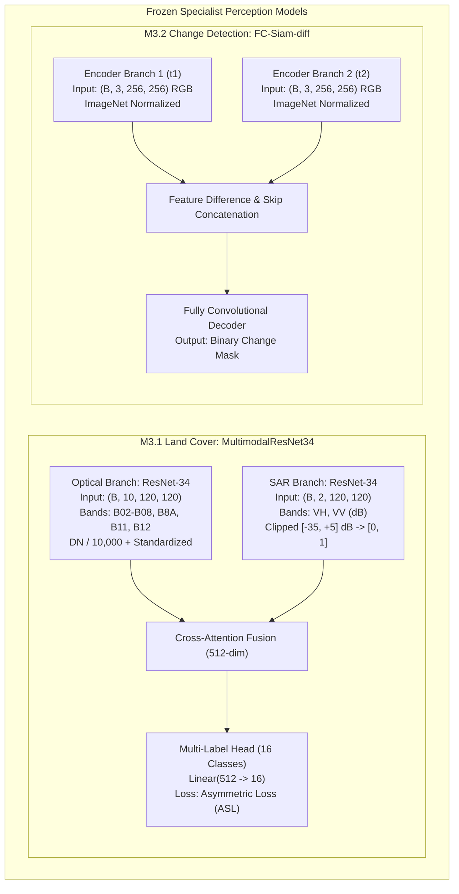
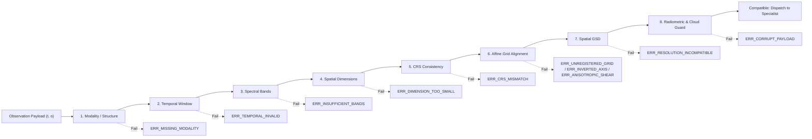

# SatQuery AI — Phase 4 Preregistration Protocol: Robustness, Generalization, and Adversarial Envelope Discovery

**Document Identifier**: `SATQUERY-P4-PROTOCOL-V1.2-DRAFT`  
**Phase**: Phase 4 — Robustness, Generalization, and Operational Envelope Discovery  
**Date**: November 8, 2026  
**Status**: **PROPOSED PREREGISTRATION PROTOCOL — DRAFT v1.2 (Statistical and Ground-Truth Reconciled — Awaiting Final Freeze)**  
**Repository Branch**: `feature/phase4-generalization-protocol`  
**Preceding Milestones**: Phase 3 Closed (M3.1 Multimodal ASL/CB-BCE, M3.2 FC-Siam-diff, M3.3 Selective Routing) with Pre-Registered Limitations  
**Model Weight & Artifact Provenance**: Completely Frozen from Phase 3  
- Multimodal Land Cover Specialist: `artifacts/specialists/deep_land_cover_asl/best_model_asl.pt` (`MultimodalResNet34`, 10 optical bands + 2 SAR bands, **16-class output head: `head.1.weight: torch.Size([16, 512])`**)
- Deep Change Detection Specialist: `artifacts/specialists/deep_change_detection_fc_siam_diff/best_model.pt` (`FCSiamDiff`, bitemporal RGB, ImageNet normalized)
- Linguistic Task Router: `artifacts/router/router_model.joblib` (TF-IDF + Logistic Regression, $T=0.0991$, $\tau_{\text{intent}}=0.65, \tau_{\text{margin}}=0.15, \tau_{\text{sel}}=1.0$)
- Physical Compatibility Gate: Deterministic closed-form validation module in [`satquery/utils/geospatial.py`](file:///c:/Users/B%20NAVANEETH/SatQueryAI/satquery/utils/geospatial.py) inspecting 8 physical dimensions

---

## 1. Executive Research Motivation & Non-Tuning Directive

Phase 3 established the foundational multimodal perception and input-constrained selective routing architecture of SatQuery AI:
- **Milestone M3.1**: Implemented and benchmarked deep multimodal land-cover classification using a dual-branch ResNet-34 (`MultimodalResNet34`) trained with asymmetric loss (ASL) on BigEarthNet-14k paired Sentinel-1 SAR and Sentinel-2 multispectral observations.
- **Milestone M3.2**: Established deep Siamese change detection using `FC-Siam-diff` and `BIT` on bitemporal Sentinel-2 imagery, evaluated under strict city-level spatial disjointness.
- **Milestone M3.3**: Established a temperature-calibrated linear task router ($T=0.0991$) tightly coupled to a deterministic 8-dimensional physical compatibility gate, demonstrating $0.00\%$ observed incompatible dispatch error rate ($\text{IDER}_{\text{obs}} = 0.0\%$, finite-sample Wilson 95% bound $\le 9.89\%$) and $59.0\%$ overall 7-task architectural success.

### The Non-Tuning Scientific Directive
**Phase 4 is strictly a validation, stress-testing, and operational envelope discovery phase.**  
To preserve open-science methodological integrity:
1. **Zero Weight / Parameter Tuning**: No specialist neural weights, router calibration temperatures ($T_{\text{cal}} = 0.0991$), or routing operating thresholds ($\tau_{\text{intent}}=0.65, \tau_{\text{margin}}=0.15, \tau_{\text{sel}}=1.0$) will be re-trained, fine-tuned, or adjusted against Phase 4 evaluation data.
2. **Strict Confirmatory Testing**: Hypotheses H1 through H5 represent confirmatory evaluations of the frozen Phase 3 checkpoints. Any exploratory analyses, failure post-mortems, or adaptation experiments will be formally quarantined into separate, non-confirmatory reporting sections.
3. **Transparent Reporting of Operational Limits**: Performance degradations, out-of-domain failure modes, or edge-case gate rejections will be documented transparently as scientific characterizations of the system's operational envelope rather than concealed.

---

## 2. Frozen Perception Architectures & Exact Input Contracts

An audit of the codebase checkpoints and dataset loaders confirms the exact hardware, architecture, and tensor contracts of the frozen models:



### Specialist 1: Multimodal Land Cover (`MultimodalResNet34`)
- **Model Checkpoint**: `artifacts/specialists/deep_land_cover_asl/best_model_asl.pt` (ASL $\gamma^+=0, \gamma^-=4, m=0.05$).
- **Architecture**: Dual-branch ResNet-34 backbones with 8-head cross-attention fusion projecting to a 512-dimensional multimodal latent space, terminated with a linear head `head.1.weight: torch.Size([16, 512])`.
- **Target Label Taxonomy (Empirically Verified: 16 Classes)**:
  Audited from `artifacts/specialists/land_cover/classes.json`:
  1. `Arable land`
  2. `Beaches, dunes, sands`
  3. `Broad-leaved forest`
  4. `Complex cultivation patterns`
  5. `Coniferous forest`
  6. `Industrial or commercial units`
  7. `Inland waters`
  8. `Inland wetlands`
  9. `Land principally occupied by agriculture, with significant areas of natural vegetation`
  10. `Mixed forest`
  11. `Moors, heathland and sclerophyllous vegetation`
  12. `Natural grassland and sparsely vegetated areas`
  13. `Pastures`
  14. `Permanent crops`
  15. `Transitional woodland, shrub`
  16. `Urban fabric`
- **Input Tensor Contract**:
  - Optical tensor: Shape `(B, 10, 120, 120)` consisting of 10 Sentinel-2 L2A surface reflectance channels in exact order: `[B02, B03, B04, B05, B06, B07, B08, B8A, B11, B12]`. Optical normalization: $\text{DN} / 10000.0$, standardized with frozen training statistics:
    $$\mu_{\text{opt}} = [0.136, 0.118, 0.106, 0.128, 0.203, 0.257, 0.272, 0.273, 0.187, 0.121]$$
    $$\sigma_{\text{opt}} = [0.082, 0.076, 0.074, 0.089, 0.098, 0.108, 0.113, 0.112, 0.095, 0.078]$$
  - SAR tensor: Shape `(B, 2, 120, 120)` consisting of 2 Sentinel-1 GRD IW polarization channels: `[VH, VV]` in decibels. SAR normalization: clipped to $[-35.0, +5.0]\text{ dB}$ and linearly scaled to $[0.0, 1.0]$ via $(\text{dB} + 35.0) / 40.0$.

### Specialist 2: Deep Bitemporal Change Detection (`FCSiamDiff`)
- **Model Checkpoint**: `artifacts/specialists/deep_change_detection_fc_siam_diff/best_model.pt`.
- **Architecture**: Fully Convolutional Siamese Difference network (`FC-Siam-diff`) with shared feature extraction backbones and difference skip connections.
- **Input Tensor Contract**:
  - Bitemporal pair: Two coregistered RGB tensors $(t_1, t_2)$ of shape `(B, 3, H, W)` with $H, W \ge 100$ (nominally $256 \times 256$ patches or full-scene sliding window).
  - Normalization: ImageNet channel-wise standardization ($\mu = [0.485, 0.456, 0.406], \sigma = [0.229, 0.224, 0.225]$).
- **Target Label Taxonomy**: Binary change mask ($1 = \text{Change}, 0 = \text{No Change}$).

### Specialist 3: Task Router & Physical Compatibility Gate
- **Router Architecture**: Scikit-Learn TF-IDF Vectorizer (word n-grams 1-2, sublinear TF scaling) + Multinomial Logistic Regression calibrated via temperature scaling ($T=0.0991$).
- **Routing Policy**:
  - Primary intent threshold: $\tau_{\text{intent}} = 0.65$
  - Confidence margin threshold: $\tau_{\text{margin}} = 0.15$
  - Specialist selection threshold: $\tau_{\text{sel}} = 1.0$
- **Physical Compatibility Gate $\mathcal{C}(t, o)$**: Deterministic closed-form programmatic gate implemented in [`satquery/utils/geospatial.py`](file:///c:/Users/B%20NAVANEETH/SatQueryAI/satquery/utils/geospatial.py).

---

## 3. The 8 Physical Compatibility Gate Dimensions (Implementation Audit & Boundary Logic)

The physical compatibility gate $\mathcal{C}(t, o) \in \{0, 1\}$ provides deterministic input validation before any neural specialist is invoked. An audit of [`satquery/utils/geospatial.py`](file:///c:/Users/B%20NAVANEETH/SatQueryAI/satquery/utils/geospatial.py) establishes the exact 8 machine-enforceable dimensions, explicit boundary equality conditions, and diagnostic error codes:



| Dimension | Checked Parameter | Gate Logic & Engineering Limits | Strict Boundary Points (Sub / Equality / Super) | Diagnostic Error Code |
| :--- | :--- | :--- | :--- | :--- |
| **1. Modality & Sensor Structure** | Payload type & dictionary keys | - Land Cover: requires paired SAR+optical paths or multimodal feature vector; rejects bitemporal pairs.<br>- Change Detection: requires bitemporal pair ($N=2$); rejects single images or 1D features.<br>- Optical-SAR Fusion: requires simultaneous S1+S2 inputs. | Single optical image to LC $\to$ Fail<br>Bitemporal pair to CD $\to$ Pass<br>Feature vector to CD $\to$ Fail | `ERR_MISSING_MODALITY` |
| **2. Temporal Revisit Window** | Revisit interval $\Delta t = \|t_2 - t_1\|$ | - Change Detection: enforces $5.0\text{ days} \le \Delta t \le 730.0\text{ days}$.<br>- Dynamic Optical-SAR Fusion: offset $\le 72.0\text{h}$ ($3.0\text{d}$). | $\Delta t = 4.9\text{d}$ (Fail: $< 5.0$)<br>$\Delta t = 5.0\text{d}$ (**Equality: Pass**)<br>$\Delta t = 730.0\text{d}$ (**Equality: Pass**)<br>$\Delta t = 730.1\text{d}$ (Fail: $> 730.0$) | `ERR_TEMPORAL_INVALID` |
| **3. Spectral Band Adequacy** | Band metadata `spectral_bands` | - Land Cover: requires minimum multispectral presence of $\{B02, B03, B04, B08\}$. Deep inference requires 10 optical channels. | Missing B08 $\to$ Fail<br>Exact required set $\{B02, B03, B04, B08\}$ $\to$ Pass | `ERR_INSUFFICIENT_BANDS` |
| **4. Spatial Dimensions** | Raster height and width $(H, W)$ | - Land Cover: requires $H, W \ge 120\text{ pixels}$.<br>- Change Detection: requires $H, W \ge 100\text{ pixels}$.<br>- Shape equality: $H_1 = H_2$ and $W_1 = W_2$ for bitemporal pairs. | LC: $119 \times 120$ (Fail)<br>LC: $120 \times 120$ (**Equality: Pass**)<br>CD: $99 \times 100$ (Fail)<br>CD: $100 \times 100$ (**Equality: Pass**) | `ERR_DIMENSION_TOO_SMALL`<br>`ERR_DIMENSION_MISMATCH` |
| **5. Geospatial CRS Consistency** | Coordinate Reference System metadata | - Bitemporal pairs: enforces identical projected reference systems (`crs1 == crs2`). Rejects unprojected lat/lon mixed with UTM or mismatched UTM zones.<br>*Note on reprojection*: Reprojection must occur upstream; computing Euclidean pixel displacements across differing CRSs is mathematically undefined. | EPSG:32632 vs EPSG:32632 $\to$ Pass<br>EPSG:32632 vs EPSG:4326 $\to$ Fail<br>EPSG:32632 vs EPSG:32633 $\to$ Fail | `ERR_CRS_MISMATCH` |
| **6. Coregistration & Affine Alignment** | GDAL GeoTransform matrices `gt1, gt2` | Evaluates relative affine transform $\mathbf{M}_{\text{rel}} = \mathbf{A}_1^{-1} \mathbf{A}_2$ and corner displacements:<br>- Inverted axis: $\det(\mathbf{M}_{\text{rel}}) \le 0$<br>- Scale distortion: $|\det(\mathbf{M}_{\text{rel}}) - 1.0| > 0.02$ or $|\sigma_i - 1.0| > 0.01$<br>- Anisotropic shear: SVD condition number $\kappa = \sigma_1 / \sigma_2 > 1.01$<br>- Axis rotation: $|\theta_{\text{rel}}| > 0.28^\circ$<br>- Corner displacement: $\delta_{\text{max}} > 0.05\text{ px}$. | $\delta = 0.049\text{ px}$ (Pass)<br>$\delta = 0.050\text{ px}$ (**Equality: Pass**)<br>$\delta = 0.051\text{ px}$ (Fail: $> 0.05$)<br>$\kappa = 1.010$ (**Equality: Pass**), $1.011$ (Fail)<br>$\|\theta\| = 0.280^\circ$ (**Equality: Pass**), $0.281^\circ$ (Fail)<br>$\det = 0.980$ (**Equality: Pass**), $0.979$ (Fail)<br>$\det = 0.000$ (Fail: $\det \le 0$) | `ERR_INVERTED_AXIS`<br>`ERR_SCALE_DISTORTION`<br>`ERR_ANISOTROPIC_SHEAR`<br>`ERR_ROTATION_MISMATCH`<br>`ERR_UNREGISTERED_GRID` |
| **7. Ground Sample Distance (GSD)** | Spatial resolution metadata `gsd_m` | - Sentinel-2 specialists require nominal resolution: $8.0\text{ m} \le \text{GSD} \le 12.0\text{ m}$. Rejects native Landsat ($30\text{ m}$) and native PlanetScope ($3\text{ m}$). | $\text{GSD} = 7.9\text{ m}$ (Fail: $< 8.0$)<br>$\text{GSD} = 8.0\text{ m}$ (**Equality: Pass**)<br>$\text{GSD} = 12.0\text{ m}$ (**Equality: Pass**)<br>$\text{GSD} = 12.1\text{ m}$ (Fail: $> 12.0$) | `ERR_RESOLUTION_INCOMPATIBLE` |
| **8. Radiometric Integrity & Cloud Guard** | Raster numerical values & `cloud_fraction` | - Numerical integrity: scans for `NaN` and `Inf` floating point values.<br>- Double-scaling trap: detects float values $\le 1.05$ where raw DN $[0, 10000]$ is expected.<br>- Cloud cover threshold: rejects payloads with cloud fraction $> 0.20$ for Land Cover and $> 0.10$ for Change Detection based on metadata contract. | LC Cloud $10\%$ (Pass)<br>LC Cloud $20\%$ (**Equality: Pass**)<br>LC Cloud $20.1\%$ (Fail: $> 0.20$)<br>CD Cloud $5\%$ (Pass)<br>CD Cloud $10\%$ (**Equality: Pass**)<br>CD Cloud $10.1\%$ (Fail: $> 0.10$) | `ERR_CORRUPT_PAYLOAD` |

---

## 4. Confirmatory Experimental Tracks

### Track 4.1: Cross-Region Geographic Generalization

- **Research Question**: Does the frozen perception pipeline generalize across global biomes outside the European training domain, and does the physical compatibility gate maintain invariant validity detection?
- **Hypothesis (H1)**: While perception accuracy (Macro $F_1$, IoU) will experience statistically significant degradation under biomic, climatic, and seasonal distribution shift relative to in-domain validation, the physical compatibility gate and router will maintain invariant validity detection ($0\%$ false dispatches).
- **Target Population**:
  1. *Land Cover Cohort ($N = 2,000$ paired patches)*:
     - Sourced from geographically verified tiles in **SEN12MS** (Spring/Summer acquisitions) and open Copernicus Sentinel-1/2 data, providing co-registered 10-band Sentinel-2 L2A and 2-band Sentinel-1 GRD IW (VH, VV) patches ($120 \times 120$ pixels, 10m GSD).
     - Stratified evenly across 4 global biomes ($N=500$ patches each):
       - **Biome 1 (Arid / Hyper-arid & Semi-arid)**: North Africa and the Arabian Peninsula (Sahara desert margins, Sinai, Rub' al Khali; Lat $24^\circ\text{N}$ to $32^\circ\text{N}$, Lon $25^\circ\text{E}$ to $45^\circ\text{E}$).
       - **Biome 2 (Tropical Rainforest)**: Amazon Basin, Brazil and Congo Basin, Central Africa (Lat $5^\circ\text{S}$ to $5^\circ\text{N}$, Lon $65^\circ\text{W}$ to $55^\circ\text{W}$ and $15^\circ\text{E}$ to $25^\circ\text{E}$).
       - **Biome 3 (Boreal Forest / Sub-Arctic)**: Fennoscandia and Interior Alaska (Lat $60^\circ\text{N}$ to $68^\circ\text{N}$, Lon $15^\circ\text{E}$ to $30^\circ\text{E}$ and $150^\circ\text{W}$ to $140^\circ\text{W}$).
       - **Biome 4 (Humid Subtropical / Monsoon Cropland)**: Indo-Gangetic Plain and Mekong Delta (Lat $10^\circ\text{N}$ to $26^\circ\text{N}$, Lon $75^\circ\text{E}$ to $105^\circ\text{E}$).
     - **Exact Cross-Taxonomy Harmonization Table**:
       The 16 BigEarthNet classes are mapped from the standard MODIS IGBP classification (MCD12Q1 Version 6, 500m) with strict botanical and agronomic fidelity:
       | BigEarthNet-16 Target Class | Mapped MODIS IGBP Class(es) | Semantic Description / Notes | Status |
       | :--- | :--- | :--- | :--- |
       | `Coniferous forest` | Class 1 (Evergreen Needleleaf), Class 3 (Deciduous Needleleaf) | Needleleaf canopy dominant | **Directly Mapped** |
       | `Broad-leaved forest` | Class 2 (Evergreen Broadleaf), Class 4 (Deciduous Broadleaf) | Broadleaf canopy dominant | **Directly Mapped** |
       | `Mixed forest` | Class 5 (Mixed Forest) | Neither broadleaf nor needleleaf $>60\%$ | **Directly Mapped** |
       | `Transitional woodland, shrub` | Class 6 (Closed Shrublands) | Woody perennial shrubs canopy $>60\%$ | **Directly Mapped** |
       | `Moors, heathland and sclerophyllous vegetation` | Class 7 (Open Shrublands) | Low shrubs canopy $10-60\%$ | **Directly Mapped** |
       | `Natural grassland and sparsely vegetated areas` | Class 8 (Woody Savannas), Class 9 (Savannas) | Herbaceous/grass canopy with scattered trees | **Directly Mapped** |
       | `Pastures` | Class 10 (Grasslands) | Lands with herbaceous types | **Directly Mapped** |
       | `Arable land` | Class 12 (Croplands) | Lands covered with temporary crops | **Directly Mapped** |
       | `Land principally occupied by agriculture...` | Class 14 (Cropland/Natural Vegetation Mosaic) | Small-scale mosaic of croplands and natural veg | **Directly Mapped** |
       | `Urban fabric` | Class 13 (Urban and Built-up Lands) | At least $30\%$ impervious surface | **Directly Mapped** |
       | `Inland wetlands` | Class 11 (Permanent Wetlands) | Permanent water-inundated land | **Directly Mapped** |
       | `Inland waters` | Class 17 (Water Bodies) | Oceans, seas, lakes, reservoirs, rivers | **Directly Mapped** |
       | `Beaches, dunes, sands` | Class 16 (Barren) | Lands with $<10\%$ vegetated cover | **Directly Mapped** |
       | `Industrial or commercial units` | *None* | Cannot be resolved from 500m MODIS Class 13 | **Unmapped / Zero-Support** |
       | `Complex cultivation patterns` | *None* | Parcel geometry cannot be resolved at 500m | **Unmapped / Zero-Support** |
       | `Permanent crops` | *None* | Perennial orchards/vineyards not split in MODIS | **Unmapped / Zero-Support** |
     - **Reporting Transparency for Unmapped Classes**:
       Because cross-taxonomy mapping from 500m MODIS cannot resolve 3 of the 16 classes (`Industrial or commercial units`, `Complex cultivation patterns`, `Permanent crops`), we explicitly mandate two reporting metrics:
       1. **Full 16-Class Macro $F_1$**: Computed across all 16 classes (where unmapped classes receive $F_1 = 0.00$ when false positives occur, avoiding artificial metric inflation).
       2. **Present Macro $F_1$ ($F_{1,\text{present}}$)**: Computed strictly over the 13 verified, directly mapped classes.
     - **Spatial Disjointness Guarantee**: Zero geographic overlap with BigEarthNet-14k European training/validation tiles (T34TCR, T34TEQ, T34TFN, T34TCS).
  2. *Change Detection Cohort ($N = 10$ held-out non-European scenes)*:
     - Sourced from **S2Looking** and held-out global cities outside the European/Mediterranean OSCD concentration:
       - Cities: Cairo, Nairobi, Santiago, Ulaanbaatar, Perth, Brisbane, Jakarta, Johannesburg, Calgary, Tashkent.
       - Complete city-level disjointness from OSCD train (`beirut`, `berrida`, `bordeaux`, `chongqing`, `dubai`, `hong_kong`, `lasvegas`, `milano`, `rennes`, `saclay_w`), val (`montpellier`, `paris`, `rio`, `valencia`), and test (`aguasclaras`, `austin`, `beihai`, `berlin`, `brasilia`, `budapest`, `campinas`, `mumbai`, `nantes`, `pisa`).
       - Tiled into $N \ge 500$ evaluation patches ($256 \times 256$, bitemporal RGB, ImageNet normalized).
- **Statistical Comparison & Independent Two-Sample Bootstrap**:
  - Because in-domain BigEarthNet patches and out-of-domain biome patches represent independent geographic observations from distinct locations, they are **strictly independent samples** (not paired).
  - Generalization gap is defined as the two-sample independent difference:
    $$\Delta F_{1, k} = F_{1,\text{OOD}, k} - F_{1,\text{in-domain}}$$
  - Statistical confidence intervals ($95\%$ CI) for $\Delta F_{1, k}$ are estimated via **Two-Sample Independent Spatial Cluster Bootstrap** ($B=1,000$ replicates):
    - Replicate $b$: Resample clusters (tiles) with replacement from the in-domain test set to compute $F_{1,\text{in-domain}}^{(b)}$; independently resample clusters from OOD Biome $k$ to compute $F_{1,\text{OOD}, k}^{(b)}$; calculate $\Delta F_{1, k}^{(b)} = F_{1,\text{OOD}, k}^{(b)} - F_{1,\text{in-domain}}^{(b)}$.
  - For Change Detection ($N=10$ scenes):
    - Due to the small cluster count ($N=10$), patches will not be pooled as independent observations. Metrics will be reported **at the scene level** ($F_{1, s}$ for $s=1,\dots,10$) alongside mean, standard error, median, and IQR.
- **Pre-Registered Acceptance Criteria**:
  - Land Cover: Retains bounded degradation ($\text{Macro } F_1 \ge 25.0\%$ on arid and temperate transfer biomes).
  - Change Detection: Physical gate achieves $100\%$ precision and recall on the mixed valid/invalid alignment suite ($10$ valid scenes + $10$ deliberately misaligned scenes).

---

### Track 4.2: Cross-Sensor & Cross-Resolution Compatibility Defense

- **Research Question**: Does the physical compatibility gate deterministically intercept observations from off-target sensors (Landsat, PlanetScope) before dispatching to Sentinel-2 specialists?
- **Hypothesis (H2) & Formal Non-Inferiority Safety Formulation**:
  Let $\delta_{\text{tol}} = 0.05$ ($5.0\%$) represent the pre-registered maximum tolerable incompatible dispatch error rate. We formulate the one-sided safety hypothesis:
  $$H_0: \text{IDER}_{\text{off-sensor}} \ge 0.05 \quad \text{vs.} \quad H_1: \text{IDER}_{\text{off-sensor}} < 0.05$$
  Under $H_0$, observing 0 errors in $N=80$ independent off-sensor trials has exact binomial probability:
  $$p = (1 - 0.05)^{80} = 0.95^{80} \approx 0.0165$$
  Because $p = 0.0165 < 0.05$, observing zero incompatible dispatches will formally reject $H_0$ at significance level $\alpha = 0.05$.
- **Target Population ($N=100$ Payloads)**:
  - **40 Landsat-8/9 Level-1/2 Payloads**:
    - 15 payloads testing resolution violation alone (`gsd_m = 30.0`, valid band names) $\to$ Expected: `ERR_RESOLUTION_INCOMPATIBLE`.
    - 15 payloads testing missing SAR for Land Cover (optical-only payload sent to LC) $\to$ Expected: `ERR_MISSING_MODALITY`.
    - 10 payloads testing spectral band mismatch (Landsat band nomenclature `['B2', 'B3', 'B4', 'B5']` lacking Sentinel-2 identifiers) $\to$ Expected: `ERR_INSUFFICIENT_BANDS`.
  - **40 PlanetScope Scene Payloads**:
    - 15 payloads testing resolution violation alone (`gsd_m = 3.0`) $\to$ Expected: `ERR_RESOLUTION_INCOMPATIBLE`.
    - 15 payloads testing missing SAR for Land Cover (RGB-NIR payload sent to LC) $\to$ Expected: `ERR_MISSING_MODALITY`.
    - 10 payloads testing spectral band mismatch (PlanetScope identifiers `['Blue', 'Green', 'Red', 'NIR']`) $\to$ Expected: `ERR_INSUFFICIENT_BANDS`.
  - **20 Sentinel-2 Level-2A Control Payloads**:
    - 10 valid Land Cover multimodal payloads (10 optical + 2 SAR bands, $120 \times 120$, GSD 10m).
    - 10 valid Change Detection bitemporal pairs (RGB, $256 \times 256$, GSD 10m, $\Delta t \in [5, 730]\text{ days}$).
- **Evaluation Metrics & Finite-Sample Uncertainty**:
  - Incompatible Dispatch Error Rate:
    $$\widehat{\text{IDER}}_{\text{off-sensor}} = \frac{N_{\text{incompatible off-sensor dispatches}}}{80}$$
  - Control False Rejection Rate:
    $$\widehat{\text{FRR}}_{\text{control}} = \frac{N_{\text{falsely rejected Sentinel-2 controls}}}{20}$$
  - Reporting of Uncertainty:
    - For 0 errors in 80 trials: **Two-sided 95% Wilson bound: $[0.00\%, 4.56\%]$**, **Clopper-Pearson exact bound: $[0.00\%, 4.51\%]$**.
    - For 0 false rejections in 20 controls: **Two-sided 95% Wilson bound: $[0.00\%, 16.11\%]$**, **Clopper-Pearson exact bound: $[0.00\%, 16.84\%]$** (finite-sample uncertainty acknowledged).
- **Pre-Registered Acceptance Criteria**:
  - Safety Rejection: $\widehat{\text{IDER}}_{\text{off-sensor}} = 0.00\%$ ($0 / 80$), rejecting $H_0: \text{IDER} \ge 0.05$ with $p = 0.0165$.
  - Control Preservation: $\widehat{\text{FRR}}_{\text{control}} = 0.00\%$ ($0 / 20$).

---

### Track 4.3: Atmospheric & Image-Quality Stress Testing

- **Scope & Architectural Clarification**:
  This track explicitly evaluates two decoupled mechanisms:
  1. **Specialist Perception Degradation**: Measures how neural specialist performance degrades when raster pixels are obscured by atmospheric haze, synthetic cloud occlusion, and sensor noise.
  2. **Ingestion Metadata Threshold Enforcement**: Verifies that when provider metadata indicates cloud contamination exceeding pre-registered limits ($> 20\%$ for LC, $> 10\%$ for CD), the physical compatibility gate $\mathcal{C}(t, o)$ deterministically halts execution. *Note*: The gate enforces the metadata contract; it is not an optical cloud segmentation model.
- **Hypothesis (H3)**: As atmospheric haze, synthetic cloud occlusion, and sensor noise increase, specialist performance curves $F1_{\text{LC}}(d)$ and $F1_{\text{CD}}(d)$ will exhibit a statistically significant downward monotonic trend (Spearman rank correlation $\rho < 0, p < 0.05$); furthermore, observations with metadata cloud cover exceeding operational limits will be intercepted deterministically with $100\%$ precision by $\mathcal{C}(t, o)$ (`ERR_CORRUPT_PAYLOAD`).
- **Exact Degradation Regimes (15 Controlled Conditions)**:
  - Evaluation Population: $N = 500$ clean baseline control patches (250 multimodal Land Cover pairs, 250 bitemporal Change Detection pairs), evaluated across 15 distinct conditions ($500 \times 15 = 7,500$ evaluated instances). Clean baseline performance ($d=0$) is established and reported separately: $F1_{\text{LC}}(\text{clean})$ and $F1_{\text{CD}}(\text{clean})$.
  - **Regime 1: Synthetic Cloud Occlusion (7 conditions)**:
    - Injection fractions $f_c \in \{0.05, 0.10, 0.15, 0.20, 0.30, 0.40, 0.50\}$.
    - Synthesized using Perlin noise masks with spatial clustering and boundary alpha attenuation; raster pixels and metadata tag `cloud_fraction` are strictly synchronized to $f_c$.
  - **Regime 2: Atmospheric Haze Scattering (4 conditions)**:
    - Physical dark-channel haze model: $\mathbf{I}'(x) = \mathbf{I}(x) \cdot t(x) + \mathbf{A}(1 - t(x))$, with atmospheric light $\mathbf{A} = 1.0$ and uniform transmission coefficients $t(x) \in \{0.90, 0.70, 0.50, 0.30\}$.
  - **Regime 3: Radiometric Sensor Noise (4 conditions)**:
    - Additive zero-mean Gaussian noise $\mathcal{N}(0, \sigma^2)$ with $\sigma \in \{0.01, 0.02, 0.05, 0.10\}$ applied to normalized reflectance.
- **Explicit Boundary Verification Matrix**:
  | Specialist Task | Cloud Fraction ($f_c$) | Strict Threshold Formula | Boundary Type | Expected Gate Decision | Expected Error Code |
  | :--- | :--- | :--- | :--- | :--- | :--- |
  | Land Cover | $10\%$ | $0.10 \le 0.20$ | Sub-threshold | **Pass** | None |
  | Land Cover | $20\%$ | $0.20 \le 0.20$ | **Exact Boundary Equality** | **Pass** | None |
  | Land Cover | $20.1\%$ | $0.201 > 0.20$ | Super-threshold Boundary | **Reject** | `ERR_CORRUPT_PAYLOAD` |
  | Land Cover | $30\%$ | $0.30 > 0.20$ | Super-threshold | **Reject** | `ERR_CORRUPT_PAYLOAD` |
  | Change Detection | $5\%$ | $0.05 \le 0.10$ | Sub-threshold | **Pass** | None |
  | Change Detection | $10\%$ | $0.10 \le 0.10$ | **Exact Boundary Equality** | **Pass** | None |
  | Change Detection | $10.1\%$ | $0.101 > 0.10$ | Super-threshold Boundary | **Reject** | `ERR_CORRUPT_PAYLOAD` |
  | Change Detection | $15\%$ | $0.15 > 0.10$ | Super-threshold | **Reject** | `ERR_CORRUPT_PAYLOAD` |
- **Evaluation Metrics & Disaggregated Reporting**:
  - Separate Specialist Curves: Report $F1_{\text{LC}}(d)$ across 16 land-cover classes and $F1_{\text{CD}}(d)$ binary change F1 independently; no pooled averaging.
  - Monotonicity Evaluation: Assessed via group-level Spearman rank correlation test ($\rho < 0, p < 0.05$), acknowledging that random noise may cause non-monotonic fluctuations between adjacent individual severity steps.
- **Pre-Registered Acceptance Criteria**:
  - Cloud Gate Enforcement: $100\%$ interception precision on boundary rejection conditions.
  - Statistical Degradation Trend: Spearman $\rho < 0$ with $p < 0.05$ on both specialist curves.

---

### Track 4.4: Complex & Adversarial Linguistic Query Defense

- **Threat Model Clarification**:
  The routing module in SatQuery AI is a linear text classifier consisting of a TF-IDF n-gram vectorizer and a temperature-calibrated Logistic Regression model ($T=0.0991$, $\tau_{\text{intent}}=0.65, \tau_{\text{margin}}=0.15$). It is **not** an autoregressive Large Language Model (LLM). Therefore, the threat model does not involve generative "jailbreaks" or prompt leakage; instead, it consists of:
  1. *Adversarial lexical perturbations*: Intentional placement of out-of-domain keywords or task-confusing vocabulary to spoof TF-IDF weight balances.
  2. *Multi-task lexical collisions*: Queries containing vocabulary strongly associated with multiple specialists simultaneously.
  3. *Domain jargon devoid of task verbs*: Ambiguous geospatial terminology without actionable operational directives.
  4. *Syntactic truncation & negation*: Truncated strings or negation clauses ("do not detect changes") that linear bag-of-words representations cannot resolve.
- **Target Population & Unambiguous Pre-Annotated Ground Truth ($N=150$ Queries)**:
  Each query is assigned exactly **one** mutually exclusive ground-truth action prior to evaluation:
  - **125 Adversarial / Ambiguous Queries** across 5 distinct cohorts ($N=25$ each):
    1. *Adversarial Lexical Perturbations* ($N=25$): Conflicting task keywords designed to distract TF-IDF $\to$ **Ground Truth: `REJECT_INSUFFICIENT_CONTEXT`**.
    2. *Conflicting Multi-Task Collisions* ($N=25$): Requests blending mutually exclusive tasks $\to$ **Ground Truth: `CLARIFY_AMBIGUOUS`**.
    3. *Polysemous Domain Jargon* ($N=25$): Ambiguous terminology without task verbs $\to$ **Ground Truth: `CLARIFY_AMBIGUOUS`**.
    4. *Truncated / Incomplete Instructions* ($N=25$): Broken or single-token queries $\to$ **Ground Truth: `REJECT_INSUFFICIENT_CONTEXT`**.
    5. *Negation Traps* ($N=25$): Semantic negation clauses $\to$ **Ground Truth: `CLARIFY_AMBIGUOUS`**.
  - **25 Clear In-Domain Control Queries** ($N=25$):
    - 8 Land Cover queries $\to$ **Ground Truth: Dispatch to Land Cover Specialist**.
    - 8 Change Detection queries $\to$ **Ground Truth: Dispatch to Change Detection Specialist**.
    - 9 Other supported architectural intents (e.g. VQA, Object Retrieval, Optical-SAR Fusion) $\to$ **Ground Truth: Correct Router Dispatch (`ROUTED_TO_INTENT`)**. *Note*: Distinguishes successful capability routing from downstream execution, since deep specialists are fully implemented for Land Cover and Change Detection.
- **Evaluation Metrics**:
  - Adversarial False Dispatch Rate:
    $$\text{FDR}_{\text{adv}} = \frac{N_{\text{adversarial queries dispatched to specialists}}}{125}$$
  - Control Preservation Accuracy: Proportion of clean in-domain controls routed to their exact target intent.
- **Pre-Registered Acceptance Criteria**:
  - Adversarial Defense: $\text{FDR}_{\text{adv}} \le 10.0\%$ (at most $12 / 125$ false dispatches; at least $113 / 125$ intercepted via clarification or rejection).
  - Control Preservation: $\ge 96.0\%$ dispatch accuracy on controls (**integer criterion: at least $24 / 25$ correct dispatches**).

---

### Track 4.5: Adversarial Physical Metadata and Coordinate Perturbations

- **Research Question**: Does the programmatic physical compatibility gate $\mathcal{C}(t, o)$ maintain crash-free, 100% interception recall across adversarial coordinate corruptions, geometric distortions, and boundary violations?
- **Hypothesis (H5) & Safety Non-Inferiority Formulation**:
  Let $\delta_{\text{tol}} = 0.05$ represent the maximum tolerable error rate. The one-sided safety hypothesis:
  $$H_0: \text{IDER}_{\text{obs}} \ge 0.05 \quad \text{vs.} \quad H_1: \text{IDER}_{\text{obs}} < 0.05$$
  Observing 0 dispatches across $N=120$ perturbed trials has exact binomial probability:
  $$p = (1 - 0.05)^{120} = 0.95^{120} \approx 0.00205 < 0.05$$
  Rejecting $H_0$ with high statistical significance.
- **Disentangled Metric Definitions**:
  - **Interception Recall ($\text{IR}_{\text{obs}}$)**: The proportion of perturbed payloads successfully intercepted:
    $$\text{IR}_{\text{obs}} = \frac{N_{\text{successfully intercepted perturbed payloads}}}{120}$$
  - **Incompatible Dispatch Error Rate ($\text{IDER}_{\text{obs}}$)**: The proportion of perturbed payloads erroneously dispatched to specialist execution:
    $$\text{IDER}_{\text{obs}} = \frac{N_{\text{perturbed payloads erroneously dispatched}}}{120}$$
    (Target: $\text{IR}_{\text{obs}} = 100.0\%$, $\text{IDER}_{\text{obs}} = 0.00\%$).
- **Target Population ($N=140$ Payloads: 120 Perturbed + 20 Controls)**:
  - **120 Perturbed Payloads** systematically spanning all 8 implemented dimensions, incorporating boundary values:
    1. *Dimension 1: Modality & Structure* ($N=15$): Single images to CD, 1D vectors to CD, optical-only to LC (`ERR_MISSING_MODALITY`).
    2. *Dimension 2: Temporal Invalidation* ($N=15$): Boundary $\Delta t = 4.9\text{d}$, $730.1\text{d}$, plus severe violations $1\text{d}, 1200\text{d}$ (`ERR_TEMPORAL_INVALID`).
    3. *Dimension 3: Spectral Band Inadequacy* ($N=10$): Omission of B02, B03, B04, or B08 (`ERR_INSUFFICIENT_BANDS`).
    4. *Dimension 4: Spatial Dimension Under-sizing* ($N=10$): Boundary $119 \times 120$ for LC, $99 \times 100$ for CD (`ERR_DIMENSION_TOO_SMALL`).
    5. *Dimension 5: CRS Mismatch* ($N=15$): Mismatched projections: EPSG:32632 vs EPSG:4326, EPSG:32632 vs EPSG:32633 (`ERR_CRS_MISMATCH`).
    6. *Dimension 6: Affine Alignment Violations* ($N=25$):
       - Axis inversion: $\det(\mathbf{M}_{\text{rel}}) \le 0$ ($N=5$, `ERR_INVERTED_AXIS`).
       - Scale distortion boundary: $\det = 0.979, 1.021$ ($N=5$, `ERR_SCALE_DISTORTION`).
       - Anisotropic shear boundary: $\kappa = 1.011, 1.050$ ($N=5$, `ERR_ANISOTROPIC_SHEAR`).
       - Angular rotation boundary: $|\theta| = 0.281^\circ, 1.5^\circ$ ($N=5$, `ERR_ROTATION_MISMATCH`).
       - Unregistered grid boundary: $\delta_{\text{max}} = 0.051\text{ px}, 0.20\text{ px}$ ($N=5$, `ERR_UNREGISTERED_GRID`, `needs_resampling=True`).
    7. *Dimension 7: Incompatible Resolution / GSD* ($N=10$): Boundary $\text{GSD} = 7.9\text{ m}, 12.1\text{ m}$, plus $30\text{ m}, 3\text{ m}$ (`ERR_RESOLUTION_INCOMPATIBLE`).
    8. *Dimension 8: Radiometric Corruption & Cloud Violations* ($N=20$):
       - Floating point `NaN` or `Inf` values ($N=5$, `ERR_CORRUPT_PAYLOAD`).
       - Double-scaling trap (Sentinel-2 float32 $\le 1.05$) ($N=5$, `ERR_CORRUPT_PAYLOAD`).
       - Cloud cover boundary: LC $f_c = 0.201, 0.30$, CD $f_c = 0.101, 0.15$ ($N=10$, `ERR_CORRUPT_PAYLOAD`).
  - **20 Pristine In-Domain Control Payloads** ($10$ LC, $10$ CD): Verified valid observations (including exact equality boundary passes: $\delta = 0.050\text{ px}$, $\kappa = 1.010$, $\theta = 0.280^\circ$, $\det = 0.980$, $\Delta t = 5.0\text{d}$, $\text{GSD} = 8.0\text{ m}$) to evaluate False Rejection Rate ($\text{FRR}_{\text{control}} = 0.0\%$).
- **Evaluation Metrics & Finite-Sample Bounds**:
  - Interception Recall: Target $100\%$ ($120 / 120$).
  - Finite-sample confidence bounds (for 0 errors in 120 trials):
    - **Wilson score 95% upper bound**: $\approx 3.10\%$
    - **Clopper-Pearson exact 95% upper bound**: $\approx 3.03\%$
  - Control False Rejection Rate: $\widehat{\text{FRR}}_{\text{control}} = 0 / 20 = 0.00\%$ (Wilson 95% bound $[0.00\%, 16.11\%]$).
  - Stability Invariant: Zero unhandled crash exceptions ($100\%$ return structured `CompatibilityGateResult`).
- **Pre-Registered Acceptance Criteria**:
  - $\text{IDER}_{\text{obs}} = 0.00\%$ across all 120 perturbed payloads.
  - Crash rate $= 0.00\%$ ($0$ exceptions).
  - Control False Rejection Rate $\text{FRR}_{\text{control}} = 0.00\%$ ($0 / 20$).

---

## 5. Hardware Runtime Environment & Software Telemetry Audit

### Host Software Environment (Verified via Python Introspection)
- **Interpreter**: `sys.version = 3.14.3 (tags/v3.14.3:323c59a, Feb 3 2026, 16:04:56) [MSC v.1944 64 bit (AMD64)]`
- **PyTorch Build**: `torch.__version__ = '2.15.0+cpu'`
- **CUDA Availability**: `torch.version.cuda = None`, `torch.cuda.is_available() = False`
- **Key Dependencies**: NumPy 1.24+, Scikit-Learn 1.3+, SciPy 1.11+, Pillow.
- **Execution Mode**: Strictly **CPU inference-only evaluations** of frozen checkpoints. Zero gradient updates or training will occur.

### Preliminary Engineering Latency Measurements
*(Measured directly on the host CPU testbed; retained strictly as preliminary engineering measurements, not guaranteed real-time bounds):*
- `MultimodalResNet34` (16 classes, batch size 1): $\approx 73.1\text{ ms/sample}$ on CPU (batch size 16: $\approx 650\text{ ms/batch}$, $\approx 24.5\text{ samples/sec}$).
- `FCSiamDiff` (Change detection, batch size 1): $\approx 115.7\text{ ms/sample}$ on CPU (batch size 16: $\approx 1980\text{ ms/batch}$, $\approx 8.1\text{ patches/sec}$).
- Task Router + Physical Gate: $< 1.0\text{ ms/query}$ on CPU.
- Memory Footprint: $\approx 1.5\text{ GiB}$ peak host RAM, zero VRAM usage under CPU execution.

### Determinism & Reproducibility Qualification
- CPU operations (TF-IDF vectorizer, Logistic Regression matrix multiplication, SVD decomposition, and affine geometric algebra) are bitwise deterministic.
- Deterministic seeding will be enforced across all evaluation scripts via:
  ```python
  import torch
  import numpy as np

  torch.manual_seed(42)
  np.random.seed(42)
  torch.use_deterministic_algorithms(True)
  ```
- Floating-point reproducibility note: Pinned seeds guarantee exact bitwise reproducibility on the host testbed.

---

## 6. Detailed Statistical Analysis Plan & Multiplicity Control

| Experimental Track | Primary Hypothesis Test | Comparison Population | Resampling / Bootstrap Unit | Multiplicity Adjustment |
| :--- | :--- | :--- | :--- | :--- |
| **Track 4.1 (Geographic)** | Independent two-sample difference in Macro $F_1$ against in-domain baseline | In-domain BigEarthNet test vs out-of-domain Biomes 1–4 | **Two-Sample Spatial Cluster Bootstrap** ($B=1,000$ replicates, resampling entire scenes/tiles) | Step-Down Holm adjustment ($\alpha = 0.05$ across 4 biomes); scene-level reporting for CD ($N=10$) |
| **Track 4.2 (Sensors)** | One-sided safety non-inferiority test ($H_0: \text{IDER} \ge 0.05$) | 80 Off-sensor payloads vs safety threshold | Exact Binomial Test ($p = 0.0165$) | Reporting Wilson (4.56%) and Clopper-Pearson (4.51%) bounds; control FRR reported separately |
| **Track 4.3 (Atmospheric)** | Spearman rank correlation test for monotonic downward trend | Baseline clean vs 15 degradation levels | Stratified patch bootstrap ($B=1,000$ replicates) | Separate curves $F1_{\text{LC}}(d)$ and $F1_{\text{CD}}(d)$; Holm adjustment across regimes |
| **Track 4.4 (Linguistic)** | Binomial proportion test ($H_0: \text{FDR}_{\text{adv}} > 0.10$) | 125 Adversarial queries vs 25 clean controls | Exact Binomial Test | Step-Down Holm across 5 adversarial cohorts |
| **Track 4.5 (Metadata)** | One-sided safety non-inferiority test ($H_0: \text{IDER} \ge 0.05$) | 120 Perturbed payloads vs safety threshold | Exact Binomial Test ($p = 0.00205$) | Reporting Wilson (3.10%) and Clopper-Pearson (3.03%) bounds |

---

## 7. Summary of Phase 4 Preregistration Parameters

| Parameter / Protocol Element | Value / Specification | Preregistration Status |
| :--- | :--- | :--- |
| **Document Version** | `SATQUERY-P4-PROTOCOL-V1.2-DRAFT` | **PROPOSED DRAFT v1.2** |
| **Land Cover Specialist** | `MultimodalResNet34` (10 optical + 2 SAR bands, $120 \times 120$, **16 classes**) | **FROZEN** |
| **Change Detection Specialist** | `FCSiamDiff` (Bitemporal RGB, $256 \times 256$) | **FROZEN** |
| **Linguistic Router** | TF-IDF + Logistic Regression ($T=0.0991$, $\tau_{\text{intent}}=0.65, \tau_{\text{margin}}=0.15, \tau_{\text{sel}}=1.0$) | **FROZEN** |
| **Physical Compatibility Gate** | 8 dimensions in `satquery/utils/geospatial.py` (with exact boundary equality checks) | **FROZEN** |
| **Execution Environment** | Host CPU inference (Python 3.14.3, PyTorch `2.15.0+cpu`), pinned seed 42 | **COMMITTED** |
| **Track 4.1 (Geographic Transfer)** | 4 Biomes ($N=2,000$ multimodal pairs, 13 mapped classes + 3 quarantined) + 10 S2Looking non-OSCD scenes | **CONFIRMATORY** |
| **Track 4.2 (Cross-Sensor Defense)** | $N=100$ payloads (40 Landsat, 40 PlanetScope, 20 S2 controls), safety limit $\delta_{\text{tol}} = 0.05$ | **CONFIRMATORY** |
| **Track 4.3 (Atmospheric Stress)** | $N=500$ patches across 15 conditions, separate $F1_{\text{LC}}$ & $F1_{\text{CD}}$ curves, metadata enforcement | **CONFIRMATORY** |
| **Track 4.4 (Linguistic Defense)** | $N=150$ queries (125 adversarial + 25 controls, mutually exclusive ground truth, $\ge 24/25$ control target) | **CONFIRMATORY** |
| **Track 4.5 (Adversarial Metadata)** | $N=140$ payloads (120 perturbed across 8 dimensions + 20 controls), separate $\text{IR}_{\text{obs}}$ & $\text{IDER}_{\text{obs}}$ | **CONFIRMATORY** |
| **Statistical Rigor** | Independent Two-Sample Cluster Bootstrap ($B=1,000$), Step-Down Holm, Exact Binomial Bounds | **COMMITTED** |
| **Protocol Freeze State** | Awaiting formal user approval and freeze | **PENDING USER FREEZE** |
