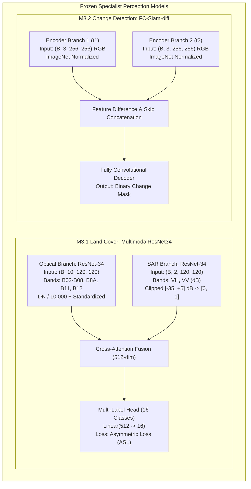
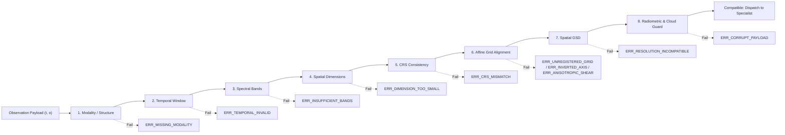

# SatQuery AI — Phase 4 Preregistration Protocol: Robustness, Generalization, and Adversarial Envelope Discovery

**Document Identifier**: `SATQUERY-P4-PROTOCOL-V1.5-DRAFT`  
**Phase**: Phase 4 — Robustness, Generalization, and Operational Envelope Discovery  
**Date**: November 8, 2026  
**Status**: **PROPOSED PREREGISTRATION PROTOCOL — DRAFT v1.5 (Methodological and Statistical Lock — Awaiting Final Freeze)**  
**Repository Branch**: `feature/phase4-generalization-protocol`  
**Preceding Milestones**: Phase 3 Closed (M3.1 Multimodal ASL/CB-BCE, M3.2 FC-Siam-diff, M3.3 Selective Routing) with Pre-Registered Limitations  
**Model Weight & Artifact Provenance**: Completely Frozen from Phase 3  
- Multimodal Land Cover Specialist: `artifacts/specialists/deep_land_cover_asl/best_model_asl.pt` (`MultimodalResNet34`, 10 optical bands + 2 SAR bands, **16-class output head: `head.1.weight: torch.Size([16, 512])`**)
- Deep Change Detection Specialist: `artifacts/specialists/deep_change_detection_fc_siam_diff/best_model.pt` (`FCSiamDiff`, bitemporal RGB, ImageNet normalized)
- Linguistic Task Router: `artifacts/router/router_model.joblib` (TF-IDF + Logistic Regression, $T=0.0991$, $\tau_{\text{intent}}=0.65, \tau_{\text{margin}}=0.15, \tau_{\text{sel}}=1.0$)
- Physical Compatibility Gate: Deterministic closed-form validation module in [`satquery/utils/geospatial.py`](file:///c:/Users/B%20NAVANEETH/SatQueryAI/satquery/utils/geospatial.py) inspecting 8 physical dimensions

---

## 1. Executive Research Motivation & Non-Tuning Directive

Phase 3 established the foundational multimodal perception and input-constrained selective routing architecture of SatQuery AI:
- **Milestone M3.1**: Implemented and benchmarked deep multimodal land-cover classification using a dual-branch ResNet-34 (`MultimodalResNet34`) trained with asymmetric loss (ASL) on BigEarthNet-14k paired Sentinel-1 SAR and Sentinel-2 multispectral observations.
- **Milestone M3.2**: Established deep Siamese change detection using `FC-Siam-diff` and `BIT` on bitemporal Sentinel-2 imagery, evaluated under strict city-level spatial disjointness.
- **Milestone M3.3**: Established a temperature-calibrated linear task router ($T=0.0991$) tightly coupled to a deterministic 8-dimensional physical compatibility gate, demonstrating $0.00\%$ observed incompatible dispatch error rate ($\text{IDER}_{\text{obs}} = 0.0\%$, finite-sample Wilson 95% bound $\le 9.89\%$) and $59.0\%$ overall 7-task architectural success.

### The Non-Tuning Scientific Directive
**Phase 4 is strictly a validation, stress-testing, and operational envelope discovery phase.**  
To preserve open-science methodological integrity:
1. **Zero Weight / Parameter Tuning**: No specialist neural weights, router calibration temperatures ($T_{\text{cal}} = 0.0991$), or routing operating thresholds ($\tau_{\text{intent}}=0.65, \tau_{\text{margin}}=0.15, \tau_{\text{sel}}=1.0$) will be re-trained, fine-tuned, or adjusted against Phase 4 evaluation data.
2. **Strict Confirmatory Testing**: Hypotheses H1 through H5 represent confirmatory evaluations of the frozen Phase 3 checkpoints. Any exploratory analyses, failure post-mortems, or adaptation experiments will be formally quarantined into separate, non-confirmatory reporting sections.
3. **Transparent Reporting of Operational Limits**: Performance degradations, out-of-domain failure modes, or edge-case gate rejections will be documented transparently as scientific characterizations of the system's operational envelope rather than concealed.
4. **Pre-Registered Protocol Lock**: Hypotheses, comparison populations, statistical test definitions, and acceptance criteria are finalized prior to execution; no post-hoc amendments based on observed results will be permitted.

---

## 2. Frozen Perception Architectures & Exact Input Contracts

An audit of the codebase checkpoints and dataset loaders confirms the exact hardware, architecture, and tensor contracts of the frozen models:



### Specialist 1: Multimodal Land Cover (`MultimodalResNet34`)
- **Model Checkpoint**: `artifacts/specialists/deep_land_cover_asl/best_model_asl.pt` (ASL $\gamma^+=0, \gamma^-=4, m=0.05$).
- **Architecture**: Dual-branch ResNet-34 backbones with 8-head cross-attention fusion projecting to a 512-dimensional multimodal latent space, terminated with a linear head `head.1.weight: torch.Size([16, 512])`.
- **Target Label Taxonomy (Empirically Verified: 16 Classes)**:
  Audited from `artifacts/specialists/land_cover/classes.json`:
  1. `Arable land`
  2. `Beaches, dunes, sands`
  3. `Broad-leaved forest`
  4. `Complex cultivation patterns`
  5. `Coniferous forest`
  6. `Industrial or commercial units`
  7. `Inland waters`
  8. `Inland wetlands`
  9. `Land principally occupied by agriculture, with significant areas of natural vegetation`
  10. `Mixed forest`
  11. `Moors, heathland and sclerophyllous vegetation`
  12. `Natural grassland and sparsely vegetated areas`
  13. `Pastures`
  14. `Permanent crops`
  15. `Transitional woodland, shrub`
  16. `Urban fabric`
- **Input Tensor Contract**:
  - Optical tensor: Shape `(B, 10, 120, 120)` consisting of 10 Sentinel-2 L2A surface reflectance channels in exact order: `[B02, B03, B04, B05, B06, B07, B08, B8A, B11, B12]`. Optical normalization: $\text{DN} / 10000.0$, standardized with frozen training statistics:
    $$\mu_{\text{opt}} = [0.136, 0.118, 0.106, 0.128, 0.203, 0.257, 0.272, 0.273, 0.187, 0.121]$$
    $$\sigma_{\text{opt}} = [0.082, 0.076, 0.074, 0.089, 0.098, 0.108, 0.113, 0.112, 0.095, 0.078]$$
  - SAR tensor: Shape `(B, 2, 120, 120)` consisting of 2 Sentinel-1 GRD IW polarization channels: `[VH, VV]` in decibels. SAR normalization: clipped to $[-35.0, +5.0]\text{ dB}$ and linearly scaled to $[0.0, 1.0]$ via $(\text{dB} + 35.0) / 40.0$.

### Specialist 2: Deep Bitemporal Change Detection (`FCSiamDiff`)
- **Model Checkpoint**: `artifacts/specialists/deep_change_detection_fc_siam_diff/best_model.pt`.
- **Architecture**: Fully Convolutional Siamese Difference network (`FC-Siam-diff`) with shared feature extraction backbones and difference skip connections.
- **Input Tensor Contract**:
  - Bitemporal pair: Two coregistered RGB tensors $(t_1, t_2)$ of shape `(B, 3, H, W)` with $H, W \ge 100$ (nominally $256 \times 256$ patches or full-scene sliding window).
  - Normalization: ImageNet channel-wise standardization ($\mu = [0.485, 0.456, 0.406], \sigma = [0.229, 0.224, 0.225]$).
- **Target Label Taxonomy**: Binary change mask ($1 = \text{Change}, 0 = \text{No Change}$).

### Specialist 3: Task Router & Physical Compatibility Gate
- **Router Architecture**: Scikit-Learn TF-IDF Vectorizer (word n-grams 1-2, sublinear TF scaling) + Multinomial Logistic Regression calibrated via temperature scaling ($T=0.0991$).
- **Routing Policy**:
  - Primary intent threshold: $\tau_{\text{intent}} = 0.65$
  - Confidence margin threshold: $\tau_{\text{margin}} = 0.15$
  - Specialist selection threshold: $\tau_{\text{sel}} = 1.0$
- **Physical Compatibility Gate $\mathcal{C}(t, o)$**: Deterministic closed-form programmatic gate implemented in [`satquery/utils/geospatial.py`](file:///c:/Users/B%20NAVANEETH/SatQueryAI/satquery/utils/geospatial.py).

---

## 3. The 8 Physical Compatibility Gate Dimensions (Implementation Audit & Boundary Logic)

The physical compatibility gate $\mathcal{C}(t, o) \in \{0, 1\}$ provides deterministic input validation before any neural specialist is invoked. An audit of [`satquery/utils/geospatial.py`](file:///c:/Users/B%20NAVANEETH/SatQueryAI/satquery/utils/geospatial.py) establishes the exact 8 machine-enforceable dimensions, explicit boundary equality conditions, and diagnostic error codes:



| Dimension | Checked Parameter | Gate Logic & Engineering Limits | Strict Boundary Points (Sub / Equality / Super) | Diagnostic Error Code |
| :--- | :--- | :--- | :--- | :--- |
| **1. Modality & Sensor Structure** | Payload type & dictionary keys | - Land Cover: requires paired SAR+optical paths or multimodal feature vector; rejects bitemporal pairs.<br>- Change Detection: requires bitemporal pair ($N=2$); rejects single images or 1D features.<br>- Optical-SAR Fusion: requires simultaneous S1+S2 inputs. | Single optical image to LC $\to$ Fail<br>Bitemporal pair to CD $\to$ Pass<br>Feature vector to CD $\to$ Fail | `ERR_MISSING_MODALITY` |
| **2. Temporal Revisit Window** | Revisit interval $\Delta t = \|t_2 - t_1\|$ | - Change Detection: enforces $5.0\text{ days} \le \Delta t \le 730.0\text{ days}$.<br>- Dynamic Optical-SAR Fusion: offset $\le 72.0\text{h}$ ($3.0\text{d}$). | $\Delta t = 4.9\text{d}$ (Fail: $< 5.0$)<br>$\Delta t = 5.0\text{d}$ (**Equality: Pass**)<br>$\Delta t = 730.0\text{d}$ (**Equality: Pass**)<br>$\Delta t = 730.1\text{d}$ (Fail: $> 730.0$) | `ERR_TEMPORAL_INVALID` |
| **3. Spectral Band Adequacy** | Band metadata `spectral_bands` | - Land Cover: requires minimum multispectral presence of $\{B02, B03, B04, B08\}$. Deep inference requires 10 optical channels. | Missing B08 $\to$ Fail<br>Exact required set $\{B02, B03, B04, B08\}$ $\to$ Pass | `ERR_INSUFFICIENT_BANDS` |
| **4. Spatial Dimensions** | Raster height and width $(H, W)$ | - Land Cover: requires $H, W \ge 120\text{ pixels}$.<br>- Change Detection: requires $H, W \ge 100\text{ pixels}$.<br>- Shape equality: $H_1 = H_2$ and $W_1 = W_2$ for bitemporal pairs. | LC: $119 \times 120$ (Fail)<br>LC: $120 \times 120$ (**Equality: Pass**)<br>CD: $99 \times 100$ (Fail)<br>CD: $100 \times 100$ (**Equality: Pass**) | `ERR_DIMENSION_TOO_SMALL`<br>`ERR_DIMENSION_MISMATCH` |
| **5. Geospatial CRS Consistency** | Coordinate Reference System metadata | - Bitemporal pairs: enforces identical projected reference systems (`crs1 == crs2`). Rejects unprojected lat/lon mixed with UTM or mismatched UTM zones.<br>*Note on reprojection*: Reprojection must occur upstream; computing Euclidean pixel displacements across differing CRSs is mathematically undefined. | EPSG:32632 vs EPSG:32632 $\to$ Pass<br>EPSG:32632 vs EPSG:4326 $\to$ Fail<br>EPSG:32632 vs EPSG:32633 $\to$ Fail | `ERR_CRS_MISMATCH` |
| **6. Coregistration & Affine Alignment** | GDAL GeoTransform matrices `gt1, gt2` | Evaluates relative affine transform $\mathbf{M}_{\text{rel}} = \mathbf{A}_1^{-1} \mathbf{A}_2$ and corner displacements:<br>- Inverted axis: $\det(\mathbf{M}_{\text{rel}}) \le 0$<br>- Scale distortion: $|\det(\mathbf{M}_{\text{rel}}) - 1.0| > 0.02$ or $|\sigma_i - 1.0| > 0.01$<br>- Anisotropic shear: SVD condition number $\kappa = \sigma_1 / \sigma_2 > 1.01$<br>- Axis rotation: $|\theta_{\text{rel}}| > 0.28^\circ$<br>- Corner displacement: $\delta_{\text{max}} > 0.05\text{ px}$. | $\delta = 0.049\text{ px}$ (Pass)<br>$\delta = 0.050\text{ px}$ (**Equality: Pass**)<br>$\delta = 0.051\text{ px}$ (Fail: $> 0.05$)<br>$\kappa = 1.010$ (**Equality: Pass**), $1.011$ (Fail)<br>$\|\theta\| = 0.280^\circ$ (**Equality: Pass**), $0.281^\circ$ (Fail)<br>$\det = 0.980$ (**Equality: Pass**), $0.979$ (Fail)<br>$\det = 0.000$ (Fail: $\det \le 0$) | `ERR_INVERTED_AXIS`<br>`ERR_SCALE_DISTORTION`<br>`ERR_ANISOTROPIC_SHEAR`<br>`ERR_ROTATION_MISMATCH`<br>`ERR_UNREGISTERED_GRID` |
| **7. Ground Sample Distance (GSD)** | Spatial resolution metadata `gsd_m` | - Sentinel-2 specialists require nominal resolution: $8.0\text{ m} \le \text{GSD} \le 12.0\text{ m}$. Rejects native Landsat ($30\text{ m}$) and native PlanetScope ($3\text{ m}$). | $\text{GSD} = 7.9\text{ m}$ (Fail: $< 8.0$)<br>$\text{GSD} = 8.0\text{ m}$ (**Equality: Pass**)<br>$\text{GSD} = 12.0\text{ m}$ (**Equality: Pass**)<br>$\text{GSD} = 12.1\text{ m}$ (Fail: $> 12.0$) | `ERR_RESOLUTION_INCOMPATIBLE` |
| **8. Radiometric Integrity & Cloud Guard** | Raster numerical values & `cloud_fraction` | - Numerical integrity: scans for `NaN` and `Inf` floating point values.<br>- Double-scaling trap: detects float values $\le 1.05$ where raw DN $[0, 10000]$ is expected.<br>- Cloud cover threshold: rejects payloads with cloud fraction $> 0.20$ for Land Cover and $> 0.10$ for Change Detection based on metadata contract. | LC Cloud $10\%$ (Pass)<br>LC Cloud $20\%$ (**Equality: Pass**)<br>LC Cloud $20.1\%$ (Fail: $> 0.20$)<br>CD Cloud $5\%$ (Pass)<br>CD Cloud $10\%$ (**Equality: Pass**)<br>CD Cloud $10.1\%$ (Fail: $> 0.10$) | `ERR_CORRUPT_PAYLOAD` |

---

## 4. Confirmatory Experimental Tracks

### Track 4.1: Cross-Region Geographic Generalization

- **Research Question**: Does the frozen perception pipeline generalize across global biomes outside the European training domain, and does the physical compatibility gate maintain invariant validity detection?
- **Hypothesis (H1)**: While perception accuracy will experience statistically significant degradation ($\Delta F_1 < 0, p < 0.05$) under severe biomic and seasonal distribution shift relative to in-domain validation, the frozen specialist will maintain a graceful performance floor ($\text{Macro } F_{1,\text{mapped13}} \ge 25.0\%$ on arid and temperate biomes), and the physical compatibility gate will maintain invariant validity detection ($0\%$ false dispatches).
- **Target Population**:
  1. *Land Cover Cohort ($N = 2,000$ paired patches)*:
     - Sourced from geographically verified tiles in **SEN12MS** (Spring/Summer acquisitions) and open Copernicus Sentinel-1/2 data, providing co-registered 10-band Sentinel-2 L2A and 2-band Sentinel-1 GRD IW (VH, VV) patches ($120 \times 120$ pixels, 10m GSD).
     - Stratified evenly across 4 global biomes ($N=500$ patches each):
       - **Biome 1 (Arid / Hyper-arid & Semi-arid)**: North Africa and the Arabian Peninsula (Sahara desert margins, Sinai, Rub' al Khali; Lat $24^\circ\text{N}$ to $32^\circ\text{N}$, Lon $25^\circ\text{E}$ to $45^\circ\text{E}$).
       - **Biome 2 (Tropical Rainforest)**: Amazon Basin, Brazil and Congo Basin, Central Africa (Lat $5^\circ\text{S}$ to $5^\circ\text{N}$, Lon $65^\circ\text{W}$ to $55^\circ\text{W}$ and $15^\circ\text{E}$ to $25^\circ\text{E}$).
       - **Biome 3 (Boreal Forest / Sub-Arctic)**: Fennoscandia and Interior Alaska (Lat $60^\circ\text{N}$ to $68^\circ\text{N}$, Lon $15^\circ\text{E}$ to $30^\circ\text{E}$ and $150^\circ\text{W}$ to $140^\circ\text{W}$).
       - **Biome 4 (Humid Subtropical / Monsoon Cropland)**: Indo-Gangetic Plain and Mekong Delta (Lat $10^\circ\text{N}$ to $26^\circ\text{N}$, Lon $75^\circ\text{E}$ to $105^\circ\text{E}$).
     - **Cross-Taxonomy Ground-Truth Construction Algorithm (MODIS MCD12Q1 $\to$ Patch Grid)**:
       Ground truth for transfer patches is derived from the MODIS Land Cover Type product (MCD12Q1 Version 6, Land Cover Type 1: IGBP taxonomy, 500m nominal grid). The exact multi-label generation follows a deterministic spatial intersection algorithm:
       1. *Spatial Alignment*: For each Sentinel-2 $120 \times 120$ patch (footprint $1200\text{ m} \times 1200\text{ m}$ in local UTM coordinates), project the bounding box $B_i$ onto the 500m sinusoidal MCD12Q1 grid, intersecting an array of $\approx 5\text{ to } 9$ partially or fully overlapping MODIS pixels.
       2. *Temporal Harmonization Rule*: The MODIS product calendar year must strictly match the acquisition year of the Sentinel-1/2 imagery ($Y_{\text{MODIS}} = Y_{\text{S2}}$). If an exact calendar-year product is unreleased, the temporally closest annual product within $\le 1$ calendar year is mandated.
       3. *Area-Weighted Class Assignment*: For each intersecting MODIS cell $m$ with IGBP class $C_m$, calculate the exact intersection area $A_m = \text{Area}(\text{Cell}_m \cap B_i)$. The fractional area coverage for IGBP class $C$ is:
          $$w_i(C) = \frac{\sum_{m: C_m = C} A_m}{\text{Area}(B_i)}$$
       4. *Multi-Label Thresholding ($\tau_{\text{area}} = 0.20$)*: A mapped BigEarthNet class $k \in \{1, \dots, 13\}$ is assigned active ground truth ($y_{i, k} = 1$) if and only if the sum of fractional areas of its corresponding MODIS classes meets or exceeds $20\%$:
          $$y_{i, k} = \mathbb{I}\left(\sum_{C \in \text{Map}(k)} w_i(C) \ge 0.20\right)$$
          If no class attains $20\%$ (highly fragmented mosaic), the single class with plurality fractional coverage is assigned active ($y_{i, k^*} = 1$ where $k^* = \arg\max_k \sum_{C \in \text{Map}(k)} w_i(C)$), guaranteeing at least one ground-truth label per patch.
     - **Cross-Taxonomy Alignment Table**:
       The target taxonomy consists of the 16 classes from `artifacts/specialists/land_cover/classes.json`. Ground truth is categorized as **Directly Mapped ($N=6$)**, **Approximately Mapped ($N=7$)**, or **Quarantined / Inevaluable ($N=3$)**:
       | BigEarthNet-16 Target Class | Mapped MODIS IGBP Class(es) | Semantic Alignment / Rationale | Categorization Status |
       | :--- | :--- | :--- | :--- |
       | `Coniferous forest` | Class 1 (Evergreen Needleleaf), Class 3 (Deciduous Needleleaf) | High fidelity needleleaf canopy alignment | **Directly Mapped** |
       | `Broad-leaved forest` | Class 2 (Evergreen Broadleaf), Class 4 (Deciduous Broadleaf) | High fidelity broadleaf canopy alignment | **Directly Mapped** |
       | `Mixed forest` | Class 5 (Mixed Forest) | Co-dominant needleleaf/broadleaf canopy | **Directly Mapped** |
       | `Arable land` | Class 12 (Croplands) | Annual cropland cover | **Directly Mapped** |
       | `Urban fabric` | Class 13 (Urban and Built-up Lands) | Impervious surface / built settlement | **Directly Mapped** |
       | `Inland wetlands` | Class 11 (Permanent Wetlands) | Water-inundated land surface | **Directly Mapped** |
       | `Transitional woodland, shrub` | Class 6 (Closed Shrublands) | Approximate: closed shrubland structure | **Approximate Mapping** |
       | `Moors, heathland and sclerophyllous...` | Class 7 (Open Shrublands) | Approximate: low-density open shrubland | **Approximate Mapping** |
       | `Natural grassland and sparsely vegetated...` | Class 8 (Woody Savannas), Class 9 (Savannas) | Approximate: savannas combine grass and sparse trees | **Approximate Mapping** |
       | `Pastures` | Class 10 (Grasslands) | Approximate: includes natural grassland and managed pasture | **Approximate Mapping** |
       | `Land principally occupied by agriculture...` | Class 14 (Cropland/Natural Vegetation Mosaic) | Approximate: mosaic pattern representation | **Approximate Mapping** |
       | `Inland waters` | Class 17 (Water Bodies) | Approximate: includes marine coastal water along with inland lakes/rivers | **Approximate Mapping** |
       | `Beaches, dunes, sands` | Class 16 (Barren) | Approximate: includes bare soil, rock, and desert along with sand/dunes | **Approximate Mapping** |
       | `Industrial or commercial units` | *None* | Cannot be resolved from 500m MODIS Class 13 | **Quarantined / Inevaluable** |
       | `Complex cultivation patterns` | *None* | Parcel geometry cannot be resolved at 500m | **Quarantined / Inevaluable** |
       | `Permanent crops` | *None* | Orchards/vineyards not distinguished from annual crops | **Quarantined / Inevaluable** |
     - **Disentangled Metrics & Sensitivity Analysis Mandate**:
       - **Primary Confirmatory Metric**: Combined 13-Class Mapped Macro $F_1$ ($F_{1,\text{mapped13}}$).
       - **Mandatory Sensitivity Analyses**:
         1. *Directly Mapped Macro $F_1$ ($F_{1,\text{direct6}}$)*: Evaluated strictly over the 6 high-fidelity classes.
         2. *Approximately Mapped Macro $F_1$ ($F_{1,\text{approx7}}$)*: Evaluated over the 7 approximate classes.
         3. *Quarantined Diagnostics Table*: Output frequencies and unverified trigger rates for the 3 unmapped classes. Under no circumstances will a 16-class Macro $F_1$ score be reported as an observed benchmark.
     - **Spatial Cluster Footprint Transparency**:
       - The in-domain BigEarthNet-14k test population comprises $N=3,248$ patches derived from exactly **3 geographic tile clusters**: `T34TCR`, `T34TEQ`, and `T34TFN` in Serbia.
       - Because resampling within $K_{\text{in}} = 3$ clusters provides limited representation of in-domain geographic uncertainty, bootstrap confidence intervals are interpreted as local envelope estimates. Per-tile in-domain metrics ($F_1(\text{T34TCR}), F_1(\text{T34TEQ}), F_1(\text{T34TFN})$) will be reported alongside aggregate figures.
  2. *Change Detection Cohort ($N = 10$ held-out non-European scenes)*:
     - Sourced from **S2Looking** and held-out global cities outside the European/Mediterranean OSCD concentration:
       - Cities: Cairo, Nairobi, Santiago, Ulaanbaatar, Perth, Brisbane, Jakarta, Johannesburg, Calgary, Tashkent.
       - Complete city-level disjointness from OSCD train, val, and test splits.
       - Tiled into $N \ge 500$ evaluation patches ($256 \times 256$, bitemporal RGB, ImageNet normalized).
     - **Scene-Level Reporting Mandate**: Due to the small cluster count ($N=10$ independent cities), patches will not be pooled as independent observations. Metrics will be reported **at the scene level** ($F_{1, s}$ for $s=1,\dots,10$) alongside mean, standard error, median, and interquartile range (IQR).
- **Statistical Comparison & Per-Biome Hypotheses**:
  - Out-of-domain and in-domain observations are **strictly independent samples**.
  - For each biome $k \in \{1, 2, 3, 4\}$, the confirmatory degradation hypothesis is:
    $$H_{0, \text{Biome } k}: \Delta F_{1, \text{mapped13}, k} \ge 0 \quad \text{vs.} \quad H_{1, \text{Biome } k}: \Delta F_{1, \text{mapped13}, k} < 0$$
    where $\Delta F_{1, \text{mapped13}, k} = F_{1,\text{mapped13},\text{OOD}, k} - F_{1,\text{mapped13},\text{in-domain}}$.
  - Confidence intervals ($95\%$ CI) and finite-bootstrap $p$-values are estimated via **Two-Sample Independent Spatial Cluster Bootstrap** ($B=1,000$ replicates), resampling tile clusters from in-domain ($K_{\text{in}}=3$) and sub-regions from out-of-domain ($K_{\text{OOD}, k} \ge 5$ per biome).
  - Multiplicity control across the 4 biomes is strictly enforced via the **Step-Down Holm procedure at FWER $\alpha = 0.05$**.
- **Pre-Registered Acceptance Criteria**:
  - Primary Performance Floor: $\text{Macro } F_{1,\text{mapped13}} \ge 25.0\%$ on arid and temperate transfer biomes.
  - Gate Specificity & Sensitivity: Physical gate achieves $100\%$ precision and recall on the mixed valid/invalid alignment suite ($10$ valid scenes + $10$ deliberately misaligned scenes).

---

### Track 4.2: Cross-Sensor & Cross-Resolution Compatibility Defense

- **Research Question**: Does the physical compatibility gate deterministically intercept observations from off-target sensors (Landsat, PlanetScope) before dispatching to Sentinel-2 specialists?
- **Source-Level Unit of Analysis & Payload Allocation**:
  - The 80 off-sensor payloads are derived from **$N_{\text{source}} = 40$ independent acquisition footprints** (20 Landsat-8/9 scenes, 20 PlanetScope scenes).
  - Exactly 2 perturbed payloads are derived from each independent source scene ($2 \times 40 = 80$):
    - *Payload A (Resolution Stress)*: Native spatial resolution preserved without resampling (`gsd_m = 30.0` for Landsat, `gsd_m = 3.0` for PlanetScope) $\to$ Expected: `ERR_RESOLUTION_INCOMPATIBLE`.
    - *Payload B (Modality / Spectral Stress)*: Optical-only payload without SAR sent to Land Cover specialist (`ERR_MISSING_MODALITY`), or off-sensor band naming nomenclature lacking Sentinel-2 channel codes (`ERR_INSUFFICIENT_BANDS`).
  - Because perturbations sharing a source footprint are statistically dependent, the primary statistical unit of analysis is defined at the **independent source footprint level**:
    $$\text{Fail}_{\text{source}, i} = \max_{j \in \{A, B\}} \mathbb{I}(\text{Payload}_{i, j} \text{ dispatched to specialist})$$
- **Confirmatory Safety Hypothesis & Exact Power Formulation**:
  - Let $\delta_{\text{tol}} = 0.10$ ($10.0\%$) represent the pre-registered maximum tolerable source-level error rate. We formulate the one-sided safety hypothesis:
    $$H_0: \text{IDER}_{\text{source}} \ge 0.10 \quad \text{vs.} \quad H_1: \text{IDER}_{\text{source}} < 0.10$$
  - Under $H_0$, observing 0 failures in $N_{\text{source}} = 40$ independent trials has exact binomial probability:
    $$p = (1 - 0.10)^{40} = 0.90^{40} \approx 0.01478 < 0.05$$
  - Observing zero source-level dispatches formally rejects $H_0$ at the $\alpha = 0.05$ significance level.
- **Target Population ($N=100$ Payloads from $N_{\text{scenes}} = 60$)**:
  - **40 Landsat-8/9 Payloads (from 20 independent scenes)**: 20 Payload A (Resolution) + 20 Payload B (Modality/Spectral).
  - **40 PlanetScope Scene Payloads (from 20 independent scenes)**: 20 Payload A (Resolution) + 20 Payload B (Modality/Spectral).
  - **20 Sentinel-2 Level-2A Control Payloads (from 20 independent scenes)**:
    - 10 valid Land Cover multimodal payloads (10 optical + 2 SAR bands, $120 \times 120$, GSD 10m).
    - 10 valid Change Detection bitemporal pairs (RGB, $256 \times 256$, GSD 10m, $\Delta t \in [5, 730]\text{ days}$).
- **Evaluation Metrics & Exact Confidence Bounds**:
  - **Confirmatory Source-Level Metric**: $\widehat{\text{IDER}}_{\text{source}} = N_{\text{failed source scenes}} / 40$.
    - For 0 errors in 40 independent trials:
      - **Two-sided 95% Clopper-Pearson exact bound**: $[0.00\%, \mathbf{8.81\%}]$
      - **Two-sided 95% Wilson score bound**: $[0.00\%, \mathbf{8.76\%}]$
      - **One-sided 95% Clopper-Pearson upper bound**: $\mathbf{7.23\%} < 10.0\%$
  - **Descriptive Engineering Metrics**:
    - $\widehat{\text{IDER}}_{\text{payload}} = N_{\text{dispatched payloads}} / 80 = 0.00\%$
    - Correct Violation Detection Rate: $\text{CVDR}_{\text{payload}} = 80 / 80 = 100.0\%$
  - **Control False Rejection Rate**:
    - $\widehat{\text{FRR}}_{\text{control}} = N_{\text{rejected controls}} / 20 = 0.00\%$ (Wilson 95% bound $[0.00\%, 16.11\%]$, Clopper-Pearson $[0.00\%, 16.84\%]$).
- **Pre-Registered Acceptance Criteria**:
  - Statistical Safety Confirmation: $\widehat{\text{IDER}}_{\text{source}} = 0.00\%$ ($0 / 40$), rejecting $H_0: \text{IDER}_{\text{source}} \ge 0.10$ with $p = 0.0148$.
  - Descriptive Engineering Target: $\widehat{\text{IDER}}_{\text{payload}} = 0.00\%$ ($0 / 80$).
  - Control Preservation: $\widehat{\text{FRR}}_{\text{control}} = 0.00\%$ ($0 / 20$).

---

### Track 4.3: Atmospheric & Image-Quality Stress Testing

- **Scope & Architectural Clarification**:
  This track explicitly evaluates two decoupled mechanisms:
  1. **Specialist Perception Robustness Envelope**: Measures how neural specialist performance degrades when raster pixels are obscured by atmospheric haze, synthetic cloud occlusion, and sensor noise.
  2. **Ingestion Metadata Contract Enforcement**: Verifies that when provider metadata indicates cloud contamination exceeding pre-registered limits ($> 20\%$ for LC, $> 10\%$ for CD), the physical compatibility gate $\mathcal{C}(t, o)$ deterministically halts execution.
- **Monotonically Increasing Severity Parameterization**:
  To guarantee unambiguous directional interpretations of degradation slopes, all perturbation parameters are coded to be **strictly monotonically increasing with degradation severity**:
  1. *Synthetic Cloud Occlusion*: Parameterized by cloud area fraction:
     $$\text{Sev}_{\text{cloud}} = f_c \in \{0.05, 0.10, 0.15, 0.20, 0.30, 0.40, 0.50\} \quad (\text{Clean reference}: f_c = 0.00)$$
  2. *Atmospheric Haze Scattering*: Parameterized by haze opacity ($1 - t$), where $t$ is atmospheric transmittance:
     $$\text{Sev}_{\text{haze}} = 1 - t \in \{0.10, 0.30, 0.50, 0.70\} \quad (\text{Clean reference}: t = 1.00 \implies \text{Sev}_{\text{haze}} = 0.00)$$
     *(derived from transmittance levels $t \in \{0.90, 0.70, 0.50, 0.30\}$; higher opacity indicates more severe haze)*.
  3. *Radiometric Sensor Noise*: Parameterized by additive Gaussian standard deviation:
     $$\text{Sev}_{\text{noise}} = \sigma \in \{0.01, 0.02, 0.05, 0.10\} \quad (\text{Clean reference}: \sigma = 0.00)$$
- **Spatial Clustering & Scene-Level Resampling Structure**:
  The evaluation cohort consists of $N=250$ patches per specialist ($i=1,\dots,250$) sampled from $M \ge 10$ distinct geographic scene clusters (tiles). Because patches from the same scene share atmospheric and land-cover properties:
  - Each patch is assigned a scene-cluster identifier $c(i) \in \{1, \dots, M\}$.
  - Bootstrap resampling is conducted strictly at the **scene-cluster level** ($M$ clusters resampled with replacement), including all patch trajectories belonging to the sampled clusters. This simultaneously accounts for spatial autocorrelation across neighboring patches and repeated-measures dependence across severity conditions.
- **Patch-Level Endpoint vs Aggregate Endpoint Formulations**:
  - *Patch-Level Performance Endpoint ($F_{1, i}(d)$)*:
    - For Land Cover (multi-label): For patch $i$ and condition $d$, sample F1 (Dice coefficient) is computed across ground-truth active classes $\mathbf{y}_i$ and predicted classes $\hat{\mathbf{y}}_i(d)$:
      $$F_{1, i}(d) = \frac{2 |\mathbf{y}_i \cap \hat{\mathbf{y}}_i(d)|}{|\mathbf{y}_i| + |\hat{\mathbf{y}}_i(d)|}$$
      In BigEarthNet, every patch satisfies $|\mathbf{y}_i| \ge 1$. If the model predicts no active classes ($|\hat{\mathbf{y}}_i(d)| = 0$), $F_{1, i}(d) = 0.0$.
    - For Change Detection (binary change mask):
      $$F_{1, i}(d) = \frac{2 \cdot \text{TP}_i(d)}{2 \cdot \text{TP}_i(d) + \text{FP}_i(d) + \text{FN}_i(d)}$$
      If a patch contains no ground-truth change pixels ($\text{TP}_i = \text{FN}_i = 0$) and the model predicts no change ($\text{FP}_i = 0$), $F_{1, i}(d) = 1.0$; if false positive pixels are predicted on an all-negative patch, $F_{1, i}(d) = 0.0$.
  - *Primary Modeling Endpoint*:
    The primary statistical model is fit on the paired within-patch degradation delta:
    $$\Delta F_{1, i}(d) = F_{1, i}(d) - F_{1, i}(\text{clean})$$
  - *Confirmatory Aggregate Benchmark*:
    Dataset-level pooled macro $F_1(d)$ (pooling true positives, false positives, and false negatives across all patches at condition $d$) will be reported in tandem as an aggregate consistency check.
- **Statistical Model & Finite-Bootstrap p-value Formula**:
  - Fit a repeated-measures linear regression model clustered by scene:
    $$\Delta F_{1, i}(d) = \beta_0 + \beta_1 \cdot \text{Severity}_d + u_i + \epsilon_{i, d}$$
    where $u_i$ is the patch random intercept.
  - **Six Confirmatory Trend Tests**:
    1. Test 4.3.1: Land Cover $\times$ Synthetic Cloud Occlusion ($\beta_{1, 1}$)
    2. Test 4.3.2: Land Cover $\times$ Atmospheric Haze Scattering ($\beta_{1, 2}$)
    3. Test 4.3.3: Land Cover $\times$ Radiometric Sensor Noise ($\beta_{1, 3}$)
    4. Test 4.3.4: Change Detection $\times$ Synthetic Cloud Occlusion ($\beta_{1, 4}$)
    5. Test 4.3.5: Change Detection $\times$ Atmospheric Haze Scattering ($\beta_{1, 5}$)
    6. Test 4.3.6: Change Detection $\times$ Radiometric Sensor Noise ($\beta_{1, 6}$)
  - **Hypothesis Formulation**: For each test $j \in \{1, \dots, 6\}$:
    $$H_{0, j}: \beta_{1, j} \ge 0 \quad \text{vs.} \quad H_{1, j}: \beta_{1, j} < 0$$
  - **Finite-Bootstrap p-value Calculation**:
    On each of $B = 1,000$ scene-cluster bootstrap resamples $b \in \{1, \dots, B\}$, refit the model to obtain bootstrap slope $\hat{\beta}_{1, j}^{*(b)}$. The one-sided finite-bootstrap $p$-value is:
    $$p_j = \frac{1 + \sum_{b=1}^B \mathbb{I}(\hat{\beta}_{1, j}^{*(b)} \ge 0)}{B + 1}$$
    With $B=1,000$, the minimum attainable $p$-value is $1 / 1001 \approx 0.000999 \approx 0.0010$, ensuring robust detection well below the initial Step-Down Holm threshold ($\alpha_1 = 0.05 / 6 \approx 0.00833$).
  - Multiplicity across the 6 tests is controlled via the **Step-Down Holm procedure at FWER $\alpha = 0.05$**.
- **Explicit Cloud Metadata Boundary Matrix**:
  | Specialist Task | Cloud Fraction ($f_c$) | Strict Threshold Formula | Boundary Type | Expected Gate Decision | Expected Error Code |
  | :--- | :--- | :--- | :--- | :--- | :--- |
  | Land Cover | $10\%$ | $0.10 \le 0.20$ | Sub-threshold | **Pass** | None |
  | Land Cover | $20\%$ | $0.20 \le 0.20$ | **Exact Boundary Equality** | **Pass** | None |
  | Land Cover | $20.1\%$ | $0.201 > 0.20$ | Super-threshold Boundary | **Reject** | `ERR_CORRUPT_PAYLOAD` |
  | Land Cover | $30\%$ | $0.30 > 0.20$ | Super-threshold | **Reject** | `ERR_CORRUPT_PAYLOAD` |
  | Change Detection | $5\%$ | $0.05 \le 0.10$ | Sub-threshold | **Pass** | None |
  | Change Detection | $10\%$ | $0.10 \le 0.10$ | **Exact Boundary Equality** | **Pass** | None |
  | Change Detection | $10.1\%$ | $0.101 > 0.10$ | Super-threshold Boundary | **Reject** | `ERR_CORRUPT_PAYLOAD` |
  | Change Detection | $15\%$ | $0.15 > 0.10$ | Super-threshold | **Reject** | `ERR_CORRUPT_PAYLOAD` |
- **Pre-Registered Acceptance Criteria**:
  - Cloud Gate Enforcement: $100\%$ interception precision on boundary rejection conditions.
  - Statistical Trend Significance: Significant downward monotonic slope on all 6 tests after Holm adjustment ($\text{Holm-adjusted } p_j < 0.05$).

---

### Track 4.4: Complex & Adversarial Linguistic Query Defense

- **Threat Model Clarification**:
  The routing module in SatQuery AI is a linear text classifier consisting of a TF-IDF n-gram vectorizer and a temperature-calibrated Logistic Regression model ($T=0.0991$, $\tau_{\text{intent}}=0.65, \tau_{\text{margin}}=0.15$). It is **not** an autoregressive Large Language Model (LLM). The threat model targets the classifier's feature space:
  1. *Adversarial lexical perturbations*: Intentional placement of out-of-domain keywords or task-confusing vocabulary to spoof TF-IDF weight balances.
  2. *Multi-task lexical collisions*: Queries containing vocabulary strongly associated with multiple specialists simultaneously.
  3. *Domain jargon devoid of task verbs*: Ambiguous geospatial terminology without actionable operational directives.
  4. *Syntactic truncation & negation*: Truncated strings or negation clauses ("do not detect changes") that linear bag-of-words representations cannot resolve.
- **Query Dependence Acknowledgment & Cohort-Structured Reporting**:
  Because queries within each cohort share syntactic structures and lexical templates, they cannot be assumed strictly independent Bernoulli trials. Therefore, evaluation is reported and verified at **both the cohort level ($N=25$ each) and the pooled level ($N=125$)**:
  - **Cohort 1: Adversarial Lexical Perturbations** ($N=25$): Conflicting task keywords $\to$ **Ground Truth: `REJECT_INSUFFICIENT_CONTEXT`**.
  - **Cohort 2: Conflicting Multi-Task Collisions** ($N=25$): Blended mutually exclusive tasks $\to$ **Ground Truth: `CLARIFY_AMBIGUOUS`**.
  - **Cohort 3: Polysemous Domain Jargon** ($N=25$): Vague terminology without task verbs $\to$ **Ground Truth: `CLARIFY_AMBIGUOUS`**.
  - **Cohort 4: Truncated / Incomplete Instructions** ($N=25$): Broken or single-token queries $\to$ **Ground Truth: `REJECT_INSUFFICIENT_CONTEXT`**.
  - **Cohort 5: Negation Traps** ($N=25$): Semantic negation clauses $\to$ **Ground Truth: `CLARIFY_AMBIGUOUS`**.
  - **Control Cohort: Clear In-Domain Queries** ($N=25$):
    - 8 Land Cover queries $\to$ **Ground Truth: Dispatch to Land Cover Specialist**.
    - 8 Change Detection queries $\to$ **Ground Truth: Dispatch to Change Detection Specialist**.
    - 9 Other supported architectural intents $\to$ **Ground Truth: Correct Router Dispatch (`ROUTED_TO_INTENT`)**.
- **Three-Part Certification Decision Structure**:
  To prevent conflating point estimates with statistical confirmation and to account for cohort-level dependence, Track 4.4 reporting enforces a three-part certification framework:
  1. **Operational Acceptance Decision**:
     - Pooled false dispatch rate: $\widehat{\text{FDR}}_{\text{adv, pooled}} = \frac{\sum_{c=1}^5 k_c}{125} \le 10.0\%$ ($k_{\text{pooled}} \le 12 / 125$).
     - Cohort breakdown cap: No single cohort may exhibit catastrophic uncalibrated failure: $\max_c \widehat{\text{FDR}}_c \le 20.0\%$ ($k_c \le 5 / 25$ for all $c \in \{1, \dots, 5\}$).
  2. **Confirmatory Statistical Safety Decision**:
     Let $\delta_{\text{unacc}} = 0.15$ ($15.0\%$) represent the unacceptable safety threshold. We test:
     $$H_0: \text{FDR}_{\text{adv}} \ge 0.15 \quad \text{vs.} \quad H_1: \text{FDR}_{\text{adv}} < 0.15$$
     Under $H_0$, observing $k_{\text{pooled}} \le 11$ false dispatches out of 125 yields exact binomial probability:
     $$p = P(X \le 11 \mid n=125, p=0.15) \approx 0.02865 < 0.05$$
     rejecting $H_0$. (If $k=12$, operational acceptance is met, but statistical confirmation is unachieved: $p = 0.05282 > 0.05$).
  3. **Certification Tiers**:
     - **Tier 1 (Fully Certified Pass)**: Both Operational Acceptance ($k_{\text{pooled}} \le 12$ AND $\max_c k_c \le 5$) AND Statistical Confirmation ($k_{\text{pooled}} \le 11$) are satisfied (i.e. $k_{\text{pooled}} \le 11$ and $\max_c k_c \le 5$), AND control preservation $\ge 24 / 25$ ($96.0\%$).
     - **Tier 2 (Accepted with Statistical Reservation)**: Operational Acceptance is satisfied ($k_{\text{pooled}} = 12$ and $\max_c k_c \le 5$) but Statistical Confirmation is unachieved ($p = 0.0528 > 0.05$), AND control preservation $\ge 24 / 25$.
     - **Tier 3 (Failed Certification)**: Operational Acceptance is unmet ($k_{\text{pooled}} \ge 13$ OR any $k_c > 5$) OR control preservation $< 24 / 25$.
  - Mandated Reporting: Full disclosure of cohort-specific rates ($k_c / 25$, 95% Wilson bound, 95% Clopper-Pearson bound) alongside pooled rates.

---

### Track 4.5: Adversarial Physical Metadata and Coordinate Perturbations

- **Research Question**: Does the programmatic physical compatibility gate $\mathcal{C}(t, o)$ maintain crash-free, 100% interception recall across adversarial coordinate corruptions, geometric distortions, and boundary violations?
- **Source-Level Unit of Analysis & Payload Allocation**:
  - The 120 perturbed payloads are derived from **$N_{\text{source}} = 30$ independent baseline observations** (15 distinct LC scenes, 15 distinct CD scenes).
  - For each baseline observation $i \in \{1, \dots, 30\}$, exactly 4 distinct adversarial perturbations are generated ($4 \times 30 = 120$ perturbed payloads), systematically covering the 8 gate dimensions.
  - Because perturbations derived from the same source observation share underlying spatial texture and metadata structures, the primary statistical unit of analysis is defined at the **independent source baseline level**:
    $$\text{Fail}_{\text{source}, i} = \max_{j \in \{1, 2, 3, 4\}} \mathbb{I}(\text{Perturbation}_{i, j} \text{ dispatched to specialist})$$
- **Confirmatory Safety Hypothesis & Exact Binomial Test**:
  - Let $\delta_{\text{tol}} = 0.10$ ($10.0\%$) represent the pre-registered maximum tolerable source-level error rate. We formulate the one-sided safety hypothesis:
    $$H_0: \text{IDER}_{\text{source}} \ge 0.10 \quad \text{vs.} \quad H_1: \text{IDER}_{\text{source}} < 0.10$$
  - Under $H_0$, observing 0 failures in $N_{\text{source}} = 30$ independent trials has exact binomial probability:
    $$p = (1 - 0.10)^{30} = 0.90^{30} \approx 0.04239 < 0.05$$
  - Observing zero source failures formally rejects $H_0$ at $\alpha = 0.05$.
- **Disentangled Metrics & Confidence Bound Clarification**:
  - **Confirmatory Source-Level Metric**: $\widehat{\text{IDER}}_{\text{source}} = N_{\text{failed source baselines}} / 30$.
    - For 0 errors in 30 independent trials:
      - **Two-sided 95% Clopper-Pearson exact bound**: $[0.00\%, \mathbf{11.57\%}]$
      - **Two-sided 95% Wilson score bound**: $[0.00\%, \mathbf{11.35\%}]$
      - **One-sided 95% Clopper-Pearson upper bound**: $\mathbf{9.50\%} < 10.0\%$
    - *Tolerance vs. Two-Sided Bound Clarification*: The two-sided 95% Clopper-Pearson upper bound ($11.57\%$) exceeds the nominal $10\%$ safety tolerance. This is mathematically expected for a two-sided interval with $N=30$ (which reserves $2.5\%$ in each tail). However, the pre-registered test is explicitly **one-sided** ($p = 0.04239 < 0.05$), which corresponds precisely to the one-sided 95% upper bound ($9.50\%$) being strictly below the $10.0\%$ tolerance limit.
  - **Descriptive Engineering Metrics**:
    - **Interception Recall ($\text{IR}_{\text{payload}}$)**: $\text{IR}_{\text{payload}} = N_{\text{intercepted payloads}} / 120$ (Target: $100.0\%$).
    - **Incompatible Dispatch Error Rate ($\text{IDER}_{\text{payload}}$)**: $\text{IDER}_{\text{payload}} = N_{\text{dispatched payloads}} / 120$ (Target: $0.00\%$).
- **Target Population ($N=140$ Payloads from $N_{\text{source}} = 50$)**:
  - **120 Perturbed Payloads (from 30 source observations)** spanning all 8 implemented dimensions:
    1. *Dimension 1: Modality & Structure* ($N=15$): Single images to CD, 1D vectors to CD, optical-only to LC (`ERR_MISSING_MODALITY`).
    2. *Dimension 2: Temporal Invalidation* ($N=15$): Boundary $\Delta t = 4.9\text{d}$, $730.1\text{d}$, plus severe violations $1\text{d}, 1200\text{d}$ (`ERR_TEMPORAL_INVALID`).
    3. *Dimension 3: Spectral Band Inadequacy* ($N=10$): Omission of B02, B03, B04, or B08 (`ERR_INSUFFICIENT_BANDS`).
    4. *Dimension 4: Spatial Dimension Under-sizing* ($N=10$): Boundary $119 \times 120$ for LC, $99 \times 100$ for CD (`ERR_DIMENSION_TOO_SMALL`).
    5. *Dimension 5: CRS Mismatch* ($N=15$): Mismatched projections: EPSG:32632 vs EPSG:4326, EPSG:32632 vs EPSG:32633 (`ERR_CRS_MISMATCH`).
    6. *Dimension 6: Affine Alignment Violations* ($N=25$):
       - Axis inversion: $\det(\mathbf{M}_{\text{rel}}) \le 0$ ($N=5$, `ERR_INVERTED_AXIS`).
       - Scale distortion boundary: $\det = 0.979, 1.021$ ($N=5$, `ERR_SCALE_DISTORTION`).
       - Anisotropic shear boundary: $\kappa = 1.011, 1.050$ ($N=5$, `ERR_ANISOTROPIC_SHEAR`).
       - Angular rotation boundary: $|\theta| = 0.281^\circ, 1.5^\circ$ ($N=5$, `ERR_ROTATION_MISMATCH`).
       - Unregistered grid boundary: $\delta_{\text{max}} = 0.051\text{ px}, 0.20\text{ px}$ ($N=5$, `ERR_UNREGISTERED_GRID`, `needs_resampling=True`).
    7. *Dimension 7: Incompatible Resolution / GSD* ($N=10$): Boundary $\text{GSD} = 7.9\text{ m}, 12.1\text{ m}$, plus $30\text{ m}, 3\text{ m}$ (`ERR_RESOLUTION_INCOMPATIBLE`).
    8. *Dimension 8: Radiometric Corruption & Cloud Violations* ($N=20$):
       - Floating point `NaN` or `Inf` values ($N=5$, `ERR_CORRUPT_PAYLOAD`).
       - Double-scaling trap (Sentinel-2 float32 $\le 1.05$) ($N=5$, `ERR_CORRUPT_PAYLOAD`).
       - Cloud cover boundary: LC $f_c = 0.201, 0.30$, CD $f_c = 0.101, 0.15$ ($N=10$, `ERR_CORRUPT_PAYLOAD`).
  - **20 Pristine In-Domain Control Payloads (from 20 independent scenes)**: Verified valid observations (including exact equality boundary passes: $\delta = 0.050\text{ px}$, $\kappa = 1.010$, $\theta = 0.280^\circ$, $\det = 0.980$, $\Delta t = 5.0\text{d}$, $\text{GSD} = 8.0\text{ m}$) to evaluate False Rejection Rate ($\text{FRR}_{\text{control}} = 0.0\%$, 95% Wilson bound $[0.00\%, 16.11\%]$).
- **Pre-Registered Acceptance Criteria**:
  - Statistical Safety Confirmation: $\widehat{\text{IDER}}_{\text{source}} = 0.00\%$ ($0 / 30$), rejecting $H_0: \text{IDER}_{\text{source}} \ge 0.10$ with $p = 0.0424$.
  - Descriptive Engineering Target: $\text{IR}_{\text{payload}} = 100.0\%$ ($120 / 120$).
  - Stability Invariant: Zero unhandled crash exceptions ($100\%$ return structured `CompatibilityGateResult`).
  - Control Preservation: $\text{FRR}_{\text{control}} = 0.00\%$ ($0 / 20$).

---

## 5. Hardware Runtime Environment & Software Telemetry Audit

### Host Software Environment (Verified via Python Introspection)
- **Interpreter**: `sys.version = 3.14.3 (tags/v3.14.3:323c59a, Feb 3 2026, 16:04:56) [MSC v.1944 64 bit (AMD64)]`
- **PyTorch Build**: `torch.__version__ = '2.15.0+cpu'`
- **CUDA Availability**: `torch.version.cuda = None`, `torch.cuda.is_available() = False`
- **Key Dependencies**: NumPy 1.24+, Scikit-Learn 1.3+, SciPy 1.11+, Pillow.
- **Execution Mode**: Strictly **CPU inference-only evaluations** of frozen checkpoints. Zero gradient updates or training will occur.

### Preliminary Engineering Latency Measurements
*(Measured directly on the host CPU testbed; retained strictly as preliminary engineering measurements, not guaranteed real-time bounds):*
- `MultimodalResNet34` (16 classes, batch size 1): $\approx 73.1\text{ ms/sample}$ on CPU (batch size 16: $\approx 650\text{ ms/batch}$, $\approx 24.5\text{ samples/sec}$).
- `FCSiamDiff` (Change detection, batch size 1): $\approx 115.7\text{ ms/sample}$ on CPU (batch size 16: $\approx 1980\text{ ms/batch}$, $\approx 8.1\text{ patches/sec}$).
- Task Router + Physical Gate: $< 1.0\text{ ms/query}$ on CPU.
- Memory Footprint: $\approx 1.5\text{ GiB}$ peak host RAM, zero VRAM usage under CPU execution.

### Empirical Reproducibility Policy
Reproducibility is targeted within the pinned software and hardware environment. Bitwise identity will be verified empirically across repeat runs rather than assumed a priori.

**Environment Variable Prerequisite**: Because Python initializes string hashing only at process startup, `PYTHONHASHSEED` must be established in the execution shell environment **prior to launching the Python interpreter**:
- Windows PowerShell: `$env:PYTHONHASHSEED = "42"`
- Windows CMD: `set PYTHONHASHSEED=42`
- Linux / macOS: `export PYTHONHASHSEED=42`

Within Python scripts and test harnesses, deterministic random state is initialized as follows:
```python
import random
import numpy as np
import torch

def configure_deterministic_environment(seed: int = 42):
    random.seed(seed)
    np.random.seed(seed)
    torch.manual_seed(seed)
    torch.use_deterministic_algorithms(True)
    torch.set_num_threads(4)

def seed_worker(worker_id):
    worker_seed = torch.initial_seed() % 2**32
    np.random.seed(worker_seed)
    random.seed(worker_seed)
```

---

## 6. Detailed Statistical Analysis Plan & Multiplicity Control

### Scope of Multiplicity Control Across Testing Families
Confirmatory claims are organized into **5 distinct testing families**, corresponding to decoupled functional subsystems of the architecture:

1. **Within-Family FWER Control**: Family-Wise Error Rate ($\alpha = 0.05$) is strictly controlled **within each testing family** (Family 1: Step-Down Holm across 4 biomes; Family 3: Step-Down Holm across 6 degradation trend tests).
2. **Decoupled Architecture Rationale**: SatQuery AI consists of modular, physically distinct subsystems: neural feature extraction transfer (Family 1), physical metadata validation (Families 2 and 5), raster corruption resilience (Family 3), and linguistic routing (Family 4). Controlling FWER across all 13 disparate tests globally would induce extreme conservativeness (inflating Type II error) and violate the principle of evaluating distinct architectural barriers independently.
3. **Master Synthesis Reporting**: The final evaluation report will provide a complete statistical synthesis table listing raw $p$-values, within-family Holm-adjusted $p$-values (the confirmatory benchmark), and global cross-family Holm-adjusted $p$-values (strictly as an exploratory sensitivity analysis).

| Testing Family | Primary Hypothesis Test | Comparison Population | Resampling / Bootstrap Unit | Multiplicity Adjustment |
| :--- | :--- | :--- | :--- | :--- |
| **Family 1: Geographic Transfer** (Track 4.1) | Independent two-sample difference in $F_{1,\text{mapped13}}$ against in-domain baseline | In-domain BigEarthNet test ($K_{\text{in}}=3$) vs OOD Biomes 1–4 ($K \ge 5$) | **Two-Sample Spatial Cluster Bootstrap** ($B=1,000$ replicates); scene-level reporting for CD ($N=10$) | Step-Down Holm adjustment ($\alpha = 0.05$ across 4 biomes) |
| **Family 2: Sensor Safety Gate** (Track 4.2) | One-sided safety non-inferiority test ($H_0: \text{IDER}_{\text{source}} \ge 0.10$) | 40 Independent source scenes vs safety threshold $\delta_{\text{tol}}=0.10$ | Exact Binomial Test ($p = 0.0148$) | Single pre-registered safety test; control FRR reported separately with CI |
| **Family 3: Degradation Trends** (Track 4.3) | Six repeated-measures severity slope tests ($H_{0, j}: \beta_{1, j} \ge 0$) | Fixed cohort evaluated across clean reference + 15 degradation levels | **Scene-Cluster Bootstrap** ($B=1,000$) preserving repeated measures | **Step-Down Holm adjustment across the 6 primary trend tests** ($\alpha = 0.05$) |
| **Family 4: Linguistic Defense** (Track 4.4) | One-sided safety test ($H_0: \text{FDR}_{\text{adv}} \ge 0.15$) and operational bound ($\le 10\%$) | 125 Adversarial queries (5 cohorts of $N=25$) vs 25 controls | Exact Binomial Test ($k \le 11 \implies p = 0.0286$) | Single pre-registered primary test; tiered certification reporting |
| **Family 5: Physical Metadata** (Track 4.5) | One-sided safety non-inferiority test ($H_0: \text{IDER}_{\text{source}} \ge 0.10$) | 30 Independent baseline observations vs safety threshold | Exact Binomial Test ($p = 0.0424$) | Single pre-registered safety test; boundary equality cases evaluated separately |

---

## 7. Summary of Phase 4 Preregistration Parameters

| Parameter / Protocol Element | Value / Specification | Preregistration Status |
| :--- | :--- | :--- |
| **Document Version** | `SATQUERY-P4-PROTOCOL-V1.5-DRAFT` | **PROPOSED DRAFT v1.5** |
| **Land Cover Specialist** | `MultimodalResNet34` (10 optical + 2 SAR bands, $120 \times 120$, **16 classes**) | **FROZEN** |
| **Change Detection Specialist** | `FCSiamDiff` (Bitemporal RGB, $256 \times 256$) | **FROZEN** |
| **Linguistic Router** | TF-IDF + Logistic Regression ($T=0.0991$, $\tau_{\text{intent}}=0.65, \tau_{\text{margin}}=0.15, \tau_{\text{sel}}=1.0$) | **FROZEN** |
| **Physical Compatibility Gate** | 8 dimensions in `satquery/utils/geospatial.py` (with exact boundary equality checks) | **FROZEN** |
| **Execution Environment** | Host CPU inference (Python 3.14.3, PyTorch `2.15.0+cpu`), pinned seed 42 | **COMMITTED** |
| **Track 4.1 (Geographic Transfer)** | 4 Biomes ($N=2,000$ paired patches, **MODIS $\ge 20\%$ area aggregation**, 13 mapped classes primary, direct/approx sensitivity analysis, $K_{\text{in}}=3$ cluster limit documented) + 10 S2Looking non-OSCD scenes | **CONFIRMATORY** |
| **Track 4.2 (Cross-Sensor Defense)** | $N=100$ payloads from **$N_{\text{scenes}}=40$ independent footprints** (2 payloads/scene: resolution vs modality), safety limit $\delta_{\text{tol}} = 0.10$ ($p = 0.0148$, Wilson 95% bound $\le 8.76\%$, Clopper-Pearson $\le 8.81\%$) | **CONFIRMATORY** |
| **Track 4.3 (Atmospheric Stress)** | $N=500$ patches, **monotonic severity parameterization** ($f_c$, $1-t$, $\sigma$), **6 repeated-measures scene-cluster bootstrap slope tests** ($B=1,000$) with Holm correction; metadata enforcement | **CONFIRMATORY** |
| **Track 4.4 (Linguistic Defense)** | $N=150$ queries (125 adversarial in 5 cohorts + 25 controls, mutually exclusive ground truth, tiered 3-part certification with cohort cap $\le 5/25$) | **CONFIRMATORY** |
| **Track 4.5 (Adversarial Metadata)** | $N=140$ payloads from **$N_{\text{source}}=30$ baseline observations** (4 payloads/scene), safety limit $\delta_{\text{tol}} = 0.10$ ($p = 0.0424$, one-sided 95% bound $9.50\% \le 10\%$, two-sided CP $11.57\%$) | **CONFIRMATORY** |
| **Reproducibility Policy** | Shell `$env:PYTHONHASHSEED="42"`, multi-generator deterministic seeding, empirical verification | **COMMITTED** |
| **Multiplicity Scope** | FWER $\alpha = 0.05$ controlled within each testing family; global cross-family Holm reported for sensitivity | **CONFIRMATORY** |
| **Protocol Freeze State** | Awaiting formal user approval and freeze | **PENDING USER FREEZE** |
