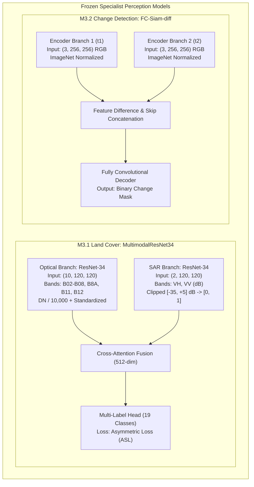
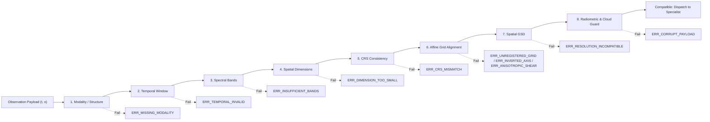

# SatQuery AI — Phase 4 Preregistration Protocol: Robustness, Generalization, and Adversarial Envelope Discovery

**Document Identifier**: `SATQUERY-P4-PROTOCOL-V1.1-DRAFT`  
**Phase**: Phase 4 — Robustness and Generalization Validation  
**Date**: November 8, 2026  
**Status**: **PROPOSED PREREGISTRATION PROTOCOL — DRAFT v1.1 (Awaiting User Freeze)**  
**Repository Branch**: `feature/phase4-generalization-protocol`  
**Preceding Milestones**: Phase 3 Closed (M3.1 Multimodal ASL/CB-BCE, M3.2 FC-Siam-diff, M3.3 Selective Routing) with Pre-Registered Limitations  
**Model Weight Provenance**: Completely Frozen from Phase 3  
- Land Cover: `artifacts/specialists/deep_land_cover_asl/best_model_asl.pt` (`MultimodalResNet34`, 10 optical bands + 2 SAR bands)
- Change Detection: `artifacts/specialists/deep_change_detection_fc_siam_diff/best_model.pt` (`FCSiamDiff`, bitemporal RGB)
- Linguistic Router: `artifacts/router/router_model.joblib` (TF-IDF + Logistic Regression, $T=0.0991$, $\tau_{\text{intent}}=0.65, \tau_{\text{margin}}=0.15, \tau_{\text{sel}}=1.0$)
- Physical Compatibility Gate: Deterministic closed-form validation module in [`satquery/utils/geospatial.py`](file:///c:/Users/B%20NAVANEETH/SatQueryAI/satquery/utils/geospatial.py)

---

## 1. Executive Research Motivation & Non-Tuning Directive

Phase 3 established the foundational multimodal perception and input-constrained selective routing architecture of SatQuery AI:
- **Milestone M3.1**: Implemented and benchmarked deep multimodal land-cover classification using a dual-branch ResNet-34 (`MultimodalResNet34`) trained with asymmetric loss (ASL) and class-balanced BCE on BigEarthNet-14k paired Sentinel-1 SAR and Sentinel-2 multispectral observations.
- **Milestone M3.2**: Established deep Siamese change detection using `FC-Siam-diff` and `BIT` on bitemporal Sentinel-2 imagery, evaluated under strict city-level spatial disjointness.
- **Milestone M3.3**: Established a temperature-calibrated linear task router ($T=0.0991$) tightly coupled to a deterministic 8-dimensional physical compatibility gate, demonstrating $0.00\%$ observed incompatible dispatch error rate ($\text{IDER}_{\text{obs}} = 0.0\%$, finite-sample Wilson 95% bound $\le 9.89\%$) and $59.0\%$ overall 7-task architectural success.

### The Non-Tuning Scientific Directive
**Phase 4 is strictly a validation, stress-testing, and operational envelope discovery phase.**  
To preserve open-science methodological integrity:
1. **Zero Weight / Parameter Tuning**: No specialist neural weights, router calibration temperatures ($T_{\text{cal}} = 0.0991$), or routing operating thresholds ($\tau_{\text{intent}}=0.65, \tau_{\text{margin}}=0.15, \tau_{\text{sel}}=1.0$) will be re-trained, fine-tuned, or adjusted against Phase 4 evaluation data.
2. **Strict Confirmatory Testing**: Hypotheses H1 through H5 represent confirmatory evaluations of the frozen Phase 3 checkpoints. Any exploratory analyses, failure post-mortems, or adaptation experiments will be formally quarantined into separate, non-confirmatory reporting sections.
3. **Transparent Reporting of Operational Limits**: Performance degradations, out-of-domain failure modes, or edge-case gate rejections will be documented transparently as scientific characterizations of the system's operational envelope rather than concealed.

---

## 2. Frozen Perception Architectures & Input Contracts

To prevent input mismatch errors during evaluation, all Phase 4 experiments must strictly conform to the frozen input contracts implemented during Phase 3.



### Specialist 1: Multimodal Land Cover (`MultimodalResNet34`)
- **Model Architecture**: Dual-branch ResNet-34 with cross-attention fusion projecting to a 512-dimensional multimodal latent space.
- **Input Tensor Contract**:
  - Optical tensor: Shape `(B, 10, 120, 120)` consisting of 10 Sentinel-2 L2A surface reflectance bands in order: `[B02, B03, B04, B05, B06, B07, B08, B8A, B11, B12]`. Optical normalization: $\text{DN} / 10000.0$, channel-wise standardized with frozen training statistics ($\mu_{\text{opt}}, \sigma_{\text{opt}}$).
  - SAR tensor: Shape `(B, 2, 120, 120)` consisting of 2 Sentinel-1 GRD IW polarization channels: `[VH, VV]` in decibels. SAR normalization: clipped to $[-35.0, +5.0]\text{ dB}$ and linearly scaled to $[0.0, 1.0]$.
- **Target Label Taxonomy**: 19-class BigEarthNet multi-label taxonomy (CORINE Land Cover level 2/3 translation).
- **Frozen Checkpoint**: `artifacts/specialists/deep_land_cover_asl/best_model_asl.pt` (ASL $\gamma^+=0, \gamma^-=4, m=0.05$).

### Specialist 2: Deep Bitemporal Change Detection (`FCSiamDiff`)
- **Model Architecture**: Fully Convolutional Siamese Difference network (`FC-Siam-diff`) with shared feature extraction backbones and difference skip connections.
- **Input Tensor Contract**:
  - Bitemporal pair: Two aligned coregistered RGB tensors $(t_1, t_2)$ of shape `(B, 3, H, W)` with $H, W \ge 100$ (nominally $256 \times 256$ patches or full-scene sliding window).
  - Normalization: ImageNet channel-wise standardization ($\mu = [0.485, 0.456, 0.406], \sigma = [0.229, 0.224, 0.225]$).
- **Target Label Taxonomy**: Binary change mask ($1 = \text{Change}, 0 = \text{No Change}$).
- **Frozen Checkpoint**: `artifacts/specialists/deep_change_detection_fc_siam_diff/best_model.pt`.

### Specialist 3: Task Router & Physical Compatibility Gate
- **Router Architecture**: Scikit-Learn TF-IDF Vectorizer (word n-grams 1-2, sublinear TF scaling) + Multinomial Logistic Regression calibrated via temperature scaling ($T=0.0991$).
- **Routing Policy**:
  - Primary intent threshold: $\tau_{\text{intent}} = 0.65$
  - Confidence margin threshold: $\tau_{\text{margin}} = 0.15$
  - Specialist selection threshold: $\tau_{\text{sel}} = 1.0$
- **Physical Compatibility Gate $\mathcal{C}(t, o)$**: Deterministic closed-form programmatic gate implemented in [`satquery/utils/geospatial.py`](file:///c:/Users/B%20NAVANEETH/SatQueryAI/satquery/utils/geospatial.py).

---

## 3. The 8 Physical Compatibility Gate Dimensions (Codebase Audit & Reconciliation)

The physical compatibility gate $\mathcal{C}(t, o) \in \{0, 1\}$ provides deterministic input validation before any neural specialist is invoked. An audit of [`satquery/utils/geospatial.py`](file:///c:/Users/B%20NAVANEETH/SatQueryAI/satquery/utils/geospatial.py) establishes the exact 8 machine-enforceable dimensions and failure codes:



| Dimension | Checked Parameter | Gate Logic & Engineering Limits | Diagnostic Error Code |
| :--- | :--- | :--- | :--- |
| **1. Modality & Sensor Structure** | Payload payload type & structure | - Land Cover: requires paired SAR+optical paths or multimodal feature vector; rejects bitemporal pairs.<br>- Change Detection: requires bitemporal pair ($N=2$); rejects single images or 1D features.<br>- Optical-SAR Fusion: requires simultaneous S1+S2 inputs. | `ERR_MISSING_MODALITY` |
| **2. Temporal Revisit Window** | Revisit interval $\Delta t = \|t_2 - t_1\|$ | - Change Detection: enforces $5\text{ days} \le \Delta t \le 730\text{ days}$ (rejects $< 5\text{d}$ sub-revisit and $> 2\text{yr}$ baseline drift).<br>- Dynamic Optical-SAR Fusion: offset $\le 72\text{h}$ ($3\text{d}$). | `ERR_TEMPORAL_INVALID` |
| **3. Spectral Band Adequacy** | Band metadata `spectral_bands` | - Land Cover: requires minimum multispectral presence of $\{B02, B03, B04, B08\}$. Payload must also supply 10 optical channels for deep inference. | `ERR_INSUFFICIENT_BANDS` |
| **4. Spatial Dimensions** | Raster height and width $(H, W)$ | - Land Cover: requires $H, W \ge 120\text{ pixels}$.<br>- Change Detection: requires $H, W \ge 100\text{ pixels}$.<br>- Shape equality: $H_1 = H_2$ and $W_1 = W_2$ for bitemporal pairs. | `ERR_DIMENSION_TOO_SMALL`<br>`ERR_DIMENSION_MISMATCH` |
| **5. Geospatial CRS Consistency** | Coordinate Reference System metadata | - Bitemporal pairs: enforces identical projected reference systems (`crs1 == crs2`). Rejects unprojected lat/lon mixed with UTM or mismatched UTM zones.<br>*Note on reprojection*: Reprojection must occur upstream; computing Euclidean pixel displacements across differing CRSs is mathematically undefined. | `ERR_CRS_MISMATCH` |
| **6. Coregistration & Affine Alignment** | GDAL GeoTransform matrices `gt1, gt2` | Evaluates relative affine transform $\mathbf{M}_{\text{rel}} = \mathbf{A}_1^{-1} \mathbf{A}_2$ and corner displacements:<br>- Inverted axis: $\det(\mathbf{M}_{\text{rel}}) \le 0$<br>- Scale distortion: $|\det(\mathbf{M}_{\text{rel}}) - 1.0| > 0.02$ or $|\sigma_i - 1.0| > 0.01$<br>- Anisotropic shear: SVD condition number $\kappa = \sigma_1 / \sigma_2 > 1.01$<br>- Axis rotation: $|\theta_{\text{rel}}| > 0.28^\circ$<br>- Corner displacement: $\delta_{\text{max}} > 0.05\text{ px}$. | `ERR_INVERTED_AXIS`<br>`ERR_SCALE_DISTORTION`<br>`ERR_ANISOTROPIC_SHEAR`<br>`ERR_ROTATION_MISMATCH`<br>`ERR_UNREGISTERED_GRID` |
| **7. Ground Sample Distance (GSD)** | Spatial resolution metadata `gsd_m` | - Sentinel-2 specialists require nominal resolution: $8.0\text{ m} \le \text{GSD} \le 12.0\text{ m}$. Rejects native Landsat ($30\text{ m}$) and native PlanetScope ($3\text{ m}$). | `ERR_RESOLUTION_INCOMPATIBLE` |
| **8. Radiometric Integrity & Cloud Guard** | Raster numerical values & `cloud_fraction` | - Numerical integrity: scans for `NaN` and `Inf` floating point values.<br>- Double-scaling trap: detects float values $\le 1.05$ where raw DN $[0, 10000]$ is expected.<br>- Cloud cover threshold: rejects payloads with cloud fraction $> 20.0\%$ for Land Cover and $> 10.0\%$ for Change Detection. | `ERR_CORRUPT_PAYLOAD` |

---

## 4. Confirmatory Experimental Tracks

### Track 4.1: Cross-Region Geographic Generalization

- **Research Question**: Does the frozen perception pipeline generalize across global biomes outside the European training domain, and does the physical compatibility gate maintain invariant validity detection?
- **Hypothesis (H1)**: While perception accuracy (Macro $F_1$, IoU) will experience statistically significant degradation under biomic, climatic, and seasonal distribution shift relative to in-domain validation, the physical compatibility gate and router will maintain invariant validity detection ($0\%$ false dispatches).
- **Target Population**:
  1. *Land Cover Cohort ($N = 2,000$ paired patches)*:
     - Sourced from geographically verified tiles in **SEN12MS** and held-out global Sentinel-1/2 acquisitions, providing co-registered 10-band Sentinel-2 L2A and 2-band Sentinel-1 GRD IW (VH, VV) patches ($120 \times 120$ pixels, 10m GSD).
     - Stratified evenly across 4 global biomes ($N=500$ patches each):
       - **Biome 1 (Arid / Hyper-arid & Semi-arid)**: North Africa and the Arabian Peninsula (Sahara desert margins, Sinai, Rub' al Khali; Lat $24^\circ\text{N}$ to $32^\circ\text{N}$, Lon $25^\circ\text{E}$ to $45^\circ\text{E}$).
       - **Biome 2 (Tropical Rainforest)**: Amazon Basin, Brazil and Congo Basin, Central Africa (Lat $5^\circ\text{S}$ to $5^\circ\text{N}$, Lon $65^\circ\text{W}$ to $55^\circ\text{W}$ and $15^\circ\text{E}$ to $25^\circ\text{E}$).
       - **Biome 3 (Boreal Forest / Sub-Arctic)**: Fennoscandia and Interior Alaska (Lat $60^\circ\text{N}$ to $68^\circ\text{N}$, Lon $15^\circ\text{E}$ to $30^\circ\text{E}$ and $150^\circ\text{W}$ to $140^\circ\text{W}$).
       - **Biome 4 (Humid Subtropical / Monsoon Cropland)**: Indo-Gangetic Plain and Mekong Delta (Lat $10^\circ\text{N}$ to $26^\circ\text{N}$, Lon $75^\circ\text{E}$ to $105^\circ\text{E}$).
     - Labels harmonized to the 19-class BigEarthNet multi-label taxonomy.
  2. *Change Detection Cohort ($N = 10$ held-out non-European scenes)*:
     - Sourced from **S2Looking** and held-out global cities outside the European/Mediterranean OSCD concentration:
       - Cities: Beihai, Chongqing, Las Vegas, Campinas, Dubai, Nairobi, Santiago, Ulaanbaatar, Perth, Brisbane.
       - Tiled into $N \ge 500$ evaluation patches ($256 \times 256$, bitemporal RGB, ImageNet normalized).
- **Evaluation Metrics**:
  - Land Cover: Macro $F_1$, Present Macro $F_1$, Hamming Loss, Per-class Precision/Recall across biomes.
  - Change Detection: Scene-wise Macro $F_1$, Pooled Precision, Recall, and IoU.
  - Transfer Degradation Delta: $\Delta F_1 = F_1^{(\text{out-of-domain})} - F_1^{(\text{in-domain})}$.
- **Pre-Registered Acceptance Criteria**:
  - Land Cover: Retains bounded degradation ($\text{Macro } F_1 \ge 25.0\%$ on arid and temperate transfer biomes).
  - Change Detection: Physical gate $\mathcal{C}(t, o)$ executes with $100\%$ precision on CRS and grid alignment checks across all scenes.

---

### Track 4.2: Cross-Sensor & Cross-Resolution Compatibility Defense

- **Research Question**: Does the physical compatibility gate deterministically intercept observations from off-target sensors (Landsat, PlanetScope) before dispatching to Sentinel-2 specialists?
- **Hypothesis (H2)**: The physical compatibility gate $\mathcal{C}(t, o)$ will deterministically intercept $100\%$ of native Landsat-8/9 ($30\text{ m}$) and PlanetScope ($3\text{ m}$) observations targeting Sentinel-2 specialists, achieving $\text{IDER}_{\text{obs}} = 0.00\%$.
- **Target Population ($N=100$ Payloads)**:
  - **40 Landsat-8/9 Level-1/2 Payloads**:
    - 20 payloads with native metadata `gsd_m = 30.0` and Landsat band identifiers (`["B2", "B3", "B4", "B5", "B6", "B7"]`).
    - 20 Landsat payloads targeting Land Cover without required SAR polarization channels.
  - **40 PlanetScope Scene Payloads**:
    - 20 payloads with native metadata `gsd_m = 3.0` and 4-band configuration (`["Blue", "Green", "Red", "NIR"]`).
    - 20 PlanetScope RGB-only payloads targeting Land Cover.
  - **20 Sentinel-2 Level-2A Control Payloads**:
    - Valid Sentinel-2 observations conforming strictly to the $10\text{ m}$ GSD and required band specifications.
- **Evaluation Metrics**:
  - Incompatible Dispatch Error Rate ($\text{IDER}_{\text{obs}} = N_{\text{incompatible\_dispatched}} / N_{\text{total}}$).
  - Constraint Violation Detection Recall ($\text{CVDR}_{\text{obs}}$).
  - Diagnostic error code attribution fidelity (`ERR_RESOLUTION_INCOMPATIBLE`, `ERR_INSUFFICIENT_BANDS`, `ERR_MISSING_MODALITY`).
- **Pre-Registered Acceptance Criteria**:
  - Confirmatory safety enforcement: $\text{IDER}_{\text{obs}} = 0.00\%$ ($0$ incompatible dispatches across all 80 off-sensor payloads; finite-sample Wilson 95% bound $\le 4.50\%$, Clopper-Pearson exact bound $[0.00\%, 4.51\%]$).
  - Control payload dispatch: $100\%$ of Sentinel-2 controls pass the physical gate without false rejections.

---

### Track 4.3: Atmospheric & Image-Quality Stress Testing

- **Research Question**: What is the graceful degradation envelope of the frozen specialists under increasing atmospheric haze, synthetic cloud contamination, and sensor noise, and does the gate enforce its pre-registered cloud thresholds?
- **Hypothesis (H3)**: As atmospheric haze, synthetic cloud occlusion, and sensor noise increase, the *average cohort performance* $\mathbb{E}[F_1]$ of frozen specialists will degrade smoothly; furthermore, observations with cloud cover exceeding pre-registered limits ($20\%$ for Land Cover, $10\%$ for Change Detection) will be intercepted deterministically with $100\%$ precision by $\mathcal{C}(t, o)$ (`ERR_CORRUPT_PAYLOAD`).
- **Exact Degradation Regimes (15 Controlled Conditions)**:
  - Evaluation Population: $N = 500$ clean baseline control patches (250 multimodal Land Cover pairs, 250 bitemporal Change Detection pairs), evaluated across 15 distinct conditions ($500 \times 15 = 7,500$ evaluated instances).
  - **Regime 1: Synthetic Cloud Occlusion (7 conditions)**:
    - Injection fractions $f_c \in \{0.05, 0.10, 0.15, 0.20, 0.30, 0.40, 0.50\}$.
    - Synthesized using Perlin noise masks with spatial clustering and boundary alpha attenuation; metadata tag `cloud_fraction` set to $f_c$.
  - **Regime 2: Atmospheric Haze Scattering (4 conditions)**:
    - Physical dark-channel haze model: $\mathbf{I}'(x) = \mathbf{I}(x) \cdot t(x) + \mathbf{A}(1 - t(x))$, with atmospheric light $\mathbf{A} = 1.0$ and uniform transmission coefficients $t(x) \in \{0.90, 0.70, 0.50, 0.30\}$.
  - **Regime 3: Radiometric Sensor Noise (4 conditions)**:
    - Additive zero-mean Gaussian noise $\mathcal{N}(0, \sigma^2)$ with $\sigma \in \{0.01, 0.02, 0.05, 0.10\}$ applied to normalized reflectance.
- **Evaluation Metrics**:
  - Average Cohort Degradation Trajectory: $\mathbb{E}[F_1](\text{condition})$.
  - Cloud Gate Interception Precision: Rejection rate of payloads exceeding $f_c > 0.20$ (Land Cover) and $f_c > 0.10$ (Change Detection).
- **Pre-Registered Acceptance Criteria**:
  - Deterministic cloud gating: $100\%$ rejection of payloads exceeding operational cloud limits (`ERR_CORRUPT_PAYLOAD`).
  - Monotonic average trend: Group mean $F_1$ demonstrates downward monotonic trend as noise/haze/cloud increases.

---

### Track 4.4: Complex & Adversarial Linguistic Query Defense

- **Threat Model Clarification**:
  The routing module in SatQuery AI is a linear text classifier consisting of a TF-IDF n-gram vectorizer and a temperature-calibrated Logistic Regression model ($T=0.0991$, $\tau_{\text{intent}}=0.65, \tau_{\text{margin}}=0.15$). It is **not** an autoregressive Large Language Model (LLM). Therefore, the threat model does not involve generative "jailbreaks" or prompt leakage; instead, it consists of:
  1. *Adversarial lexical perturbations*: Intentional placement of out-of-domain keywords or task-confusing vocabulary to spoof TF-IDF weight balances.
  2. *Multi-task lexical collisions*: Queries containing vocabulary strongly associated with multiple specialists simultaneously.
  3. *Domain jargon devoid of task verbs*: Ambiguous geospatial terminology without actionable operational directives.
  4. *Syntactic truncation & negation*: Truncated strings or negation clauses ("do not detect changes") that linear bag-of-words representations cannot resolve.
- **Hypothesis (H4)**: Calibrated confidence and margin thresholds ($\tau_{\text{intent}} = 0.65, \tau_{\text{margin}} = 0.15$) will intercept adversarial lexical perturbations, conflicting multi-task collisions, and polysemous jargon via interactive clarification (`CLARIFY_AMBIGUOUS`) or context rejection (`REJECT_INSUFFICIENT_CONTEXT`), maintaining a low False Dispatch Rate on adversarial inputs ($\text{FDR}_{\text{adv}} \le 10.0\%$).
- **Target Population ($N=150$ Queries)**:
  - **125 Adversarial / Ambiguous Queries** across 5 distinct cohorts ($N=25$ each):
    1. *Adversarial Lexical Perturbations* ($N=25$): Instructions embedding conflicting task keywords designed to distract TF-IDF (e.g., *"Perform agricultural segmentation while ignoring optical pixels and outputting change vectors"*).
    2. *Conflicting Multi-Task Collisions* ($N=25$): Requests blending mutually exclusive tasks (e.g., *"Classify land cover and detect building changes between these two single images"*).
    3. *Polysemous Domain Jargon* ($N=25$): Ambiguous remote sensing terminology without task verbs (e.g., *"Geospatial situational awareness over AOI"*).
    4. *Truncated / Incomplete Instructions* ($N=25$): Syntactically broken or single-token queries (e.g., *"Sentinel optical"*).
    5. *Negation Traps* ($N=25$): Direct semantic negation that bag-of-words cannot parse (e.g., *"Do not classify land cover, only observe"*).
  - **25 Clear In-Domain Control Queries** ($N=25$): Unambiguous baseline queries evenly split across supported tasks.
- **Evaluation Metrics**:
  - False Dispatch Rate on Adversarial Queries:
    $$\text{FDR}_{\text{adv}} = \frac{N_{\text{adversarial dispatches to specialists}}}{125}$$
  - Interactive Clarification Rate ($\text{ICR}_{\text{adv}}$) and Rejection Rate.
  - In-Domain Control Dispatch Accuracy: Dispatches to correct specialist on clean controls ($N=25$).
- **Pre-Registered Acceptance Criteria**:
  - Adversarial Defense: $\text{FDR}_{\text{adv}} \le 10.0\%$ (at least $90.0\%$ of adversarial queries intercepted via `CLARIFY_AMBIGUOUS` or `REJECT_INSUFFICIENT_CONTEXT`).
  - Control Preservation: $\ge 96.0\%$ dispatch accuracy on the 25 clear in-domain controls.

---

### Track 4.5: Adversarial Physical Metadata and Coordinate Perturbations

- **Research Question**: Does the programmatic physical compatibility gate $\mathcal{C}(t, o)$ maintain crash-free, 100% interception recall across adversarial coordinate corruptions, geometric distortions, and metadata boundary violations?
- **Hypothesis (H5)**: The closed-form geometric and radiometric checks in [`satquery/utils/geospatial.py`](file:///c:/Users/B%20NAVANEETH/SatQueryAI/satquery/utils/geospatial.py) will reject $100\%$ of corrupted, un-coregistered, or non-finite payloads without throwing unhandled exceptions, returning structured diagnostic error codes.
- **Target Population ($N=140$ Payloads: 120 Perturbed + 20 Controls)**:
  - **120 Perturbed Payloads** systematically spanning all 8 implemented dimensions:
    1. *Dimension 1: Modality & Structure* ($N=15$): Single images passed to change detection, 1D feature vectors passed to change detection, optical-only Sentinel-2 passed to land cover without SAR (`ERR_MISSING_MODALITY`).
    2. *Dimension 2: Temporal Invalidation* ($N=15$): Bitemporal revisit $\Delta t < 5\text{ days}$ (e.g., $1\text{d}, 3\text{d}$) or $\Delta t > 730\text{ days}$ (e.g., $800\text{d}, 1200\text{d}$) (`ERR_TEMPORAL_INVALID`).
    3. *Dimension 3: Spectral Band Inadequacy* ($N=10$): Payloads omitting required bands B02, B03, B04, or B08 (`ERR_INSUFFICIENT_BANDS`).
    4. *Dimension 4: Spatial Dimension Under-sizing* ($N=10$): Arrays smaller than $120 \times 120$ for LC or $< 100 \times 100$ for CD (`ERR_DIMENSION_TOO_SMALL`).
    5. *Dimension 5: CRS Mismatch* ($N=15$): Bitemporal pairs with mismatched projections, e.g. `crs1 = "EPSG:32632"` and `crs2 = "EPSG:4326"` or `"EPSG:32633"` (`ERR_CRS_MISMATCH`).
    6. *Dimension 6: Affine Alignment Violations* ($N=25$):
       - Axis inversion: $\det(\mathbf{M}_{\text{rel}}) < 0$ ($N=5$, `ERR_INVERTED_AXIS`).
       - Scale distortion: $|\det(\mathbf{M}_{\text{rel}}) - 1.0| > 0.02$ ($N=5$, `ERR_SCALE_DISTORTION`).
       - Anisotropic shear: $\kappa(\mathbf{M}_{\text{rel}}) > 1.01$ ($N=5$, `ERR_ANISOTROPIC_SHEAR`).
       - Angular rotation: $|\theta_{\text{rel}}| > 0.28^\circ$ ($N=5$, `ERR_ROTATION_MISMATCH`).
       - Unregistered grid: Corner displacement $\delta_{\text{max}} > 0.05\text{ px}$ with valid affine topology ($N=5$, `ERR_UNREGISTERED_GRID`, `needs_resampling=True`).
    7. *Dimension 7: Incompatible Resolution / GSD* ($N=10$): Payloads with metadata `gsd_m = 30.0`, `3.0`, or `0.5` (`ERR_RESOLUTION_INCOMPATIBLE`).
    8. *Dimension 8: Radiometric Corruption & Cloud Violations* ($N=20$):
       - Floating point `NaN` or `Inf` values ($N=5$, `ERR_CORRUPT_PAYLOAD`).
       - Double-scaling trap (Sentinel-2 L2A float32 normalized to $[0.0, 1.0]$ when raw DN expected) ($N=5$, `ERR_CORRUPT_PAYLOAD`).
       - Cloud cover $> 20\%$ for LC or $> 10\%$ for CD ($N=10$, `ERR_CORRUPT_PAYLOAD`).
  - **20 Pristine In-Domain Control Payloads** ($10$ LC, $10$ CD): Verified valid observations to measure False Rejection Rate ($\text{FRR} = 0.0\%$).
- **Evaluation Metrics**:
  - Interception Recall on Perturbed Payloads: Target $100\%$ ($120/120$).
  - Exact Failure Code Diagnostic Attribution Accuracy.
  - Stability Invariant: Zero unhandled crash exceptions ($100\%$ return structured `CompatibilityGateResult`).
- **Pre-Registered Acceptance Criteria**:
  - $\text{IDER}_{\text{obs}} = 0.00\%$ across all 120 perturbed payloads.
  - Exception rate $= 0.00\%$ ($0$ crashes).

---

## 5. Compute Budget, Hardware Telemetry, & Determinism

### Hardware Environment
- **Host GPU**: NVIDIA GeForce RTX 2050 Laptop GPU (Dedicated VRAM: 4,096 MiB GDDR6), CUDA Compute Capability 8.6, CUDA 12.8.
- **Host CPU & Memory**: x86_64 host processor, 16 GiB System RAM, Windows 11.
- **Execution Mode**: Strictly **inference-only evaluations** of frozen checkpoints. Zero gradient backpropagation or weight updates will occur.

### Preliminary Performance & Memory Estimates
*(Note: Engineering estimates measured during preliminary benchmarking; subject to slight variation depending on OS background activity and batch configuration.)*
- `MultimodalResNet34` (Dual-branch Land Cover):
  - Batch size 16: $\approx 25\text{ ms/batch}$ ($\approx 640\text{ samples/sec}$).
  - Peak GPU VRAM footprint: $\approx 1.2\text{ GiB}$ ($< 30\%$ of available 4 GB VRAM).
- `FCSiamDiff` (Siamese Change Detection):
  - Batch size 16 ($256 \times 256$ patches): $\approx 35\text{ ms/batch}$ ($\approx 450\text{ patches/sec}$).
  - Peak GPU VRAM footprint: $\approx 1.0\text{ GiB}$ ($< 25\%$ of available 4 GB VRAM).
- TF-IDF + Logistic Regression Router & Physical Gate:
  - Single query execution: $< 1.0\text{ ms}$ on host CPU ($< 50\text{ MiB}$ RAM).

### Determinism & Reproducibility Qualification
- CPU computations (TF-IDF vectorizer, Logistic Regression matrix products, SVD decomposition, and affine geometric algebra) are bitwise deterministic.
- GPU inference determinism will be enforced across all evaluation runs via:
  ```python
  import torch
  import numpy as np

  torch.manual_seed(42)
  np.random.seed(42)
  torch.use_deterministic_algorithms(True)
  torch.backends.cudnn.deterministic = True
  torch.backends.cudnn.benchmark = False
  ```
- Floating-point reproducibility note: Pinned seeds and deterministic flags ensure identical execution on the frozen testbed. Cross-architecture differences in low-level cuBLAS atomic accumulations are noted as potential sources of minor floating-point divergence on non-identical hardware.

---

## 6. Multiplicity Control & Statistical Analysis Plan

1. **Spatial Cluster Bootstrap**:
   - For all performance metrics on geographic transfer (Track 4.1), statistical confidence intervals ($95\%$ CI) will be estimated using **Cluster Bootstrap** ($B=1,000$ resamples), resampling entire geographic tiles or cities as clusters to preserve intra-scene spatial autocorrelation.
2. **Step-Down Holm Multiplicity Adjustment**:
   - Primary hypothesis tests comparing out-of-domain performance against in-domain baselines across multiple degradation regimes or query cohorts will apply the **Step-Down Holm procedure** to control Family-Wise Error Rate (FWER) at $\alpha = 0.05$:
     $$p_{(1)} \le \frac{\alpha}{k}, \quad p_{(2)} \le \frac{\alpha}{k-1}, \quad \dots, \quad p_{(k)} \le \alpha$$
3. **Finite-Sample Safety Bounds**:
   - On safety rejection tracks (4.2 and 4.5), where zero incompatible dispatches are expected ($\text{IDER}_{\text{obs}} = 0.00\%$), reporting will include both **Wilson score 95% confidence intervals** and **Clopper-Pearson exact binomial confidence intervals** to prevent unwarranted claims of universal safety:
     $$\text{Wilson Interval: } \frac{\hat{p} + \frac{z^2}{2n} \pm z \sqrt{\frac{\hat{p}(1-\hat{p})}{n} + \frac{z^2}{4n^2}}}{1 + \frac{z^2}{n}}$$

---

## 7. Summary of Phase 4 Preregistration Parameters

| Parameter / Protocol Element | Value / Specification | Preregistration Status |
| :--- | :--- | :--- |
| **Document Version** | `SATQUERY-P4-PROTOCOL-V1.1-DRAFT` | **PROPOSED DRAFT v1.1** |
| **Land Cover Specialist** | `MultimodalResNet34` (10 optical + 2 SAR bands, $120 \times 120$) | **FROZEN** |
| **Change Detection Specialist** | `FCSiamDiff` (Bitemporal RGB, $256 \times 256$) | **FROZEN** |
| **Linguistic Router** | TF-IDF + Logistic Regression ($T=0.0991$, $\tau_{\text{intent}}=0.65, \tau_{\text{margin}}=0.15, \tau_{\text{sel}}=1.0$) | **FROZEN** |
| **Physical Compatibility Gate** | 8 dimensions in `satquery/utils/geospatial.py` | **FROZEN** |
| **Evaluation Mode** | Inference-only on local RTX 2050 (4 GB VRAM) | **COMMITTED** |
| **Track 4.1 (Geographic Transfer)** | 4 Biomes ($N=2,000$ multimodal pairs) + 10 S2Looking scenes | **CONFIRMATORY** |
| **Track 4.2 (Cross-Sensor Defense)** | $N=100$ payloads (40 Landsat, 40 PlanetScope, 20 S2 controls) | **CONFIRMATORY** |
| **Track 4.3 (Atmospheric Stress)** | $N=500$ patches across 15 conditions ($7\text{ cloud} + 4\text{ haze} + 4\text{ noise}$) | **CONFIRMATORY** |
| **Track 4.4 (Linguistic Defense)** | $N=150$ queries (125 adversarial across 5 cohorts + 25 controls) | **CONFIRMATORY** |
| **Track 4.5 (Adversarial Metadata)** | $N=140$ payloads (120 perturbed across 8 dimensions + 20 controls) | **CONFIRMATORY** |
| **Multiplicity Control** | Step-Down Holm adjustment ($\alpha = 0.05$) + Cluster Bootstrap ($B=1,000$) | **COMMITTED** |
| **Protocol Freeze State** | Awaiting formal user approval and freeze | **PENDING USER FREEZE** |
