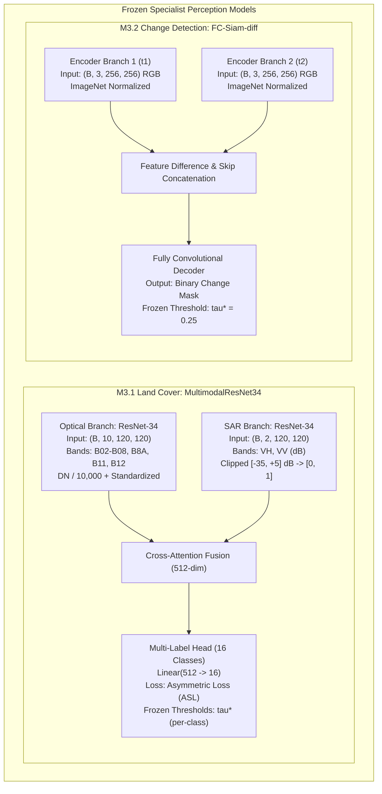
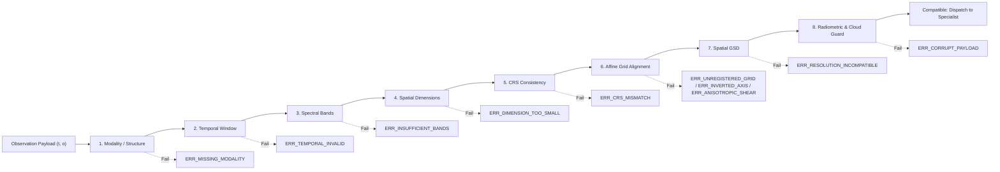

# SatQuery AI — Phase 4 Preregistration Protocol: Robustness, Generalization, and Adversarial Envelope Discovery

**Document Identifier**: `SATQUERY-P4-PROTOCOL-V1.8-DRAFT`  
**Phase**: Phase 4 — Robustness, Generalization, and Operational Envelope Discovery  
**Date**: November 9, 2026  
**Status**: **PROPOSED PREREGISTRATION PROTOCOL — DRAFT v1.8 (Methodological & Statistical Lock — Pending Final User Freeze)**  
**Repository Branch**: `feature/phase4-generalization-protocol`  
**Preceding Milestones**: Phase 3 Closed (M3.1 Multimodal ASL/CB-BCE, M3.2 FC-Siam-diff, M3.3 Selective Routing) with Pre-Registered Limitations  
**Model Weight & Threshold Provenance**: Completely Frozen from Phase 3  
- **Multimodal Land Cover Specialist**: `artifacts/specialists/deep_land_cover_asl/best_model_asl.pt` (SHA-256: `a3e2d24fc6b1b12e48960bc26f9d13eec2407fafb6a6237531da75038e65aabf`)
  - Architecture: `MultimodalResNet34`, 10 optical bands + 2 SAR bands, **16-class output head: `head.1.weight: torch.Size([16, 512])`**
  - **Frozen 16-Class Inference Threshold Vector**: `artifacts/specialists/deep_land_cover_asl/threshold_config.json` (SHA-256: `76fa4eda7aec18d4e2df7f9434c603d76effebc2ba569764320dbad58d40ad0d`):
    $$\boldsymbol{\tau}^* = [0.70, 0.50, 0.60, 0.65, 0.55, 0.65, 0.75, 0.55, 0.60, 0.55, 0.35, 0.55, 0.60, 0.45, 0.60, 0.65]$$
  - Class Label Taxonomy: `artifacts/specialists/land_cover/classes.json` (SHA-256: `cdb18c8a0a9dc74f52920720340251f14de323bc5c4fb4f07436f90f3500f3e9`)
- **Deep Change Detection Specialist**: `artifacts/specialists/deep_change_detection_fc_siam_diff/best_model.pt` (SHA-256: `8e42ac5abbb907bac3b18abdbf0367748f3849dbd7dea22aaa8c219da4000df3`)
  - Architecture: `FCSiamDiff`, bitemporal RGB, ImageNet normalized
  - **Frozen Inference Operating Threshold**: `artifacts/specialists/deep_change_detection_fc_siam_diff/threshold_config.json` (SHA-256: `c190999eb02f7c6ea043348e9c36b086a6e4ba2d6f2794bd0d889a757553f680`):
    $$\tau^* = 0.25$$
- **Linguistic Task Router**: `artifacts/router/router_model.joblib` (SHA-256: `eaf6c5b2cd8e718980a3496ce416b69ff9793cb1584e176951a9f652941cc218`)
  - Architecture: TF-IDF n-grams + Multinomial Logistic Regression calibrated with temperature $T=0.0991$
  - Frozen Routing Operating Thresholds: $\tau_{\text{intent}}=0.65, \tau_{\text{margin}}=0.15, \tau_{\text{sel}}=1.0$
- **Physical Compatibility Gate**: Deterministic closed-form validation module in [`satquery/utils/geospatial.py`](file:///c:/Users/B%20NAVANEETH/SatQueryAI/satquery/utils/geospatial.py) (SHA-256: `156b76cd1ab4abc54341e6a405f9cd58f1387096f6cc92917c62ec01a11911f5`) inspecting 8 physical dimensions

---

## 1. Executive Research Motivation & Non-Tuning Directive

Phase 3 established the foundational multimodal perception and input-constrained selective routing architecture of SatQuery AI:
- **Milestone M3.1**: Implemented and benchmarked deep multimodal land-cover classification using a dual-branch ResNet-34 (`MultimodalResNet34`) trained with asymmetric loss (ASL) on BigEarthNet-14k paired Sentinel-1 SAR and Sentinel-2 multispectral observations.
- **Milestone M3.2**: Established deep Siamese change detection using `FC-Siam-diff` and `BIT` on bitemporal Sentinel-2 imagery, evaluated under strict city-level spatial disjointness.
- **Milestone M3.3**: Established a temperature-calibrated linear task router ($T=0.0991$) tightly coupled to a deterministic 8-dimensional physical compatibility gate, demonstrating $0.00\%$ observed incompatible dispatch error rate ($\text{IDER}_{\text{obs}} = 0.0\%$, finite-sample Wilson 95% bound $\le 9.89\%$) and $59.0\%$ overall 7-task architectural success.

### The Non-Tuning Scientific Directive
**Phase 4 is strictly a validation, stress-testing, and operational envelope discovery phase.**  
To preserve open-science methodological integrity:
1. **Zero Weight / Parameter Tuning**: No specialist neural weights, router calibration temperatures ($T_{\text{cal}} = 0.0991$), specialist inference thresholds ($\boldsymbol{\tau}^*_{\text{LC}}$, $\tau^*_{\text{CD}} = 0.25$), or routing thresholds ($\tau_{\text{intent}}=0.65, \tau_{\text{margin}}=0.15, \tau_{\text{sel}}=1.0$) will be re-trained, fine-tuned, or adjusted against Phase 4 evaluation data.
2. **Strict Confirmatory Testing**: Confirmatory evaluations test the frozen Phase 3 checkpoints. Any exploratory analyses, failure post-mortems, or adaptation experiments will be formally quarantined into separate, non-confirmatory reporting sections.
3. **Transparent Reporting of Operational Limits**: Performance degradations, out-of-domain failure modes, or edge-case gate rejections will be documented transparently as scientific characterizations of the system's operational envelope rather than concealed.
4. **Pre-Registered Protocol Lock**: Hypotheses, comparison populations, statistical test definitions, and acceptance criteria are finalized prior to execution; no post-hoc amendments based on observed results will be permitted.

---

## 2. Frozen Perception Architectures & Exact Input Contracts

An audit of the codebase checkpoints and dataset loaders confirms the exact hardware, architecture, and tensor contracts of the frozen models:



### Specialist 1: Multimodal Land Cover (`MultimodalResNet34`)
- **Model Checkpoint**: `artifacts/specialists/deep_land_cover_asl/best_model_asl.pt` (ASL $\gamma^+=0, \gamma^-=4, m=0.05$).
- **Architecture**: Dual-branch ResNet-34 backbones with 8-head cross-attention fusion projecting to a 512-dimensional multimodal latent space, terminated with a linear head `head.1.weight: torch.Size([16, 512])`.
- **Target Label Taxonomy (Empirically Verified: 16 Classes)**:
  Audited from `artifacts/specialists/land_cover/classes.json`:
  1. `Arable land` ($\tau^* = 0.70$)
  2. `Beaches, dunes, sands` ($\tau^* = 0.50$)
  3. `Broad-leaved forest` ($\tau^* = 0.60$)
  4. `Complex cultivation patterns` ($\tau^* = 0.65$)
  5. `Coniferous forest` ($\tau^* = 0.55$)
  6. `Industrial or commercial units` ($\tau^* = 0.65$)
  7. `Inland waters` ($\tau^* = 0.75$)
  8. `Inland wetlands` ($\tau^* = 0.55$)
  9. `Land principally occupied by agriculture, with significant areas of natural vegetation` ($\tau^* = 0.60$)
  10. `Mixed forest` ($\tau^* = 0.55$)
  11. `Moors, heathland and sclerophyllous vegetation` ($\tau^* = 0.35$)
  12. `Natural grassland and sparsely vegetated areas` ($\tau^* = 0.55$)
  13. `Pastures` ($\tau^* = 0.60$)
  14. `Permanent crops` ($\tau^* = 0.45$)
  15. `Transitional woodland, shrub` ($\tau^* = 0.60$)
  16. `Urban fabric` ($\tau^* = 0.65$)
- **Input Tensor Contract**:
  - Optical tensor: Shape `(B, 10, 120, 120)` consisting of 10 Sentinel-2 L2A surface reflectance channels in exact order: `[B02, B03, B04, B05, B06, B07, B08, B8A, B11, B12]`. Optical normalization: $\text{DN} / 10000.0$, standardized with frozen training statistics:
    $$\mu_{\text{opt}} = [0.136, 0.118, 0.106, 0.128, 0.203, 0.257, 0.272, 0.273, 0.187, 0.121]$$
    $$\sigma_{\text{opt}} = [0.082, 0.076, 0.074, 0.089, 0.098, 0.108, 0.113, 0.112, 0.095, 0.078]$$
  - SAR tensor: Shape `(B, 2, 120, 120)` consisting of 2 Sentinel-1 GRD IW polarization channels: `[VH, VV]` in decibels. SAR normalization: clipped to $[-35.0, +5.0]\text{ dB}$ and linearly scaled to $[0.0, 1.0]$ via $(\text{dB} + 35.0) / 40.0$.

### Specialist 2: Deep Bitemporal Change Detection (`FCSiamDiff`)
- **Model Checkpoint**: `artifacts/specialists/deep_change_detection_fc_siam_diff/best_model.pt`.
- **Architecture**: Fully Convolutional Siamese Difference network (`FC-Siam-diff`) with shared feature extraction backbones and difference skip connections.
- **Inference Threshold**: $\tau^* = 0.25$ (frozen from OSCD validation tuning).
- **Input Tensor Contract**:
  - Bitemporal pair: Two coregistered RGB tensors $(t_1, t_2)$ of shape `(B, 3, H, W)` with $H, W \ge 100$ (nominally $256 \times 256$ patches or full-scene sliding window).
  - Normalization: ImageNet channel-wise standardization ($\mu = [0.485, 0.456, 0.406], \sigma = [0.229, 0.224, 0.225]$).
- **Target Label Taxonomy**: Binary change mask ($1 = \text{Change}, 0 = \text{No Change}$).

### Specialist 3: Task Router & Physical Compatibility Gate
- **Router Architecture**: Scikit-Learn TF-IDF Vectorizer (word n-grams 1-2, sublinear TF scaling) + Multinomial Logistic Regression calibrated via temperature scaling ($T=0.0991$).
- **Routing Policy**:
  - Primary intent threshold: $\tau_{\text{intent}} = 0.65$
  - Confidence margin threshold: $\tau_{\text{margin}} = 0.15$
  - Specialist selection threshold: $\tau_{\text{sel}} = 1.0$
- **Physical Compatibility Gate $\mathcal{C}(t, o)$**: Deterministic closed-form programmatic gate implemented in [`satquery/utils/geospatial.py`](file:///c:/Users/B%20NAVANEETH/SatQueryAI/satquery/utils/geospatial.py).

---

## 3. The 8 Physical Compatibility Gate Dimensions (Implementation Audit & Boundary Logic)

The physical compatibility gate $\mathcal{C}(t, o) \in \{0, 1\}$ provides deterministic input validation before any neural specialist is invoked. An audit of [`satquery/utils/geospatial.py`](file:///c:/Users/B%20NAVANEETH/SatQueryAI/satquery/utils/geospatial.py) establishes the exact 8 machine-enforceable dimensions, explicit boundary equality conditions, and diagnostic error codes:



| Dimension | Checked Parameter | Gate Logic & Engineering Limits | Strict Boundary Points (Sub / Equality / Super) | Diagnostic Error Code |
| :--- | :--- | :--- | :--- | :--- |
| **1. Modality & Sensor Structure** | Payload type & dictionary keys | - Land Cover: requires paired SAR+optical paths or multimodal feature vector; rejects bitemporal pairs.<br>- Change Detection: requires bitemporal pair ($N=2$); rejects single images or 1D features.<br>- Optical-SAR Fusion: requires simultaneous S1+S2 inputs. | Single optical image to LC $\to$ Fail<br>Bitemporal pair to CD $\to$ Pass<br>Feature vector to CD $\to$ Fail | `ERR_MISSING_MODALITY` |
| **2. Temporal Revisit Window** | Revisit interval $\Delta t = \|t_2 - t_1\|$ | - Change Detection: enforces $5.0\text{ days} \le \Delta t \le 730.0\text{ days}$.<br>- Dynamic Optical-SAR Fusion: offset $\le 72.0\text{h}$ ($3.0\text{d}$). | $\Delta t = 4.9\text{d}$ (Fail: $< 5.0$)<br>$\Delta t = 5.0\text{d}$ (**Equality: Pass**)<br>$\Delta t = 730.0\text{d}$ (**Equality: Pass**)<br>$\Delta t = 730.1\text{d}$ (Fail: $> 730.0$) | `ERR_TEMPORAL_INVALID` |
| **3. Spectral Band Adequacy** | Band metadata `spectral_bands` | - Land Cover: requires minimum multispectral presence of $\{B02, B03, B04, B08\}$. Deep inference requires 10 optical channels. | Missing B08 $\to$ Fail<br>Exact required set $\{B02, B03, B04, B08\}$ $\to$ Pass | `ERR_INSUFFICIENT_BANDS` |
| **4. Spatial Dimensions** | Raster height and width $(H, W)$ | - Land Cover: requires $H, W \ge 120\text{ pixels}$.<br>- Change Detection: requires $H, W \ge 100\text{ pixels}$.<br>- Shape equality: $H_1 = H_2$ and $W_1 = W_2$ for bitemporal pairs. | LC: $119 \times 120$ (Fail)<br>LC: $120 \times 120$ (**Equality: Pass**)<br>CD: $99 \times 100$ (Fail)<br>CD: $100 \times 100$ (**Equality: Pass**) | `ERR_DIMENSION_TOO_SMALL`<br>`ERR_DIMENSION_MISMATCH` |
| **5. Geospatial CRS Consistency** | Coordinate Reference System metadata | - Bitemporal pairs: enforces identical projected reference systems (`crs1 == crs2`). Rejects unprojected lat/lon mixed with UTM or mismatched UTM zones.<br>*Note on reprojection*: Reprojection must occur upstream; computing Euclidean pixel displacements across differing CRSs is mathematically undefined. | EPSG:32632 vs EPSG:32632 $\to$ Pass<br>EPSG:32632 vs EPSG:4326 $\to$ Fail<br>EPSG:32632 vs EPSG:32633 $\to$ Fail | `ERR_CRS_MISMATCH` |
| **6. Coregistration & Affine Alignment** | GDAL GeoTransform matrices `gt1, gt2` | Evaluates relative affine transform $\mathbf{M}_{\text{rel}} = \mathbf{A}_1^{-1} \mathbf{A}_2$ and corner displacements:<br>- Inverted axis: $\det(\mathbf{M}_{\text{rel}}) \le 0$<br>- Scale distortion: $|\det(\mathbf{M}_{\text{rel}}) - 1.0| > 0.02$ or $|\sigma_i - 1.0| > 0.01$<br>- Anisotropic shear: SVD condition number $\kappa = \sigma_1 / \sigma_2 > 1.01$<br>- Axis rotation: $|\theta_{\text{rel}}| > 0.28^\circ$<br>- Corner displacement: $\delta_{\text{max}} > 0.05\text{ px}$. | $\delta = 0.049\text{ px}$ (Pass)<br>$\delta = 0.050\text{ px}$ (**Equality: Pass**)<br>$\delta = 0.051\text{ px}$ (Fail: $> 0.05$)<br>$\kappa = 1.010$ (**Equality: Pass**), $1.011$ (Fail)<br>$\|\theta\| = 0.280^\circ$ (**Equality: Pass**), $0.281^\circ$ (Fail)<br>$\det = 0.980$ (**Equality: Pass**), $0.979$ (Fail)<br>$\det = 0.000$ (Fail: $\det \le 0$) | `ERR_INVERTED_AXIS`<br>`ERR_SCALE_DISTORTION`<br>`ERR_ANISOTROPIC_SHEAR`<br>`ERR_ROTATION_MISMATCH`<br>`ERR_UNREGISTERED_GRID` |
| **7. Ground Sample Distance (GSD)** | Spatial resolution metadata `gsd_m` | - Sentinel-2 specialists require nominal resolution: $8.0\text{ m} \le \text{GSD} \le 12.0\text{ m}$. Rejects native Landsat ($30\text{ m}$) and native PlanetScope ($3\text{ m}$). | $\text{GSD} = 7.9\text{ m}$ (Fail: $< 8.0$)<br>$\text{GSD} = 8.0\text{ m}$ (**Equality: Pass**)<br>$\text{GSD} = 12.0\text{ m}$ (**Equality: Pass**)<br>$\text{GSD} = 12.1\text{ m}$ (Fail: $> 12.0$) | `ERR_RESOLUTION_INCOMPATIBLE` |
| **8. Radiometric Integrity & Cloud Guard** | Raster numerical values & `cloud_fraction` | - Numerical integrity: scans for `NaN` and `Inf` floating point values.<br>- Double-scaling trap: detects float values $\le 1.05$ where raw DN $[0, 10000]$ is expected.<br>- Cloud cover threshold: rejects payloads with cloud fraction $> 0.20$ for Land Cover and $> 0.10$ for Change Detection based on metadata contract. | LC Cloud $10\%$ (Pass)<br>LC Cloud $20\%$ (**Equality: Pass**)<br>LC Cloud $20.1\%$ (Fail: $> 0.20$)<br>CD Cloud $5\%$ (Pass)<br>CD Cloud $10\%$ (**Equality: Pass**)<br>CD Cloud $10.1\%$ (Fail: $> 0.10$) | `ERR_CORRUPT_PAYLOAD` |

---

## 4. Confirmatory Experimental Tracks

### Track 4.1: Cross-Region Geographic Generalization

- **Research Question**: Does the frozen perception pipeline generalize across global biomes outside the European training domain, and does the physical compatibility gate maintain invariant validity detection?
- **Dual-Ground-Truth Harmonization Strategy**:
  To prevent confounding geographic domain shift with annotation methodology (CORINE Land Cover vs MODIS), evaluation implements a dual-ground-truth strategy:
  1. **Primary Confirmatory Comparison (Harmonized MODIS-to-MODIS)**:
     The in-domain baseline evaluation is recomputed on the test patches of BigEarthNet-14k using the **exact same MODIS MCD12Q1 label construction algorithm, spatial intersection, and temporal rules** applied to the out-of-domain (OOD) transfer biomes. This guarantees that ground-truth granularity, spatial resolution, and class mapping rules are held strictly invariant between in-domain and out-of-domain evaluations.
  2. **Descriptive Calibration Baseline (Native BigEarthNet CORINE)**:
     In-domain performance evaluated on native CORINE-derived BigEarthNet labels is reported in tandem. The difference $F_{1,\text{in-domain}}^{(\text{CORINE})} - F_{1,\text{in-domain}}^{(\text{MODIS})}$ explicitly quantifies the taxonomy-harmonization penalty within the training domain, preventing misattribution of label coarsening to geographic transfer loss.
- **Target Population & Pre-Evaluation Sample Accounting**:
  1. *Land Cover Cohort ($N_{\text{initial}} = 2,000$ paired patches OOD + $N_{\text{initial}} = 3,248$ in-domain)*:
     - Sourced from geographically verified tiles in **SEN12MS** (Spring/Summer acquisitions) and open Copernicus Sentinel-1/2 data, providing co-registered 10-band Sentinel-2 L2A and 2-band Sentinel-1 GRD IW (VH, VV) patches ($120 \times 120$ pixels, 10m GSD).
     - Stratified initially across 4 global biomes ($N_{\text{initial}}=500$ patches each):
       - **Biome 1 (Arid / Hyper-arid & Semi-arid)**: North Africa and Arabian Peninsula (Sahara margins, Sinai, Rub' al Khali; Lat $24^\circ\text{N}$ to $32^\circ\text{N}$, Lon $25^\circ\text{E}$ to $45^\circ\text{E}$).
       - **Biome 2 (Tropical Rainforest)**: Amazon Basin, Brazil and Congo Basin, Central Africa (Lat $5^\circ\text{S}$ to $5^\circ\text{N}$, Lon $65^\circ\text{W}$ to $55^\circ\text{W}$ and $15^\circ\text{E}$ to $25^\circ\text{E}$).
       - **Biome 3 (Boreal Forest / Sub-Arctic)**: Fennoscandia and Interior Alaska (Lat $60^\circ\text{N}$ to $68^\circ\text{N}$, Lon $15^\circ\text{E}$ to $30^\circ\text{E}$ and $150^\circ\text{W}$ to $140^\circ\text{W}$).
       - **Biome 4 (Humid Subtropical / Monsoon Cropland)**: Indo-Gangetic Plain and Mekong Delta (Lat $10^\circ\text{N}$ to $26^\circ\text{N}$, Lon $75^\circ\text{E}$ to $105^\circ\text{E}$).
     - **Mandatory Geographic Cluster Manifest**:
       Before evaluation execution, all candidates are cataloged and cryptographically locked in `data/manifests/phase4_ood_manifest.csv`. The manifest specifies:
       `patch_id, scene_id, biome_id, cluster_id, subregion_id, center_lat, center_lon, epsg, s2_granule_id, s2_acq_date, s1_scene_id, s1_acq_date, modis_product_year, modis_qc_valid_ratio`.
       Each biome contains at least 5 distinct geographic subregions ($K_{\text{OOD}, k} \ge 5$).
     - **Strict Pre-Evaluation Exclusion & Evaluable Sample Accounting**:
       The initial sample counts ($N_{\text{initial}} = 3,248$ in-domain, $2,000$ OOD) are strictly gross acquisition counts and **will not be presented as the final evaluation denominator**. Evaluable sample sizes are derived after applying deterministic screening:
       1. *QC Exclusion*: Patches with valid MODIS coverage $A_{\text{valid}, i} / \text{Area}(\mathcal{P}_i) < 0.80$ are excluded ($N_{\text{excluded, QC}}$).
       2. *Temporal Exclusion*: Patches where nearest product year $|Y^* - Y_{\text{acq}}| > 1$ are excluded ($N_{\text{excluded, temporal}}$).
       3. *Quarantine Exclusion*: Patches where no mapped BigEarthNet class reaches $\ge 20\%$ coverage are quarantined ($N_{\text{quarantined}}$).
       4. *Evaluable Cohort*: $N_{\text{evaluable}} = N_{\text{initial}} - N_{\text{excluded, QC}} - N_{\text{excluded, temporal}} - N_{\text{quarantined}}$.
       The evaluation report will publish complete sample accounting tables disclosing initial, excluded, quarantined, and evaluable sample counts per biome and per in-domain tile cluster, along with exact positive ground-truth support per class ($N_{\text{true}, c}$).
     - **Simplified MODIS MCD12Q1 Area-Weighted Construction & Quarantine Rule**:
       1. *Footprint Polygon Construction*: Construct footprint polygon $\mathcal{P}_i$ from affine GeoTransform and reproject to MODIS Sinusoidal projection.
       2. *Area Fractional Weighting*: For valid pixels, compute fractional coverage $w_i(C)$ across all 17 IGBP classes:
          $$w_i(C) = \frac{\sum_{m \text{ valid}, C_m = C} A_{m, i}}{A_{\text{valid}, i}}$$
       3. *Mapped Class Aggregation*: For each of the 13 mapped BigEarthNet classes $k \in \{1, \dots, 13\}$, calculate aggregated coverage:
          $$w_i(k) = \sum_{C \in \text{Map}(k)} w_i(C)$$
       4. *Deterministic Multi-Label Assignment & Absolute Quarantine*:
          - If $\max_{k \in \{1, \dots, 13\}} w_i(k) \ge 0.20$, assign all qualifying mapped labels:
            $$y_{i, k} = \mathbb{I}\left(w_i(k) \ge 0.20\right)$$
          - **If no mapped class reaches $20\%$ ($\max_{k \in \{1, \dots, 13\}} w_i(k) < 0.20$), the patch is strictly quarantined as Inevaluable / Out-of-Scope**.
          - *No Plurality Fallback*: To eliminate logically unreachable branches and prevent forcing mapped labels onto patches dominated by unmapped terrain (e.g. Snow/Ice, Water bodies not in target, or diffuse fragmentation), no secondary plurality fallback will assign another mapped class.
     - **Cross-Taxonomy Alignment Table**:
       The target taxonomy consists of the 16 classes from `artifacts/specialists/land_cover/classes.json`. Ground truth is categorized as **Directly Mapped ($N=6$)**, **Approximately Mapped ($N=7$)**, or **Quarantined / Inevaluable ($N=3$)**:
       | BigEarthNet-16 Target Class | Mapped MODIS IGBP Class(es) | Semantic Alignment / Rationale | Categorization Status |
       | :--- | :--- | :--- | :--- |
       | `Coniferous forest` | Class 1 (Evergreen Needleleaf), Class 3 (Deciduous Needleleaf) | High fidelity needleleaf canopy alignment | **Directly Mapped** |
       | `Broad-leaved forest` | Class 2 (Evergreen Broadleaf), Class 4 (Deciduous Broadleaf) | High fidelity broadleaf canopy alignment | **Directly Mapped** |
       | `Mixed forest` | Class 5 (Mixed Forest) | Co-dominant needleleaf/broadleaf canopy | **Directly Mapped** |
       | `Arable land` | Class 12 (Croplands) | Annual cropland cover | **Directly Mapped** |
       | `Urban fabric` | Class 13 (Urban and Built-up Lands) | Impervious surface / built settlement | **Directly Mapped** |
       | `Inland wetlands` | Class 11 (Permanent Wetlands) | Water-inundated land surface | **Directly Mapped** |
       | `Transitional woodland, shrub` | Class 6 (Closed Shrublands) | Approximate: closed shrubland structure | **Approximate Mapping** |
       | `Moors, heathland and sclerophyllous...` | Class 7 (Open Shrublands) | Approximate: low-density open shrubland | **Approximate Mapping** |
       | `Natural grassland and sparsely vegetated...` | Class 8 (Woody Savannas), Class 9 (Savannas) | Approximate: savannas combine grass and sparse trees | **Approximate Mapping** |
       | `Pastures` | Class 10 (Grasslands) | Approximate: includes natural grassland and managed pasture | **Approximate Mapping** |
       | `Land principally occupied by agriculture...` | Class 14 (Cropland/Natural Vegetation Mosaic) | Approximate: mosaic pattern representation | **Approximate Mapping** |
       | `Inland waters` | Class 17 (Water Bodies) | Approximate: includes marine coastal water along with inland lakes/rivers | **Approximate Mapping** |
       | `Beaches, dunes, sands` | Class 16 (Barren) | Approximate: includes bare soil, rock, and desert along with sand/dunes | **Approximate Mapping** |
       | `Industrial or commercial units` | *None* | Cannot be resolved from 500m MODIS Class 13 | **Quarantined / Inevaluable** |
       | `Complex cultivation patterns` | *None* | Parcel geometry cannot be resolved at 500m | **Quarantined / Inevaluable** |
       | `Permanent crops` | *None* | Orchards/vineyards not distinguished from annual crops | **Quarantined / Inevaluable** |
     - **Disentangled Metrics & Absent-Class False Positive Reporting**:
       To prevent metric blind spots where a model generates false positive alarms on absent classes without penalization:
       1. **Primary Confirmatory Metric: Present-Class Macro $F_1$ ($F_{1,\text{mapped13}}^{\text{present}}$)**:
          Averaged strictly over the subset of mapped classes $C_{\text{present}, k} \subseteq \{1, \dots, 13\}$ with non-zero ground-truth support in Biome $k$ ($\sum_{i=1}^{N_{\text{evaluable}, k}} y_{i, c} \ge 1$):
          $$F_{1,\text{mapped13}}^{\text{present}} = \frac{1}{|C_{\text{present}, k}|} \sum_{c \in C_{\text{present}, k}} F_{1, c}$$
          where $F_{1, c} = \frac{2 \text{TP}_c}{2 \text{TP}_c + \text{FP}_c + \text{FN}_c}$. For any present class with zero model predictions ($\text{TP}_c = \text{FP}_c = 0$), $F_{1, c} = 0.0$.
       2. **Mandatory Absent-Class False Positive Metrics (Blind Spot Protection)**:
          For all absent classes $c \in C_{\text{absent}, k} = \{c \in \{1,\dots,13\} \mid N_{\text{true}, c} = 0\}$:
          - *Absent-Class False Positive Rate ($FPR_{\text{absent}}$)*:
            $$FPR_{\text{absent}} = \frac{\sum_{c \in C_{\text{absent}, k}} \text{FP}_c}{|C_{\text{absent}, k}| \times N_{\text{evaluable}, k}}$$
            measuring the proportion of absent class-patch instances that received false positive alarms.
          - *Absent-Class False Positive Share ($FPS_{\text{absent}}$)*:
            $$FPS_{\text{absent}} = \frac{\sum_{c \in C_{\text{absent}, k}} \text{FP}_c}{\sum_{c=1}^{16} \sum_{i=1}^{N_{\text{evaluable}, k}} \hat{y}_{i, c}}$$
            measuring what fraction of all positive specialist predictions were triggered on absent classes.
          - *Per-Class Absent Alarms*: The report will explicitly tabularize $\text{FP-Count}_c$ and $\text{FPR}_c = \text{FP}_c / N_{\text{evaluable}, k}$ for every absent class.
       3. **Secondary Sensitivity Metric: Standard Fixed-13 Macro $F_1$ ($F_{1,\text{mapped13}}^{\text{fixed13}}$)**:
          Evaluated across all 13 mapped classes using standard machine learning convention (`zero_division=0.0`):
          $$F_{1,\text{mapped13}}^{\text{fixed13}} = \frac{1}{13} \sum_{c=1}^{13} F_{1, c}$$
          where for any class with zero true instances ($\text{TP}_c = \text{FN}_c = 0$), $F_{1, c} = 0.0$ regardless of predictions. Standard $F_1$ does **not** reward true-negative specificity with $F_1 = 1.0$; true negative behavior is evaluated strictly via $FPR_{\text{absent}}$.
       4. **Sub-Taxonomy Sensitivity Metrics**: Direct-Six ($F_{1,\text{direct6}}^{\text{present}}$) and Approximate-Seven ($F_{1,\text{approx7}}^{\text{present}}$) apply the identical present-class averaging convention over their respective active classes.
       5. **Quarantined Diagnostics Table**: Model output frequencies and unverified trigger rates for the 3 unmapped classes (`Industrial`, `Complex cultivation`, `Permanent crops`).
     - **Conditional Spatial Cluster Scope**:
       The in-domain BigEarthNet-14k test population comprises patches derived from exactly **3 geographic tile clusters**: `T34TCR`, `T34TEQ`, and `T34TFN` in Serbia. All geographic transfer inferences and bootstrap confidence intervals are **formally conditional on the available spatial clusters**. Per-tile in-domain metrics will be reported alongside aggregate figures.
  2. *Change Detection Cohort ($N = 10$ held-out non-European scenes)*:
     - Sourced from **S2Looking** and held-out global cities outside the European/Mediterranean OSCD concentration:
       Cities: Cairo, Nairobi, Santiago, Ulaanbaatar, Perth, Brisbane, Jakarta, Johannesburg, Calgary, Tashkent.
     - Scene-level metrics reported ($F_{1, s}$ for $s=1,\dots,10$) alongside mean, standard error, median, and IQR.
- **Statistical Comparison & Per-Biome Hypotheses**:
     $$H_{0, \text{Biome } k}: \Delta F_{1, \text{mapped13}, k} \ge 0 \quad \text{vs.} \quad H_{1, \text{Biome } k}: \Delta F_{1, \text{mapped13}, k} < 0$$
     where $\Delta F_{1, \text{mapped13}, k} = F_{1,\text{mapped13},\text{OOD}, k}^{(\text{MODIS})} - F_{1,\text{mapped13},\text{in-domain}}^{(\text{MODIS})}$.
  - Two-sample null-centered spatial cluster bootstrap ($B=1,000$ resamples) with Step-Down Holm adjustment across the 4 biomes at FWER $\alpha = 0.05$.
- **Pre-Registered Acceptance Criteria**:
  - Performance Floor Standards:
    - Biome 1 (Arid / Desert Margins): $\text{Macro } F_{1,\text{mapped13}}^{\text{present}} \ge 25.0\%$
    - Biome 4 (Humid Subtropical Cropland): $\text{Macro } F_{1,\text{mapped13}}^{\text{present}} \ge 25.0\%$
    - Biome 2 (Tropical Rainforest) and Biome 3 (Boreal Forest): Characterization biomes with documented canopy volume saturation; floor is set to $\text{Macro } F_{1,\text{mapped13}}^{\text{present}} \ge 15.0\%$.
  - Absent-Class Specificity Floor: $FPR_{\text{absent}} \le 15.0\%$ across all biomes.
  - Gate Specificity & Sensitivity: Physical gate achieves $100\%$ precision and recall on the mixed valid/invalid alignment suite ($10$ valid scenes + $10$ deliberately misaligned scenes).
  - Track Certification: Confirmatory Geographic Generalization Pass requires meeting performance floors on all 4 transfer biomes and 100% gate verification.

---

### Track 4.2: Cross-Sensor & Cross-Resolution Compatibility Defense

- **Research Question**: Does the physical compatibility gate deterministically intercept observations from off-target sensors (Landsat, PlanetScope) before dispatching to Sentinel-2 specialists?
- **Source-Level Unit of Analysis & Footprint Selection**:
  - The 80 off-sensor payloads are derived from **$N_{\text{source}} = 40$ independent acquisition footprints** (20 Landsat-8/9 scenes, 20 PlanetScope scenes).
  - *Spatial Disjointness Guarantee*: All 40 footprints are sampled from distinct geographic coordinates across multiple continents, verifying that pairwise bounding box intersection over union is strictly zero ($\text{IoU} = 0.0$), with acquisition dates separated by $> 30$ days.
  - Exactly 2 perturbed payloads are derived from each independent source scene ($2 \times 40 = 80$):
    - *Payload A (Resolution Stress)*: Native spatial resolution preserved without resampling (`gsd_m = 30.0` for Landsat, `gsd_m = 3.0` for PlanetScope) $\to$ Expected: `ERR_RESOLUTION_INCOMPATIBLE`.
    - *Payload B (Modality / Spectral Stress)*: Optical-only payload without SAR sent to Land Cover specialist (`ERR_MISSING_MODALITY`), or off-sensor band naming nomenclature lacking Sentinel-2 channel codes (`ERR_INSUFFICIENT_BANDS`).
  - The primary statistical unit of analysis is defined at the **independent source footprint level**:
    $$\text{Fail}_{\text{source}, i} = \max_{j \in \{A, B\}} \mathbb{I}(\text{Payload}_{i, j} \text{ dispatched to specialist})$$
- **Confirmatory Safety Hypothesis & Pre-Registered Decision Rule**:
  > [!NOTE]
  > The values $0/40$ and $p = 0.01478$ represent the **pre-registered statistical decision rule and critical rejection threshold under $H_0$**, NOT observed empirical results.
  - Let $\delta_{\text{tol}} = 0.10$ ($10.0\%$) represent the pre-registered maximum tolerable source-level error rate:
    $$H_0: \text{IDER}_{\text{source}} \ge 0.10 \quad \text{vs.} \quad H_1: \text{IDER}_{\text{source}} < 0.10$$
  - Under $H_0$, observing 0 failures in $N_{\text{source}} = 40$ independent trials has exact binomial probability:
    $$p = (1 - 0.10)^{40} = 0.90^{40} \approx 0.01478 < 0.05$$
  - Observing zero source-level dispatches in the evaluation run will formally reject $H_0$ at the $\alpha = 0.05$ significance level.
- **Target Population Breakdown ($N_{\text{payloads}} = 100$ from $N_{\text{scenes}} = 60$)**:
  - **40 Landsat-8/9 Payloads (from 20 independent scenes)**: 20 Payload A (Resolution) + 20 Payload B (Modality/Spectral).
  - **40 PlanetScope Scene Payloads (from 20 independent scenes)**: 20 Payload A (Resolution) + 20 Payload B (Modality/Spectral).
  - **20 Sentinel-2 Level-2A Control Payloads (from 20 independent scenes)**: 10 valid Land Cover payloads + 10 valid Change Detection pairs.
  - **Total Cohort Breakdown**: Exactly **60 independent source scenes** yielding **100 total evaluation payloads** (40 off-sensor scenes $\to$ 80 invalid payloads; 20 control scenes $\to$ 20 valid payloads).
- **Evaluation Metrics & Empirical Measurement Definitions**:
  - **Confirmatory Source-Level Metric**: $\widehat{\text{IDER}}_{\text{source}} = N_{\text{failed source scenes}} / 40$.
    - For 0 errors in 40 independent trials:
      - Two-sided 95% Clopper-Pearson exact bound: $[0.00\%, \mathbf{8.81\%}]$
      - Two-sided 95% Wilson score bound: $[0.00\%, \mathbf{8.76\%}]$
      - One-sided 95% Clopper-Pearson upper bound: $\mathbf{7.23\%} < 10.0\%$
  - **Descriptive Engineering Metrics**:
    - Observed Incompatible Dispatch Rate: $\widehat{\text{IDER}}_{\text{payload}} = N_{\text{dispatched payloads}} / 80$.
    - **Empirical Correct Violation Detection Rate ($\widehat{\text{CVDR}}_{\text{payload}}$)**:
      $$\widehat{\text{CVDR}}_{\text{payload}} = \frac{N_{\text{invalid payloads correctly intercepted}}}{80}$$
      Target: $100.0\%$ ($80 / 80$).
  - **Control False Rejection Rate**: $\widehat{\text{FRR}}_{\text{control}} = N_{\text{rejected controls}} / 20 = 0.00\%$ (Wilson 95% bound $[0.00\%, 16.11\%]$).
- **Pre-Registered Acceptance Criteria**:
  - Statistical Safety Confirmation: $\widehat{\text{IDER}}_{\text{source}} = 0.00\%$ ($0 / 40$), rejecting $H_0: \text{IDER}_{\text{source}} \ge 0.10$ with $p = 0.0148$.
  - Descriptive Engineering Target: $\widehat{\text{CVDR}}_{\text{payload}} = 100.0\%$ ($80 / 80$), $\widehat{\text{IDER}}_{\text{payload}} = 0.00\%$ ($0 / 80$).
  - Control Preservation: $\widehat{\text{FRR}}_{\text{control}} = 0.00\%$ ($0 / 20$).

---

### Track 4.3: Atmospheric & Image-Quality Stress Testing

- **Scope & Architectural Clarification**:
  This track explicitly evaluates two decoupled mechanisms:
  1. **Specialist Perception Robustness Envelope**: Measures how neural specialist performance degrades when raster pixels are obscured by atmospheric haze, synthetic cloud occlusion, and sensor noise.
  2. **Ingestion Metadata Contract Enforcement**: Verifies that when provider metadata indicates cloud contamination exceeding pre-registered limits ($> 20\%$ for LC, $> 10\%$ for CD), the physical compatibility gate $\mathcal{C}(t, o)$ deterministically halts execution.
- **Strict Cohort Invariance Guarantee**:
  The clean reference baseline ($d=0$) and all 15 degradation conditions evaluate the **exact same set of $N=250$ patches, identical ground-truth annotations, and frozen specialist inference thresholds**. Patch substitution, ground-truth alteration, or threshold modification across conditions is strictly prohibited.
- **Frozen Specialist Inference Operating Thresholds (Phase 3 Checkpoint Lock)**:
  - **Land Cover (`MultimodalResNet34`)**: Operates strictly at the frozen 16-class threshold vector $\boldsymbol{\tau}^* \in \mathbb{R}^{16}$ from `threshold_config.json`:
    $$\boldsymbol{\tau}^* = [0.70, 0.50, 0.60, 0.65, 0.55, 0.65, 0.75, 0.55, 0.60, 0.55, 0.35, 0.55, 0.60, 0.45, 0.60, 0.65]$$
  - **Change Detection (`FCSiamDiff`)**: Operates strictly at the frozen validation threshold $\tau^* = 0.25$.
- **Exact Perturbation Operators, Input Domains & Channel Scopes**:
  All perturbations are implemented in the **physical pre-standardization domain**:
  - *Optical domain*: Physical surface reflectance $\mathbf{X}_{\text{opt}} \in [0.0, 1.0]^{10 \times 120 \times 120}$ ($\text{DN} / 10000.0$).
  - *SAR domain*: Normalized backscatter $\mathbf{X}_{\text{SAR}} \in [0.0, 1.0]^{2 \times 120 \times 120}$ ($(\text{dB} + 35.0) / 40.0$).
  - *Change detection domain*: Bitemporal RGB images $\mathbf{X}_{t_1}, \mathbf{X}_{t_2} \in [0.0, 1.0]^{3 \times 256 \times 256}$.
  
  1. **Synthetic Cloud Occlusion Operator (Optical Channels Only)**:
     - Synthetic water-droplet clouds represent tropospheric condensation: applied **strictly to Optical channels** (Sentinel-1 C-band microwaves penetrate clouds).
     - Applied to post-event image $t_2$ in Change Detection.
     - *Deterministic Pixel Rank Selection*: A continuous 2D Perlin noise field $N_i(x, y) \in [0, 1]$ is generated with pinned seed $\text{seed} = 42 + 100 \cdot i + \text{cond\_id}$. To eliminate float thresholding ties, the binary cloud mask $\mathbf{M}_{\text{cloud}} \in \{0, 1\}^{H \times W}$ is formed by selecting **exactly $K = \lfloor f_c \times H \times W \rfloor$ pixels** having the highest Perlin noise values (descending rank ordering with stable coordinate tie-breaking).
     - *Blending Equation*:
       $$\mathbf{X}_{\text{opt}}'(c, x, y) = \mathbf{X}_{\text{opt}}(c, x, y) \cdot (1 - \alpha \cdot \mathbf{M}_{\text{cloud}}(x, y)) + \mathbf{A}_{\text{cloud}} \cdot (\alpha \cdot \mathbf{M}_{\text{cloud}}(x, y))$$
       where cloud opacity $\alpha = 0.90$ and cloud albedo $\mathbf{A}_{\text{cloud}} = 0.95$. Clipped to $[0.0, 1.0]$. Fractional areas: $f_c \in \{0.05, 0.10, 0.15, 0.20, 0.30, 0.40, 0.50\}$.
  2. **Atmospheric Haze Scattering Operator (Optical Channels Only)**:
     - Formulated via the physical Koschmieder atmospheric attenuation model: applied **strictly to Optical channels**.
     - *Transformation Equation*:
       $$\mathbf{X}_{\text{opt}}'(c, x, y) = \mathbf{X}_{\text{opt}}(c, x, y) \cdot t + \mathbf{A}_{\text{atm}}(c) \cdot (1 - t)$$
       where atmospheric transmittance $t \in \{0.90, 0.70, 0.50, 0.30\}$, parameterized by increasing opacity $\text{Sev}_{\text{haze}} = 1 - t \in \{0.10, 0.30, 0.50, 0.70\}$ ($\text{Clean}: t=1.00 \implies \text{Sev}=0.00$), and atmospheric airlight $\mathbf{A}_{\text{atm}} = 0.85$. Clipped to $[0.0, 1.0]$.
  3. **Normalized-Tensor Perturbation Sensitivity Operator (Optical and SAR Channels)**:
     - > [!IMPORTANT]
       > **Physical vs. Normalized-Tensor Interpretation**: This perturbation evaluates the model's sensitivity to numerical tensor perturbations in normalized $[0, 1]$ input space. It does **not** assume or claim physical sensor noise equivalence across optical and radar modalities: optical reflectance represents photon flux, whereas SAR backscatter represents logarithmic radar cross-section.
     - Additive zero-mean Gaussian noise applied independently to channels in the normalized input domain:
       $$\mathbf{X}'(c, x, y) = \text{clip}\left(\mathbf{X}(c, x, y) + \epsilon(c, x, y), 0.0, 1.0\right), \quad \epsilon(c, x, y) \sim \mathcal{N}(0, \sigma^2)$$
       for $\sigma \in \{0.01, 0.02, 0.05, 0.10\}$ ($\text{Clean}: \sigma = 0.00$), generated via a pinned PyTorch generator: `torch.Generator().manual_seed(42 + 100 * patch_id + cond_id)`.
  4. *Standardization Timing*: Frozen dataset standardization $(\mathbf{X}' - \mu) / \sigma$ is applied **immediately after physical perturbation clipping**, exactly mirroring the ingestion pipeline.
- **Spatial Clustering & Scene-Level Resampling Structure**:
  The evaluation cohort consists of $N=250$ patches per specialist ($i=1,\dots,250$) sampled across $M \ge 10$ distinct geographic scene clusters (tiles). Bootstrap resampling is conducted strictly at the **scene-cluster level** ($M$ clusters resampled with replacement). When a cluster is drawn multiple times in a bootstrap replicate, each duplicate occurrence is assigned a unique compound identifier $c' = (c, k)$ to preserve independent covariance structure.
- **Statistical Model & Confirmatory Step-Down Holm Test**:
  - Regression Model: Clustered Ordinary Least Squares (OLS) with Liang-Zeger cluster-robust variance estimation clustered by scene $c \in \{1, \dots, M\}$:
    $$\Delta F_{1, c, i}(d) = \beta_0 + \beta_1 \cdot \text{Severity}_d + \epsilon_{c, i, d}$$
    with small-sample degrees-of-freedom correction $df = M - 1$.
    The observed test statistic is the cluster-robust Studentized $t$-statistic:
    $$t_{\text{obs}, j} = \frac{\hat{\beta}_{1, j, \text{obs}} - 0}{\widehat{\text{SE}}_{\text{cluster}}(\hat{\beta}_{1, j, \text{obs}})}$$
  - **Six Confirmatory Negative Linear Severity Trend Tests**:
    *(Tests characterize whether a statistically significant negative linear trend exists with respect to increasing severity; they do not assert strictly monotonic degradation at every discrete intermediate point.)*
    1. Test 4.3.1: Land Cover $\times$ Synthetic Cloud Occlusion ($\beta_{1, 1}$)
    2. Test 4.3.2: Land Cover $\times$ Atmospheric Haze Scattering ($\beta_{1, 2}$)
    3. Test 4.3.3: Land Cover $\times$ Normalized-Tensor Noise ($\beta_{1, 3}$)
    4. Test 4.3.4: Change Detection $\times$ Synthetic Cloud Occlusion ($\beta_{1, 4}$)
    5. Test 4.3.5: Change Detection $\times$ Atmospheric Haze Scattering ($\beta_{1, 5}$)
    6. Test 4.3.6: Change Detection $\times$ Normalized-Tensor Noise ($\beta_{1, 6}$)
  - **Hypothesis Formulation**: For each test $j \in \{1, \dots, 6\}$:
    $$H_{0, j}: \beta_{1, j} \ge 0 \quad \text{vs.} \quad H_{1, j}: \beta_{1, j} < 0$$
  - **Studentized Null-Centered Bootstrap Algorithm & Confirmatory Decision Rule**:
    On each of $B = 1,000$ scene-cluster bootstrap resamples $b \in \{1, \dots, B\}$, refit the clustered regression to obtain bootstrap slope $\hat{\beta}_{1, j}^{*(b)}$ and cluster-robust standard error $\widehat{\text{SE}}^{*(b)}$. Center the bootstrap $t$-statistic under the null hypothesis:
    $$t_{j}^{*(b)} = \frac{\hat{\beta}_{1, j}^{*(b)} - \hat{\beta}_{1, j, \text{obs}}}{\widehat{\text{SE}}^{*(b)}}$$
    The one-sided null-based finite-bootstrap $p$-value is:
    $$p_j = \frac{1 + \sum_{b=1}^B \mathbb{I}(t_{j}^{*(b)} \le t_{\text{obs}, j})}{B + 1}$$
    - **Primary Confirmatory Rejection Rule**: Rejection of $H_{0, j}$ is determined strictly by the **Step-Down Holm-adjusted $p$-value**:
      $$\text{Holm-adjusted } p_j < 0.05$$
    - **Descriptive Confidence Interval Reporting**:
      Ordinary one-sided 95% bootstrap upper confidence bounds are reported strictly as descriptive measures of parameter uncertainty:
      $$\hat{\beta}_{1, j, \text{upper}}^{95\%} = \hat{\beta}_{1, j, \text{obs}} - q^*_{0.05} \cdot \widehat{\text{SE}}_{\text{cluster}}$$
      where $q^*_{0.05} = \text{Quantile}_{0.05}\left(\{t_j^{*(b)}\}_{b=1}^B\right)$ is the 5th percentile of the studentized bootstrap $t$-distribution. Ordinary 95% bounds do not form an independent rejection criterion, preventing false contradictions between unadjusted intervals and Holm-adjusted hypothesis tests.
- **Explicit Cloud Metadata Boundary Matrix**:
  | Specialist Task | Cloud Fraction ($f_c$) | Strict Threshold Formula | Boundary Type | Expected Gate Decision | Expected Error Code |
  | :--- | :--- | :--- | :--- | :--- | :--- |
  | Land Cover | $10\%$ | $0.10 \le 0.20$ | Sub-threshold | **Pass** | None |
  | Land Cover | $20\%$ | $0.20 \le 0.20$ | **Exact Boundary Equality** | **Pass** | None |
  | Land Cover | $20.1\%$ | $0.201 > 0.20$ | Super-threshold Boundary | **Reject** | `ERR_CORRUPT_PAYLOAD` |
  | Land Cover | $30\%$ | $0.30 > 0.20$ | Super-threshold | **Reject** | `ERR_CORRUPT_PAYLOAD` |
  | Change Detection | $5\%$ | $0.05 \le 0.10$ | Sub-threshold | **Pass** | None |
  | Change Detection | $10\%$ | $0.10 \le 0.10$ | **Exact Boundary Equality** | **Pass** | None |
  | Change Detection | $10.1\%$ | $0.101 > 0.10$ | Super-threshold Boundary | **Reject** | `ERR_CORRUPT_PAYLOAD` |
  | Change Detection | $15\%$ | $0.15 > 0.10$ | Super-threshold | **Reject** | `ERR_CORRUPT_PAYLOAD` |
- **Pre-Registered Acceptance Criteria**:
  - Cloud Gate Enforcement: $100\%$ interception precision on boundary rejection conditions.
  - Statistical Trend Significance: Significant negative linear severity trend on all 6 tests after Step-Down Holm adjustment ($\text{Holm-adjusted } p_j < 0.05$).

---

### Track 4.4: Complex & Adversarial Linguistic Query Defense

- **Threat Model Clarification**:
  The routing module in SatQuery AI is a linear text classifier consisting of a TF-IDF n-gram vectorizer and a temperature-calibrated Logistic Regression model ($T=0.0991$, $\tau_{\text{intent}}=0.65, \tau_{\text{margin}}=0.15$). It is **not** an autoregressive Large Language Model (LLM). The threat model targets the classifier's feature space:
  1. *Adversarial lexical perturbations*: Intentional placement of out-of-domain keywords or task-confusing vocabulary to spoof TF-IDF weight balances.
  2. *Multi-task lexical collisions*: Queries containing vocabulary strongly associated with multiple specialists simultaneously.
  3. *Domain jargon devoid of task verbs*: Ambiguous geospatial terminology without actionable operational directives.
  4. *Syntactic truncation & negation*: Truncated strings or negation clauses ("do not detect changes") that linear bag-of-words representations cannot resolve.
- **Fixed Adversarial Benchmark Specification**:
  Because queries within each cohort share syntactic structures and lexical templates, they are evaluated as a **Fixed Operational Adversarial Benchmark** rather than an asymptotic population inference test.
  - **Evaluation Cohorts ($N=125$ Adversarial Queries across 5 Cohorts of $N=25$)**:
    - **Cohort 1: Adversarial Lexical Perturbations** ($N=25$): Conflicting task keywords $\to$ **Ground Truth: `REJECT_INSUFFICIENT_CONTEXT`**.
    - **Cohort 2: Conflicting Multi-Task Collisions** ($N=25$): Blended mutually exclusive tasks $\to$ **Ground Truth: `CLARIFY_AMBIGUOUS`**.
    - **Cohort 3: Polysemous Domain Jargon** ($N=25$): Vague terminology without task verbs $\to$ **Ground Truth: `CLARIFY_AMBIGUOUS`**.
    - **Cohort 4: Truncated / Incomplete Instructions** ($N=25$): Broken or single-token queries $\to$ **Ground Truth: `REJECT_INSUFFICIENT_CONTEXT`**.
    - **Cohort 5: Negation Traps** ($N=25$): Semantic negation clauses $\to$ **Ground Truth: `CLARIFY_AMBIGUOUS`**.
  - **In-Domain Control Cohort ($N=25$)**:
    - 8 Land Cover queries $\to$ **Ground Truth: Dispatch to Land Cover Specialist**.
    - 8 Change Detection queries $\to$ **Ground Truth: Dispatch to Change Detection Specialist**.
    - 9 Other supported architectural intents $\to$ **Ground Truth: Correct Router Dispatch (`ROUTED_TO_INTENT`)**.
- **Mandatory Reporting & Pre-Registered Certification Tiers**:
  Evaluation mandates reporting cohort false dispatch counts $k_c$ and observed false dispatch rates $\widehat{\text{FDR}}_c = k_c / 25$, alongside cohort 95% Clopper-Pearson intervals and the pooled rate $\widehat{\text{FDR}}_{\text{adv, pooled}} = \frac{\sum k_c}{125}$.
  Certification follows three operational tiers:
  - **Tier 1 (Certified Robust Pass)**:
    - Pooled false dispatch rate: $\widehat{\text{FDR}}_{\text{adv, pooled}} \le 10.0\%$ ($k_{\text{pooled}} \le 12 / 125$).
    - Cohort breakdown cap: $\max_{c \in \{1,\dots,5\}} k_c \le 5 / 25$ ($20.0\%$).
    - In-domain control query preservation: $\ge 24 / 25$ ($96.0\%$).
  - **Tier 2 (Operational with Subsystem Reservation)**:
    - Pooled rate $\le 12.0\%$ ($k_{\text{pooled}} \le 15 / 125$) AND $\max_c k_c \le 6 / 25$, with control preservation $\ge 23 / 25$.
  - **Tier 3 (Failed Certification)**:
    - Pooled rate $> 12.0\%$ ($k_{\text{pooled}} \ge 16$) OR any cohort $k_c > 6 / 25$ OR control preservation $< 23 / 25$.

---

### Track 4.5: Adversarial Physical Metadata and Coordinate Perturbations

- **Research Question**: Does the programmatic physical compatibility gate $\mathcal{C}(t, o)$ maintain crash-free, 100% interception recall across adversarial coordinate corruptions, geometric distortions, and boundary violations?
- **Source-Level Unit of Analysis**:
  - The 120 perturbed payloads are derived from **$N_{\text{source}} = 30$ independent baseline observations** (15 distinct LC scenes, 15 distinct CD scenes).
  - Primary statistical unit of analysis is defined at the **independent source baseline level**:
    $$\text{Fail}_{\text{source}, i} = \max_{j \in \{1, 2, 3, 4\}} \mathbb{I}(\text{Perturbation}_{i, j} \text{ dispatched to specialist})$$
- **Confirmatory Safety Hypothesis & Pre-Registered Decision Rule**:
  > [!NOTE]
  > The values $0/30$ and $p = 0.04239$ represent the **pre-registered statistical decision rule and critical rejection threshold under $H_0$**, NOT observed empirical results.
  - Safety hypothesis: $H_0: \text{IDER}_{\text{source}} \ge 0.10$ vs $H_1: \text{IDER}_{\text{source}} < 0.10$.
  - Under $H_0$, observing 0 failures in $N_{\text{source}} = 30$ independent trials has exact binomial probability:
    $$p = (1 - 0.10)^{30} = 0.90^{30} \approx 0.04239 < 0.05$$
  - Observing zero source failures in the evaluation run will formally reject $H_0$ at $\alpha = 0.05$.
- **Explicit 30-Source to 120-Perturbation Allocation Matrix**:
  Each of the 30 source baselines is mapped to exactly 4 distinct perturbations:
  
  | Source Observations | Specialist Domain | Perturbation 1 (Type & Code) | Perturbation 2 (Type & Code) | Perturbation 3 (Type & Code) | Perturbation 4 (Type & Code) |
  | :--- | :--- | :--- | :--- | :--- | :--- |
  | **Sources 1–5** ($N=5$) | Land Cover | Dim 1: Missing SAR / Optical-only (`ERR_MISSING_MODALITY`) | Dim 3: Omission of B08 (`ERR_INSUFFICIENT_BANDS`) | Dim 4: Undersized $119 \times 120$ (`ERR_DIMENSION_TOO_SMALL`) | Dim 8: Cloud cover $f_c = 0.201$ (`ERR_CORRUPT_PAYLOAD`) |
  | **Sources 6–10** ($N=5$) | Land Cover | Dim 1: Bitemporal pair sent to LC (`ERR_MISSING_MODALITY`) | Dim 3: Omission of B04 (`ERR_INSUFFICIENT_BANDS`) | Dim 7: GSD boundary $7.9\text{ m}$ (`ERR_RESOLUTION_INCOMPATIBLE`) | Dim 8: Double-scaling trap $\le 1.05$ (`ERR_CORRUPT_PAYLOAD`) |
  | **Sources 11–15** ($N=5$) | Land Cover | Dim 1: 1D Feature vector sent to LC (`ERR_MISSING_MODALITY`) | Dim 7: GSD boundary $12.1\text{ m}$ (`ERR_RESOLUTION_INCOMPATIBLE`) | Dim 8: Floating `NaN` / `Inf` values (`ERR_CORRUPT_PAYLOAD`) | Dim 8: Cloud cover $f_c = 0.30$ (`ERR_CORRUPT_PAYLOAD`) |
  | **Sources 16–20** ($N=5$) | Change Detection | Dim 1: Single image sent to CD (`ERR_MISSING_MODALITY`) | Dim 2: Temporal boundary $\Delta t = 4.9\text{d}$ (`ERR_TEMPORAL_INVALID`) | Dim 5: CRS mismatch EPSG:32632 vs 4326 (`ERR_CRS_MISMATCH`) | Dim 6: Unregistered grid $\delta = 0.051\text{ px}$ (`ERR_UNREGISTERED_GRID`) |
  | **Sources 21–25** ($N=5$) | Change Detection | Dim 2: Temporal boundary $\Delta t = 730.1\text{d}$ (`ERR_TEMPORAL_INVALID`) | Dim 4: Undersized $99 \times 100$ (`ERR_DIMENSION_TOO_SMALL`) | Dim 5: CRS mismatch EPSG:32632 vs 32633 (`ERR_CRS_MISMATCH`) | Dim 6: Anisotropic shear $\kappa = 1.011$ (`ERR_ANISOTROPIC_SHEAR`) |
  | **Sources 26–30** ($N=5$) | Change Detection | Dim 2: Extreme revisit $\Delta t = 1200\text{d}$ (`ERR_TEMPORAL_INVALID`) | Dim 6: Axis inversion $\det \le 0$ (`ERR_INVERTED_AXIS`) | Dim 6: Scale distortion $\det = 0.979$ (`ERR_SCALE_DISTORTION`) | Dim 8: Cloud cover $f_c = 0.101$ (`ERR_CORRUPT_PAYLOAD`) |

  *Recounted Dimension Breakdown (Audit Verification)*:
  - Dim 1 (Modality & Sensor Structure): Sources 1–5, 6–10, 11–15, 16–20 $\implies \mathbf{20}$ payloads
  - Dim 2 (Temporal Revisit Window): Sources 16–20, 21–25, 26–30 $\implies \mathbf{15}$ payloads
  - Dim 3 (Spectral Band Adequacy): Sources 1–5, 6–10 $\implies \mathbf{10}$ payloads
  - Dim 4 (Spatial Dimensions): Sources 1–5, 21–25 $\implies \mathbf{10}$ payloads
  - Dim 5 (Geospatial CRS Consistency): Sources 16–20, 21–25 $\implies \mathbf{10}$ payloads
  - Dim 6 (Affine Alignment & Coregistration): Sources 16–20 (1), 21–25 (1), 26–30 (2) $\implies \mathbf{20}$ payloads
  - Dim 7 (Ground Sample Distance / GSD): Sources 6–10, 11–15 $\implies \mathbf{10}$ payloads
  - Dim 8 (Radiometric & Cloud Guard): Sources 1–5 (1), 6–10 (1), 11–15 (2), 26–30 (1) $\implies \mathbf{25}$ payloads
  - **Total Perturbed Payloads**: $20 + 15 + 10 + 10 + 10 + 20 + 10 + 25 = \mathbf{120}$ payloads.

- **Disentangled Metrics & Population Totals**:
  - **Confirmatory Source-Level Metric**: $\widehat{\text{IDER}}_{\text{source}} = N_{\text{failed source baselines}} / 30$.
    - For 0 errors in 30 independent trials:
      - Two-sided 95% Clopper-Pearson exact bound: $[0.00\%, \mathbf{11.57\%}]$
      - Two-sided 95% Wilson score bound: $[0.00\%, \mathbf{11.35\%}]$
      - One-sided 95% Clopper-Pearson upper bound: $\mathbf{9.50\%} < 10.0\%$
  - **Descriptive Engineering Metrics**:
    - **Interception Recall ($\text{IR}_{\text{payload}}$)**: $\text{IR}_{\text{payload}} = N_{\text{intercepted payloads}} / 120$ (Target: $100.0\%$).
    - **Incompatible Dispatch Error Rate ($\text{IDER}_{\text{payload}}$)**: $\text{IDER}_{\text{payload}} = N_{\text{dispatched payloads}} / 120$ (Target: $0.00\%$).
  - **Independent Control Cohort ($N=20$)**: Sourced from 20 independent scenes (10 LC, 10 CD) strictly distinct from the 30 source baselines, evaluating False Rejection Rate ($\widehat{\text{FRR}}_{\text{control}} = 0 / 20 = 0.00\%$).
  - **Total Cohort Breakdown**: Exactly **50 independent source observations** yielding **140 total evaluation payloads** (30 perturbed sources $\to$ 120 payloads; 20 control scenes $\to$ 20 payloads).
- **Pre-Registered Acceptance Criteria**:
  - Statistical Safety Confirmation: $\widehat{\text{IDER}}_{\text{source}} = 0.00\%$ ($0 / 30$), rejecting $H_0: \text{IDER}_{\text{source}} \ge 0.10$ with $p = 0.0424$.
  - Descriptive Engineering Target: $\text{IR}_{\text{payload}} = 100.0\%$ ($120 / 120$).
  - Stability Invariant: Zero unhandled crash exceptions ($100\%$ return structured `CompatibilityGateResult`).
  - Control Preservation: $\text{FRR}_{\text{control}} = 0.00\%$ ($0 / 20$).

---

## 5. Hardware Runtime Environment & Software Telemetry Audit

### Host Software & Hardware Environment (Empirically Pinned)
- **Interpreter**: `sys.version = 3.14.3 (tags/v3.14.3:323c59a, Feb 3 2026, 16:04:56) [MSC v.1944 64 bit (AMD64)]`
- **Operating System**: `Windows-11-10.0.26300-SP0 (AMD64)`
- **Host CPU Hardware**: `Intel64 Family 6 Model 186 Stepping 2, GenuineIntel`
- **PyTorch Build**: `torch.__version__ = '2.15.0+cpu'`, `torch.version.cuda = None`, `torch.cuda.is_available() = False`
- **Pinned Key Dependencies**:
  - `numpy == 2.5.3`
  - `scipy == 1.18.1`
  - `scikit-learn == 1.9.1`
  - `pillow == 12.3.0`
- **Execution Mode**: Strictly **CPU inference-only evaluations** of frozen checkpoints. Zero gradient updates or training will occur.

### Complete Cryptographic Provenance Manifest
All assets, checkpoints, configs, and software files are cryptographically locked:

| Component | Path / Location | SHA-256 Digest |
| :--- | :--- | :--- |
| **Land Cover Specialist Checkpoint** | `artifacts/specialists/deep_land_cover_asl/best_model_asl.pt` | `a3e2d24fc6b1b12e48960bc26f9d13eec2407fafb6a6237531da75038e65aabf` |
| **Land Cover Threshold Config** | `artifacts/specialists/deep_land_cover_asl/threshold_config.json` | `76fa4eda7aec18d4e2df7f9434c603d76effebc2ba569764320dbad58d40ad0d` |
| **Land Cover Class Taxonomy** | `artifacts/specialists/land_cover/classes.json` | `cdb18c8a0a9dc74f52920720340251f14de323bc5c4fb4f07436f90f3500f3e9` |
| **Change Detection Specialist Checkpoint**| `artifacts/specialists/deep_change_detection_fc_siam_diff/best_model.pt` | `8e42ac5abbb907bac3b18abdbf0367748f3849dbd7dea22aaa8c219da4000df3` |
| **Change Detection Threshold Config** | `artifacts/specialists/deep_change_detection_fc_siam_diff/threshold_config.json` | `c190999eb02f7c6ea043348e9c36b086a6e4ba2d6f2794bd0d889a757553f680` |
| **Router Model Checkpoint** | `artifacts/router/router_model.joblib` | `eaf6c5b2cd8e718980a3496ce416b69ff9793cb1584e176951a9f652941cc218` |
| **Physical Gate Implementation** | `satquery/utils/geospatial.py` | `156b76cd1ab4abc54341e6a405f9cd58f1387096f6cc92917c62ec01a11911f5` |
| **Core Taxonomy Module** | `satquery/taxonomy.py` | `f1c424218f5144621ea5b6ae94065ada326ef3ff0d61e1ed0fe236e23c059997` |
| **Task Router Logic Module** | `satquery/router.py` | `f3bf45452df165ef0a6fd0241fb3973050ac0d69609abf118f8c343491f175b1` |
| **Metadata Parsing Module** | `satquery/utils/metadata.py` | `f3cbbc36ab3ad7c4f8bcad1144ba8235f013f4b84a49ad51989fa6f1aff159c8` |
| **Environment Lockfile** | `requirements-lock.txt` | `72c893fb4425dd0c83c77a39338b26325da9cb96d473c2b511630369585b3b25` |

### Empirical Reproducibility Policy & Local Scope
> [!NOTE]
> Reproducibility is verified across repeat runs within this **specific pinned software, dependency, and hardware testbed**. Bitwise agreement across two runs establishes internal determinism and absence of execution drift on this system; it does not claim cross-architecture floating point bitwise invariance.

1. **Environment Variable Prerequisite**: `$env:PYTHONHASHSEED = "42"` (PowerShell) / `export PYTHONHASHSEED=42` (POSIX).
2. **Inference Execution Constraints**:
   - Specialists invoked under `model.eval()`, `torch.inference_mode()`, and `torch.set_grad_enabled(False)`.
   - DataLoaders configured with `num_workers = 0` and pinned worker seeds.
   - Image raster decoding: Deterministic PIL decoding with explicit nearest-neighbor / bilinear interpolation flags.
3. **Deterministic Random State Initialization**:
```python
import random
import numpy as np
import torch

def configure_deterministic_environment(seed: int = 42):
    random.seed(seed)
    np.random.seed(seed)
    torch.manual_seed(seed)
    torch.use_deterministic_algorithms(True)
    torch.set_num_threads(4)

def seed_worker(worker_id):
    worker_seed = torch.initial_seed() % 2**32
    np.random.seed(worker_seed)
    random.seed(worker_seed)
```
4. **Bitwise Agreement Verification Threshold**:
   Across 2 repeated verification runs under identical seeds, the evaluation harness mandates **100% bitwise identity of classification logits and discrete predictions** ($L_\infty \text{ difference} = 0.0$). Any non-deterministic variation aborts execution.

---

## 6. Detailed Statistical Analysis Plan & Multiplicity Control

### Scope of Multiplicity Control Across Testing Families
Confirmatory claims are organized into **5 distinct testing families**, corresponding to decoupled functional subsystems of the architecture:

1. **Within-Family FWER Control**: Family-Wise Error Rate ($\alpha = 0.05$) is strictly controlled **within each testing family** (Family 1: Step-Down Holm across 4 biomes; Family 3: Step-Down Holm across 6 degradation trend tests).
2. **Explicit Multiplicity Scope Limitation**:
   **Within-family FWER control does not establish a single global Phase 4 confirmatory pass.** Because SatQuery AI consists of modular, physically decoupled subsystems (neural feature extraction transfer, physical metadata validation, raster corruption resilience, and linguistic routing), each subsystem is evaluated and certified independently. The final evaluation report will not declare an aggregate Phase 4 statistical pass; rather, it will explicitly report the pass/fail status of each individual subsystem family.
3. **Master Synthesis Reporting**: The final evaluation report will provide a complete statistical synthesis table listing:
   - Raw $p$-values.
   - Within-family Holm-adjusted $p$-values (the confirmatory benchmark for each subsystem).
   - Global cross-family Holm-adjusted $p$-values (across all 13 tests) reported strictly as an exploratory sensitivity analysis.

| Testing Family | Primary Hypothesis Test | Comparison Population | Resampling / Bootstrap Unit | Multiplicity Adjustment |
| :--- | :--- | :--- | :--- | :--- |
| **Family 1: Geographic Transfer** (Track 4.1) | Independent two-sample difference in $F_{1,\text{mapped13}}^{\text{present}}$ against in-domain baseline | In-domain BigEarthNet test ($K_{\text{in}}=3$) vs OOD Biomes 1–4 ($K \ge 5$) | **Two-Sample Spatial Cluster Bootstrap** ($B=1,000$ replicates); scene-level reporting for CD ($N=10$) | Step-Down Holm adjustment ($\alpha = 0.05$ across 4 biomes) |
| **Family 2: Sensor Safety Gate** (Track 4.2) | One-sided safety non-inferiority test ($H_0: \text{IDER}_{\text{source}} \ge 0.10$) | 40 Independent source scenes vs safety threshold $\delta_{\text{tol}}=0.10$ | Exact Binomial Test ($p = 0.0148$) | Single pre-registered safety decision rule; control FRR reported separately with CI |
| **Family 3: Degradation Trends** (Track 4.3) | Six repeated-measures severity slope tests ($H_{0, j}: \beta_{1, j} \ge 0$) at frozen thresholds | Fixed cohort evaluated across clean reference + 15 degradation levels | **Scene-Cluster Studentized Bootstrap** ($B=1,000$) preserving repeated measures | **Step-Down Holm adjustment across the 6 primary trend tests** ($\alpha = 0.05$) |
| **Family 4: Linguistic Defense** (Track 4.4) | Fixed Operational Adversarial Benchmark (Tiered Certification: pooled $\le 10\%$, cohort cap $\le 5/25$) | 125 Adversarial queries (5 cohorts of $N=25$) vs 25 controls | Descriptive benchmark rates with Clopper-Pearson intervals | Non-inferential fixed benchmark; tiered certification reporting |
| **Family 5: Physical Metadata** (Track 4.5) | One-sided safety non-inferiority test ($H_0: \text{IDER}_{\text{source}} \ge 0.10$) | 30 Independent baseline observations vs safety threshold | Exact Binomial Test ($p = 0.0424$) | Single pre-registered safety decision rule; boundary equality cases evaluated separately |

---

## 7. Summary of Phase 4 Preregistration Parameters

| Parameter / Protocol Element | Value / Specification | Preregistration Status |
| :--- | :--- | :--- |
| **Document Version** | `SATQUERY-P4-PROTOCOL-V1.8-DRAFT` | **PROPOSED DRAFT v1.8** |
| **Land Cover Specialist** | `MultimodalResNet34` (10 optical + 2 SAR bands, $120 \times 120$, **16 classes**) | **FROZEN** |
| **Land Cover Inference Thresholds** | Frozen Phase 3 threshold vector $\boldsymbol{\tau}^* \in \mathbb{R}^{16}$ from `threshold_config.json` | **FROZEN** |
| **Change Detection Specialist** | `FCSiamDiff` (Bitemporal RGB, $256 \times 256$) | **FROZEN** |
| **Change Detection Threshold** | Frozen Phase 3 threshold $\tau^* = 0.25$ from `threshold_config.json` | **FROZEN** |
| **Linguistic Router** | TF-IDF + Logistic Regression ($T=0.0991$, $\tau_{\text{intent}}=0.65, \tau_{\text{margin}}=0.15, \tau_{\text{sel}}=1.0$) | **FROZEN** |
| **Physical Compatibility Gate** | 8 dimensions in [`satquery/utils/geospatial.py`](file:///c:/Users/B%20NAVANEETH/SatQueryAI/satquery/utils/geospatial.py) (with exact boundary equality checks) | **FROZEN** |
| **Execution Environment** | Pinned Host CPU inference (Python 3.14.3, PyTorch `2.15.0+cpu`, NumPy 2.5.3, SciPy 1.18.1, Scikit-Learn 1.9.1), pinned seed 42 | **COMMITTED** |
| **Track 4.1 (Geographic Transfer)** | 4 Biomes ($N_{\text{initial}}=2,000$ paired patches), **Dual MODIS-to-MODIS harmonization**, simplified $\ge 20\%$ mapped assignment, absolute quarantine on diffuse/unmapped patches, **primary $F_{1,\text{mapped13}}^{\text{present}}$ + mandatory $FPR_{\text{absent}}$ reporting**, fixed-13 with standard `zero_division=0.0`, conditional $K_{\text{in}}=3$ cluster limit + 10 S2Looking non-OSCD scenes | **CONFIRMATORY** |
| **Track 4.2 (Cross-Sensor Defense)** | $N_{\text{payloads}}=100$ from **$N_{\text{scenes}}=60$ independent scenes** (40 off-sensor $\to$ 80 payloads with $\text{IoU}=0$; 20 controls $\to$ 20 payloads), pre-registered decision rule $\delta_{\text{tol}} = 0.10$ ($p = 0.0148$, Wilson 95% bound $\le 8.76\%$, Clopper-Pearson $\le 8.81\%$), empirical $\widehat{\text{CVDR}}_{\text{payload}}$ | **CONFIRMATORY** |
| **Track 4.3 (Atmospheric Stress)** | $N=500$ patches, severity parameterization ($f_c$, $1-t$, $\sigma$), strict cohort invariance, optical-only cloud/haze (deterministic top-k cloud pixel ranking) and **normalized-tensor noise sensitivity operator**, **6 clustered OLS with Studentized null-centered bootstrap slope tests** ($B=1,000$) with Holm correction as sole confirmatory criterion; descriptive CIs; metadata enforcement | **CONFIRMATORY** |
| **Track 4.4 (Linguistic Defense)** | Fixed Operational Adversarial Benchmark: $N=150$ queries (125 adversarial in 5 cohorts + 25 controls, mutually exclusive ground truth, tiered 3-part certification with cohort cap $\le 5/25$, descriptive Clopper-Pearson reporting) | **FIXED BENCHMARK** |
| **Track 4.5 (Adversarial Metadata)** | $N_{\text{payloads}}=140$ from **$N_{\text{source}}=50$ independent baseline observations** (30 perturbed $\to$ 120 payloads under audited $30 \times 4$ allocation matrix; 20 controls $\to$ 20 payloads), pre-registered decision rule $\delta_{\text{tol}} = 0.10$ ($p = 0.0424$, one-sided 95% bound $9.50\% \le 10\%$, two-sided CP $11.57\%$) | **CONFIRMATORY** |
| **Reproducibility Policy** | Shell `$env:PYTHONHASHSEED="42"`, deterministic algorithms, `model.eval()`, `torch.inference_mode()`, bitwise agreement verification ($L_\infty = 0.0$) across 2 runs within pinned testbed | **COMMITTED** |
| **Multiplicity Scope** | FWER $\alpha = 0.05$ controlled within each testing family; within-family control explicitly does not declare global single pass; global cross-family Holm reported for sensitivity | **CONFIRMATORY** |
| **Protocol Freeze State** | Awaiting formal user approval and freeze | **PENDING USER FREEZE** |
