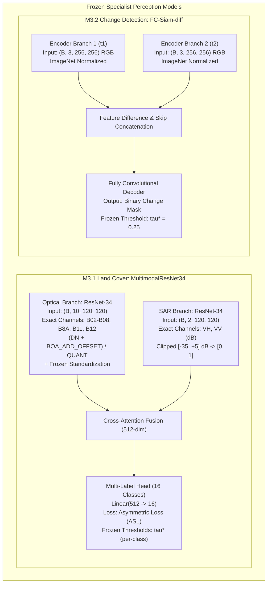
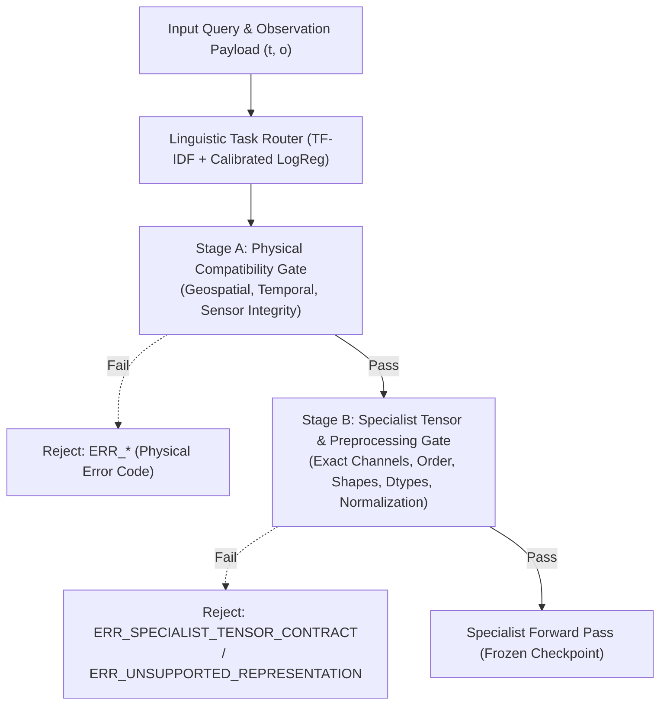

# SatQuery AI — Phase 4 Preregistration Protocol: Robustness, Generalization, and Adversarial Envelope Discovery

**Document Identifier**: `SATQUERY-P4-PROTOCOL-V1.12.1-DRAFT`  
**Phase**: Phase 4 — Robustness, Generalization, and Operational Envelope Discovery  
**Date**: November 10, 2026  
**Status**: **PROPOSED PREREGISTRATION PROTOCOL — DRAFT v1.12.1 (P0 Cloud-Mask Native Resolution, Sentinel-2 Ingested Offset, CRN Noise Tensor Shape, and Source Independence Audit Lock — Pending Final User Freeze)**  
**Repository Branch**: `feature/phase4-generalization-protocol`  
**Preceding Milestones**: Phase 3 Closed (M3.1 Multimodal ASL/CB-BCE, M3.2 FC-Siam-diff, M3.3 Selective Routing) with Pre-Registered Limitations; Supersedes `SATQUERY-P4-PROTOCOL-V1.12-DRAFT` with resolution-aware nested cloud masks ($120 \times 120$ for LC, $256 \times 256$ for CD), dynamic metadata-ingested Sentinel-2 reflectance offsets, explicit CRN noise tensor shapes and channel independence specifications, conditional in-domain reference scope disclosures, Track 4.5 source independence modeling qualifications, and expanded 39-component cryptographic provenance manifest.  
**Confirmatory Experiment Status**: **ZERO Confirmatory Experiments Executed (Draft Protocol Specification Only)**  
**Model Weight & Threshold Provenance**: Completely Frozen from Phase 3  
- **Multimodal Land Cover Specialist**: `artifacts/specialists/deep_land_cover_asl/best_model_asl.pt` (SHA-256: `a3e2d24fc6b1b12e48960bc26f9d13eec2407fafb6a6237531da75038e65aabf`)
  - Architecture: `MultimodalResNet34`, 10 optical bands + 2 SAR bands, **16-class output head: `head.1.weight: torch.Size([16, 512])`**
  - **Frozen 16-Class Inference Threshold Vector**: `artifacts/specialists/deep_land_cover_asl/threshold_config.json` (SHA-256: `76fa4eda7aec18d4e2df7f9434c603d76effebc2ba569764320dbad58d40ad0d`):
    $$\boldsymbol{\tau}^* = [0.70, 0.50, 0.60, 0.65, 0.55, 0.65, 0.75, 0.55, 0.60, 0.55, 0.35, 0.55, 0.60, 0.45, 0.60, 0.65]$$
  - Class Label Taxonomy: `artifacts/specialists/land_cover/classes.json` (SHA-256: `cdb18c8a0a9dc74f52920720340251f14de323bc5c4fb4f07436f90f3500f3e9`)
- **Deep Change Detection Specialist**: `artifacts/specialists/deep_change_detection_fc_siam_diff/best_model.pt` (SHA-256: `8e42ac5abbb907bac3b18abdbf0367748f3849dbd7dea22aaa8c219da4000df3`)
  - Architecture: `FCSiamDiff`, bitemporal RGB, ImageNet normalized
  - **Frozen Inference Operating Threshold**: `artifacts/specialists/deep_change_detection_fc_siam_diff/threshold_config.json` (SHA-256: `c190999eb02f7c6ea043348e9c36b086a6e4ba2d6f2794bd0d889a757553f680`):
    $$\tau^* = 0.25$$
- **Linguistic Task Router**: `artifacts/router/router_model.joblib` (SHA-256: `eaf6c5b2cd8e718980a3496ce416b69ff9793cb1584e176951a9f652941cc218`)
  - Architecture: TF-IDF n-grams + Multinomial Logistic Regression calibrated with temperature $T=0.0991$
  - Frozen Routing Operating Thresholds: $\tau_{\text{intent}}=0.65, \tau_{\text{margin}}=0.15, \tau_{\text{sel}}=1.0$
- **Two-Stage Input Compatibility Architecture**:
  - **Stage A (Geospatial Physical Gate)**: Closed-form validation in [`satquery/utils/geospatial.py`](file:///c:/Users/B%20NAVANEETH/SatQueryAI/satquery/utils/geospatial.py) (SHA-256: `156b76cd1ab4abc54341e6a405f9cd58f1387096f6cc92917c62ec01a11911f5`) inspecting 8 physical dimensions.
  - **Stage B (Specialist Tensor & Preprocessing Contract Gate)**: Verification of exact channel count, canonical channel order, spatial dimensions, finite floating-point values, and frozen scaling/standardization provenance.

---

## 1. Executive Research Motivation & Non-Tuning Directive

Phase 3 established the foundational multimodal perception and input-constrained selective routing architecture of SatQuery AI:
- **Milestone M3.1**: Implemented and benchmarked deep multimodal land-cover classification using a dual-branch ResNet-34 (`MultimodalResNet34`) trained with asymmetric loss (ASL) on BigEarthNet-14k paired Sentinel-1 SAR and Sentinel-2 multispectral observations.
- **Milestone M3.2**: Established deep Siamese change detection using `FC-Siam-diff` and `BIT` on bitemporal Sentinel-2 imagery, evaluated under strict city-level spatial disjointness.
- **Milestone M3.3**: Established a temperature-calibrated linear task router ($T=0.0991$) tightly coupled to a deterministic physical compatibility gate, demonstrating $0.00\%$ observed incompatible dispatch error rate ($\text{IDER}_{\text{obs}} = 0.0\%$, finite-sample Wilson 95% bound $\le 9.89\%$) and $59.0\%$ overall 7-task architectural success.

### The Non-Tuning Scientific Directive
**Phase 4 is strictly a validation, stress-testing, and operational envelope discovery phase.**  
To preserve open-science methodological integrity:
1. **Zero Weight / Parameter Tuning**: No specialist neural weights, router calibration temperatures ($T_{\text{cal}} = 0.0991$), specialist inference thresholds ($\boldsymbol{\tau}^*_{\text{LC}}$, $\tau^*_{\text{CD}} = 0.25$), or routing thresholds ($\tau_{\text{intent}}=0.65, \tau_{\text{margin}}=0.15, \tau_{\text{sel}}=1.0$) will be re-trained, fine-tuned, or adjusted against Phase 4 evaluation data.
2. **Strict Confirmatory Testing**: Confirmatory evaluations test the frozen Phase 3 checkpoints. Any exploratory analyses, failure post-mortems, or adaptation experiments will be formally quarantined into separate, non-confirmatory reporting sections.
3. **Transparent Reporting of Operational Limits**: Performance degradations, out-of-domain failure modes, or edge-case gate rejections will be documented transparently as scientific characterizations of the system's operational envelope rather than concealed.
4. **Pre-Registered Protocol Lock**: Hypotheses, comparison populations, statistical test definitions, and acceptance criteria are finalized prior to execution; no post-hoc amendments based on observed results will be permitted.

---

## 2. Frozen Perception Architectures & Exact Input Contracts

An audit of the codebase checkpoints and dataset loaders confirms the exact hardware, architecture, and tensor contracts of the frozen models:



### Specialist 1: Multimodal Land Cover (`MultimodalResNet34`)
- **Model Checkpoint**: `artifacts/specialists/deep_land_cover_asl/best_model_asl.pt` (ASL $\gamma^+=0, \gamma^-=4, m=0.05$).
- **Architecture**: Dual-branch ResNet-34 backbones with 8-head cross-attention fusion projecting to a 512-dimensional multimodal latent space, terminated with a linear head `head.1.weight: torch.Size([16, 512])`.
- **Target Label Taxonomy (Empirically Verified: 16 Classes)**:
  Audited from `artifacts/specialists/land_cover/classes.json` (SHA-256: `cdb18c8a0a9dc74f52920720340251f14de323bc5c4fb4f07436f90f3500f3e9`), matching model head `head.1.weight: torch.Size([16, 512])`.
  > [!IMPORTANT]
  > **Dual Indexing Disambiguation (0-Based Python vs 1-Based Protocol)**:
  > In Python code and PyTorch tensors, arrays use **zero-based indexing** $c \in \{0, \dots, 15\}$. In mathematical protocol text and human-readable lists, classes are numbered **one-based** $c \in \{1, \dots, 16\}$.
  > - **Three Quarantined Classes**:
  >   - `Complex cultivation patterns`: 0-based index **3** (1-based index **4**), $\tau^* = 0.65$
  >   - `Industrial or commercial units`: 0-based index **5** (1-based index **6**), $\tau^* = 0.65$
  >   - `Permanent crops`: 0-based index **13** (1-based index **14**), $\tau^* = 0.45$
  > - **Thirteen Mapped Classes**:
  >   - 0-based: `[0, 1, 2, 4, 6, 7, 8, 9, 10, 11, 12, 14, 15]`
  >   - 1-based: `[1, 2, 3, 5, 7, 8, 9, 10, 11, 12, 13, 15, 16]`

  | 0-Based (Code) | 1-Based (Doc) | Class Label | Frozen $\tau^*$ | Evaluation Status |
  | :---: | :---: | :--- | :---: | :--- |
  | `0` | `1` | `Arable land` | 0.70 | **Directly Mapped** |
  | `1` | `2` | `Beaches, dunes, sands` | 0.50 | **Approximate Mapping** |
  | `2` | `3` | `Broad-leaved forest` | 0.60 | **Directly Mapped** |
  | `3` | `4` | `Complex cultivation patterns` | 0.65 | **Quarantined / Inevaluable** |
  | `4` | `5` | `Coniferous forest` | 0.55 | **Directly Mapped** |
  | `5` | `6` | `Industrial or commercial units` | 0.65 | **Quarantined / Inevaluable** |
  | `6` | `7` | `Inland waters` | 0.75 | **Approximate Mapping** |
  | `7` | `8` | `Inland wetlands` | 0.55 | **Directly Mapped** |
  | `8` | `9` | `Land principally occupied by agriculture...` | 0.60 | **Approximate Mapping** |
  | `9` | `10` | `Mixed forest` | 0.55 | **Directly Mapped** |
  | `10` | `11` | `Moors, heathland and sclerophyllous vegetation` | 0.35 | **Approximate Mapping** |
  | `11` | `12` | `Natural grassland and sparsely vegetated areas` | 0.55 | **Approximate Mapping** |
  | `12` | `13` | `Pastures` | 0.60 | **Approximate Mapping** |
  | `13` | `14` | `Permanent crops` | 0.45 | **Quarantined / Inevaluable** |
  | `14` | `15` | `Transitional woodland, shrub` | 0.60 | **Approximate Mapping** |
  | `15` | `16` | `Urban fabric` | 0.65 | **Directly Mapped** |
- **Input Tensor Contract**:
  - Optical tensor: Shape `(B, 10, 120, 120)` consisting of 10 Sentinel-2 L2A surface reflectance channels in **exact canonical order**: `[B02, B03, B04, B05, B06, B07, B08, B8A, B11, B12]`.
    - Native 20m bands (`B05, B06, B07, B8A, B11, B12`) must be resampled to 10m GSD via bilinear interpolation to match the native 10m bands (`B02, B03, B04, B08`).
    - Processing Baseline Reconciliation & Dynamic Metadata Ingestion: Surface reflectance $\rho_{\lambda}$ is computed strictly using dynamic, per-band metadata ingestion:
      $$\rho_{\lambda} = \frac{\text{DN}_{\lambda} + \text{BOA\_ADD\_OFFSET}_{\lambda}}{\text{QUANTIFICATION\_VALUE}}$$
      where $\text{QUANTIFICATION\_VALUE} = 10,000.0$, and $\text{BOA\_ADD\_OFFSET}_{\lambda}$ is ingested directly from product metadata ($0.0$ for archival products $\text{PB} < 04.00$; nominally $-1000.0$ for modern products $\text{PB} \ge 04.00$ when reported by Copernicus SAFE XML/JSON manifests, but ingested dynamically per band rather than assumed as an immutable universal constant).
    - Non-Clipping Physical Policy: Surface reflectance $\rho_{\lambda}$ is **not silently clipped to $[0.0, 1.0]$**. Values are verified to be finite (`not np.isfinite` halts execution) and within expected physical tolerances $[-0.05, 1.20]$ to accommodate water dark-target subtraction shadows and cloud/snow specular glint without artificial truncation.
    - Channel Standardization: Scaled via frozen training split statistics:
      $$X_{\text{opt}, c} = \frac{\rho_c - \mu_{\text{opt}, c}}{\sigma_{\text{opt}, c}}$$
      $$\mu_{\text{opt}} = [0.136, 0.118, 0.106, 0.128, 0.203, 0.257, 0.272, 0.273, 0.187, 0.121]$$
      $$\sigma_{\text{opt}} = [0.082, 0.076, 0.074, 0.089, 0.098, 0.108, 0.113, 0.112, 0.095, 0.078]$$
    - Regression Test Lock: Bitwise equivalence and shift quantification are validated in `tests/test_preprocessing_compatibility.py` (SHA-256: `1a8908e3a0b9b2d2a6d9f4ed81686762c08f33f2c272b9bb47c01ff10e2442c9`).
  - SAR tensor: Shape `(B, 2, 120, 120)` consisting of 2 Sentinel-1 GRD IW polarization channels in **exact canonical order**: `[VH, VV]` in decibels.
    - Clipping & Scaling: clipped to $[-35.0, +5.0]\text{ dB}$ and linearly scaled to $[0.0, 1.0]$ via $(\text{dB} + 35.0) / 40.0$.
  - Representation constraint: Generic 1D feature vectors are strictly **unsupported** by the frozen neural specialist checkpoint and are rejected at Stage B validation.

### Specialist 2: Deep Bitemporal Change Detection (`FCSiamDiff`)
- **Model Checkpoint**: `artifacts/specialists/deep_change_detection_fc_siam_diff/best_model.pt`.
- **Architecture**: Fully Convolutional Siamese Difference network (`FC-Siam-diff`) with shared feature extraction backbones and difference skip connections.
- **Inference Threshold**: $\tau^* = 0.25$ (frozen from OSCD validation tuning).
- **Input Tensor Contract**:
  - Bitemporal pair: Two coregistered RGB tensors $(t_1, t_2)$ of shape `(B, 3, H, W)` with $H, W \ge 100$ (nominally $256 \times 256$ patches or full-scene sliding window).
  - Normalization: ImageNet channel-wise standardization ($\mu = [0.485, 0.456, 0.406], \sigma = [0.229, 0.224, 0.225]$).
- **Target Label Taxonomy**: Binary change mask ($1 = \text{Change}, 0 = \text{No Change}$).

### Specialist 3: Task Router & Two-Stage Input Compatibility Pipeline
- **Router Architecture**: Scikit-Learn TF-IDF Vectorizer (word n-grams 1-2, sublinear TF scaling) + Multinomial Logistic Regression calibrated via temperature scaling ($T=0.0991$).
- **Routing Policy**:
  - Primary intent threshold: $\tau_{\text{intent}} = 0.65$
  - Confidence margin threshold: $\tau_{\text{margin}} = 0.15$
  - Specialist selection threshold: $\tau_{\text{sel}} = 1.0$

---

## 3. Two-Stage Input Compatibility Architecture (Stage A Physical & Stage B Specialist Preprocessing / Tensor Contract)

To guarantee that a physically plausible geospatial observation does not cause runtime exceptions or tensor mismatches in the downstream neural models, SatQuery AI implements a strict **Two-Stage Validation Pipeline**:



### Stage A: Geospatial Physical Compatibility Gate $\mathcal{C}_{\text{phys}}(t, o)$
Implemented in [`satquery/utils/geospatial.py`](file:///c:/Users/B%20NAVANEETH/SatQueryAI/satquery/utils/geospatial.py), inspecting 8 machine-enforceable dimensions:

| Dimension | Checked Parameter | Gate Logic & Engineering Limits | Strict Boundary Points (Sub / Equality / Super) | Diagnostic Error Code |
| :--- | :--- | :--- | :--- | :--- |
| **1. Modality & Sensor Structure** | Payload type & dictionary keys | - Land Cover: requires paired SAR+optical paths; rejects bitemporal pairs.<br>- Change Detection: requires bitemporal pair ($N=2$); rejects single images or 1D features.<br>- Optical-SAR Fusion: requires simultaneous S1+S2 inputs. | Single optical image to LC $\to$ Fail<br>Bitemporal pair to CD $\to$ Pass<br>Feature vector to CD $\to$ Fail | `ERR_MISSING_MODALITY` |
| **2. Temporal Revisit Window** | Revisit interval $\Delta t = \|t_2 - t_1\|$ | - Change Detection: enforces $5.0\text{ days} \le \Delta t \le 730.0\text{ days}$.<br>- Dynamic Optical-SAR Fusion: offset $\le 72.0\text{h}$ ($3.0\text{d}$). | $\Delta t = 4.9\text{d}$ (Fail: $< 5.0$)<br>$\Delta t = 5.0\text{d}$ (**Equality: Pass**)<br>$\Delta t = 730.0\text{d}$ (**Equality: Pass**)<br>$\Delta t = 730.1\text{d}$ (Fail: $> 730.0$) | `ERR_TEMPORAL_INVALID` |
| **3. Spectral Band Adequacy** | Band metadata `spectral_bands` | - Verifies metadata declarations contain valid Sentinel-2 optical bands and Sentinel-1 polarization channels. | Missing optical band codes $\to$ Fail<br>Unrecognized sensor band labels $\to$ Fail | `ERR_INSUFFICIENT_BANDS` |
| **4. Spatial Dimensions** | Raster height and width $(H, W)$ | - Land Cover: requires $H, W \ge 120\text{ pixels}$.<br>- Change Detection: requires $H, W \ge 100\text{ pixels}$.<br>- Shape equality: $H_1 = H_2$ and $W_1 = W_2$ for bitemporal pairs. | LC: $119 \times 120$ (Fail)<br>LC: $120 \times 120$ (**Equality: Pass**)<br>CD: $99 \times 100$ (Fail)<br>CD: $100 \times 100$ (**Equality: Pass**) | `ERR_DIMENSION_TOO_SMALL`<br>`ERR_DIMENSION_MISMATCH` |
| **5. Geospatial CRS Consistency** | Coordinate Reference System metadata | - Bitemporal pairs: enforces identical projected reference systems (`crs1 == crs2`). Rejects unprojected lat/lon mixed with UTM or mismatched UTM zones. | EPSG:32632 vs EPSG:32632 $\to$ Pass<br>EPSG:32632 vs EPSG:4326 $\to$ Fail<br>EPSG:32632 vs EPSG:32633 $\to$ Fail | `ERR_CRS_MISMATCH` |
| **6. Coregistration & Affine Alignment** | GDAL GeoTransform matrices `gt1, gt2` | Evaluates relative affine transform $\mathbf{M}_{\text{rel}} = \mathbf{A}_1^{-1} \mathbf{A}_2$ and corner displacements:<br>- Inverted axis: $\det(\mathbf{M}_{\text{rel}}) \le 0$<br>- Scale distortion: $|\det(\mathbf{M}_{\text{rel}}) - 1.0| > 0.02$ or $|\sigma_i - 1.0| > 0.01$<br>- Anisotropic shear: SVD condition number $\kappa = \sigma_1 / \sigma_2 > 1.01$<br>- Axis rotation: $|\theta_{\text{rel}}| > 0.28^\circ$<br>- Corner displacement: $\delta_{\text{max}} > 0.05\text{ px}$. | $\delta = 0.049\text{ px}$ (Pass)<br>$\delta = 0.050\text{ px}$ (**Equality: Pass**)<br>$\delta = 0.051\text{ px}$ (Fail: $> 0.05$)<br>$\kappa = 1.010$ (**Equality: Pass**), $1.011$ (Fail)<br>$\|\theta\| = 0.280^\circ$ (**Equality: Pass**), $0.281^\circ$ (Fail)<br>$\det = 0.980$ (**Equality: Pass**), $0.979$ (Fail)<br>$\det = 0.000$ (Fail: $\det \le 0$) | `ERR_INVERTED_AXIS`<br>`ERR_SCALE_DISTORTION`<br>`ERR_ANISOTROPIC_SHEAR`<br>`ERR_ROTATION_MISMATCH`<br>`ERR_UNREGISTERED_GRID` |
| **7. Ground Sample Distance (GSD)** | Spatial resolution metadata `gsd_m` | - Sentinel-2 specialists require nominal resolution: $8.0\text{ m} \le \text{GSD} \le 12.0\text{ m}$. Rejects native Landsat ($30\text{ m}$) and native PlanetScope ($3\text{ m}$). | $\text{GSD} = 7.9\text{ m}$ (Fail: $< 8.0$)<br>$\text{GSD} = 8.0\text{ m}$ (**Equality: Pass**)<br>$\text{GSD} = 12.0\text{ m}$ (**Equality: Pass**)<br>$\text{GSD} = 12.1\text{ m}$ (Fail: $> 12.0$) | `ERR_RESOLUTION_INCOMPATIBLE` |
| **8. Radiometric Integrity & Cloud Guard** | Raster numerical values & `cloud_fraction` | - Numerical integrity: scans for `NaN` and `Inf` floating point values.<br>- Double-scaling trap: detects float values $\le 1.05$ where raw DN $[0, 10000]$ is expected.<br>- Cloud cover threshold: rejects payloads with cloud fraction $> 0.20$ for Land Cover and $> 0.10$ for Change Detection based on metadata contract. | LC Cloud $10\%$ (Pass)<br>LC Cloud $20\%$ (**Equality: Pass**)<br>LC Cloud $20.1\%$ (Fail: $> 0.20$)<br>CD Cloud $5\%$ (Pass)<br>CD Cloud $10\%$ (**Equality: Pass**)<br>CD Cloud $10.1\%$ (Fail: $> 0.10$) | `ERR_CORRUPT_PAYLOAD` |

### Stage B: Specialist Tensor & Preprocessing Contract Gate $\mathcal{C}_{\text{tensor}}(M_k, \mathbf{X})$
Executes immediately upon Stage A clearance and prior to passing tensors into the neural forward pass of specialist $M_k$:
1. **Land Cover Specialist Preprocessing & Tensor Contract (`MultimodalResNet34`)**:
   - *Optical Tensor Specification*: Shape must be exactly `(B, 10, 120, 120)` with `dtype == torch.float32`.
   - *Canonical Channel Sequence*: Must strictly correspond to `[B02, B03, B04, B05, B06, B07, B08, B8A, B11, B12]`. Any omission (e.g. 4-band RGB+NIR) or permutation halts execution with `ERR_SPECIALIST_TENSOR_CONTRACT`.
   - *Resampling Provenance & Pipeline*: Verifies that 20m bands (`B05, B06, B07, B8A, B11, B12`) were resampled from native 20m GSD (60x60) to 10m GSD (120x120) via bilinear interpolation (`torch.nn.functional.interpolate` with `mode='bilinear', align_corners=False`), matching native 10m bands (`B02, B03, B04, B08`). Verified by `satquery.utils.s2_metadata.resample_s2_20m_to_10m` which returns structured provenance metadata `{"resampling_method": "bilinear", "align_corners": False, "channel_order": CANONICAL_S2_BANDS}`.
     - *Training Pipeline Parity & Pass-Through Verification*: During Phase 2/3 model training, BigEarthNet-14k patches were loaded from pre-resampled 10-band GeoTIFFs (`BEN_14k/BigEarthNet-S2`) already at $120 \times 120$ spatial resolution with `ModelPixelScaleTag: (10.0, 10.0, 0.0)`. Empirical verification on actual satellite GeoTIFF patches confirms: (1) `resample_s2_20m_to_10m` acts as an exact bitwise identity pass-through ($L_\infty = 0.0$) on pre-resampled patches; (2) when native 20m bands ($60 \times 60$) are upsampled, PyTorch `align_corners=False` exhibits bitwise/numerical identity ($L_\infty = 0.0$, max diff $< 10^{-6}$) with standard PIL bilinear interpolation (`Image.Resampling.BILINEAR`), reconstructing original pre-resampled bands with spatial correlation $r > 0.979$. Verified in `tests/test_taxonomy_and_metrics.py::test_resampling_parity_actual_bigearthnet_patch`.
   - *Processing Baseline Reconciliation & Metadata Ingestion*:
     Sentinel-2 Level-2A surface reflectance conversion is governed by the product processing baseline and ingested metadata offsets:
     $$\rho_{\lambda} = \frac{\text{DN}_\lambda + \text{BOA\_ADD\_OFFSET}_\lambda}{\text{QUANTIFICATION\_VALUE}}$$
     where $\text{QUANTIFICATION\_VALUE} = 10,000.0$.
     - *Dynamic Per-Band Offset Ingestion*: The offset $\text{BOA\_ADD\_OFFSET}_\lambda$ is ingested directly from product metadata. For archival products ($\text{PB} < 04.00$), $\text{BOA\_ADD\_OFFSET}_\lambda = 0.0$ for all bands. For modern products ($\text{PB} \ge 04.00$), per-band offsets are extracted dynamically from product metadata (nominally $-1000.0$ when reported by Copernicus SAFE XML/JSON manifests, but ingested dynamically per band rather than assumed as an immutable universal constant).
     - *Automated Metadata Parsing*: Implemented in `satquery.utils.s2_metadata.parse_s2_metadata`, which extracts processing baseline and per-band offsets directly from Copernicus XML metadata (`MTD_MSIL2A.xml`, `MTD_TL.xml`), JSON/dictionary manifests, or SAFE product naming conventions (`_N0400_`, `_N0205_`).
     - *Safe Error Handling*: Payloads missing processing baseline metadata or presenting contradictory declarations (e.g., PB $\ge$ 04.00 with zero offset) are rejected with `ERR_METADATA_INCOMPLETE` / `ValueError` before inference.
     - *Baseline Offset Defense*: Applying the archival $\text{DN}/10000$ formula to $\text{PB} \ge 04.00$ products introduces an artificial $+0.10$ reflectance shift ($+1.35\sigma$ on Band 4 Red). Stage B guarantees complete radiometric alignment across archival and modern products.
   - *Non-Clipping Physical Inspection*: Surface reflectance $\rho$ is verified for finite floating-point values (`not np.isfinite` raises `ERR_NON_FINITE_TENSOR`). It is **not silently clipped to $[0.0, 1.0]$**; values within nominal physical tolerance $[-0.05, 1.20]$ are preserved to avoid distorting shadow or glint distributions. Tensors with values outside $[-0.05, 1.20]$ halt execution with `ERR_UNPHYSICAL_REFLECTANCE`.
   - *Standardization Invariants*: Applies channel-wise standardization using frozen training split parameters:
     $$X_{\text{opt}, c} = \frac{\rho_c - \mu_{\text{opt}, c}}{\sigma_{\text{opt}, c}}$$
     with $\mu_{\text{opt}} = [0.136, 0.118, 0.106, 0.128, 0.203, 0.257, 0.272, 0.273, 0.187, 0.121]$ and $\sigma_{\text{opt}} = [0.082, 0.076, 0.074, 0.089, 0.098, 0.108, 0.113, 0.112, 0.095, 0.078]$.
   - *SAR Tensor Specification*: Shape must be exactly `(B, 2, 120, 120)` with `dtype == torch.float32`, corresponding to `[VH, VV]`.
   - *SAR Normalization Invariants*: Verifies clipping to $[-35.0, +5.0]\text{ dB}$ and linear scaling to $[0.0, 1.0]$ via $(\text{dB} + 35.0) / 40.0$.
   - *Representation Constraint*: If input is formatted as a 1D feature vector or summary embedding, it is rejected with `ERR_UNSUPPORTED_REPRESENTATION`.
   - *Regression & Integration Verification*: Preprocessing compatibility is validated bitwise in `tests/test_preprocessing_compatibility.py` (SHA-256: `1a8908e3a0b9b2d2a6d9f4ed81686762c08f33f2c272b9bb47c01ff10e2442c9`); full XML/dict metadata parsing, baseline reconciliation, and resampling provenance are verified in `tests/test_s2_metadata_integration.py` (SHA-256: `141bed10699d3b6ed716435c1f3cb5503151f87a194043ae4cc4342c079b1e4c`).
2. **Change Detection Specialist Preprocessing & Tensor Contract (`FCSiamDiff`)**:
   - *Bitemporal Tensor Specification*: Verifies two tensors $(t_1, t_2)$ each of shape `(B, 3, H, W)` with $H, W \ge 100$, $H_1 = H_2, W_1 = W_2$, and `dtype == torch.float32` (RGB channels).
   - *ImageNet Normalization Invariant*: Verifies standardization with ImageNet channel statistics ($\mu = [0.485, 0.456, 0.406], \sigma = [0.229, 0.224, 0.225]$), canonical `(3, H, W)` channel ordering, and finite floating-point values.

---

## 4. Confirmatory Experimental Tracks

### Track 4.1: Cross-Region Geographic Generalization

- **Research Question**: Does the frozen perception pipeline generalize across global biomes outside the European training domain, and does the physical compatibility gate maintain invariant validity detection?
- **Scientific Qualification on Label Harmonization Strategy**:
  > [!IMPORTANT]
  > **Taxonomy Shift Disclosure**: Geographic transfer performance is evaluated against a common MODIS MCD12Q1-derived proxy-label construction applied identically to in-domain and out-of-domain cohorts. Because the frozen model was trained using CORINE-derived BigEarthNet annotations, the evaluation inherently reflects a compound shift: **geographic transfer combined with a training-to-evaluation taxonomy shift**. Results are therefore interpreted as **geographic transfer under harmonized proxy evaluation labels**, rather than as an isolated causal estimate of geographic domain shift alone. The native CORINE in-domain evaluation ($F_{1,\text{in-domain}}^{(\text{CORINE})}$) is reported in tandem to quantify the in-domain proxy penalty.
- **Target Population & Pre-Evaluation Sample Accounting**:
  1. *Land Cover Cohort ($N_{\text{initial}} = 2,000$ paired patches OOD + $N_{\text{initial}} = 3,248$ in-domain)*:
     - Co-registered 10-band Sentinel-2 L2A and 2-band Sentinel-1 GRD IW (VH, VV) patches ($120 \times 120$ pixels, 10m GSD).
     - Stratified initially across 4 global biomes ($N_{\text{initial}}=500$ patches each):
       - **Biome 1 (Arid / Hyper-arid & Semi-arid)**: North Africa and Arabian Peninsula (Sahara margins, Sinai, Rub' al Khali; Lat $24^\circ\text{N}$ to $32^\circ\text{N}$, Lon $25^\circ\text{E}$ to $45^\circ\text{E}$).
       - **Biome 2 (Tropical Rainforest)**: Amazon Basin, Brazil and Congo Basin, Central Africa (Lat $5^\circ\text{S}$ to $5^\circ\text{N}$, Lon $65^\circ\text{W}$ to $55^\circ\text{W}$ and $15^\circ\text{E}$ to $25^\circ\text{E}$).
       - **Biome 3 (Boreal Forest / Sub-Arctic)**: Fennoscandia and Interior Alaska (Lat $60^\circ\text{N}$ to $68^\circ\text{N}$, Lon $15^\circ\text{E}$ to $30^\circ\text{E}$ and $150^\circ\text{W}$ to $140^\circ\text{W}$).
       - **Biome 4 (Humid Subtropical / Monsoon Cropland)**: Indo-Gangetic Plain and Mekong Delta (Lat $10^\circ\text{N}$ to $26^\circ\text{N}$, Lon $75^\circ\text{E}$ to $105^\circ\text{E}$).
     - **Mandatory Geographic Cluster Manifest**:
       Before evaluation execution, all candidates are cataloged and cryptographically locked in `data/manifests/phase4_ood_manifest.csv`. The manifest specifies:
       `patch_id, scene_id, biome_id, cluster_id, subregion_id, center_lat, center_lon, epsg, s2_granule_id, s2_acq_date, s1_scene_id, s1_acq_date, modis_product_year, modis_qc_valid_ratio`.
       Each biome contains at least 5 distinct geographic subregions ($K_{\text{OOD}, k} \ge 5$).
     - **Strict Pre-Evaluation Exclusion & Sequential Mutually Exclusive Accounting**:
       Initial sample counts ($N_{\text{initial}}$) represent gross candidate acquisitions and **will not be presented as the final evaluation denominator**. To eliminate ambiguity and guarantee that overlapping screening criteria cannot double-subtract candidates, evaluable sample sizes are derived through a strict **sequential screening pipeline** where each exclusion count represents candidates newly excluded at that specific stage:
       1. *Step 1 — QC Screening*: Evaluate valid MODIS raster coverage on gross candidates. Patches failing coverage ($A_{\text{valid}, i} / \text{Area}(\mathcal{P}_i) < 0.80$) are excluded:
          $$N_{\text{excluded, QC}} = \sum_{i=1}^{N_{\text{initial}}} \mathbb{I}\left(\frac{A_{\text{valid}, i}}{\text{Area}(\mathcal{P}_i)} < 0.80\right)$$
          Surviving QC-pass candidate subset: $\mathcal{S}_{\text{QC}} = \{i \mid \text{QC-pass}\}$, with count $N_{\text{pass, QC}} = N_{\text{initial}} - N_{\text{excluded, QC}}$.
       2. *Step 2 — Temporal Screening (Evaluated Strictly Among $\mathcal{S}_{\text{QC}}$)*: Screen surviving patches for acquisition-to-product temporal alignment. Patches with $|Y^* - Y_{\text{acq}}| > 1$ are newly excluded:
          $$N_{\text{excluded, temporal}} = \sum_{i \in \mathcal{S}_{\text{QC}}} \mathbb{I}\left(|Y_i^* - Y_{\text{acq}, i}| > 1\right)$$
          Surviving temporally aligned candidate subset: $\mathcal{S}_{\text{QC} \land \text{temporal}} = \{i \in \mathcal{S}_{\text{QC}} \mid |Y_i^* - Y_{\text{acq}, i}| \le 1\}$, with count $N_{\text{pass, temporal}} = N_{\text{pass, QC}} - N_{\text{excluded, temporal}}$.
       3. *Step 3 — MODIS Label Quarantine (Evaluated Strictly Among $\mathcal{S}_{\text{QC} \land \text{temporal}}$)*: Screen surviving patches for mapped class coverage. Patches where no mapped BigEarthNet class reaches $\ge 20\%$ are quarantined:
          $$N_{\text{quarantined}} = \sum_{i \in \mathcal{S}_{\text{QC} \land \text{temporal}}} \mathbb{I}\left(\max_{k \in \{1, \dots, 13\}} w_i(k) < 0.20\right)$$
       4. *Step 4 — Final Evaluable Cohort*:
          $$N_{\text{evaluable}} = N_{\text{initial}} - N_{\text{excluded, QC}} - N_{\text{excluded, temporal}} - N_{\text{quarantined}} = N_{\text{pass, temporal}} - N_{\text{quarantined}}$$
          Because steps 1–3 are evaluated sequentially on surviving subsets, $\{N_{\text{excluded, QC}}, N_{\text{excluded, temporal}}, N_{\text{quarantined}}\}$ form a mutually exclusive partition of the excluded population, mathematically preventing double-subtraction. The evaluation report will publish complete sample accounting tables disclosing initial, step-1 excluded, step-2 excluded, step-3 quarantined, and evaluable sample counts per biome and per in-domain tile cluster, along with exact positive ground-truth support per class ($N_{\text{true}, c}$).
     - **Simplified MODIS MCD12Q1 Area-Weighted Construction & Absolute Quarantine Rule**:
       1. *Footprint Polygon Construction*: Construct footprint polygon $\mathcal{P}_i$ from affine GeoTransform and reproject to MODIS Sinusoidal projection.
       2. *Area Fractional Weighting*: For valid pixels, compute fractional coverage $w_i(C)$ across all 17 IGBP classes:
          $$w_i(C) = \frac{\sum_{m \text{ valid}, C_m = C} A_{m, i}}{A_{\text{valid}, i}}$$
       3. *Mapped Class Aggregation*: For each of the 13 mapped BigEarthNet classes $k \in \{1, \dots, 13\}$, calculate aggregated coverage:
          $$w_i(k) = \sum_{C \in \text{Map}(k)} w_i(C)$$
       4. *Deterministic Multi-Label Assignment & Absolute Quarantine*:
          - If $\max_{k \in \{1, \dots, 13\}} w_i(k) \ge 0.20$, assign all qualifying mapped labels:
            $$y_{i, k} = \mathbb{I}\left(w_i(k) \ge 0.20\right)$$
          - **If no mapped class reaches $20\%$ ($\max_{k \in \{1, \dots, 13\}} w_i(k) < 0.20$), the patch is strictly quarantined as Inevaluable / Out-of-Scope**.
          - *No Plurality Fallback & Strict Quarantine Policy*: Configured explicitly as `NO_FALLBACK_STRICT_QUARANTINE` in `configs/modis_harmonization_config.json`. To eliminate logically unreachable branches and prevent forcing mapped labels onto patches dominated by unmapped terrain (e.g. Snow/Ice, Barren/Desert where unmapped, or diffuse fragmentation), no secondary plurality fallback will assign another mapped class. Quarantined patches have zero labels assigned ($\mathbf{y}_i = \mathbf{0}_{16}$) and are excluded from the evaluable denominator $N_{\text{evaluable}}$. Under no circumstances are synthetic labels, plurality assignments, or zero-vector pseudo-classes injected into the evaluation metrics. Verified in `tests/test_taxonomy_and_metrics.py::test_modis_quarantine_edge_cases_and_zero_fallback_rejection`.
     - **Cross-Taxonomy Alignment Table**:
       The target taxonomy consists of the 16 classes from `artifacts/specialists/land_cover/classes.json`. Ground truth is categorized as **Directly Mapped ($N=6$)**, **Approximately Mapped ($N=7$)**, or **Quarantined / Inevaluable ($N=3$)**:
       | BigEarthNet-16 Target Class | Mapped MODIS IGBP Class(es) | Semantic Alignment / Rationale | Categorization Status |
       | :--- | :--- | :--- | :--- |
       | `Coniferous forest` | Class 1 (Evergreen Needleleaf), Class 3 (Deciduous Needleleaf) | High fidelity needleleaf canopy alignment | **Directly Mapped** |
       | `Broad-leaved forest` | Class 2 (Evergreen Broadleaf), Class 4 (Deciduous Broadleaf) | High fidelity broadleaf canopy alignment | **Directly Mapped** |
       | `Mixed forest` | Class 5 (Mixed Forest) | Co-dominant needleleaf/broadleaf canopy | **Directly Mapped** |
       | `Arable land` | Class 12 (Croplands) | Annual cropland cover | **Directly Mapped** |
       | `Urban fabric` | Class 13 (Urban and Built-up Lands) | Impervious surface / built settlement | **Directly Mapped** |
       | `Inland wetlands` | Class 11 (Permanent Wetlands) | Water-inundated land surface | **Directly Mapped** |
       | `Transitional woodland, shrub` | Class 6 (Closed Shrublands) | Approximate: closed shrubland structure | **Approximate Mapping** |
       | `Moors, heathland and sclerophyllous...` | Class 7 (Open Shrublands) | Approximate: low-density open shrubland | **Approximate Mapping** |
       | `Natural grassland and sparsely vegetated...` | Class 8 (Woody Savannas), Class 9 (Savannas) | Approximate: savannas combine grass and sparse trees | **Approximate Mapping** |
       | `Pastures` | Class 10 (Grasslands) | Approximate: includes natural grassland and managed pasture | **Approximate Mapping** |
       | `Land principally occupied by agriculture...` | Class 14 (Cropland/Natural Vegetation Mosaic) | Approximate: mosaic pattern representation | **Approximate Mapping** |
       | `Inland waters` | Class 17 (Water Bodies) | Approximate: includes marine coastal water along with inland lakes/rivers | **Approximate Mapping** |
       | `Beaches, dunes, sands` | Class 16 (Barren) | Approximate: includes bare soil, rock, and desert along with sand/dunes | **Approximate Mapping** |
       | `Industrial or commercial units` | *None* | Cannot be resolved from 500m MODIS Class 13 | **Quarantined / Inevaluable** |
       | `Complex cultivation patterns` | *None* | Parcel geometry cannot be resolved at 500m | **Quarantined / Inevaluable** |
       | `Permanent crops` | *None* | Orchards/vineyards not distinguished from annual crops | **Quarantined / Inevaluable** |
     - **Explicit Interpretation of Fixed-13 Macro $F_1$ & Absent-Class Safeguards**:
       > [!NOTE]
       > **Fixed-Taxonomy Interpretation**: The primary metric is Fixed-13 Macro $F_1$ ($F_{1,\text{fixed13}} = \frac{1}{13} \sum_{c=1}^{13} F_{1, c}$) evaluated with standard `zero_division=0.0`. It enforces a common class denominator across all biomes. However, because $F_{1, c} = 0.0$ whenever $N_{\text{true}, c} = 0$, an absent class with zero false alarms and an absent class with many false alarms both yield $F_{1, c} = 0.0$. Therefore:
       > 1. $F_{1,\text{fixed13}}$ is a **fixed-taxonomy comparative benchmark**, not a pure measure of recognition quality on represented classes alone.
       > 2. Absent-class false alarm behavior **must be evaluated jointly with $FPR_{\text{absent}}$ and per-class false-positive counts**.
       > 3. The identical zero-division convention applies to Direct-Six ($F_{1,\text{direct6}}^{\text{fixed6}}$) and Approximate-Seven ($F_{1,\text{approx7}}^{\text{fixed7}}$).
       
       1. **Primary Confirmatory Comparison Metric: Fixed-13 Macro $F_1$ ($F_{1,\text{fixed13}}$)**:
          $$F_{1,\text{fixed13}} = \frac{1}{13} \sum_{c=1}^{13} F_{1, c}, \quad \text{where } F_{1, c} = \begin{cases} \frac{2 \text{TP}_c}{2 \text{TP}_c + \text{FP}_c + \text{FN}_c}, & \text{if } N_{\text{true}, c} \ge 1 \\ 0.0, & \text{if } N_{\text{true}, c} = 0 \end{cases}$$
       2. **Secondary Descriptive Metric: Present-Class Macro $F_1$ ($F_{1,\text{mapped13}}^{\text{present}}$)**:
          Averaged strictly over classes with ground-truth support in that biome ($C_{\text{present}, k} = \{c \in \{1,\dots,13\} \mid N_{\text{true}, c} \ge 1\}$):
          $$F_{1,\text{mapped13}}^{\text{present}} = \frac{1}{|C_{\text{present}, k}|} \sum_{c \in C_{\text{present}, k}} F_{1, c}$$
       3. **Mandatory Absent-Class False Positive Metrics (Restricted to Mapped Taxonomy $\mathcal{M}$)**:
          The 13 mapped classes define the evaluation ground-truth space $\mathcal{M} = \{1, \dots, 13\}$. The 3 quarantined classes $\mathcal{Q} = \{\text{Industrial or commercial units (6)}, \text{Complex cultivation patterns (4)}, \text{Permanent crops (14)}\}$ have zero ground truth support by construction and are **strictly excluded from the mapped absent-class set $C_{\text{absent}, k}$**.
          For all absent mapped classes $c \in C_{\text{absent}, k} = \{c \in \mathcal{M} \mid N_{\text{true}, c} = 0\}$:
          - *Absent-Class False Positive Rate ($FPR_{\text{absent}}$)*:
            $$FPR_{\text{absent}} = \frac{\sum_{c \in C_{\text{absent}, k}} \text{FP}_c}{|C_{\text{absent}, k}| \times N_{\text{evaluable}, k}}$$
            where $\text{FP}_c = \sum_{i=1}^{N_{\text{evaluable}, k}} \hat{y}_{i, c}$ (since $y_{i, c} = 0$ for all $i$ when $c \in C_{\text{absent}, k}$).
          - *Absent-Class False Positive Share ($FPS_{\text{absent}}$)*:
            $$FPS_{\text{absent}} = \begin{cases} \frac{\sum_{c \in C_{\text{absent}, k}} \text{FP}_c}{\sum_{c \in \mathcal{M}} \sum_{i=1}^{N_{\text{evaluable}, k}} \hat{y}_{i, c}}, & \text{if } \sum_{c \in \mathcal{M}} \sum_{i=1}^{N_{\text{evaluable}, k}} \hat{y}_{i, c} \ge 1 \\ \text{NA}, & \text{if } \sum_{c \in \mathcal{M}} \sum_{i=1}^{N_{\text{evaluable}, k}} \hat{y}_{i, c} = 0 \end{cases}$$
            The denominator is **strictly restricted to positive predictions among the 13 mapped classes**. If the model produces zero positive predictions on all mapped classes across the evaluation cohort, the denominator is zero; the metric is **explicitly reported as NA** (rather than silently assigned 0.0) to avoid false claims of zero false alarms.
          - *Mandatory Reporting of $|C_{\text{absent}, k}|$*: Every evaluation table reporting $FPR_{\text{absent}}$ or $FPS_{\text{absent}}$ must disclose the exact number of absent mapped classes $|C_{\text{absent}, k}|$ used in that calculation. Verified in `tests/test_taxonomy_and_metrics.py` (SHA-256: `9053d95365f68a58c7b1a9757d3ac88f34115efbf8e8a2c9582565ce729d08cd`).
          - *Per-Class Absent Alarms*: Tabularize $\text{FP-Count}_c$ and $\text{FPR}_c = \text{FP}_c / N_{\text{evaluable}, k}$ for each absent class in $C_{\text{absent}, k}$.
        4. **Sub-Taxonomy Sensitivity Metrics**: Direct-Six ($F_{1,\text{direct6}}^{\text{fixed6}}$) and Approximate-Seven ($F_{1,\text{approx7}}^{\text{fixed7}}$).
        5. **Dedicated Quarantined Outputs Diagnostic Table**:
           The 3 unmapped model outputs are reported in an independent diagnostic table to prevent distorting mapped transfer metrics while monitoring model trigger behavior:
           - *Quarantined Output Trigger Counts*: Tabularize $\sum_{i=1}^{N_{\text{evaluable}, k}} \hat{y}_{i, c}$ for each $c \in \mathcal{Q}$.
           - *Quarantined Trigger Rates*: $\frac{1}{N_{\text{evaluable}, k}} \sum_{i=1}^{N_{\text{evaluable}, k}} \hat{y}_{i, c}$ for each $c \in \mathcal{Q}$.
           - *Quarantined Output Share ($FPS_{\text{quarantine}}$)*:
             $$FPS_{\text{quarantine}} = \frac{\sum_{c \in \mathcal{Q}} \sum_{i=1}^{N_{\text{evaluable}, k}} \hat{y}_{i, c}}{\sum_{c=1}^{16} \sum_{i=1}^{N_{\text{evaluable}, k}} \hat{y}_{i, c}}$$
             quantifying what fraction of total 16-channel model outputs fall onto unmapped categories.
     - **Conditional Spatial Cluster Scope & Leave-One-Tile-Out Sensitivity**:
       > [!WARNING]
       > **Three-Cluster In-Domain Scope & Statistical Degrees of Freedom**: The in-domain BigEarthNet-14k test population comprises patches derived from exactly **3 geographic tile clusters**: `T34TCR`, `T34TEQ`, and `T34TFN` in Serbia.
       > 1. **Limited Inferential Support vs. Monte Carlo Reporting Resolution**: Resampling over $K_{\text{in}} = 3$ clusters provides strictly limited empirical support for in-domain spatial variability ($df \le 2$). A cluster-level bootstrap sample of 3 clusters with replacement admits at most $3^3 = 27$ distinct ordered configurations ($\binom{3+3-1}{3} = 10$ distinct unordered multiset compositions). Executing $B=2,000$ bootstrap replicates provides only a **Monte Carlo numerical reporting grid** ($p_{\min} = 1/(B+1) = 1/2001 \approx 0.000500$), **not** 2,000 independent geographic observations, high inferential resolution, or additional statistical power. The empirical p-value reporting resolution must be strictly distinguished from the coarse underlying inferential support governed entirely by the 3 original Serbian scenes. In-domain baseline estimates, standard errors, and comparative transfer conclusions remain formally conditional on these 3 specific tile clusters; leave-one-tile-out sensitivity analyses are mandatory; and all claims of unconditioned global geographic generalization are strictly prohibited.
       > 2. All geographic transfer inferences, p-values, and bootstrap confidence intervals are **formally conditional on this three-tile reference population**.
       > 3. A non-significant hypothesis test ($\text{Holm } p \ge 0.05$) indicates **insufficient evidence to detect degradation relative to this conditional 3-tile reference**; it must **never** be reported as proof of global geographic generalization, domain invariance, or equivalence.
       > 4. To evaluate sensitivity to individual tile clusters, evaluation mandates reporting **leave-one-tile-out sensitivity analyses**: computing $\Delta F_{1, k}^{(\setminus\text{tile})}$ when excluding each in-domain tile in turn ($\setminus\text{T34TCR}$, $\setminus\text{T34TEQ}$, $\setminus\text{T34TFN}$) alongside per-tile metrics. These are strictly categorized as descriptive sensitivity analyses.
  2. *Change Detection Cohort ($N = 10$ held-out non-European scenes)*:
     - Sourced from **S2Looking** and held-out global cities outside the European/Mediterranean OSCD concentration:
       Cities: Cairo, Nairobi, Santiago, Ulaanbaatar, Perth, Brisbane, Jakarta, Johannesburg, Calgary, Tashkent.
     - Scene-level metrics reported ($F_{1, s}$ for $s=1,\dots,10$) alongside mean, standard error, median, and IQR.
- **Statistical Hypotheses & Decoupled Decision Framework**:
  Evaluation formally decouples **statistical transfer-degradation inference** from **operational performance certification**:
  
  1. *Transfer-Degradation Hypothesis Testing*:
     For each biome $k \in \{1, 2, 3, 4\}$, test:
     $$H_{0, \text{Biome } k}: \Delta F_{1, \text{fixed13}, k} \ge 0 \quad \text{vs.} \quad H_{1, \text{Biome } k}: \Delta F_{1, \text{fixed13}, k} < 0$$
     where $\Delta F_{1, \text{fixed13}, k} = F_{1,\text{fixed13},\text{OOD}, k}^{(\text{MODIS})} - F_{1,\text{fixed13},\text{in-domain}}^{(\text{MODIS})}$.
     - Evaluated via two-sample null-centered spatial cluster bootstrap ($B=2,000$ resamples) with Step-Down Holm adjustment across the 4 biomes at FWER $\alpha = 0.05$.
     - *Inference Interpretation*: Rejection ($\text{Holm } p_k < 0.05$) confirms statistically significant transfer degradation in Biome $k$. A non-significant result ($\text{Holm } p_k \ge 0.05$) indicates insufficient evidence to reject the null under the conditional three-cluster reference; it must **never** be reported as proof of "domain invariance" or "equivalent performance".
  
  2. *Operational Performance Certification*:
     Certification assesses whether the deployed model maintains usable operational capability despite transfer loss:
     - Biome 1 (Arid / Desert Margins): $\text{Macro } F_{1,\text{fixed13}} \ge 20.0\%$ (and $F_{1,\text{mapped13}}^{\text{present}} \ge 25.0\%$).
     - Biome 4 (Humid Subtropical Cropland): $\text{Macro } F_{1,\text{fixed13}} \ge 20.0\%$ (and $F_{1,\text{mapped13}}^{\text{present}} \ge 25.0\%$).
     - Biome 2 (Tropical Rainforest) and Biome 3 (Boreal Forest): Characterization biomes with canopy volume saturation; floor is set to $\text{Macro } F_{1,\text{fixed13}} \ge 12.0\%$ (and $F_{1,\text{mapped13}}^{\text{present}} \ge 15.0\%$).
     - Absent-Class Specificity Floor: $FPR_{\text{absent}} \le 15.0\%$ across all biomes.
     - Two-Stage Gate Verification: $100\%$ precision and recall on Stage A and Stage B validation suites.
  
  3. *Certification Decision Matrix*:
     - **Certified Operationally with Documented Transfer Degradation**: Absolute performance floor met AND transfer degradation test is statistically significant ($p < 0.05$). Operational deployment authorized within documented degradation envelope.
     - **Certified Operationally — No Statistically Significant Degradation Detected**: Absolute performance floor met AND transfer test is non-significant ($p \ge 0.05$). Does not establish equivalence or invariance.
     - **Uncertified (Transfer Failure)**: Absolute performance floor not met in one or more biomes, regardless of hypothesis test outcome.

---

### Track 4.2: Cross-Sensor & Cross-Resolution Compatibility Defense

- **Research Question**: Does the physical compatibility gate deterministically intercept observations from off-target sensors (Landsat, PlanetScope) before dispatching to Sentinel-2 specialists?
- **Source-Level Sampling & Statistical Independence Protocol**:
  - The 80 off-sensor payloads are derived from **$N_{\text{source}} = 40$ independent acquisition footprints** (20 Landsat-8/9 scenes, 20 PlanetScope scenes).
  - *Spatial-Temporal Dispersion Guarantee*:
    - **Minimum Geographic Separation**: Pairwise center-to-center great-circle distance $d_{\text{min}} \ge 150\text{ km}$ across all 40 scenes, spanning at least 4 distinct continents and disjoint UTM zones.
    - **Temporal Dispersion**: Acquisition timestamps separated by $\ge 30\text{ days}$ or distinct seasonal campaigns.
    - **Zero Polygon Overlap**: Pairwise bounding box intersection-over-union is strictly zero ($\text{IoU} = 0.0$).
  - *Conditional Statistical Scope*: The binomial safety test is formally conditional on this spatial-temporal dispersion protocol. Different scenes may still share broad platform or processing similarities; complete physical independence is an asymptotic ideal approximated by spatial separation.
  - Exactly 2 perturbed payloads are derived from each independent source scene ($2 \times 40 = 80$):
    - *Payload A (Resolution Stress)*: Native spatial resolution preserved without resampling (`gsd_m = 30.0` for Landsat, `gsd_m = 3.0` for PlanetScope) $\to$ Expected: `ERR_RESOLUTION_INCOMPATIBLE`.
    - *Payload B (Modality / Spectral Stress)*: Optical-only payload without SAR sent to Land Cover specialist (`ERR_MISSING_MODALITY`), or off-sensor band naming nomenclature lacking Sentinel-2 channel codes (`ERR_INSUFFICIENT_BANDS`).
  - The primary statistical unit of analysis is defined at the **independent source footprint level**:
    $$\text{Fail}_{\text{source}, i} = \max_{j \in \{A, B\}} \mathbb{I}(\text{Payload}_{i, j} \text{ dispatched to specialist})$$
- **Confirmatory Safety Hypothesis & Pre-Registered Decision Rule**:
  > [!NOTE]
  > The values $0/40$ and $p = 0.01478$ represent the **pre-registered statistical decision rule and critical rejection threshold under $H_0$**, NOT observed empirical results.
  - Let $\delta_{\text{tol}} = 0.10$ ($10.0\%$) represent the pre-registered maximum tolerable source-level error rate:
    $$H_0: \text{IDER}_{\text{source}} \ge 0.10 \quad \text{vs.} \quad H_1: \text{IDER}_{\text{source}} < 0.10$$
  - Under $H_0$, observing 0 failures in $N_{\text{source}} = 40$ independent trials has exact binomial probability:
    $$p = (1 - 0.10)^{40} = 0.90^{40} \approx 0.01478 < 0.05$$
  - Observing zero source-level dispatches in the evaluation run will formally reject $H_0$ at the $\alpha = 0.05$ significance level.
- **Target Population Breakdown ($N_{\text{payloads}} = 100$ from $N_{\text{scenes}} = 60$)**:
  - **40 Landsat-8/9 Payloads (from 20 independent scenes)**: 20 Payload A (Resolution) + 20 Payload B (Modality/Spectral).
  - **40 PlanetScope Scene Payloads (from 20 independent scenes)**: 20 Payload A (Resolution) + 20 Payload B (Modality/Spectral).
  - **20 Sentinel-2 Level-2A Control Payloads (from 20 independent scenes)**: 10 valid Land Cover payloads + 10 valid Change Detection pairs.
  - **Total Cohort Breakdown**: Exactly **60 independent source scenes** yielding **100 total evaluation payloads** (40 off-sensor scenes $\to$ 80 invalid payloads; 20 control scenes $\to$ 20 valid payloads).
- **Evaluation Metrics & Empirical Measurement Definitions**:
  - **Confirmatory Source-Level Metric**: $\widehat{\text{IDER}}_{\text{source}} = N_{\text{failed source scenes}} / 40$.
    - For 0 errors in 40 independent trials:
      - Two-sided 95% Clopper-Pearson exact bound: $[0.00\%, \mathbf{8.81\%}]$
      - Two-sided 95% Wilson score bound: $[0.00\%, \mathbf{8.76\%}]$
      - One-sided 95% Clopper-Pearson upper bound: $\mathbf{7.22\%} < 10.0\%$ (exact: $1 - 0.05^{1/40} = 0.0721575 \approx 7.22\%$)
  - **Descriptive Engineering Metrics**:
    - Observed Incompatible Dispatch Rate: $\widehat{\text{IDER}}_{\text{payload}} = N_{\text{dispatched payloads}} / 80$.
    - **Empirical Correct Violation Detection Rate ($\widehat{\text{CVDR}}_{\text{payload}}$)**:
      $$\widehat{\text{CVDR}}_{\text{payload}} = \frac{N_{\text{invalid payloads correctly intercepted}}}{80}$$
      Target: $100.0\%$ ($80 / 80$).
  - **Control False Rejection Rate**: $\widehat{\text{FRR}}_{\text{control}} = N_{\text{rejected controls}} / 20 = 0.00\%$ (Wilson 95% bound $[0.00\%, 16.11\%]$).
- **Pre-Registered Acceptance Criteria**:
  - Statistical Safety Confirmation: $\widehat{\text{IDER}}_{\text{source}} = 0.00\%$ ($0 / 40$), rejecting $H_0: \text{IDER}_{\text{source}} \ge 0.10$ with $p = 0.0148$.
  - Descriptive Engineering Target: $\widehat{\text{CVDR}}_{\text{payload}} = 100.0\%$ ($80 / 80$), $\widehat{\text{IDER}}_{\text{payload}} = 0.00\%$ ($0 / 80$).
  - Control Preservation: $\widehat{\text{FRR}}_{\text{control}} = 0.00\%$ ($0 / 20$).

---

### Track 4.3: Atmospheric & Image-Quality Stress Testing

- **Scope & Architectural Clarification**:
  This track explicitly evaluates two decoupled mechanisms:
  1. **Specialist Perception Robustness Envelope**: Measures how neural specialist performance degrades when raster pixels are obscured by atmospheric haze, synthetic cloud occlusion, and sensor noise.
  2. **Ingestion Metadata Contract Enforcement**: Verifies that when provider metadata indicates cloud contamination exceeding pre-registered limits ($> 20\%$ for LC, $> 10\%$ for CD), the physical compatibility gate $\mathcal{C}_{\text{phys}}(t, o)$ deterministically halts execution.
- **Strict Cohort Invariance Guarantee**:
  The clean reference baseline ($d=0$) and all 15 degradation conditions evaluate the **exact same set of $N=250$ patches, identical ground-truth annotations, and frozen specialist inference thresholds**. Patch substitution, ground-truth alteration, or threshold modification across conditions is strictly prohibited.
- **Frozen Specialist Inference Operating Thresholds (Phase 3 Checkpoint Lock)**:
  - **Land Cover (`MultimodalResNet34`)**: Operates strictly at the frozen 16-class threshold vector $\boldsymbol{\tau}^* \in \mathbb{R}^{16}$ from `threshold_config.json`:
    $$\boldsymbol{\tau}^* = [0.70, 0.50, 0.60, 0.65, 0.55, 0.65, 0.75, 0.55, 0.60, 0.55, 0.35, 0.55, 0.60, 0.45, 0.60, 0.65]$$
  - **Change Detection (`FCSiamDiff`)**: Operates strictly at the frozen validation threshold $\tau^* = 0.25$.
- **Exact Perturbation Operators, Nesting & Common Random Numbers**:
  All perturbations are implemented in the **scaled $[0, 1]$ pre-standardization input domain**:
  - *Optical Reflectance Domain Reconciliation & Cohort Screening Policy*:
    Under Stage B non-clipping physical policy, clean satellite observations may exhibit valid physical excursions within $[-0.05, 1.20]$ (e.g. shadow overcorrection or specular glint). To prevent silent clipping of clean inputs while ensuring mathematical consistency with perturbation operators:
    1. *Cohort Pre-Screening & Post-Screening Target*: The Track 4.3 evaluation cohort ($N_{\text{evaluable}} = 250$) is strictly restricted to candidate patches whose clean baseline optical reflectance falls entirely within the unit interval $[0.0, 1.0]$ across all 10 channels:
       $$\min_{c, x, y} \rho(c, x, y) \ge 0.0 \quad \text{and} \quad \max_{c, x, y} \rho(c, x, y) \le 1.0$$
       Patches exhibiting valid physical excursions outside $[0.0, 1.0]$ are excluded under screening code $N_{\text{excluded, excursion}}$ and replaced via the deterministic cluster-stratified sequential quota procedure until exactly $N_{\text{evaluable}} = 250$ patches ($25$ per cluster across $M=10$ clusters) are accrued.
    2. *Zero-Clipping Clean Baseline Guarantee*: For all patches in the Track 4.3 cohort, clean baseline inputs require **no clipping whatsoever** ($\mathbf{X}_{\text{clean}} = \rho \in [0.0, 1.0]$).
    3. *Synthetic Operator Excursion Bounding*: Clipping to $[0.0, 1.0]$ is applied **only to post-perturbation excursions** induced by the synthetic operators themselves (e.g., haze atmospheric airlight addition, cloud albedo blending, or positive additive Gaussian noise exceeding $1.0$).
    4. *Pipeline Symmetry*: Clean baseline ($d=0$) and perturbed conditions ($d>0$) follow an identical preprocessing pipeline:
       $$\mathbf{X}_{\text{eval}} = \mathcal{P}_d(\mathbf{X}_{\text{clean}}) \implies X_{\text{std}} = \frac{\mathbf{X}_{\text{eval}} - \mu_{\text{opt}}}{\sigma_{\text{opt}}} \implies \text{Forward Pass}$$
       where $\mathcal{P}_{d=0}(\mathbf{X}) = \mathbf{X}$ is the exact unperturbed identity pass-through. Verified by `satquery.utils.perturbations.validate_track43_reflectance_bounds` and tested in `tests/test_track43_perturbations.py::test_track43_optical_reflectance_excursion_screening_and_non_clipping_policy`.
  - *SAR domain*: Scaled backscatter $\mathbf{X}_{\text{SAR}} \in [0.0, 1.0]^{2 \times 120 \times 120}$ ($(\text{dB} + 35.0) / 40.0$).
  - *Change detection domain*: Bitemporal RGB images $\mathbf{X}_{t_1}, \mathbf{X}_{t_2} \in [0.0, 1.0]^{3 \times 256 \times 256}$.
  
  1. **Strictly Nested Synthetic Optical Cloud Occlusion Operator (Native Specialist Resolutions)**:
     - > [!NOTE]
       > **Benchmark Scope**: This operator provides a controlled synthetic optical occlusion stress test; it does not simulate full 3D atmospheric radiative transfer or cloud thermodynamics. Sentinel-1 C-band microwaves penetrate non-precipitating clouds and are unaffected.
     - *Native Resolution Mask Generation Protocol*:
       Masks are defined and generated independently at the target specialist's native evaluation resolution:
       $$K(f_c, H, W) = \lfloor f_c \times H \times W \rfloor$$
       - **Land Cover Specialist ($H=120, W=120$)**:
         $$M_{\text{LC}}(f_c) \in \{0, 1\}^{120 \times 120}, \quad K_{\text{LC}}(f_c) = \lfloor f_c \times 14,400 \rfloor$$
         Exact pixel counts across the 7 severity fractions:
         $$K(0.05)=720, \ K(0.10)=1440, \ K(0.15)=2160, \ K(0.20)=2880, \ K(0.30)=4320, \ K(0.40)=5760, \ K(0.50)=7200$$
         *Channel Application Rule*: Applied identically across all 10 optical channels ($c \in \{0, \dots, 9\}$); the 2 SAR channels (VH, VV) remain completely untouched ($\mathbf{X}'_{\text{SAR}} = \mathbf{X}_{\text{SAR}}$, difference $= 0.0$).
       - **Change Detection Specialist ($H=256, W=256$)**:
         $$M_{\text{CD}}(f_c) \in \{0, 1\}^{256 \times 256}, \quad K_{\text{CD}}(f_c) = \lfloor f_c \times 65,536 \rfloor$$
         Exact pixel counts across the 7 severity fractions:
         $$K(0.05)=3276, \ K(0.10)=6553, \ K(0.15)=9830, \ K(0.20)=13107, \ K(0.30)=19660, \ K(0.40)=26214, \ K(0.50)=32768$$
         *Temporal Application Rule*: Applied across all 3 RGB channels of post-event image $t_2$ only; pre-event image $t_1$ remains completely untouched ($\mathbf{X}'_{t_1} = \mathbf{X}_{t_1}$, difference $= 0.0$).
     - *Mask Binary Semantics & Deterministic Tie-Breaking*:
       - Binary mask values: $\mathbf{M}(x, y) = 1$ denotes an occluded pixel (blended with cloud albedo $\mathbf{A}_{\text{cloud}} = 0.95$ and opacity $\alpha = 0.90$); $\mathbf{M}(x, y) = 0$ denotes an unobstructed pixel (unmodified surface observation).
       - Deterministic Tie-Breaking: When continuous noise field values are identical at the cutoff magnitude, ties are resolved deterministically by row-major spatial coordinate index $(r \cdot W + c)$ via stable sort on the C-contiguous flattened array (`np.argsort(-flat, kind="stable")`).
     - *Strictly Nested Mask Construction*:
       1. For each patch $i$ and resolution $(H, W)$, generate a continuous 2D Perlin/fractal noise field $N_i(x, y) \in [0, 1]$ **once** using a fixed patch seed: `seed = 42 + 100 * patch_id` (independent of severity condition).
       2. Rank-order all $H \times W$ pixels in descending order of noise magnitude with stable row-major coordinate tie-breaking.
       3. Select the top $K(f_c, H, W)$ pixels to form binary mask $\mathbf{M}(f_c) \in \{0, 1\}^{H \times W}$.
       4. *Strict Proper Subset Guarantee*:
          $$\mathbf{M}(0.05) \subset \mathbf{M}(0.10) \subset \mathbf{M}(0.15) \subset \dots \subset \mathbf{M}(0.50)$$
          Because selection follows a single fixed rank ordering, increasing severity strictly adds newly occluded pixels while retaining 100% of previously occluded pixels ($M(f_{c, 1}) \le M(f_{c, 2})$ everywhere).
     - *Blending Equation*:
       $$\mathbf{X}'(c, x, y) = \mathbf{X}(c, x, y) \cdot (1 - \alpha \cdot \mathbf{M}(x, y)) + \mathbf{A}_{\text{cloud}} \cdot (\alpha \cdot \mathbf{M}(x, y))$$
       where cloud opacity $\alpha = 0.90$ and cloud albedo $\mathbf{A}_{\text{cloud}} = 0.95$. Clipped to $[0.0, 1.0]$.
  2. **Atmospheric Haze Scattering Operator (Optical Channels Only)**:
     - > [!NOTE]
       > **Benchmark Scope**: Formulated via the simplified 1D Koschmieder atmospheric attenuation approximation, evaluating optical specialist sensitivity to uniform path radiance and transmission loss.
     - *Land Cover Application*: Applied to all 10 optical channels:
       $$\mathbf{X}'_{\text{opt}}(c, x, y) = \text{clip}\left(\mathbf{X}_{\text{opt}}(c, x, y) \cdot t + \mathbf{A}_{\text{atm}} \cdot (1 - t), 0.0, 1.0\right)$$
       SAR channels remain completely untouched ($\mathbf{X}'_{\text{SAR}} = \mathbf{X}_{\text{SAR}}$).
     - *Change Detection Application*: Applied across all 3 RGB channels of post-event image $t_2$:
       $$\mathbf{X}'_{t_2}(c, x, y) = \text{clip}\left(\mathbf{X}_{t_2}(c, x, y) \cdot t + \mathbf{A}_{\text{atm}} \cdot (1 - t), 0.0, 1.0\right)$$
       Pre-event image $t_1$ remains completely untouched ($\mathbf{X}'_{t_1} = \mathbf{X}_{t_1}$).
     - Transmittance $t \in \{0.90, 0.70, 0.50, 0.30\}$, parameterized by increasing opacity $\text{Sev}_{\text{haze}} = 1 - t \in \{0.10, 0.30, 0.50, 0.70\}$ ($\text{Clean}: t=1.00 \implies \text{Sev}=0.00$), and atmospheric airlight $\mathbf{A}_{\text{atm}} = 0.85$.
  3. **Scaled $[0, 1]$ Input-Domain Noise with Common Random Numbers (CRN)**:
     - > [!IMPORTANT]
       > **Scope and Interpretation**: This operator evaluates specialist sensitivity to additive numerical perturbations in the scaled $[0, 1]$ input domain (normalized-tensor sensitivity). It does **not** simulate physical sensor noise, photon shot noise, or radar speckle, and makes no claim of physical noise equivalence between optical reflectance and radar backscatter.
     - *Explicit Noise Tensor Shapes & Channel Independence*:
       Base standard Gaussian noise tensors $\mathbf{Z} \sim \mathcal{N}(0, 1)$ are generated using dedicated independent pseudo-random streams:
       - **LC Optical**: Shape $(10, 120, 120)$, seed stream `10007 + 100 * patch_id`, drawn independently across all 10 channels.
       - **LC SAR**: Shape $(2, 120, 120)$, seed stream `20011 + 100 * patch_id`, drawn independently across the 2 polarizations (VH, VV).
       - **CD Pre-Event $t_1$**: Shape $(3, 256, 256)$, seed stream `30013 + 100 * patch_id`, drawn independently across the 3 RGB channels.
       - **CD Post-Event $t_2$**: Shape $(3, 256, 256)$, seed stream `40009 + 100 * patch_id`, drawn independently across the 3 RGB channels and independent of $t_1$.
     - *Explicit Preprocessing Injection Stage & Numerical Sensitivity Interpretation*:
       Noise is injected strictly in the scaled $[0.0, 1.0]$ pre-standardization / pre-normalization domain:
       - **LC Optical**: Injected into scaled $[0, 1]$ surface reflectance $\rho$ PRIOR to channel-wise standardization $(\rho - \mu_{\text{opt}}) / \sigma_{\text{opt}}$.
       - **LC SAR**: Injected into scaled $[0, 1]$ backscatter PRIOR to neural forward pass.
       - **CD RGB**: Injected into scaled $[0, 1]$ RGB ($t_1$ and $t_2$) PRIOR to ImageNet normalization $(X - \mu_{\text{ImageNet}}) / \sigma_{\text{ImageNet}}$.
       *Operational Scope*: This evaluates normalized-tensor numerical sensitivity and gradient stability, NOT physical sensor noise or radar speckle.
     - *Common Random Numbers (CRN) Protocol*:
       1. For each patch $i$, the base noise tensors are generated **once** per modality and timepoint.
       2. For each severity condition $\sigma \in \{0.01, 0.02, 0.05, 0.10\}$, compute scaled perturbation:
          $$\epsilon_i(c, x, y; \sigma) = \sigma \cdot \mathbf{Z}_i(c, x, y)$$
          ensuring perturbations across severity levels are strictly monotonic scalar magnifications of the identical spatial-spectral noise realization.
       3. Perturb input: $\mathbf{X}'(c, x, y) = \text{clip}\left(\mathbf{X}(c, x, y) + \epsilon_i(c, x, y; \sigma), 0.0, 1.0\right)$.
       4. Apply frozen channel-wise standardization $(\mathbf{X}' - \mu) / \sigma$ (for LC optical) or ImageNet normalization (for CD RGB).
       5. Feed normalized tensors to the unchanged specialist forward pass.
- **Target Population, Cluster-Stratified Sequential Sampling & Excursion Accounting**:
  - *Post-Screening Evaluable Cohort Size*: $N = 250$ patches per specialist ($i=1,\dots,250$) represents the **final evaluable cohort size after screening** ($N_{\text{evaluable}} = 250$).
  - *Cluster Stratification & Equal Quotas*: To preserve spatial representation and prevent geographic distortion, the 250 evaluable patches are stratified evenly across $M = 10$ distinct geographic scene clusters (tiles), establishing an exact quota of $n_m = 25$ evaluable patches per scene cluster ($m \in \{1, \dots, 10\}$).
  - *Deterministic, Label-Independent Quota Selection (Conditional Cohort Interpretation)*:
    1. Within each scene cluster $m$, all candidate patches are indexed in a deterministic pseudo-random order using a pre-registered seed:
       $$\text{Order}_m = \text{Permute}(\text{Candidates}_m, \text{seed} = 54321 + 100 \cdot m)$$
    2. Candidate patches are screened sequentially in strict pre-registered order:
       - If optical reflectance satisfies $\rho(c, x, y) \in [0.0, 1.0]$ across all 10 channels, the patch is admitted into cluster $m$'s evaluable cohort.
       - If any pixel falls outside $[0.0, 1.0]$ (excursion $\rho < 0.0$ or $\rho > 1.0$), the patch is excluded and counted under $N_{\text{excluded, excursion}, m}$.
       - The sequential selector immediately screens the next candidate in $\text{Order}_m$ until the cluster quota $n_m = 25$ is satisfied.
    3. *Conditional Inference Scope & Characterization of Selection Effects*:
       - Selection is deterministic and label-independent: candidate screening order is cryptographically locked prior to inspection, and admission depends solely on physical surface reflectance bounds ($\rho \in [0.0, 1.0]$), without reference to ground-truth labels, model predictions, or feature representations.
       - **Conditional Cohort Limitation**: Because reflectance excursions may correlate with specific physical surface types or environmental regimes (e.g., deep topographic shadows, water atmospheric overcorrections, or snow/ice specular glint), **this screening does NOT produce an unconditional unbiased sample of all satellite observations**.
       - **Generalization Scope**: Experimental results, robustness envelopes, and trend statistics generalize **only to the eligible $[0.0, 1.0]$ reflectance cohort**.
       - Mandatory reporting of per-cluster and pooled excursion counts ($N_{\text{excluded, excursion}}$) and excursion rates ($\hat{r}_{\text{excursion}}$) is required to explicitly characterize potential selection effects.
  - *Mandatory Excursion Accounting Disclosure*:
    The Phase 4 evaluation report will publish a complete Track 4.3 sample accounting table disclosing per-cluster and pooled totals:
    $$N_{\text{candidate, drawn}}, \quad N_{\text{excluded, excursion}}, \quad N_{\text{evaluable}} = 250, \quad \hat{r}_{\text{excursion}} = \frac{N_{\text{excluded, excursion}}}{N_{\text{candidate, drawn}}}$$
- **Spatial Clustering & Scene-Level Resampling Structure**:
  The final evaluable cohort consists of $N_{\text{evaluable}} = 250$ patches per specialist ($i=1,\dots,250$) sampled across the $M = 10$ distinct geographic scene clusters (tiles). Bootstrap resampling is conducted strictly at the **scene-cluster level** ($M$ clusters resampled with replacement). When a cluster is drawn multiple times in a bootstrap replicate, each duplicate occurrence is assigned a unique compound identifier $c' = (c, k)$ to preserve independent covariance structure.
- **Statistical Model & Confirmatory Step-Down Holm Test**:
  - Regression Model: Clustered Ordinary Least Squares (OLS) with Liang-Zeger cluster-robust variance estimation clustered by scene $c \in \{1, \dots, M\}$:
    $$\Delta F_{1, c, i}(d) = \beta_0 + \beta_1 \cdot \text{Severity}_d + \epsilon_{c, i, d}$$
    with small-sample degrees-of-freedom correction $df = M - 1$.
    The observed test statistic is the cluster-robust Studentized $t$-statistic:
    $$t_{\text{obs}, j} = \frac{\hat{\beta}_{1, j, \text{obs}} - 0}{\widehat{\text{SE}}_{\text{cluster}}(\hat{\beta}_{1, j, \text{obs}})}$$
  - **Six Confirmatory Negative Linear Severity Trend Tests**:
    *(Tests assess whether a statistically significant negative linear trend exists across increasing severity; a negative slope demonstrates a linear downward trend over the tested range, but does not assert strictly monotonic decrements between every discrete adjacent step.)*
    1. Test 4.3.1: Land Cover $\times$ Synthetic Cloud Occlusion ($\beta_{1, 1}$)
    2. Test 4.3.2: Land Cover $\times$ Atmospheric Haze Scattering ($\beta_{1, 2}$)
    3. Test 4.3.3: Land Cover $\times$ Scaled Input-Domain Noise ($\beta_{1, 3}$)
    4. Test 4.3.4: Change Detection $\times$ Synthetic Cloud Occlusion ($\beta_{1, 4}$)
    5. Test 4.3.5: Change Detection $\times$ Atmospheric Haze Scattering ($\beta_{1, 5}$)
    6. Test 4.3.6: Change Detection $\times$ Scaled Input-Domain Noise ($\beta_{1, 6}$)
  - **Hypothesis Formulation**: For each test $j \in \{1, \dots, 6\}$:
    $$H_{0, j}: \beta_{1, j} \ge 0 \quad \text{vs.} \quad H_{1, j}: \beta_{1, j} < 0$$
  - **Studentized Null-Centered Bootstrap Algorithm & Confirmatory Decision Rule**:
    On each of $B = 2,000$ scene-cluster bootstrap resamples $b \in \{1, \dots, B\}$, refit the clustered regression to obtain bootstrap slope $\hat{\beta}_{1, j}^{*(b)}$ and cluster-robust standard error $\widehat{\text{SE}}^{*(b)}$. Center the bootstrap $t$-statistic under the null hypothesis:
    $$t_{j}^{*(b)} = \frac{\hat{\beta}_{1, j}^{*(b)} - \hat{\beta}_{1, j, \text{obs}}}{\widehat{\text{SE}}^{*(b)}}$$
    The one-sided null-based finite-bootstrap $p$-value is:
    $$p_j = \frac{1 + \sum_{b=1}^B \mathbb{I}(t_{j}^{*(b)} \le t_{\text{obs}, j})}{B + 1}$$
    *Finite Bootstrap Resolution*: With $B=2,000$, the minimum empirical $p$-value resolution is $p_{\min} = 1 / 2001 \approx 0.0004998$, providing ample headroom below the most stringent Holm threshold ($\alpha / 6 \approx 0.00833$).
    - **Primary Confirmatory Rejection Rule**: Rejection of $H_{0, j}$ is determined strictly by the **Step-Down Holm-adjusted $p$-value**:
      $$\text{Holm-adjusted } p_j < 0.05$$
    - **Descriptive Confidence Interval Reporting**:
      Ordinary one-sided 95% bootstrap upper confidence bounds are reported strictly as descriptive measures of parameter uncertainty:
      $$\hat{\beta}_{1, j, \text{upper}}^{95\%} = \hat{\beta}_{1, j, \text{obs}} - q^*_{0.05} \cdot \widehat{\text{SE}}_{\text{cluster}}$$
      where $q^*_{0.05} = \text{Quantile}_{0.05}\left(\{t_j^{*(b)}\}_{b=1}^B\right)$ is the 5th percentile of the studentized bootstrap $t$-distribution. Ordinary 95% bounds do not form an independent rejection criterion, preventing false contradictions between unadjusted intervals and Holm-adjusted hypothesis tests.
- **Explicit Cloud Metadata Boundary Matrix**:
  | Specialist Task | Cloud Fraction ($f_c$) | Strict Threshold Formula | Boundary Type | Expected Gate Decision | Expected Error Code |
  | :--- | :--- | :--- | :--- | :--- | :--- |
  | Land Cover | $10\%$ | $0.10 \le 0.20$ | Sub-threshold | **Pass** | None |
  | Land Cover | $20\%$ | $0.20 \le 0.20$ | **Exact Boundary Equality** | **Pass** | None |
  | Land Cover | $20.1\%$ | $0.201 > 0.20$ | Super-threshold Boundary | **Reject** | `ERR_CORRUPT_PAYLOAD` |
  | Land Cover | $30\%$ | $0.30 > 0.20$ | Super-threshold | **Reject** | `ERR_CORRUPT_PAYLOAD` |
  | Change Detection | $5\%$ | $0.05 \le 0.10$ | Sub-threshold | **Pass** | None |
  | Change Detection | $10\%$ | $0.10 \le 0.10$ | **Exact Boundary Equality** | **Pass** | None |
  | Change Detection | $10.1\%$ | $0.101 > 0.10$ | Super-threshold Boundary | **Reject** | `ERR_CORRUPT_PAYLOAD` |
  | Change Detection | $15\%$ | $0.15 > 0.10$ | Super-threshold | **Reject** | `ERR_CORRUPT_PAYLOAD` |
- **Pre-Registered Acceptance Criteria**:
  - Cloud Gate Enforcement: $100\%$ interception precision on boundary rejection conditions.
  - Statistical Trend Significance: Significant negative linear severity trend on all 6 tests after Step-Down Holm adjustment ($\text{Holm-adjusted } p_j < 0.05$).

---

### Track 4.4: Complex & Adversarial Linguistic Query Defense

- **Threat Model Clarification**:
  The routing module in SatQuery AI is a linear text classifier consisting of a TF-IDF n-gram vectorizer and a temperature-calibrated Logistic Regression model ($T=0.0991$, $\tau_{\text{intent}}=0.65, \tau_{\text{margin}}=0.15$). It is **not** an autoregressive Large Language Model (LLM). The threat model targets the classifier's feature space:
  1. *Adversarial lexical perturbations*: Intentional placement of out-of-domain keywords or task-confusing vocabulary to spoof TF-IDF weight balances.
  2. *Multi-task lexical collisions*: Queries containing vocabulary strongly associated with multiple specialists simultaneously.
  3. *Domain jargon devoid of task verbs*: Ambiguous geospatial terminology without actionable operational directives.
  4. *Syntactic truncation & negation*: Truncated strings or negation clauses ("do not detect changes") that linear bag-of-words representations cannot resolve.
- **Fixed Adversarial Benchmark Specification**:
  Because queries within each cohort share syntactic structures and lexical templates, they are evaluated as a **Fixed Operational Adversarial Benchmark** rather than an asymptotic population inference test.
  - **Evaluation Cohorts ($N=125$ Adversarial Queries across 5 Cohorts of $N=25$)**:
    - **Cohort 1: Adversarial Lexical Perturbations** ($N=25$): Conflicting task keywords $\to$ **Ground Truth: `REJECT_INSUFFICIENT_CONTEXT`**.
    - **Cohort 2: Conflicting Multi-Task Collisions** ($N=25$): Blended mutually exclusive tasks $\to$ **Ground Truth: `CLARIFY_AMBIGUOUS`**.
    - **Cohort 3: Polysemous Domain Jargon** ($N=25$): Vague terminology without task verbs $\to$ **Ground Truth: `CLARIFY_AMBIGUOUS`**.
    - **Cohort 4: Truncated / Incomplete Instructions** ($N=25$): Broken or single-token queries $\to$ **Ground Truth: `REJECT_INSUFFICIENT_CONTEXT`**.
    - **Cohort 5: Negation Traps** ($N=25$): Semantic negation clauses $\to$ **Ground Truth: `CLARIFY_AMBIGUOUS`**.
  - **In-Domain Control Cohort ($N=25$)**:
    - 8 Land Cover queries $\to$ **Ground Truth: Dispatch to Land Cover Specialist**.
    - 8 Change Detection queries $\to$ **Ground Truth: Dispatch to Change Detection Specialist**.
    - 9 Other supported architectural intents $\to$ **Ground Truth: Correct Router Dispatch (`ROUTED_TO_INTENT`)**.
- **Mandatory Reporting & Pre-Registered Certification Tiers**:
  Evaluation mandates reporting cohort false dispatch counts $k_c$ and observed false dispatch rates $\widehat{\text{FDR}}_c = k_c / 25$, alongside cohort 95% Clopper-Pearson intervals and the pooled rate $\widehat{\text{FDR}}_{\text{adv, pooled}} = \frac{\sum k_c}{125}$.
  Certification follows three operational tiers:
  - **Tier 1 (Certified Robust Pass)**:
    - Pooled false dispatch rate: $\widehat{\text{FDR}}_{\text{adv, pooled}} \le 10.0\%$ ($k_{\text{pooled}} \le 12 / 125$).
    - Cohort breakdown cap: $\max_{c \in \{1,\dots,5\}} k_c \le 5 / 25$ ($20.0\%$).
    - In-domain control query preservation: $\ge 24 / 25$ ($96.0\%$).
  - **Tier 2 (Operational with Subsystem Reservation)**:
    - Pooled rate $\le 12.0\%$ ($k_{\text{pooled}} \le 15 / 125$) AND $\max_c k_c \le 6 / 25$, with control preservation $\ge 23 / 25$.
  - **Tier 3 (Failed Certification)**:
    - Pooled rate $> 12.0\%$ ($k_{\text{pooled}} \ge 16$) OR any cohort $k_c > 6 / 25$ OR control preservation $< 23 / 25$.

---

### Track 4.5: Adversarial Physical Metadata and Coordinate Perturbations

- **Research Question**: Does the programmatic physical compatibility gate $\mathcal{C}_{\text{phys}}(t, o)$ maintain crash-free, 100% interception recall across adversarial coordinate corruptions, geometric distortions, and boundary violations?
- **Source-Level Sampling & Independence Protocol**:
  - The 120 perturbed payloads are derived from **$N_{\text{source}} = 30$ independent baseline observations** (15 distinct LC scenes, 15 distinct CD scenes).
  - *Spatial Dispersion Guarantee*: Pairwise center-to-center distance $d_{\text{min}} \ge 100\text{ km}$ across all 30 scenes, ensuring disjoint acquisition footprints ($\text{IoU} = 0.0$).
  - *Conditional Statistical Scope & Independence Assumption*: As in Track 4.2, source-level trial independence is an operational modeling assumption supported by geographic and temporal dispersion ($d_{\text{min}} \ge 100\text{ km}$, distinct acquisition orbits and sensor passes), rather than a mathematically proven theorem. Exact binomial tests and one-sided Clopper-Pearson bounds ($p = 0.0424$, upper bound $\le 9.50\%$) are conditional on this source-sampling independence assumption, rather than an unconditional guarantee of zero-error safety across arbitrary future observation regimes.
  - Primary statistical unit of analysis is defined at the **independent source baseline level**:
    $$\text{Fail}_{\text{source}, i} = \max_{j \in \{1, 2, 3, 4\}} \mathbb{I}(\text{Perturbation}_{i, j} \text{ dispatched to specialist})$$
- **Confirmatory Safety Hypothesis & Pre-Registered Decision Rule**:
  > [!NOTE]
  > The values $0/30$ and $p = 0.04239$ represent the **pre-registered statistical decision rule and critical rejection threshold under $H_0$**, NOT observed empirical results.
  - Safety hypothesis: $H_0: \text{IDER}_{\text{source}} \ge 0.10$ vs $H_1: \text{IDER}_{\text{source}} < 0.10$.
  - Under $H_0$, observing 0 failures in $N_{\text{source}} = 30$ independent trials has exact binomial probability:
    $$p = (1 - 0.10)^{30} = 0.90^{30} \approx 0.04239 < 0.05$$
  - Observing zero source failures in the evaluation run will formally reject $H_0$ at $\alpha = 0.05$.
- **Explicit 30-Source to 120-Perturbation Allocation Matrix**:
  Each of the 30 source baselines is mapped to exactly 4 distinct perturbations:
  
  | Source Observations | Specialist Domain | Perturbation 1 (Type & Code) | Perturbation 2 (Type & Code) | Perturbation 3 (Type & Code) | Perturbation 4 (Type & Code) |
  | :--- | :--- | :--- | :--- | :--- | :--- |
  | **Sources 1–5** ($N=5$) | Land Cover | Dim 1: Missing SAR / Optical-only (`ERR_MISSING_MODALITY`) | Dim 3: Omission of B08 (`ERR_INSUFFICIENT_BANDS`) | Dim 4: Undersized $119 \times 120$ (`ERR_DIMENSION_TOO_SMALL`) | Dim 8: Cloud cover $f_c = 0.201$ (`ERR_CORRUPT_PAYLOAD`) |
  | **Sources 6–10** ($N=5$) | Land Cover | Dim 1: Bitemporal pair sent to LC (`ERR_MISSING_MODALITY`) | Dim 3: Omission of B04 (`ERR_INSUFFICIENT_BANDS`) | Dim 7: GSD boundary $7.9\text{ m}$ (`ERR_RESOLUTION_INCOMPATIBLE`) | Dim 8: Double-scaling trap $\le 1.05$ (`ERR_CORRUPT_PAYLOAD`) |
  | **Sources 11–15** ($N=5$) | Land Cover | Dim 1: 1D Feature vector sent to LC (`ERR_MISSING_MODALITY`) | Dim 7: GSD boundary $12.1\text{ m}$ (`ERR_RESOLUTION_INCOMPATIBLE`) | Dim 8: Floating `NaN` / `Inf` values (`ERR_CORRUPT_PAYLOAD`) | Dim 8: Cloud cover $f_c = 0.30$ (`ERR_CORRUPT_PAYLOAD`) |
  | **Sources 16–20** ($N=5$) | Change Detection | Dim 1: Single image sent to CD (`ERR_MISSING_MODALITY`) | Dim 2: Temporal boundary $\Delta t = 4.9\text{d}$ (`ERR_TEMPORAL_INVALID`) | Dim 5: CRS mismatch EPSG:32632 vs 4326 (`ERR_CRS_MISMATCH`) | Dim 6: Unregistered grid $\delta = 0.051\text{ px}$ (`ERR_UNREGISTERED_GRID`) |
  | **Sources 21–25** ($N=5$) | Change Detection | Dim 2: Temporal boundary $\Delta t = 730.1\text{d}$ (`ERR_TEMPORAL_INVALID`) | Dim 4: Undersized $99 \times 100$ (`ERR_DIMENSION_TOO_SMALL`) | Dim 5: CRS mismatch EPSG:32632 vs 32633 (`ERR_CRS_MISMATCH`) | Dim 6: Anisotropic shear $\kappa = 1.011$ (`ERR_ANISOTROPIC_SHEAR`) |
  | **Sources 26–30** ($N=5$) | Change Detection | Dim 2: Extreme revisit $\Delta t = 1200\text{d}$ (`ERR_TEMPORAL_INVALID`) | Dim 6: Axis inversion $\det \le 0$ (`ERR_INVERTED_AXIS`) | Dim 6: Scale distortion $\det = 0.979$ (`ERR_SCALE_DISTORTION`) | Dim 8: Cloud cover $f_c = 0.101$ (`ERR_CORRUPT_PAYLOAD`) |

  *Recounted Dimension Breakdown (Audit Verification)*:
  - Dim 1 (Modality & Sensor Structure): Sources 1–5, 6–10, 11–15, 16–20 $\implies \mathbf{20}$ payloads
  - Dim 2 (Temporal Revisit Window): Sources 16–20, 21–25, 26–30 $\implies \mathbf{15}$ payloads
  - Dim 3 (Spectral Band Adequacy): Sources 1–5, 6–10 $\implies \mathbf{10}$ payloads
  - Dim 4 (Spatial Dimensions): Sources 1–5, 21–25 $\implies \mathbf{10}$ payloads
  - Dim 5 (Geospatial CRS Consistency): Sources 16–20, 21–25 $\implies \mathbf{10}$ payloads
  - Dim 6 (Affine Alignment & Coregistration): Sources 16–20 (1), 21–25 (1), 26–30 (2) $\implies \mathbf{20}$ payloads
  - Dim 7 (Ground Sample Distance / GSD): Sources 6–10, 11–15 $\implies \mathbf{10}$ payloads
  - Dim 8 (Radiometric & Cloud Guard): Sources 1–5 (1), 6–10 (1), 11–15 (2), 26–30 (1) $\implies \mathbf{25}$ payloads
  - **Total Perturbed Payloads**: $20 + 15 + 10 + 10 + 10 + 20 + 10 + 25 = \mathbf{120}$ payloads.

- **Disentangled Metrics & Population Totals**:
  - **Confirmatory Source-Level Metric**: $\widehat{\text{IDER}}_{\text{source}} = N_{\text{failed source baselines}} / 30$.
    - For 0 errors in 30 independent trials:
      - Two-sided 95% Clopper-Pearson exact bound: $[0.00\%, \mathbf{11.57\%}]$
      - Two-sided 95% Wilson score bound: $[0.00\%, \mathbf{11.35\%}]$
      - One-sided 95% Clopper-Pearson upper bound: $\mathbf{9.50\%} < 10.0\%$
  - **Descriptive Engineering Metrics**:
    - **Interception Recall ($\text{IR}_{\text{payload}}$)**: $\text{IR}_{\text{payload}} = N_{\text{intercepted payloads}} / 120$ (Target: $100.0\%$).
    - **Incompatible Dispatch Error Rate ($\text{IDER}_{\text{payload}}$)**: $\text{IDER}_{\text{payload}} = N_{\text{dispatched payloads}} / 120$ (Target: $0.00\%$).
  - **Independent Control Cohort ($N=20$)**: Sourced from 20 independent scenes (10 LC, 10 CD) strictly distinct from the 30 source baselines, evaluating False Rejection Rate ($\widehat{\text{FRR}}_{\text{control}} = 0 / 20 = 0.00\%$).
  - **Total Cohort Breakdown**: Exactly **50 independent source observations** yielding **140 total evaluation payloads** (30 perturbed sources $\to$ 120 payloads; 20 control scenes $\to$ 20 payloads).
- **Pre-Registered Acceptance Criteria**:
  - Statistical Safety Confirmation: $\widehat{\text{IDER}}_{\text{source}} = 0.00\%$ ($0 / 30$), rejecting $H_0: \text{IDER}_{\text{source}} \ge 0.10$ with $p = 0.0424$.
  - Descriptive Engineering Target: $\text{IR}_{\text{payload}} = 100.0\%$ ($120 / 120$).
  - Stability Invariant: Zero unhandled crash exceptions ($100\%$ return structured `CompatibilityGateResult`).
  - Control Preservation: $\text{FRR}_{\text{control}} = 0.00\%$ ($0 / 20$).

---

## 5. Hardware Runtime Environment & Software Telemetry Audit

### Host Software & Hardware Environment (Empirically Pinned)
- **Interpreter**: `sys.version = 3.14.3 (tags/v3.14.3:323c59a, Feb 3 2026, 16:04:56) [MSC v.1944 64 bit (AMD64)]`
- **Operating System**: `Windows-11-10.0.26300-SP0 (AMD64)`
- **Host CPU Hardware**: `Intel64 Family 6 Model 186 Stepping 2, GenuineIntel`
- **PyTorch Build**: `torch.__version__ = '2.15.0+cpu'`, `torch.version.cuda = None`, `torch.cuda.is_available() = False`
- **Pinned Key Dependencies**:
  - `numpy == 2.5.3`
  - `scipy == 1.18.1`
  - `scikit-learn == 1.9.1`
  - `pillow == 12.3.0`
- **Execution Mode**: Strictly **CPU inference-only evaluations** of frozen checkpoints. Zero gradient updates or training will occur.

### Complete Cryptographic Provenance Manifest
All assets, checkpoints, configs, and software files are cryptographically locked:

| Component | Path / Location | SHA-256 Digest | Category |
| :--- | :--- | :--- | :--- |
| **Land Cover Specialist Checkpoint** | `artifacts/specialists/deep_land_cover_asl/best_model_asl.pt` | `a3e2d24fc6b1b12e48960bc26f9d13eec2407fafb6a6237531da75038e65aabf` | Model Weights |
| **Land Cover Threshold Config** | `artifacts/specialists/deep_land_cover_asl/threshold_config.json` | `76fa4eda7aec18d4e2df7f9434c603d76effebc2ba569764320dbad58d40ad0d` | Model Thresholds |
| **Land Cover Class Taxonomy** | `artifacts/specialists/land_cover/classes.json` | `cdb18c8a0a9dc74f52920720340251f14de323bc5c4fb4f07436f90f3500f3e9` | Taxonomy |
| **Land Cover Model Architecture** | `satquery/specialists/models/multimodal_resnet.py` | `cc5468f30192947a67c51ac4431d169d0c10ee9136f13815cd7a1677cef1b137` | Source Code |
| **Land Cover Dataset & Preprocessing**| `satquery/specialists/dataset_land_cover.py` | `a73356eacfbb2ec78d115334712948369ee5613d40063089dc1d31bf073181a9` | Preprocessing Code |
| **Land Cover Specialist Wrapper** | `satquery/specialists/deep_land_cover.py` | `8ef9fbd581adb083e770faa005b0b33fdc0608fc7117704805f815b5c0105d7a` | Specialist Wrapper |
| **Change Detection Specialist Checkpoint**| `artifacts/specialists/deep_change_detection_fc_siam_diff/best_model.pt` | `8e42ac5abbb907bac3b18abdbf0367748f3849dbd7dea22aaa8c219da4000df3` | Model Weights |
| **Change Detection Threshold Config** | `artifacts/specialists/deep_change_detection_fc_siam_diff/threshold_config.json` | `c190999eb02f7c6ea043348e9c36b086a6e4ba2d6f2794bd0d889a757553f680` | Model Thresholds |
| **Change Detection Dataset & Preprocessing**| `satquery/specialists/dataset_change_detection.py` | `554c544d457c9a4f1adfe0db850e57aad0a05cc888ee01b4e2579c3cfdd21c61` | Preprocessing Code |
| **Change Detection Specialist Wrapper** | `satquery/specialists/change_detection.py` | `1aaf30839ad269fa4055688c643ecf9430cc0d3fab78feabb66359c586e3459b` | Specialist Wrapper |
| **Router Model Checkpoint** | `artifacts/router/router_model.joblib` | `eaf6c5b2cd8e718980a3496ce416b69ff9793cb1584e176951a9f652941cc218` | Model Weights |
| **Router Hyperparameter Config** | `configs/router_config.json` | `1160e4e4f5c6008c995d2d0cdb63fde55b53d85b329a819ea3e02748c7f04ef9` | Configuration |
| **Perturbation Operators Configuration**| `configs/perturbation_config.json` | `efe597b29bd878aa7cb0ae5623b9a7eed7262464d0114e210c42c39ba18e7c56` | Configuration |
| **Perturbation Operators Module** | `satquery/utils/perturbations.py` | `c77a396f9bdc53bfebac1ec9befa94d5c4a1054d9d61168f0067a7aa5e4cbe57` | Source Code |
| **MODIS Harmonization Configuration** | `configs/modis_harmonization_config.json` | `0fd6209bea3b8b4fb9f13b2add07ea7d1bf1f8b6a764a202ff3726e6e4832c65` | Configuration |
| **S2 Preprocessing Baseline Config** | `configs/s2_preprocessing_config.json` | `020f8e117b67d3da53fcb6e5ebd7c576ca45fe69d19e2223a576e282b4004933` | Configuration |
| **OOD Candidate Manifest Spec** | `configs/ood_candidate_manifest_spec.json` | `3ed8fba913ac557a479c8f6d3428d9dc427910f8bd0f9d600334ce15fdda55ac` | Configuration |
| **Sentinel-2 Metadata Module** | `satquery/utils/s2_metadata.py` | `fcd941b0261850ece3657999f9e3a6e6684e5786bf96838816b480d4a4e99f49` | Source Code |
| **Physical Gate Implementation** | `satquery/utils/geospatial.py` | `156b76cd1ab4abc54341e6a405f9cd58f1387096f6cc92917c62ec01a11911f5` | Source Code |
| **Temporal Gate Implementation** | `satquery/utils/temporal.py` | `2126aaa91280e18f19d440fe8ea54c10fb5438cc34afc57bcc76c6ee47c4db79` | Source Code |
| **Core Taxonomy Module** | `satquery/taxonomy.py` | `f1c424218f5144621ea5b6ae94065ada326ef3ff0d61e1ed0fe236e23c059997` | Source Code |
| **Task Router Logic Module** | `satquery/router.py` | `f3bf45452df165ef0a6fd0241fb3973050ac0d69609abf118f8c343491f175b1` | Source Code |
| **Metadata Parsing Module** | `satquery/utils/metadata.py` | `f3cbbc36ab3ad7c4f8bcad1144ba8235f013f4b84a49ad51989fa6f1aff159c8` | Source Code |
| **Dataset Orchestration Core** | `satquery/dataset.py` | `a59356dc89be0e94865a34c2538a069c5d2e6cc259857a0e0102a8bb8eb6038c` | Source Code |
| **System Orchestrator** | `satquery/orchestrator.py` | `254e24ccc508145ac0b715ba88c8cdbe729fcde9d1aec45a67374cfbccc4ac25` | Source Code |
| **Evaluation Metrics & Verification**| `satquery/evaluation.py` | `5fca3ec08664f96381101bdb2e6711acd43934085e46d50962a9d51757c644fc` | Source Code |
| **Evidence Package Exporter** | `satquery/evidence.py` | `372ddeac05a5d11dde28155437632f66f1cae206000a16d4a0eb1b5d63e7dd6b` | Source Code |
| **BigEarthNet Test Split Metadata** | `data/test_full_metadata.parquet` | `069bca852cce37a28081c20f9fc1ed731fcedfcb129d01400f34f0fdcc5aa59c` | Dataset Manifest |
| **BigEarthNet Test Ground Truth** | `data/y_test_ground_truth.npy` | `d776b34d80fc8ff9b19022ec0d3ccdf938b1c9bbf7867a231d4b7d1058dbfb23` | Ground Truth |
| **BigEarthNet Val Split Metadata** | `data/val_full_metadata.parquet` | `807b23eb45e7438d7f7e930bb88eb2b7724cba68a94f5ac13f8ee7907ce29a83` | Dataset Manifest |
| **BigEarthNet Val Ground Truth** | `data/y_val_ground_truth.npy` | `5faa7a958191c21cbc99888d181e530064ac8f6103214cabd7b0c4d8cd0f08f7` | Ground Truth |
| **OSCD Change Detection Catalog** | `data/oscd/manifest.json` | `2ce5800100bf9ee2a004ef6d7cde9d5425357aa0bf66c0539c9762f52ccef7ec` | Dataset Manifest |
| **Change Detection Benchmark Catalog**| `data/change_detection_catalog.parquet` | `b38f9c226c6222ef64c45c0cdf5763ec109f8b511754cc1715bfebb519342985` | Dataset Manifest |
| **Linguistic Benchmark N=200 Catalog**| `data/benchmark_n200_catalog.json` | `8aa9a8bbc8c811adf719685306fa800706d162a61ec8d2a530e90796c4be346f` | Benchmark Catalog |
| **Stage B Preprocessing Test Suite** | `tests/test_preprocessing_compatibility.py` | `1a8908e3a0b9b2d2a6d9f4ed81686762c08f33f2c272b9bb47c01ff10e2442c9` | Test Suite |
| **S2 Metadata Integration Test Suite**| `tests/test_s2_metadata_integration.py` | `141bed10699d3b6ed716435c1f3cb5503151f87a194043ae4cc4342c079b1e4c` | Test Suite |
| **Taxonomy & Metric Test Suite** | `tests/test_taxonomy_and_metrics.py` | `9053d95365f68a58c7b1a9757d3ac88f34115efbf8e8a2c9582565ce729d08cd` | Test Suite |
| **Track 4.3 Perturbation Test Suite**| `tests/test_track43_perturbations.py` | `51be9185768b16b23e707341305acdad5887c471f668d5ae92ac782fb6f03e7b` | Test Suite |
| **Environment Lockfile** | `requirements-lock.txt` | `72c893fb4425dd0c83c77a39338b26325da9cb96d473c2b511630369585b3b25` | Environment |

### Empirical Reproducibility Policy & Local Scope
> [!NOTE]
> Reproducibility is verified across repeat runs within this **specific pinned software, dependency, and hardware testbed**. Bitwise agreement across two runs establishes internal determinism and absence of execution drift on this system; it does not claim cross-architecture floating point bitwise invariance.

1. **Environment Variable Prerequisite**: `$env:PYTHONHASHSEED = "42"` (PowerShell) / `export PYTHONHASHSEED=42` (POSIX).
2. **Inference Execution Constraints**:
   - Specialists invoked under `model.eval()`, `torch.inference_mode()`, and `torch.set_grad_enabled(False)`.
   - DataLoaders configured with `num_workers = 0` and pinned worker seeds.
   - Image raster decoding: Deterministic PIL decoding with explicit nearest-neighbor / bilinear interpolation flags.
3. **Deterministic Random State Initialization**:
```python
import random
import numpy as np
import torch

def configure_deterministic_environment(seed: int = 42):
    random.seed(seed)
    np.random.seed(seed)
    torch.manual_seed(seed)
    torch.use_deterministic_algorithms(True)
    torch.set_num_threads(4)

def seed_worker(worker_id):
    worker_seed = torch.initial_seed() % 2**32
    np.random.seed(worker_seed)
    random.seed(worker_seed)
```
4. **Bitwise Agreement Verification Threshold**:
   Across 2 repeated verification runs under identical seeds, the evaluation harness mandates **100% bitwise identity of classification logits and discrete predictions** ($L_\infty \text{ difference} = 0.0$). Any non-deterministic variation aborts execution.

---

## 6. Detailed Statistical Analysis Plan & Multiplicity Control

### Scope of Multiplicity Control Across Testing Families
Confirmatory claims are organized into **5 distinct testing families**, corresponding to decoupled functional subsystems of the architecture:

1. **Within-Family FWER Control**: Family-Wise Error Rate ($\alpha = 0.05$) is strictly controlled **within each testing family** (Family 1: Step-Down Holm across 4 biomes; Family 3: Step-Down Holm across 6 degradation trend tests).
2. **Explicit Multiplicity Scope Limitation**:
   **Within-family FWER control does not establish a single global Phase 4 confirmatory pass.** Because SatQuery AI consists of modular, physically decoupled subsystems (neural feature extraction transfer, physical metadata validation, raster corruption resilience, and linguistic routing), each subsystem is evaluated and certified independently. The final evaluation report will not declare an aggregate Phase 4 statistical pass; rather, it will explicitly report the pass/fail status of each individual subsystem family.
3. **Master Synthesis Reporting**: The final evaluation report will provide a complete statistical synthesis table listing:
   - Raw $p$-values.
   - Within-family Holm-adjusted $p$-values (the confirmatory benchmark for each subsystem).
   - Global cross-family Holm-adjusted $p$-values (across all 13 tests) reported strictly as an exploratory sensitivity analysis.

| Testing Family | Primary Hypothesis Test | Comparison Population | Resampling / Bootstrap Unit | Multiplicity Adjustment |
| :--- | :--- | :--- | :--- | :--- |
| **Family 1: Geographic Transfer** (Track 4.1) | Independent two-sample difference in $F_{1,\text{fixed13}}$ against in-domain baseline | In-domain BigEarthNet test ($K_{\text{in}}=3$) vs OOD Biomes 1–4 ($K \ge 5$) | **Two-Sample Spatial Cluster Bootstrap** ($B=2,000$ replicates); leave-one-tile-out sensitivity; scene-level reporting for CD ($N=10$) | Step-Down Holm adjustment ($\alpha = 0.05$ across 4 biomes) |
| **Family 2: Sensor Safety Gate** (Track 4.2) | One-sided safety non-inferiority test ($H_0: \text{IDER}_{\text{source}} \ge 0.10$) | 40 Independent source scenes vs safety threshold $\delta_{\text{tol}}=0.10$ | Exact Binomial Test ($p = 0.0148$) | Single pre-registered safety decision rule; control FRR reported separately with CI |
| **Family 3: Degradation Trends** (Track 4.3) | Six repeated-measures severity slope tests ($H_{0, j}: \beta_{1, j} \ge 0$) at frozen thresholds | Fixed cohort evaluated across clean reference + 15 degradation levels | **Scene-Cluster Studentized Bootstrap** ($B=2,000$) preserving repeated measures | **Step-Down Holm adjustment across the 6 primary trend tests** ($\alpha = 0.05$) |
| **Family 4: Linguistic Defense** (Track 4.4) | Fixed Operational Adversarial Benchmark (Tiered Certification: pooled $\le 10\%$, cohort cap $\le 5/25$) | 125 Adversarial queries (5 cohorts of $N=25$) vs 25 controls | Descriptive benchmark rates with Clopper-Pearson intervals | Non-inferential fixed benchmark; tiered certification reporting |
| **Family 5: Physical Metadata** (Track 4.5) | One-sided safety non-inferiority test ($H_0: \text{IDER}_{\text{source}} \ge 0.10$) | 30 Independent baseline observations vs safety threshold | Exact Binomial Test ($p = 0.0424$) | Single pre-registered safety decision rule; boundary equality cases evaluated separately |

---

## 7. Summary of Phase 4 Preregistration Parameters

| Parameter / Protocol Element | Value / Specification | Preregistration Status |
| :--- | :--- | :--- |
| **Document Version** | `SATQUERY-P4-PROTOCOL-V1.12.1-DRAFT` | **PROPOSED DRAFT v1.12.1** |
| **Land Cover Specialist** | `MultimodalResNet34` (10 optical + 2 SAR bands, $120 \times 120$, **16 classes**) | **FROZEN** |
| **Land Cover Inference Thresholds** | Frozen Phase 3 threshold vector $\boldsymbol{\tau}^* \in \mathbb{R}^{16}$ from `threshold_config.json` | **FROZEN** |
| **Change Detection Specialist** | `FCSiamDiff` (Bitemporal RGB, $256 \times 256$) | **FROZEN** |
| **Change Detection Threshold** | Frozen Phase 3 threshold $\tau^* = 0.25$ from `threshold_config.json` | **FROZEN** |
| **Linguistic Router** | TF-IDF + Logistic Regression ($T=0.0991$, $\tau_{\text{intent}}=0.65, \tau_{\text{margin}}=0.15, \tau_{\text{sel}}=1.0$) | **FROZEN** |
| **Two-Stage Compatibility Pipeline** | Stage A: 8 physical dimensions in `geospatial.py`<br>Stage B: Exact channel sequence, shapes, dtypes, resampling provenance, and standardization | **FROZEN** |
| **Execution Environment** | Pinned Host CPU inference (Python 3.14.3, PyTorch `2.15.0+cpu`, NumPy 2.5.3, SciPy 1.18.1, Scikit-Learn 1.9.1), pinned seed 42 | **COMMITTED** |
| **Track 4.1 (Geographic Transfer)** | 4 Biomes ($N_{\text{initial}}=2,000$ paired patches), Dual MODIS harmonization with compound shift disclosure, **primary metric $F_{1,\text{fixed13}}$ with common 13-class denominator**, descriptive $F_{1,\text{mapped13}}^{\text{present}}$ + mandatory $FPR_{\text{absent}}$ reporting, conditional 3-cluster scope with leave-one-tile-out sensitivity, decoupled statistical vs operational certification | **CONFIRMATORY** |
| **Track 4.2 (Cross-Sensor Defense)** | $N_{\text{payloads}}=100$ from $N_{\text{scenes}}=60$ independent scenes ($d_{\text{min}} \ge 150\text{ km}$, $\ge 4$ continents, $\ge 30\text{d}$ revisit), pre-registered decision rule $\delta_{\text{tol}} = 0.10$ ($p = 0.0148$), empirical $\widehat{\text{CVDR}}_{\text{payload}}$ | **CONFIRMATORY** |
| **Track 4.3 (Atmospheric Stress)** | $N=500$ patches, strict cohort invariance, **strictly nested optical cloud occlusion masks** ($M_{0.05} \subset \dots \subset M_{0.50}$), **Common Random Numbers (CRN) scaled input-domain noise**, **6 clustered OLS slope tests with Studentized null-centered bootstrap ($B=2,000$)**, Step-Down Holm correction as sole confirmatory criterion; descriptive CIs | **CONFIRMATORY** |
| **Track 4.4 (Linguistic Defense)** | Fixed Operational Adversarial Benchmark: $N=150$ queries (125 adversarial in 5 cohorts + 25 controls, mutually exclusive ground truth, tiered 3-part certification with cohort cap $\le 5/25$, descriptive Clopper-Pearson reporting) | **FIXED BENCHMARK** |
| **Track 4.5 (Adversarial Metadata)** | $N_{\text{payloads}}=140$ from $N_{\text{source}}=50$ independent baseline observations ($d_{\text{min}} \ge 100\text{ km}$, audited $30 \times 4$ allocation matrix + 20 controls), pre-registered decision rule $\delta_{\text{tol}} = 0.10$ ($p = 0.0424$) | **CONFIRMATORY** |
| **Reproducibility Policy** | Shell `$env:PYTHONHASHSEED="42"`, deterministic algorithms, `model.eval()`, `torch.inference_mode()`, bitwise agreement verification ($L_\infty = 0.0$) across 2 runs within pinned testbed | **COMMITTED** |
| **Multiplicity Scope** | FWER $\alpha = 0.05$ controlled within each testing family; within-family control explicitly does not declare global single pass; global cross-family Holm reported for sensitivity | **CONFIRMATORY** |
| **Protocol Freeze State** | Awaiting formal user approval and freeze | **PENDING USER FREEZE** |
