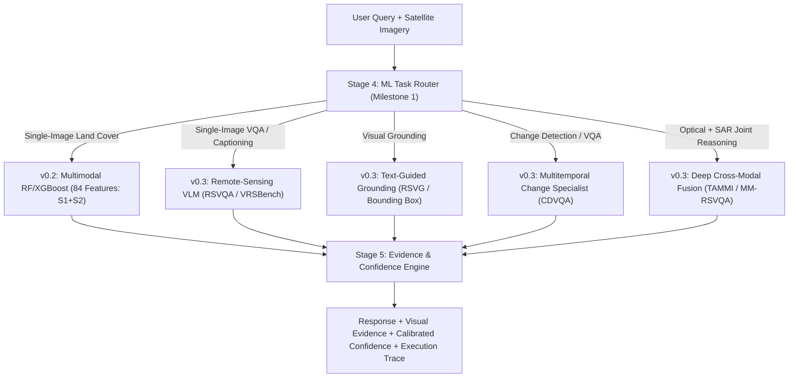

# SatQuery AI 🛰️
**Interactive Vision-Language Assistant for Multimodal Remote-Sensing Image Analysis**

*SIH 2026 Problem Statement: SIH26167*  
*Organization: Indian Space Research Organisation (ISRO)*  
*Theme: Space Technology | Category: Software*

---

## 1. Project Overview

Satellite remote sensing produces vital observations for agriculture, urban development, disaster response, and environmental monitoring. However, extracting actionable intelligence traditionally requires manual selection of fragmented GIS tools, complex sensor configurations, and task-specific models.

**SatQuery AI** replaces this disconnected workflow with an **agentic, ML-driven system** that accepts natural-language questions alongside single-image, multitemporal, or optical–SAR satellite imagery. The system:
1. Classifies the analytical intent via an **ML Task Router**.
2. Automatically determines the required input configuration (`single_image`, `temporal_pair`, `optical_sar_pair`).
3. Dispatches the request to the appropriate specialist model.
4. Generates interpretable answers supported by **visual evidence** (masks, bounding boxes, indices) and **calibrated confidence scores**.

---

## 2. Multi-Version Model & Architecture Hierarchy

SatQuery AI is built in modular phases following a core development principle:
> *"Build the ML capability first, integrate the intelligence second, and build the interface around the working intelligence."*



### Version Hierarchy Roadmap

| Version | Milestone | Core Component | Dataset | Primary Model | Status |
| :--- | :--- | :--- | :--- | :--- | :--- |
| **v0.1** | **Milestone 1** | **ML Task Router & Taxonomy** | `data/starter_queries.csv` | Calibrated TF-IDF + Logistic Classifier | **Complete** |
| **v0.2** | **Milestone 2** | **Land Cover Classification & Optical-SAR Fusion** | BigEarthNet-14k (7,180 Train / 3,255 Val) | Random Forest (84 Features: S1+S2) | **Complete** |
| **v0.3** | **Milestone 3** | **Multitemporal Change Detection** | OSCD Benchmark (10 Train / 4 Val / 10 Test) | Normalized Change Vector Analysis (CVA) | **Complete** |
| **v0.4** | **Starter Demo** | **Interactive Web Analyst Dashboard** | OSCD + BigEarthNet Samples | Flask REST API + Tailwind UI + Trace | **Complete** |
| **v1.0** | Next Phase | Deep Vision-Language Specialists | RSVQA, VRSBench, CDVQA | Remote-Sensing VLMs & Deep Siamese Networks | Planned |

---

## 3. Dataset Hierarchy

The platform integrates benchmark collections specifically curated for remote-sensing earth observation:

1. **Starter Queries (`data/starter_queries.csv`)**: Evaluates initial query classification and taxonomy routing across 7 task types.
2. **BigEarthNet-14k (`BEN-14k`)**: 13,683 paired Sentinel-1 (radar) and Sentinel-2 (optical) tiles used for multimodal land-cover classification across 16 CORINE classes.
3. **Onera Satellite Change Detection (`OSCD`) Benchmark (`data/oscd/`)**: 24 true temporal Sentinel-2 pairs split geographically into 10 training scenes, 4 validation scenes (used to freeze the optimal decision threshold $\tau^* = 0.28$), and 10 held-out test scenes.
4. **RSVQA & VRSBench**: Large-scale benchmarks for single-image visual question answering, captioning, and object grounding.
5. **CDVQA**: Multitemporal change detection and change-oriented VQA.
6. **ISRO / SAC Evaluation Benchmarks**: Georeferenced Cartosat-2S optical and RISAT SAR observations.

---

## 4. Task Taxonomy & Input Specifications

| Task Key | Display Name | Required Input | Specialist Target | Benchmark Dataset |
| :--- | :--- | :--- | :--- | :--- |
| `LAND_COVER_CLASSIFICATION` | Multilabel Land Cover | `single_image` | Random Forest / XGBoost | BigEarthNet |
| `SINGLE_IMAGE_VQA` | Single-Image VQA | `single_image` | RSVQA Specialist VLM | RSVQA / VRSBench |
| `SCENE_CAPTIONING` | Scene Description | `single_image` | Vision-Language Captioner | VRSBench |
| `VISUAL_GROUNDING` | Text-Guided Grounding | `single_image` | Referring Expression Net | VRSBench / RSVG |
| `CHANGE_DETECTION` | Multitemporal Change Detection | `temporal_pair` | TemporalDifferenceBaseline / CVA | OSCD Benchmark |
| `CHANGE_VQA` | Change-Oriented VQA | `temporal_pair` | Multitemporal VQA | CDVQA |
| `OPTICAL_SAR_FUSION` | Optical-SAR Joint Analysis | `optical_sar_pair` | Multimodal Fusion Network | BigEarthNet / MM-RSVQA |

---

## 5. Quick Start & Starter Demo

### Step 1 — Local Installation
Ensure Python 3.10+ is installed:
```powershell
# Create virtual environment
python -m venv .venv
.\.venv\Scripts\Activate.ps1

# Upgrade pip and install editable package with dev dependencies
python -m pip install --upgrade pip
python -m pip install -e ".[dev]"
```

### Step 2 — Train the Router
```powershell
python scripts\train_router.py
```
This generates:
* `artifacts/router/router_model.joblib`: Trained calibrated router model.
* `artifacts/router/evaluation_report.json`: Precision, Recall, Macro/Micro F1, review rate.
* `artifacts/router/confusion_matrix.png`: High-resolution confusion matrix plot.

### Step 3 — Test Predictions with CLI
```powershell
# Test land cover classification query
python scripts\predict_query.py "What land-cover types are visible in this image?"

# Test change detection query
python scripts\predict_query.py "What changed between these two dates?"

# Test optical-SAR fusion query with JSON output
python scripts\predict_query.py "Compare radar backscatter and optical moisture." --json
```

### Step 4 — Run Full Automated Test Suite (34 Tests)
```powershell
pytest -v
```

### Step 5 — Launch Interactive Starter Demo Web Dashboard 🚀
To launch the interactive analyst UI locally:
```powershell
python scripts\run_demo_app.py
```
Or specify host and port:
```powershell
python scripts\run_demo_app.py --port 5000
```
Then navigate to **`http://127.0.0.1:5000`** in your browser. The starter demo features:
* **Interactive Query Preset Chips**: One-click testing for change detection, land-cover classification, optical-SAR joint reasoning, and honest unsupported task handling.
* **Side-by-Side Satellite Viewer**: Inspect real Sentinel-2 temporal pairs ($T_1$ and $T_2$) from the OSCD benchmark.
* **Dynamic Change Overlay**: Red highlighted change masks with cyan bounding boxes localizing the largest altered pixel cluster.
* **Multimodal Land-Cover Evidence**: Probability bars and decision thresholds for detected CORINE surface classes.
* **Routing Policy Arbitration**: Switch between `provisional` execution and `clarify` policy modes.
* **Observable 5-Step Execution Trace**: Live visualization of intent routing, specialist dispatch, and evidence synthesis.

---

## 6. Git & GitHub Setup

To initialize and push this research repository to your GitHub:

```powershell
# 1. Initialize git
git init
git add .
git commit -m "Initialize SatQuery AI research project (Milestone 1)"

# 2. Add remote (replace YOUR_GITHUB_USERNAME with your GitHub handle)
git branch -M main
git remote add origin https://github.com/YOUR_GITHUB_USERNAME/satquery-ai.git

# 3. Push to GitHub
git push -u origin main
```

---

## 7. Kaggle Execution

In Kaggle notebooks, you can clone and test the repository without needing local GPU resources:
```python
!git clone https://github.com/YOUR_GITHUB_USERNAME/satquery-ai.git
%cd satquery-ai
!python -m pip install -e .
!python scripts/train_router.py
!python scripts/predict_query.py "Compare radar and optical observations."
```

---

## 8. License & Acknowledgments
Developed for **Smart India Hackathon (SIH 2026)** problem statement **SIH26167** in collaboration with ISRO guidelines.
